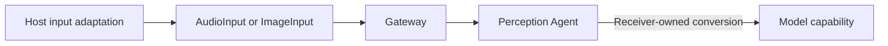

# Generic Media Input Contracts

## Summary

Immutable Foundation-only audio and image transport values used by AgentInput and Gateway admission.

## Ownership and boundaries

Input validates geometry, PCM alignment and capture metadata. Caller/receiver owns SDK adaptation, session/order checks and model preprocessing. No sound-source schema, display policy or native lifetime is defined here.

## External relationships and data flow

Runtime arrows show data or capability calls; dashed arrows show injection.

## Audio and image interfaces

AudioInput carries native-rate interleaved Float32 data, mono or four-channel ACN/SN3D layout and monotonic capture time. Alignment includes every channel; sampleCount counts scalar values and frameCount counts time samples. The per-input byte limit is 64,000. Mono convenience construction retains the same transport contract.

ImageInput carries geometry, rotation, sequence/time and optional monotonic capture instant. Content is RGB bytes or an opaque Sendable ImageAttachment. Input errors describe malformed transport only; outOfOrder/scopeClosed belong to receiver/Gateway policy. RGB input is exact RGB8 with each dimension 1–640; opaque attachments allow dimensions 1–4096 with at most 4,194,304 pixels. Timestamps must be finite/nonnegative and rotation is 0–3 clockwise quarter turns. Values own no worker or queue.

✅ Validated rate/layout/geometry and opaque media attachments are implemented.

## Related design

[Parent design](../README.md)
