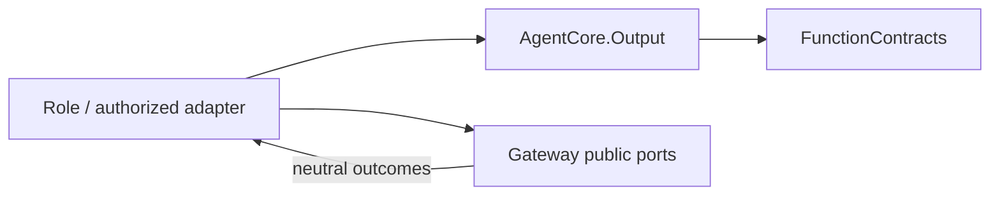
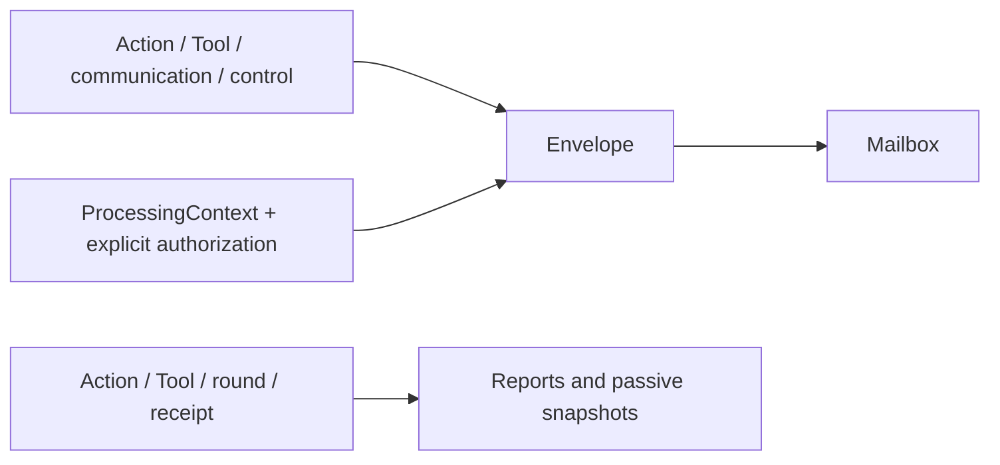

# Output — Calls, causal envelopes and feedback

## Ownership and interfaces

AgentCore.Output owns cognitive calls, causal envelopes, Agent-facing outcomes, a bounded mailbox and passive failure snapshots. Neutral execution identities, leases, permits and snapshots belong to FunctionContracts. This directory has no Gateway/Actions implementation, device or UI dependency.

## Files

| File | Responsibility |
| --- | --- |
| [AgentOutput.swift](AgentOutput.swift) | OutputKind, ActionCall, ToolCall, unified output, bounded failure diagnostic and round acknowledgment. |
| [OutputEnvelope.swift](OutputEnvelope.swift) | Producer/processing/round identity, private execution resources and ExecutionOwner's AgentID adapter. |
| [CommunicationAction.swift](CommunicationAction.swift) | Role communication intent, admission receipt and bounded receipt correlation. |
| [AgentOutputMailbox.swift](AgentOutputMailbox.swift) | Shared-capacity discrete output and explicit latest-state replacement. |
| [ActionResult.swift](ActionResult.swift) | Cognitive completion, causal evidence, Action feedback and activity events. |
| [ToolResult.swift](ToolResult.swift) | Native Tool value, failure code and reasoning-continuation evidence. |
| [ActionReport.swift](ActionReport.swift) | Bounded multi-step reports preserving partial effects. |
| [OutputFailureState.swift](OutputFailureState.swift) | Passive cognitive failure records and snapshots. |

## Calls and causality

ActionCall retains a resolved ActionPath, channel and string parameters. ToolCall retains native call identity and string arguments without channel membership. Rejected calls cannot execute. OutputKind contains only the supported communication, scheduling, Action, Tool and control kinds. Round completion maps to control; rejected calls retain their Action/Tool kind for permission checks.

OutputEnvelope retains input/session/task/turn, root/parent/hops, round/call and sequence. The actual incarnation/execution owner comes from trusted binding. Scheduling identity prefers round, then task, then input; it is independent of resource ownership. Private resourceBindings and attachments remain outside model arguments; bindingResources preserves provenance and round identity. ExecutionOwner remains a neutral FunctionContracts value with a cognitive AgentID adapter.

## Completion and failure

ActionResult, ToolResult, GenerationRoundResult and CommunicationReceipt use runtime.action.result, runtime.tool.result, runtime.round.result and runtime.message.receipt. A send receipt establishes target admission; publish has no receipt. Sealing a round does not finish a reply. Completion values are not truncated or rejected by a delivery-byte quota; model projections are caller-owned.

AgentActionReport permits at most 256 entries, paths up to 128 bytes, codes of 1–64 bytes and at most 16 detail keys per entry (keys up to 64 bytes, values up to 512). Partial success, failure, timeout and cancellation remain distinct. Explicit values, including an empty string, are business output. Reports/completed/activity handles are completion evidence; real failures may permit continuation, pure cancellation does not. Tool results without completion retain value semantics; Action results normalize missing completion to completed.

AgentFailureDiagnostic bounds code to 64 bytes and detail to 2,048 characters. Passive observations neither trigger inference nor acknowledge delivery. Neutral execution snapshots retain identity, address, phase, completion and bounded failure evidence, without media attachments.

## Mailbox and receipts

The mailbox has one shared capacity. Discrete entries cannot be replaced. An explicit same-key latest state may replace a pending state and returns the displaced item; a new key at capacity fails. Terminal closure retains admitted discrete work and can replace pending state. Roles own replacement keys and displaced-call settlement.

CommunicationReceipts has at most 16 correlation slots. Evidence is committed before acknowledgment; commit failure closes the slot and wakes the waiter with the real error. Repeated submission cannot convert failure into success. Resource permits require execution-owner validation and do not establish device health or physical safety.
