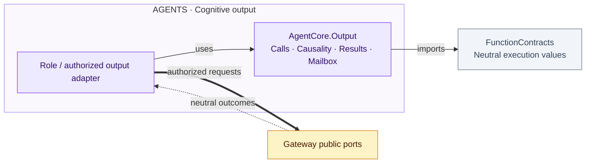
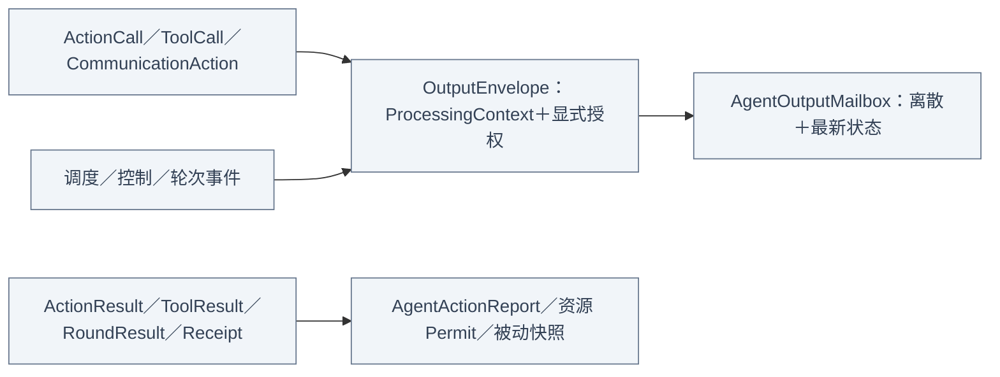

# Output — 调用、执行信封与反馈证据

## 职责与外部关系

Cognitive Action/Tool calls, causal output envelopes, Agent-facing outcomes, mailbox and passive output-failure observations. Neutral execution snapshots and permits are imported from FunctionContracts. This target has no Actions/Gateway implementation, native device or UI dependency; identity fields alone grant no authority.

## 文件与职责

| 文件 | 职责 |
| --- | --- |
| [ActionCall.swift](ActionCall.swift) | 规范 Action 地址、Channel 与调用参数 |
| [ToolCall.swift](ToolCall.swift) | native／内部 Tool 调用与字符串参数 |
| [CommunicationAction.swift](CommunicationAction.swift) | 角色通信输出、接纳回执及有界等待关联 |
| [AgentOutput.swift](AgentOutput.swift) | 统一输出枚举、轮次结果与失败诊断 |
| [OutputKind.swift](OutputKind.swift) | 输出种类 |
| [OutputEnvelope.swift](OutputEnvelope.swift) | 生产者、输入因果、轮次／任务与输出序号信封 |
| [AgentOutputMailbox.swift](AgentOutputMailbox.swift) | 共享总容量下的离散输出与同键最新状态替换 |
| [ActionResult.swift](ActionResult.swift) | 执行所有者、因果值、Action 完成／反馈与活动事件 |
| [ToolResult.swift](ToolResult.swift) | Tool 完成值、失败码与续推判断 |
| [ActionReport.swift](ActionReport.swift) | 有界多步骤结果及部分失败 |
| [OutputFailureState.swift](OutputFailureState.swift) | Passive cognitive output-failure records and snapshots; execution snapshots belong to FunctionContracts |
| [ResourceLease.swift](../../../../Actions/Support/Contracts/ResourceLease.swift) | 资源标识、租约、身份绑定资源端口与执行许可 |

## 内部结构

## 调用、因果与真实结果

ActionCall 保留已解析 ActionPath、有效 Channel 与字符串参数；ToolCall 无 Channel 成员关系；rejectedCall 不可执行。OutputEnvelope 从处理上下文保留 input/session/task/turn、root/parent/hops、round/call 与生产者序号；实际 incarnation/execution owner 由传输绑定。schedulingID 优先 round，再 task，再 input，与资源 owner 独立。

ActionResult、ToolResult、GenerationRoundResult 和 CommunicationReceipt 分别使用 `runtime.action.result`、`runtime.tool.result`、`runtime.round.result`、`runtime.message.receipt`。send 的 receipt 只说明目标接纳，publish 无回执；轮次 seal 不等于最终回复。完成值至多 64 KiB UTF-8。AgentActionReport 至多 256 项，path ≤128 字节、code 1–64、detail 至多 16 键，key ≤64、value ≤512；保留部分成功、失败、超时和取消。

hasBusinessOutput 只识别显式 value，包括空字符串。真实失败也可授权上层续推；成功 report、completed 和 activity 句柄只提供完成证据。纯取消不视为失败；混合报告真实失败优先。agent.cancelled 与 agent.finished/agent.error 区分，ToolResult 无 completion 时保留 value 语义，ActionResult 无 completion 时规范化为 completed。

## Mailbox、资源与诊断

AgentOutputMailbox 配置一个共享总容量，离散输出不可替换，显式同 key 最新状态可替换并返回被置换项；新 key 满载抛 capacityExceeded。终态关闭保留已接纳离散输出，可用终态替换待处理状态。角色负责 replacement key 与被替换调用收尾。

CommunicationReceipts 最多 16 个关联槽，证据提交后确认；提交失败关闭槽并唤醒真实错误，重复不能转成功。ResourceExecutionContext 包含中立 resource IDs、可信 owner 与 bound permit，执行方还要验证当前许可；不证明设备健康或物理停止。

执行快照保留身份、地址、Channel、阶段、displayName、完成结果与最多 512 字符失败文本，不保存原调用参数或媒体附件；完成结果可以包含业务 value 或多步骤 report。AgentFailureDiagnostic 限分类／code／2048 字符详情，仅失败输出可携带；被动快照不能触发推理或确认投递。可选中立执行附件服务授权类型化结果端口，不作为外部输入总线。

## Execution ownership and lifecycle

ExecutionOwner, resource lease/permit, ActionExecutionRecord and ActionExecutionSnapshot are neutral FunctionContracts values. AgentCore supplies cognitive identity adaptation only. ActionResult keeps Agent causality/Task semantics; Agents/Support projects neutral Gateway outcomes. Generic scheduling does not import these cognitive contracts.

OutputEnvelope.resourceBindings carries private request-time resource scopes to execution; bindingResources returns a copy retaining provenance, attachments and round identity. Relaying roles preserve these bindings. They are not executable model arguments.
