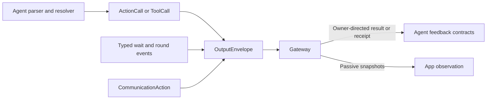

# Resolved Output and Execution Evidence

## Summary

Neutral invocation, envelope, result, resource-permit and observation values at the Agent boundary.

## Ownership and boundaries

Values contain trusted identities and bounded producer evidence without importing Actions, Gateway, device or UI implementations. Execution interfaces live in FunctionContracts; Core delivery values do not authorize effects by themselves.

## External relationships and data flow

Runtime arrows show data or capability calls; dashed arrows show injection.

## Calls, causality and results

ActionCall contains resolved ActionPath, effective Channel and string arguments. ToolCall retains ID/path/arguments without Channel membership. rejectedCall is non-executable. OutputEnvelope retains source Agent ID, original input metadata, input/session/task/turn, optional round/call IDs and producer sequence. Its input metadata preserves admitted provenance; live executor incarnation and execution owner are validated/bound by runtime transport. `schedulingID` selects round ID, then task ID, then input ID; it is distinct from execution ownership.

ActionResult/ToolResult/RoundResult/CommunicationReceipt are distinct evidence, not duplicate confirmations. Round seal differs from final conversation completion. Only send produces a receipt; publication does not. Completion values are bounded to 64 KiB UTF-8. SignalCausality preserves input/root/parent/hops/turn; runtime feedback advances one hop under a fresh admission lifetime.

Reports retain at most 256 entries with paths ≤128 bytes, producer codes 1–64 bytes and up to 16 detail keys (key ≤64 bytes, value ≤512). Core does not interpret motor fields. Partial failure and execution timeout remain visible beside successful children; explicit cancellation remains cancelled.

## Mailbox, receipts and resource authority

AgentOutputMailbox separates bounded discrete output from explicitly replaceable latest state. The configured capacity is shared by all entries; same-key replacement returns the displaced envelope to its owner, while a new entry at capacity throws capacityExceeded. Terminal close retains accepted discrete entries and may replace pending state snapshots with a final terminal envelope. CommunicationReceipts retains at most 16 correlated slots; deduplicate and acknowledge only after evidence commit. Commit failure closes the slot and wakes its waiter with the real error; duplicate delivery cannot convert it to success.

ResourceID is device-neutral. ResourceExecutionContext carries held IDs, trusted owner and a bound ResourceExecutionPermit; effects validate current authority rather than trusting IDs. Resource values do not prove health or physical stop. Permits/closures own no native coordinator.

## Observations

ActionExecutionRecord/Snapshot contains payload-free identity/path/Channel/state/completion facts, immutable displayName and bounded 512-character captured failure text. OutputFailure snapshots carry bounded opaque producer codes and optional inputID. UI interpretation is outside Core. No raw arguments, credentials or error objects are retained; observations cannot resume reasoning or acknowledge publication.

✅ Resolved values, causal feedback, bounded mailboxes and independent execution observations are implemented.

❌ Durable execution delivery and full typed replacement of legacy control strings are not implemented.

## Related design

[Parent design](../README.md)

## Result-driven ReACT (ADR0214)

✅ ADR0214：删除 GenerationFeedbackPolicy/GenerationPolicies；AgentActionCompletion 推导 hasBusinessOutput，ToolResult 推导 requiresReasoning（真实失败、failureCode 或真实失败 report 优先；纯取消不算失败/不续推；仅 value 为业务输出；所有成功 report、活动句柄和 completed 均为完成证据）。不新增可配置/序列化的 ReACT 标志。

✅ Implemented: legacy control vocabulary includes agent.cancelled as explicit cancellation completion for the envelope input/round, distinct from successful agent.finished and failed agent.error. Ownership remains bound by the host.

✅ 2026-10-13 已实现：收窄 hasBusinessOutput 到显式 value；保留 ToolResult.hasFailure 对 report 真实失败、非取消 isError 与 failureCode 的优先判定，旧原生 value 兼容与报告结构保持不变。

✅ ToolResult and both report contracts distinguish pure cancellation from real failure. cancelled status/code/report remain evidence; hasFailure/requiresReasoning exclude pure cancellation. Mixed real failures take precedence over cancelled leaves and preserve partial effects.

## SQLite records and runtime identity

✅ Implemented: technical identities are opaque UUID strings; committed business entities use dialog/message/task/media/device SQLite IDs. Consumers use Storage repositories while preserving ownership, cancellation and independent foundation boundaries. Complete messages, including each ReACT message, persist at termination; delta fragments do not persist. The custom allocator and replaced file/index implementation are removed. See the project SQLite business-record plan.
