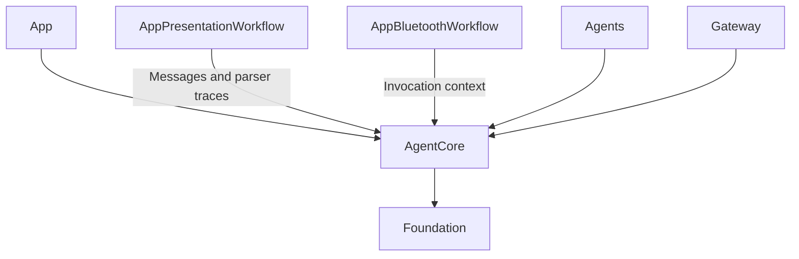
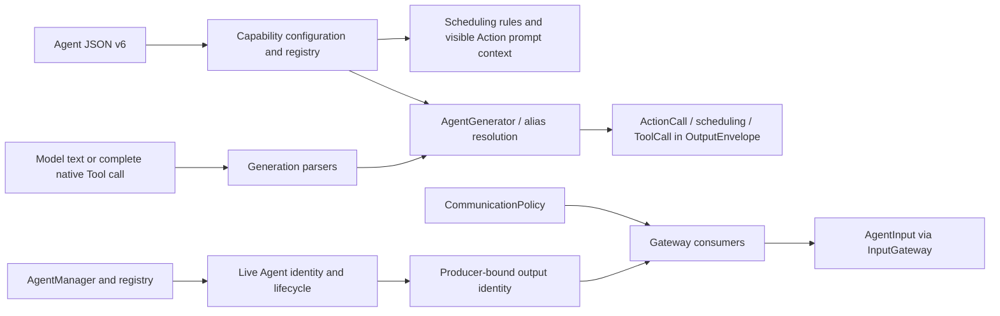

# Agents/Support/Core — Shared Agent Contracts

Defines Agent identity, input/output, lifecycle, configuration, parsing and communication contracts. The goal is reusable infrastructure without business policy. It depends only on Foundation and the Swift standard library, never UI, concrete Agents, model engines or device adapters.

## Directory structure

```text
Agents/Support/Core/
├── Agent.swift, AgentDescriptor.swift, AgentID.swift  # Agent interface and identity
├── AgentInput.swift, InputKind.swift                  # Generic input and interaction context
├── HarnessError.swift                               # Shared errors
├── Input/                                           # Generic audio/image transport
├── Runtime/                                         # Registry, manager and lifecycle
├── Capability/                                      # JSON v6 validation and local permissions
├── Generation/                                      # Shared parsers and text-to-Action mapping
├── Output/                                          # Resolved calls, results and trusted context
├── Communication/                                   # Typed inputs, messaging contracts and policy
└── README.md                                        # Module boundary and status
```

## Upstream and downstream

Arrows mean compile-time dependency on shared contracts; AgentCore does not import its consumers.



## Internal structure and data flow



AgentInput separates payload from source, session, turn and timing metadata. ToolResult stays here to avoid a circular runtime dependency. Agents own parser instances and resolve aliases before output leaves them. Native Tool calls are separate from text/XML Function Tokens.

Runtime tracks Agents; it is not a generic mailbox worker. Business Agents own their inboxes and state. Gateways bound active direct calls without lanes or workers. Deadlines are freshness checks before receive; caller cancellation propagates through structured calls. Agent-owned buffers decide state replacement, ordering and accepted-work cleanup. Receipts confirm admission only.

Detailed bounds and algorithms belong to [Runtime](Runtime/README.md), [Capability](Capability/README.md), [Generation](Generation/README.md), [Output](Output/README.md) and [Communication](Communication/README.md).

## Feature status

- ✅ Agent contracts, bounded registration, lifecycle and source/session identity.
- ✅ JSON v6 permissions, Action prompt context, shared parsing and resolved output.
- ✅ Typed events, static communication policy, deadlines and bounded event delivery.
- ✅ AgentContext, preprocessing/batches, round coordination and typed task contracts. ❌ Generic supervised AgentRuntime and automatic work replay.
- ❌ Incremental native Tool argument assembly and durable event delivery.

## Issue record

| Status | Issue / next step |
| --- | --- |
| Open | Request/reply needs a bounded completion path that cannot block behind its requester. |
| Open | Non-cooperative receivers can delay cancellation; transport is not a real-time safety system. |


✅ AgentMessage transports type-erased immutable Encodable/Sendable content with bounded encoding and validation. Concrete messages and schema policy belong to business Agents/Support/Communication. ❌ Persistent or remote delivery remains unsupported.


✅ GenerationEvent preserves resolved Actions and typed wait boundaries. The shared lexical stack handles combined Channel/wait nesting; SchedulingDirective crosses the trusted output boundary without introducing runtime, UI or model dependencies. ❌ Execution policy remains in Gateway, not AgentCore.

✅ Runtime registries separate model alias resolution from code-owned InternalAction/InternalTool permission checks. Generator text mapping is a bounded Agent-supplied callback. See [capabilities](Capability/README.md). ❌ Full JSON Schema/native Tool transport remain deferred.

✅ Physically owned by Agents/Support/Core, compiled as the independent AgentCore target. The business Agents target excludes Core to prevent duplicate compilation and the Agents → StorageAudio → AgentCore dependency cycle. Core depends only on Foundation; importing Agents from Core is forbidden. ❌ Directory consolidation does not merge business policy into shared contracts.

## Action runtime stage 2

✅ Shared output values now include ActionResult, ActivityEvent, ExecutionOwner and ResourceLease/ResourceControl; Runtime owns bounded receipt history and stop observation. AgentCore still has no dependency on Gateway, concrete Agents or device services. ❌ Persistent receipt delivery belongs to future work.

✅ DeliveryHistory provides bounded communication outcomes without dependencies on transport or business Agents.


✅ Visual skeleton presentation and detection statistics belong to UI/Camera, not AgentCore. Output contains generic invocation/runtime contracts only; no pose-specific presentation policy or preview conversion remains.

✅ ImageInput/AudioInput are AgentCore/Input transport values, referenced by generic InputPayload. AgentTurn identifies a workflow-defined interaction; Core does not assign speech semantics.

✅ Concrete AgentID names belong to Agents/Support/Communication/AgentContracts.swift. PoseObservation, SpeechPhase and SpeechSynthesisInput are Agents/Support/Communication values; no compatibility aliases remain in Core. CapabilityContextBuilder describes generic output syntax/scheduling only; Assistant owns text-to-audio guidance.
✅ CommunicationContracts registers domain schema validators, size/freshness and new-work policy. Core contains only standard transport kinds; host device sources/TTL belong to App, PlatformKit generates native camera gray64 samples, and VisionPerception owns SampledImageAttachment plus motion/cadence interpretation. ❌ Remote codecs and hot reload are not implemented.

✅ Resource identities contain no camera constants; action reports contain no motor/target/observed fields. Device failures are opaque bounded identifiers. Shared text segmentation accepts a validated producer policy and defaults to sentence boundaries; Assistant owns the 60/120-character soft limits. ❌ Business detail schemas are not validated by Core.

✅ ADR0121 removes the Types module: AgentCore/Input owns generic audio/image transport, UI/Camera owns PoseOverlay, and VisionPerception owns PoseOverlayPayload. App adapts the independent Tool payload into UI values. ❌ Capability SDKs must not import consumer or presentation modules.

✅ ADR0131: Core Output values include independent generic output failure observations and bounded report descriptions. They import no device/App/Gateway/UI services and cannot trigger recovery. ❌ Durable output diagnostics remain pending.


✅ ADR0141 adds generic ResourceExecutionPermit to trusted Output context. It carries a revocable validation closure only; actual ownership remains Gateway-owned, concrete effect checks App-owned. ❌ No device health, scheduler or platform dependency is introduced.

## Signal origin — ADR0149

✅ InputMetadata now carries SignalOrigin.external/agent/runtime independently of payload meaning; external is the default value, not an inferred authority. OutputEnvelope retains original input metadata for feedback correlation. Gateway entry points enforce provenance and execution ownership.
✅ ADR0163 completes Action/activity causal transport. ❌ Typed replacement of remaining host event/control strings stays pending.

✅ ADR0163: Output contracts carry explicit SignalCausality for Action/activity feedback. Typed history content remains in the business Agents communication catalog rather than Core payload enums.

## Action/Tool generation rounds — ADR0183


✅ AgentCore owns neutral policies/envelopes; the owning role selects continuation policy through the shared Chat worker; Gateway owns execution and round acknowledgment; App owns bounded dispatch and registration projection. Shared resources, deadlines and joined cleanup still apply across both routes.

❌ Live-model, native UI and physical-device acceptance remain pending; native/XML task delegation and specialist loops are implemented. See [ADR0183](../../../../docs/adr/0183-generation-round-observations.md).

## Agent composition — ADR0187

✅ Agent 自有预处理、版本化结构化 Context 和 Builder 已接入；共享机制在现有 Agents/Support/Core 与 Agents 目录中。业务职责保持当前分界。函数结果按运行时捕获的执行所有者定向返回，通信投递回执只表示接纳；模型续轮不订阅自身广播。

✅ 上下文采用有界原子提交，重启将未完成工作标为中断，不重放设备动作。普通输入、反馈和控制分别接纳；所有容量或持久化失败显式返回。音视频和原生会话保持有界临时状态。

✅ 第二阶段已实现独立摄影 LLM、正式任务委派及任务定向后续输入。❌ 真实模型、原生 UI、真机语音验收仍待完成。

设计与阶段边界见 [ADR0187](../../../../docs/adr/0187-agent-composition-and-react.md)；验证见 [Validation-History](../../../../docs/Validation-History.md)。

✅ Implemented organization: AgentDecisionContext.swift resides in Core/Runtime and compiles in AgentCore, with its same-target import removed. Immutable snapshots and selected Signal/batch validation belong to AgentCore; model and persistence adapters belong to Agents/Support. No duplicate definition or compatibility alias is retained.

✅ ADR0189 implemented: this Foundation-only AgentCore framework directory has moved intact to Agents/Support/Core. Its ownership and compilation boundary are unchanged; relative documentation links and registered source paths move with it.


✅ Execution-log tabs: Neutral Signal observation values join existing Communication diagnostics; Foundation-only Core stores identities, bounded summaries, branch admission status and generic task protocol evidence.
