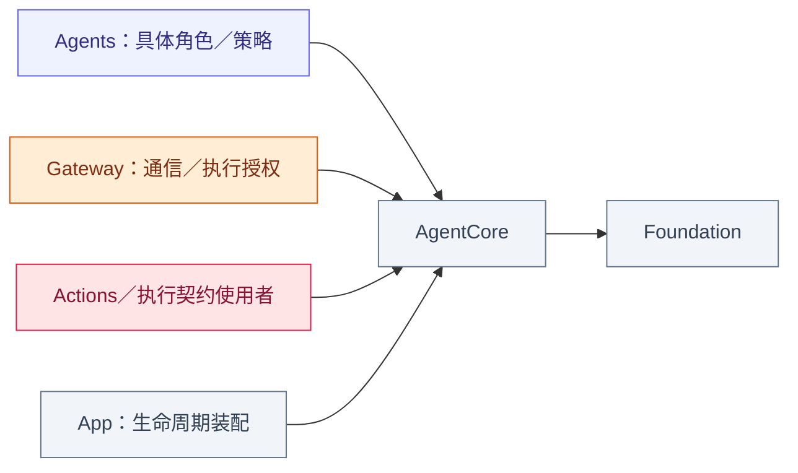
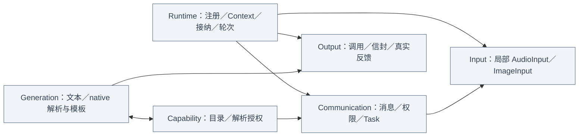

# AgentCore — 独立 Agent 运行契约

## 职责与编译边界

本目录单独编译为 AgentCore，仅依赖 Foundation。定义泛化 Agent、身份、生命周期、局部处理值、通信权限、生成解析与输出证据，不导入 UI、PlatformKit、ModelKit、Storage、Agents 业务实现或 Gateway 实现。物理目录位于 Agents 下不改变独立编译边界。

## 文件与职责

| 文件 | 职责 |
| --- | --- |
| [Agent.swift](Agent.swift) | Actor 协议：生命周期、输入接纳、输出流、状态及按轮有效目录 |
| [AgentDescriptor.swift](AgentDescriptor.swift) | 身份、版本、输入／输出种类和初始能力声明 |
| [AgentID.swift](AgentID.swift) | 中立身份值，不内置生产角色名称 |
| [AgentInput.swift](AgentInput.swift) | 输入载荷、因果元数据、SignalOrigin 及中立故障值 |
| [InputKind.swift](InputKind.swift) | InputPayload 对应的种类集合 |
| [HarnessError.swift](HarnessError.swift) | 注册、接纳、权限、处理与生命周期的通用错误 |

## 外部关系（一层）

依赖箭头指向被使用的契约；Core 不创建上层角色或基础容器。

## 内部结构

## 统一处理与执行契约

Agent 协议暴露 descriptor、outputs、start/pause/resume/stop、receive/status 与可选 effectiveCapabilities(roundID)。角色持有自己的 Worker 和订阅，Core 不提供业务路由。有效目录是每轮不可变值；固定执行者可返回 nil，Core 不知道 Skill 载入政策。

ProcessingContext 保存 request/session/generation/source/sequence/root/parent/hops/deadline/turn；身份字段非空且至多 128 UTF-8 字节，hops 为 0…8。它可创建本地 AgentInput、用于构造 OutputEnvelope，但不授予执行者身份。SignalOrigin 区分 local/agent/runtime；Gateway 拒绝 local 输入，外部输入没有 Signal 来源标记。

AgentInput／InputMetadata 是进程内值，capturedAt 使用 uptime，deadline 使用 ContinuousClock，不是远程 wire format。payload 有 text/event/audio/image/observation、Action/Tool/round 结果、communicationReceipt 和 activityEvent。业务 observation 的具体 schema 和角色含义由上层注入。

本地 UI／原生／事实不通过 Signal 传输；Agent 消息保留可信来源与因果身份；执行反馈保留原 call/execution/round/task/session 归属。消息投递接纳、任务终态、轮次封闭、UI 接纳及原生完成分别建模，不能相互替代。

## 状态、容量与错误

Context／DecisionContext 是通用快照值，持久化由外部领域实现拥有。Manager 撤销授权先于停止清理；注册实例替换等待旧 owner 加入。队列和证据有显式上限／拒绝，Signal 和 Decision 无隐式 TTL；实时媒体 freshness 和显式 Action/provider 截止时间归各自 owner。

RuntimeFailureEvent／ContainerFailureEvent 保存中立有界诊断与关联；Core 不决定 Toast、重试或模型恢复。错误、取消与部分效果分别保留，不自动重放。

## 子目录

[Capability](Capability/README.md) 管声明与权限；[Communication](Communication/README.md) 管通用消息和任务；[Generation](Generation/README.md) 管解析与模板；[Input](Input/README.md) 管媒体值；[Output](Output/README.md) 管调用／证据；[Runtime](Runtime/README.md) 管实例、Context 与协调。

## 待实现

❌ 通用 factory、自动重启、远程传输和持久化执行递送。
