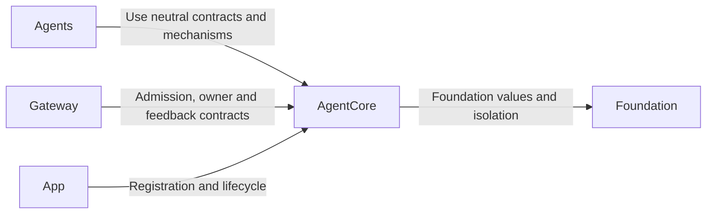
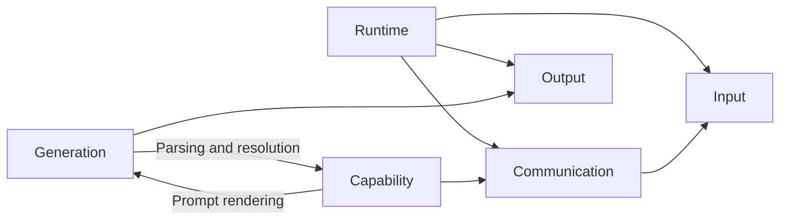

# AgentCore — Neutral Agent Framework

## Summary

Foundation-only contracts and bounded mechanisms for identity, lifecycle, input, permissions, communication, generation and decision evidence.

## Ownership and boundaries

AgentCore has no project dependencies, concrete role identities, business schemas, model sessions, Storage adapters or UI/device policy. Agents supplies role processing; Gateway supplies transport/execution; App supplies assembly/lifetime.

## External relationships and data flow

Runtime arrows show data or capability calls; dashed arrows show injection.

## Internal structure

## Framework contracts

SignalOrigin separates external, Agent and runtime provenance. Output and feedback carry session/incarnation/causal/task/round identities rather than trusting model parameters. Call parsing resolves permissions inside the Agent; effects execute through Gateway. Task admission, task completion and native effect completion are distinct.

AgentContext and AgentDecisionContext are generic immutable snapshots/evidence contracts; Core persistence is injected load/CAS commit only. Directory arrows describe source use; the Capability builder uses Generation templates while the Generation interpreter uses the Capability resolver, all within one target. SignalInbox and AgentAdmissionGate provide explicit bounded admission. AgentRoundCoordinator registers calls, seals and merges results; AgentTaskBudget validates cumulative request/call/execution budgets. Runtime defaults are mechanism limits, not concrete role policy.

The independent target also packages FunctionTokenPrompts.json and provides bounded, strict PromptTemplates rendering. Role prompt assets live in Agents; Core knows no role names or business instructions.

## Isolation and failures

AgentManager/registry owns live instances/incarnations. Stop revokes authority before joining work; replacement waits for cleanup. Roles own their workers and interpret pause. No framework retry, effect replay, role-specific business context or implicit subscriber acknowledgment is added.

✅ Independent neutral framework, structured context/task/round contracts and bounded mechanisms are implemented.

❌ Generic factory/automatic restart, remote transport and durable execution delivery are not implemented.

## Related design

[Parent design](../README.md) · [Capability](Capability/README.md) · [Communication](Communication/README.md) · [Generation](Generation/README.md) · [Input](Input/README.md) · [Output](Output/README.md) · [Runtime](Runtime/README.md)

✅ Agent.effectiveCapabilities(roundID) 是中立不可变轮次授权查询，默认 nil 保留固定执行者契约；Core 不认识 Skill 或 Task Mode。CapabilityContextBuilder 分别提供协议和目录渲染，策略层控制组合顺序。

✅ ADR0213: shared FunctionTokenPrompts guidance describes task-local Channel/wait ordering, independent same-name Channels across tasks and explicit resource conflict/takeover outcomes. Canonical addresses do not create queues; prompt text grants no execution authority.

## Lifecycle-owned conversation and audio (2026-10-12)

✅ 已移除对话生成、ReACT、收件箱排队、结果屏障、ASR 收尾、TTS 合成及回复占用租约的计时终止。Signal 默认无过期时间，框架不再按通信契约附加 TTL。保留显式实时感知数据的新鲜度和网络传输自身超时；它们不作为对话/语音缓存生命周期。Action 自身超时通过原始执行者的 ActionResult 返回。请求/调用数及队列/PCM 容量仍有界，不以计时自动删除已接纳输入。语音句柄无读等待或错误记录 TTL，按播放完成、输入/会话正常结束、异常或显式取消清理；取消加入生成和播放工作。

✅ Core decision budget has optional caller-supplied request/native bounds; nil defaults record cumulative usage without an arbitrary business stop.
