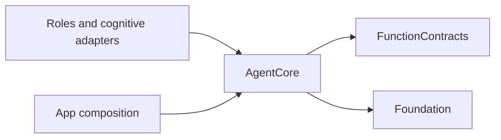
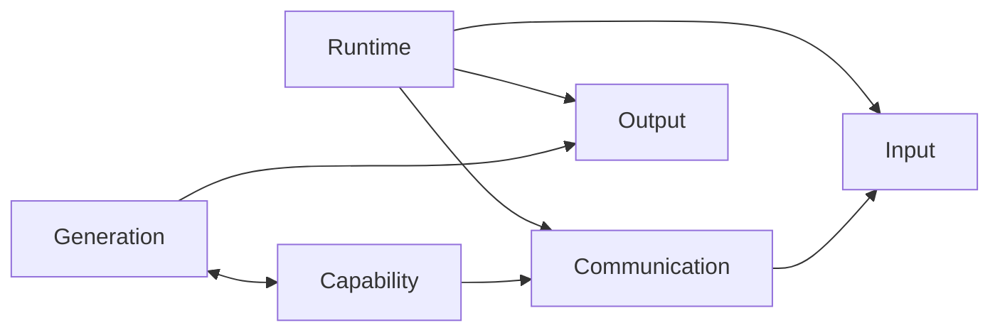

# AgentCore — Independent cognitive contracts

## Ownership and compilation

This directory compiles as AgentCore, depending only on Foundation and FunctionContracts. It defines generic role identity, local input, communication permissions, parsing, output evidence and runtime coordination. It imports no UI, PlatformKit, ModelKit, Storage, Agents implementation or Gateway implementation. Its physical location does not change that target boundary.

## Root files

| File | Responsibility |
| --- | --- |
| [Agent.swift](Agent.swift) | Actor lifecycle, input admission, output stream, status and optional round-effective capabilities. |
| [AgentDescriptor.swift](AgentDescriptor.swift) | AgentID, immutable required perception/cognition category, version and declared input/output capabilities. |
| [AgentInput.swift](AgentInput.swift) | InputKind, payload, causal metadata, local/Agent/runtime origin and bounded container/runtime failure evidence. |
| [HarnessError.swift](HarnessError.swift) | Registration, admission, permissions and lifecycle errors. |
| [ContainerContext.swift](ContainerContext.swift) | Type-erased read-only snapshot source, encoding and shared multimodal contract aliases. |

Gateway and Actions do not import AgentCore. Agents adapters translate at their public boundaries. Identity fields do not grant authority; category does not select runtime policy.

## Subdirectories

- [Capability](Capability/README.md): configuration, declarations, resolution and permission checks.
- [Communication](Communication/README.md): generic messages, task envelopes and delivery evidence.
- [Generation](Generation/README.md): incremental parsing, output interpretation and templates.
- [Input](#local-media-values): local audio and image values.
- [Output](Output/README.md): calls, envelopes, feedback, mailbox and passive failure observations.
- [Runtime](Runtime/README.md): instances, private context, admission and round coordination.

## Input, identity and completion

Agent owns its actual workers and subscriptions. An effective catalog is immutable per round; deterministic roles may return nil. Core does not load Skills or route business effects.

ProcessingContext retains request/session/generation/source/sequence/root/parent/hops/deadline/turn. Identity fields are nonempty and at most 128 UTF-8 bytes; hops are 0...8. It constructs local input and output causality without granting execution identity. AgentInput and InputMetadata are in-process values: capture uses uptime and deadlines use ContinuousClock. Payloads include text, events, local media, observations, Action/Tool/round results, communication receipts and activity events. The owner defines business observation schemas.

Native/UI facts are consumed directly by roles. Inter-role transport rejects local-origin input. Execution feedback retains call/execution/round/task/session identity. Message admission, task termination, round closure, UI admission and native completion are distinct.

Context and DecisionContext are generic snapshots. Domain owners supply persistence. Manager revokes authorization before joined role cleanup; replacement waits for the old owner. Queues have explicit bounds and rejection. Signal/Decision values have no implicit TTL; freshness and execution deadlines belong to their consumers. Failures preserve cancellation and partial effects without replay, Toast policy or automatic recovery.

## Read-only container context

ContainerContextSource reads its owner on each request. Its generic initializer encodes an Encodable value; `encoded:` passes existing JSON Data unchanged. It owns no facts, cache or lifecycle. [Context](../Context/README.md) provides bounded collection and session fencing. Multimodal aliases retain request-time images outside the private context journal.

## Local media values

The simple [Input](Input/) leaf contains two distinct formats:

- [AudioInput.swift](Input/AudioInput.swift): immutable interleaved finite Float PCM, nonempty and channel-complete, at most 16,000 samples at 8–192 kHz. Layout is mono or first-order Ambisonics ACN/SN3D; sequence and capture time are retained.
- [ImageInput.swift](Input/ImageInput.swift): opaque Sendable frame, dimensions, clockwise quarter-turn rotation, sequence and time. Dimensions are 1–4096 per edge, at most 4,194,304 pixels; rotation is 0–3 and media time finite/nonnegative.

Consumers own capture generations, continuity and freshness. Authorized presentation may retain the same frame attachment. No media producer or native lifecycle is created here.
