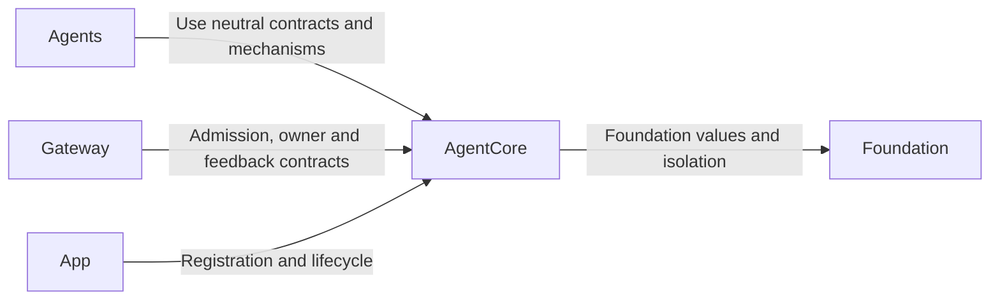
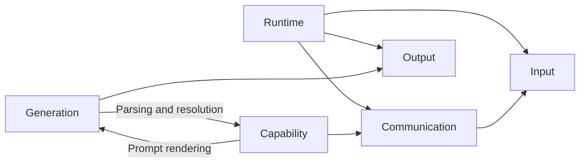

# AgentCore — Neutral Agent Framework

## Summary

Foundation-only contracts and bounded mechanisms for identity, lifecycle, input, permissions, communication, generation and decision evidence.

## Ownership and boundaries

AgentCore has no project dependencies, concrete role identities, business schemas, model sessions, Storage adapters or UI/device policy. Agents supplies role processing; Gateway supplies transport/execution; App supplies assembly/lifetime.

## External relationships and data flow

Runtime arrows show data or capability calls; dashed arrows show injection.

## Internal structure

## Framework contracts

SignalOrigin separates external, Agent and runtime provenance. Output and feedback carry session/incarnation/causal/task/round identities rather than trusting model parameters. Call parsing resolves permissions inside the Agent; effects execute through Gateway. Task admission, task completion and native effect completion are distinct.

AgentContext and AgentDecisionContext are generic immutable snapshots/evidence contracts; Core persistence is injected load/CAS commit only. Directory arrows describe source use; the Capability builder uses Generation templates while the Generation interpreter uses the Capability resolver, all within one target. SignalInbox and AgentAdmissionGate provide explicit bounded admission. AgentRoundCoordinator registers calls, seals and merges results; AgentTaskBudget validates cumulative request/call/execution budgets. Runtime defaults are mechanism limits, not concrete role policy.

The independent target also packages FunctionToken.prompts.json and provides bounded, strict PromptTemplates rendering. Role prompt assets live in Agents; Core knows no role names or business instructions.

## Isolation and failures

AgentManager/registry owns live instances/incarnations. Stop revokes authority before joining work; replacement waits for cleanup. Roles own their workers and interpret pause. No framework retry, effect replay, role-specific business context or implicit subscriber acknowledgment is added.

✅ Independent neutral framework, structured context/task/round contracts and bounded mechanisms are implemented.

❌ Generic factory/automatic restart, remote transport and durable execution delivery are not implemented.

## Related design

[Parent design](../README.md) · [Capability](Capability/README.md) · [Communication](Communication/README.md) · [Generation](Generation/README.md) · [Input](Input/README.md) · [Output](Output/README.md) · [Runtime](Runtime/README.md)
