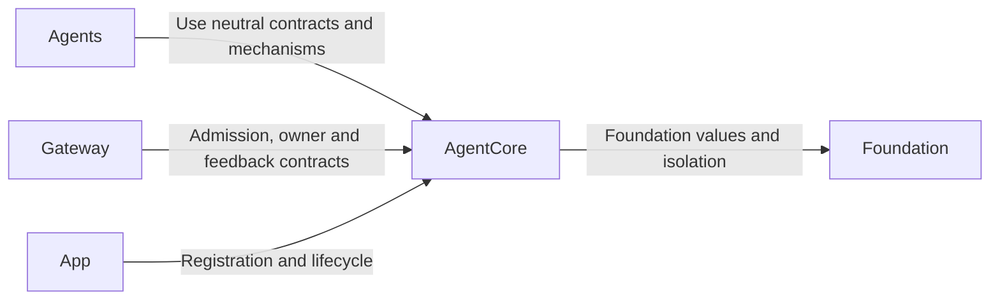
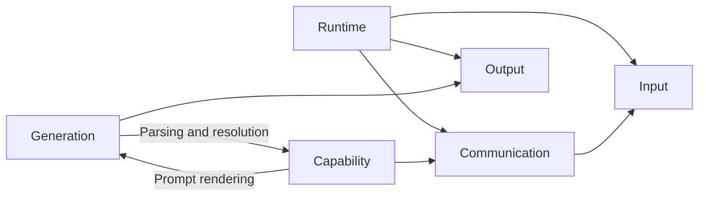

# AgentCore — Neutral Agent Framework

## Summary

independent runtime framework contracts and bounded mechanisms for identity, lifecycle, input, permissions, communication, generation and decision evidence.

## Ownership and boundaries

AgentCore is Foundation-only and owns no concrete role identities, business schemas, model sessions, Storage dependency, persistence adapters or UI/device policy. Agents supplies role processing; Gateway supplies transport/execution; App supplies assembly/lifetime.

## External relationships and data flow

Runtime arrows show data or capability calls; dashed arrows show injection.

## Internal structure

## Framework contracts

SignalOrigin separates external, Agent and runtime provenance. Output and feedback carry session/incarnation/causal/task/round identities rather than trusting model parameters. Call parsing resolves permissions inside the Agent; effects execute through Gateway. Task admission, task completion and native effect completion are distinct.

AgentContext and AgentDecisionContext are generic immutable snapshots/evidence contracts; Repository and durable checkpoint implementations are outside Core. Directory arrows describe source use; the Capability builder uses Generation templates while the Generation interpreter uses the Capability resolver, all within one target. SignalInbox and AgentAdmissionGate provide explicit bounded admission. AgentRoundCoordinator registers calls, seals and merges results; AgentTaskBudget records per-input cumulative usage and enforces only explicitly supplied request/native limits; production defaults are nil. Runtime defaults are mechanism limits, not concrete role policy.

The independent target also packages FunctionTokenPrompts.json and provides bounded, strict PromptTemplates rendering. Role prompt assets live in Agents; Core knows no role names or business instructions.

## Isolation and failures

AgentManager/registry owns live instances/incarnations. Stop revokes authority before joining work; replacement waits for cleanup. Roles own their workers and interpret pause. No framework retry, effect replay, role-specific business context or implicit subscriber acknowledgment is added.

Independent neutral framework, structured context/task/round contracts and bounded mechanisms are implemented.

## Related design

[Parent design](../README.md) · [Capability](Capability/README.md) · [Communication](Communication/README.md) · [Generation](Generation/README.md) · [Input](Input/README.md) · [Output](Output/README.md) · [Runtime](Runtime/README.md)

## Runtime capability snapshots

Agent.effectiveCapabilities(roundID) supplies an immutable invocation catalog; nil uses the fixed-executor contract. Core has no Skill/Task Mode policy. CapabilityContextBuilder separates protocol and catalog rendering; roles choose the composition. Channels order work within one task, while same-name Channels across tasks remain independent and resources still constrain execution.

## Lifetime and bounds

Signal/inbox/round lifetime has no implicit TTL or generation timer. Explicit freshness and provider/Action deadlines retain their own owners. AgentTaskBudget counts requests/native calls with representation-safe saturation; positive optional bounds are validated and enforced when supplied. Context evidence is bounded to 32 MiB logical Data before publication without whole-context encoding.

## Signal envelope and payloads

AgentInput.swift 定义 AgentInput、InputMetadata、AgentTurn、InputPayload 和 SignalOrigin。它们是进程内契约；capturedAt 使用 uptime，deadline 使用 ContinuousClock，不是远程 wire format。元数据默认值不能证明生产者权威。

| Contract element | Canonical structure / rule |
| --- | --- |
| Identity and scope | `AgentInput.id`, `sessionID`, optional `AgentTurn`; distinguish delivery identity, session and interaction. |
| Schema | `InputMetadata.contract` and `version` identify payload semantics; `topic` currently equals contract. Agent configuration JSON v7 is a separate format version. |
| Producer | `source` and optional `incarnation`; AgentBindings input adapters assign external sources, and the runtime binds Agent identity. Model text cannot assign trusted identity or permissions. |
| Time and order | `capturedAt` uses process uptime; `sequence` is producer-scoped; `deadline` uses `ContinuousClock`. These are process-local values, not wall-clock timestamps or a remote wire format. |
| Causality | `rootID`, optional `parentID`, `hops`; forwarded messages preserve their root and identify their parent. Execution feedback also preserves its call/execution correlation and owning session. |
| Content | `InputPayload` selects typed text, event, audio, image, Agent message, Tool result, Action result, generation-round result or activity feedback. A kind declaration alone does not implement a payload or adapter. |
| Domain message | `AgentMessage` carries immutable `Encodable & Sendable` content. Domain-owned schemas validate concrete type, fields, units, encoded size and freshness through `CommunicationContracts`. |

| Payload | Meaning / contract | Current origin |
| --- | --- | --- |
| `.communicationReceipt(CommunicationReceipt)` | Directed target admission | Internal Runtime; not processing/effect/task completion |
| `.text(String)` | User text, `user.text` | External; supported input, but no production text-entry field |
| `.event(String)` | Legacy host event, `runtime.event` | External; new business intents use typed messages |
| `.audio(AudioInput)` | Captured microphone audio, `media.audio` | External |
| `.image(ImageInput)` | Captured camera image, `media.image` | External |
| `.observation(AgentMessage)` | Typed user/host intent, native fact, Agent observation or command; domain contract identifies meaning | External or internal Agent |
| `.toolResult(ToolResult)` | Actual returning Tool outcome, `tool.result` | Internal Runtime |
| `.actionResult(ActionResult)` | Actual Action outcome, `action.result` | Internal Runtime |
| `.roundResult(GenerationRoundResult)` | Sealed generation-round completion, `generation.round.result` | Internal Runtime; current generation-round implementation |
| `.activityEvent(ActivityEvent)` | Persistent activity lifecycle, `activity.event` | Internal Runtime admission supported; camera events remain local |

InputKind 的 video/binary 尚无 InputPayload 分支或 codec。输入支持、订阅、通信授权和执行反馈准入分别验证；外部调用不能靠 source="runtime" 构造内部执行权。媒体几何/PCM 校验见 [Input](Input/README.md)，身份和消息权见 [Communication](Communication/README.md)。

## 待实现

- Generic factory/automatic restart, remote transport and durable execution delivery are not implemented.

✅ Generation 资源说明两种输出协议及原生名称来源；不将具体 Agent、Task 或设备策略加入 Core。解析器与权限契约保持不变。

## Platform 根、设备接入与同帧呈现

✅ ImageValueAttachment 只包装 Sendable 值，OutputEnvelope 按需保留通用 ImageInput。框架契约仍无项目依赖；不引入 CoreVideo、PlatformKit、具体消息契约或设备策略。邮箱停止释放可替换状态，离散消息继续遵循既有排空规则。

## 外部输入描述

✅ AgentInput.swift 定义 Foundation-only ExternalInputDraft/ExternalInputProviding；只携带内容、来源、因果和轮次，没有 origin/incarnation/taskScope 权限。实际 Signal 构造在 Gateway。

## 统一容器异常通道

✅ AgentInput.swift 定义中立 Codable ContainerFailureEvent 及分类/身份/有界内容验证；CommunicationContracts.standard 注册 container.failure。只定义值与 schema，不拥有硬件、容器或上报 worker。

## ApplicationControl 异常展示

✅ RuntimeFailureEvent 保存有界执行诊断及原有 session/input/round/call/worker 关联；ContainerFailureEvent 保存容器原生故障。两者是 observation 事实，不授予执行权限，不含 UI 或模型依赖。展示策略由角色实现。