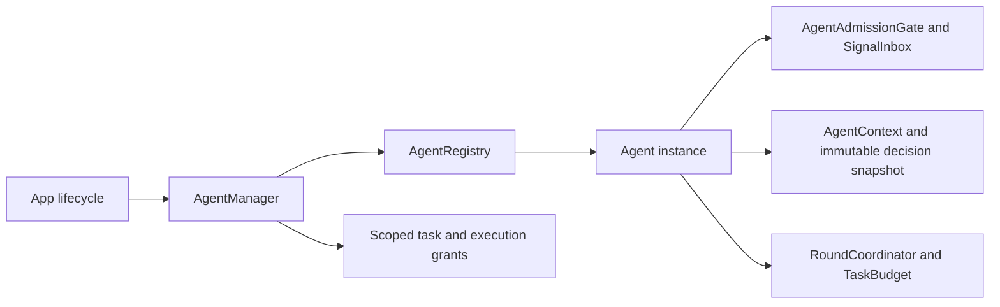

# Registration, Context and Coordination Mechanisms

## Summary

Bounded lifecycle registration, generic decision context, input admission and task/round coordination.

## Ownership and boundaries

AgentManager owns live identity and grants; concrete roles own workers and lifecycle behavior. This Foundation-only directory has no role/model/Storage implementation. AgentContextPersistence supplies injected load/CAS commit.

## External relationships and data flow

Runtime arrows show data or capability calls; dashed arrows show injection.

## Identity and lifecycle

Registry permits 64 Agents and rejects duplicates/full capacity. Registration issues an incarnation UUID and optional session binding. Stop revokes identity/task grants before joining Agent work and resource cleanup; repeat stop joins the same cleanup. Up to four stop observers are supported. A stopped instance is terminal; replacement requires a new instance after removal. Pause semantics belong to each role.

Manager retains at most 32 active task grants and 32 execution scopes per task, validating both participant incarnations and full scope. Stop revokes descendants and joins cleanup. ActionResultInbox retains 128 terminal results by default (configurable 1–512), deduplicates execution IDs and counts history eviction; it is not a work queue.

## Context and round state

AgentContext<State> version 1 validates agent/scope/revision, at most 8192 records (each ≤512 KiB), 8192 consumption batches and 256 work/task records. Active work cannot be evicted/erased. append/consume may explicitly retain a recent window with counted eviction; default overflow rejects. Restart recovery interrupts unfinished work without replay.

AgentDecisionContext validates immutable snapshots and selected Signal/batch membership. AgentRoundCoordinator registers up to 120 calls, deduplicates results, seals/cancels and gates result-driven reasoning continuation. AgentTaskBudget validates cumulative request/native-call counts; the role commits budget evidence at its round boundary. Persistence contracts contain no Storage dependency.

## Admission and cancellation

SignalInbox accepts capacities 1–8192, takes highest priority first and FIFO within a priority, and fuses at most 128 same-key inputs within one session/task. Only explicit replaceLatest removes pending same-key entries; replacement itself is keyed across the inbox, so the role owns key scoping. New entries at capacity reject. The inbox does not apply an implicit queue TTL; explicit input validation and lifetime remain role-owned.

AgentAdmissionGate serializes short actor state/commit sections across suspension. A lock protects its permit and bounded FIFO waiters. Overflow rejects; cancellation removes a waiter; close fails queued waiters. The role releases on every exit and checks cancellation before processing. Model/device work must not retain the permit.

✅ Bounded registration, revocable grants and generic context/admission/round mechanisms are implemented.

❌ Factory creation, automatic restart and generic health supervision are not implemented.

## Related design

[Parent design](../README.md)

## Lifecycle-owned conversation and audio (2026-10-12)

✅ 已移除对话生成、ReACT、收件箱排队、结果屏障、ASR 收尾、TTS 合成及回复占用租约的计时终止。Signal 默认无过期时间，框架不再按通信契约附加 TTL。保留显式实时感知数据的新鲜度和网络传输自身超时；它们不作为对话/语音缓存生命周期。Action 自身超时通过原始执行者的 ActionResult 返回。请求/调用数及队列/PCM 容量仍有界，不以计时自动删除已接纳输入。语音句柄无读等待或错误记录 TTL，按播放完成、输入/会话正常结束、异常或显式取消清理；取消加入生成和播放工作。

## Result-driven ReACT (ADR0214)

✅ ADR0214：AgentRoundCoordinator register 只登记 callID，accept 接受实际 ToolResult；全部调用完成并封轮后由结果计算 needsReasoning，不读取注册策略。保持容量、身份、重复反馈和取消约束。

✅ 已清理从未被现有预处理器使用的 SignalDisposition.recordOnly 枚举项；真实被动事实和反馈仍由原有 updateState/feedback 路径拥有。

AgentTaskBudget defaults to nil request/native limits and records cumulative counts. Optional positive caller limits and historical decoded bounds remain validated/enforced; counts saturate only at Int representation capacity. Shared Chat instantiates it per admitted input and retains it across continuation, independently of a multi-input foreground Goal Task. No elapsed-time budget remains. See [system ReACT limits](../../../../README.md#react-limits-and-time-ownership) for worker hard bounds and other layers.

✅ AgentTaskBudget defaults maximumRequests/maximumNativeCalls to nil (unlimited), records counts with representation-safe saturation, still validates and enforces explicitly supplied bounds/legacy records. Shared Chat removes its direct fixed caps.
