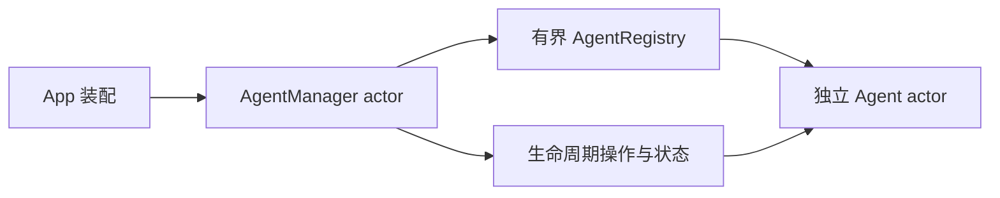

# Runtime · Agent 注册与生命周期

用途：管理独立 Agent 实例。设计目标：通用基础层不引用具体 Agent，业务状态与运行状态分离。

- ✅ AgentManager actor：注册、查找、描述符列表、start/pause/resume/stop/stopAll。
- ✅ AgentRegistry：Manager 隔离下的值类型目录，拒绝重复 ID，最多 64 个 Agent，满时明确 queueFull。
- ✅ AgentLifecycle/AgentStatus：registered/running/paused/stopped/failed 与排队/处理数。
- ❌ factory、自动 restart、健康监督与通用 AgentRuntime；已实现结构化 Context 与中断恢复；仍由具体 Agent 持有 worker/mailbox。

stop 仍是现有 Agent 的终态，恢复需新实例；pause 只阻止领取下一输入，进行中的生成允许完成。

维护：修改本目录代码、文件或子目录时同步 README；✅ 已实现，❌ 未实现。设计以 MobileHarness/README.md 为目标，历史决策见 ADR 0018。

✅ 生命周期枚举与文件名统一为 AgentLifecycle / AgentLifecycle.swift。

✅ Registration issues an incarnation UUID with optional session binding. Stop invalidates identity before joining the Agent; remove allows a freshly constructed replacement only after cleanup. Speech/camera session instances are isolated; generic restart/factory supervision remains unimplemented.

✅ Source location: `MobileHarness/Agents/Support/Core/Runtime`; compiled by `AgentCore`. Directory relocation preserves existing behavior and public contracts. ❌ No new runtime capabilities are implied.

## Action runtime stage 2

✅ ActionResultInbox retains 128 terminal receipts by default (configurable 1–512), deduplicates retained execution IDs and counts oldest-history eviction. AgentManager supports at most four stop observers, invalidates incarnation before stopping, and joins Agent stop with resource cleanup concurrently. ❌ Inbox is not a durable business work queue.

## Agent composition — ADR0187

✅ Agent 自有预处理、版本化结构化 Context 和 Builder 已接入；共享机制在现有 Agents/Support/Core 与 Agents 目录中。业务职责保持当前分界。函数结果按运行时捕获的执行所有者定向返回，通信投递回执只表示接纳；模型续轮不订阅自身广播。

✅ 上下文采用有界原子提交，重启将未完成工作标为中断，不重放设备动作。普通输入、反馈和控制分别接纳；所有容量或持久化失败显式返回。音视频和原生会话保持有界临时状态。

✅ 第二阶段已实现独立摄影 LLM、正式任务委派及任务定向后续输入。❌ 真实模型、原生 UI、真机语音验收仍待完成。

SignalInbox 声明容量/序号/优先级与融合 key；只在相同 session/task 中形成批次，替换仅作用于显式最新状态。过期条目交还 Agent 记录终态。AgentRoundCoordinator 精确登记最多120个调用、去重结果、seal/cancel 和 observation 屏障；AgentTaskBudget 保存累计请求/调用/执行预算，Assistant 在本轮边界写入 work budget 证据；解码与使用均验证预算结构。

AgentContext<State> version1 保存结构化 State、最多8192条每条512KiB的证据、8192消费批次与256个 work/任务记录。终态 work 可被明确淘汰，活跃工作禁止淘汰；其他容量超限明确拒绝。AgentContextPersistence 只定义 load/CAS commit，不导入 Storage。AgentManager 保存32个活跃任务 grant、每任务32个执行范围，校验完整 scope 与双方 incarnation；停止撤销后代任务并加入清理，重复 stop 加入同一清理工作。

设计与阶段边界见 [ADR0187](../../../../../docs/adr/0187-agent-composition-and-react.md)；验证见 [Validation-History](../../../../../docs/Validation-History.md)。

✅ eraseEvidence 按任务身份清理已结束工作与消费证据，活跃 work 拒绝删除；业务历史选择仍在 Agents 适配层。

✅ append/consume 可由 Agent 显式选择 retainingLast；默认仍拒绝超限，流式 Agent 的淘汰计数与最近证据持久化，Core 不选择哪些业务事实可替换。

✅ Implemented organization: AgentDecisionContext.swift resides in Core/Runtime and compiles in AgentCore, with its same-target import removed. Immutable snapshots and selected Signal/batch validation belong to AgentCore; model and persistence adapters belong to Agents/Support. No duplicate definition or compatibility alias is retained.

✅ AgentAdmissionGate serializes short actor state/commit admission across suspension points. A Foundation lock protects the permit and bounded FIFO waiters; overflow rejects explicitly, cancellation removes a waiter, and close fails all queued waiters. The owning Agent releases the granted permit on every exit and checks cancellation before processing. No business/model/device dependency is introduced.
