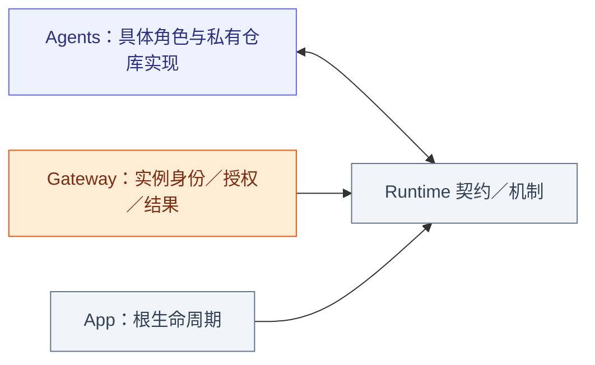
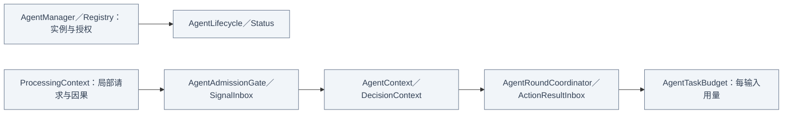

# Runtime — 实例、处理上下文与轮次协调

## 职责与外部关系

Foundation-only 的注册、生命周期、通用 Context、短接纳、任务授权与轮次协调。角色拥有实际订阅／Worker，持久化实现和原生清理由上层注入，不由本目录创建。

## 文件与职责

| 文件 | 职责 |
| --- | --- |
| [AgentRegistry.swift](AgentRegistry.swift) | Manager 隔离下的有界实例表、查找与移除 |
| [AgentManager.swift](AgentManager.swift) | 注册实例 incarnation、生命周期、执行／Task 授权、停止观察与撤权 |
| [AgentLifecycle.swift](AgentLifecycle.swift) | 注册、运行、暂停、停止和失败状态值 |
| [AgentStatus.swift](AgentStatus.swift) | 生命周期、排队数与已处理数快照 |
| [ProcessingContext.swift](ProcessingContext.swift) | 本地处理身份、因果字段与 AgentInput／Output 适配 |
| [SignalProcessing.swift](SignalProcessing.swift) | 输入分类、批次、优先级队列和短接纳门 |
| [AgentContext.swift](AgentContext.swift) | 私有证据／工作／Task 快照、容量校验及可选 persistence 接口 |
| [AgentDecisionContext.swift](AgentDecisionContext.swift) | 不可变决策选取与批次一致性验证 |
| [AgentRoundCoordinator.swift](AgentRoundCoordinator.swift) | 轮内调用登记、结果加入、seal 与续推判断 |
| [ActionResultInbox.swift](ActionResultInbox.swift) | 按 executionID 去重的有界结果证据 |
| [AgentTaskBudget.swift](AgentTaskBudget.swift) | 跨续轮用量计数与可选请求／调用限制 |

## 内部结构

## 实例与授权生命周期

Registry 至多 64 个 Agent，重复／满载拒绝；Manager 注册时创建 incarnation，可绑定 session。每任务最多 32 个执行 scope，活跃 task grant 最多 32，验证参与实例和完整作用域。stop 先撤销身份及子授权，再加入角色／资源清理，重复停止加入同一清理；最多四个 stop observers。停止实例不可重启，替换须移除并创建新实例；pause 由角色定义。

ProcessingContext 是本地 request/session/generation/turn／因果值，不是入站 Signal 或授权。异步任务拥有者检查停止／代际；角色可本地构造 AgentInput 复用处理逻辑，但不得送入 Gateway 伪装外部事件。

## Context 与工作状态

✅ Record.init 对显式 id 原样保留，缺省 id 直接使用非抛错的 UUID 字符串；初始化的 throws 仅用于证据字段校验。

AgentContext version 1 验证 agent/scope/revision，最多 8192 条记录（单条 ≤512 KiB）、8192 消费批次、256 work/task 记录；逻辑 Data 总上限 32 MiB。仅终态可淘汰，默认超限拒绝，显式滚动保留计数。DecisionContext 是不可变选取快照，校验 Signal／批次成员；不含 Storage 依赖。

工作可经历 queued → running → awaitingFeedback → continuation → running，最终 completed/failed/cancelled/interrupted。此为常见角色流程，不是 Core 强制完整转移表；transitionWork 拒绝未知或已终态工作，角色决定非终态转移。重启恢复只标 interrupted，不重放效果。

## 接纳、结果与容量

SignalInbox 容量 1–8192，优先级从高到低、同级 FIFO；同 session/task 的 fuse 最多合并 128 项，只有显式 replaceLatest 删除同 key 待处理项，key 作用域由角色决定。无隐式队列 TTL，新项满载拒绝。

AgentAdmissionGate 用锁保护短 permit 与有界 FIFO 等待者；取消移除等待、close 唤醒失败、owner 每个出口释放并检查取消。模型／设备工作不可持有该 permit。

AgentRoundCoordinator 每轮最多登记 120 个调用，去重实际结果，在所有调用完成并 seal 后计算 needsReasoning；显式业务值或真实失败允许续推，纯取消不允许。ActionResultInbox 默认保留 128 个终态（可配 1–512），按 executionID 去重并累计淘汰，不是工作队列。

AgentTaskBudget 跨同一输入的续轮累计用量，正数可选限制显式生效，生产 request/native 上限为 nil；计数饱和安全。新的用户输入有独立 Decision 预算，即使仍属于同一前台 Task。provider 网络和 Action 执行截止时间另有 owner，不等于整个 Decision 时限。

❌ 通用 factory、自动重启和健康监督未实现。局部媒体见 [Input](../Input/README.md)，真实结果见 [Output](../Output/README.md)。
