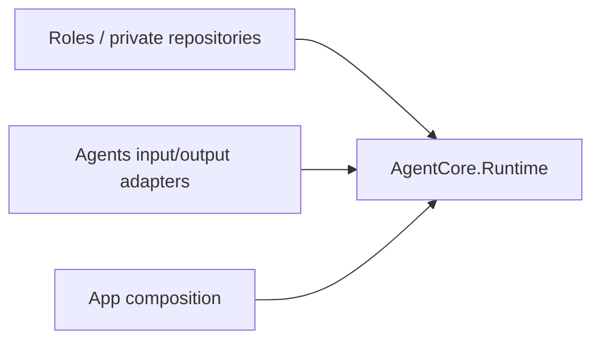
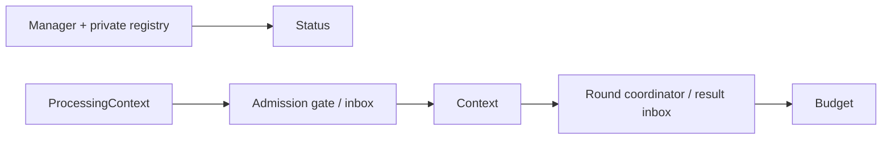

# Runtime — Instances, private context and round coordination

## Boundaries

Runtime owns generic registration, lifecycle, context, short admission, Task authorization and round joins. Roles own subscriptions and workers; persistence and native cleanup are injected by their owners.

## Files

| File | Responsibility |
| --- | --- |
| [AgentManager.swift](AgentManager.swift) | Incarnations, private bounded registry, lifecycle, execution/Task grants, stop observation and revocation. |
| [AgentStatus.swift](AgentStatus.swift) | AgentLifecycle and content-free lifecycle/queue/processed-count snapshot. |
| [ProcessingContext.swift](ProcessingContext.swift) | Local request and causality identity; AgentInput adaptation. |
| [SignalProcessing.swift](SignalProcessing.swift) | Input classification, batches, bounded priority inbox and short admission gate. |
| [AgentContext.swift](AgentContext.swift) | Private evidence/work/Task snapshots, validation and optional persistence port. |
| [AgentDecisionContext.swift](AgentDecisionContext.swift) | Immutable decision selection and batch consistency. |
| [AgentRoundCoordinator.swift](AgentRoundCoordinator.swift) | Per-round call registration, result joins, seal and continuation evidence. |
| [ActionResultInbox.swift](ActionResultInbox.swift) | Bounded terminal evidence deduplicated by execution ID. |
| [AgentTaskBudget.swift](AgentTaskBudget.swift) | Cross-round usage with optional request/call limits. |

## Identity and Task authorization

The manager-isolated registry admits at most 64 roles and rejects duplicates/overflow. Registration creates an incarnation with optional session binding. Each Task has at most 32 execution scopes; at most 32 active Task grants are retained. Scope and participant identity are validated. Receiver authorization checks original sender incarnation and session; business admission remains with the role.

Beginning termination atomically checks executor/scope, closes admission and returns the grant generation and registered executions. Bound ports validate incarnation before treating a missing grant as already retired. Retirement and cleanup recovery can be generation-scoped.

Stop revokes identity and grants before joining cleanup. Concurrent stops join the same cleanup; at most four stop observers exist. A stopped instance cannot restart: replacement requires removal and a new instance. Role pause semantics are independent. ProcessingContext is causality, not an inbound Signal or authorization.

## Context and transactions

Context schema version 1 validates agent/scope/revision, at most 8,192 records (512 KiB each), 8,192 consumed batches, 256 work/Task records and 32 MiB logical Data. Only terminal work is evictable; overflow rejects unless rolling retention is explicit. Record initialization preserves an explicit ID or creates a UUID and throws only for validation. DecisionContext validates explicit batch members without Storage dependencies.

Common work phases are queued, running, awaitingFeedback, continuation and terminal completed/failed/cancelled/interrupted. Core rejects transitions for missing/terminal work; it does not prescribe every nonterminal transition. Recovery marks interrupted work without replaying effects. Persistence ownership and transactional publication belong to [Context](../../Context/README.md).

## Admission, selection and results

SignalInbox capacity is 1–8,192, ordered by descending priority then FIFO. Same-session/task fusion has at most 128 members; replacement requires an explicit same key. There is no implicit TTL. take(excluding:) skips blocked input; takeAll freezes same-session members by admission sequence in one actor operation. Caller policy selects primary input and exclusions; Core does not infer decision semantics.

AgentAdmissionGate protects short permits and a bounded FIFO with a lock. Cancellation removes waiters; close wakes them with failure. Every owner exit releases its permit, including cancellation after grant. Model/device work cannot hold the permit.

AgentRoundCoordinator admits at most 120 calls, validates round/call identity and single result ownership, and computes continuation after every call settles and the round seals. Explicit business output or real failure permits reasoning; cancellation alone does not. Values are not truncated or quota-rejected. ActionResultInbox retains 128 terminal results by default (configurable 1–512), deduplicates execution IDs and counts eviction; it is not a work queue.

AgentTaskBudget saturates usage counters and applies optional positive limits across continuation rounds. Production request/native limits are nil. Every new user decision has its own budget even within the same foreground Task. Provider and Action deadlines have independent owners.
