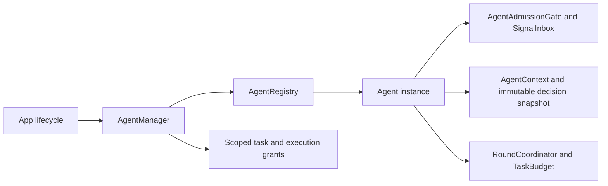

# Registration, Context and Coordination Mechanisms

## Summary

Bounded lifecycle registration, generic decision context, input admission and task/round coordination.

## Ownership and boundaries

AgentManager owns live identity and grants; concrete roles own workers and lifecycle behavior. This Foundation-only directory has no role/model/Storage implementation. AgentContextPersistence supplies injected load/CAS commit.

## External relationships and data flow

Runtime arrows show data or capability calls; dashed arrows show injection.

## Identity and lifecycle

Registry permits 64 Agents and rejects duplicates/full capacity. Registration issues an incarnation UUID and optional session binding. Stop revokes identity/task grants before joining Agent work and resource cleanup; repeat stop joins the same cleanup. Up to four stop observers are supported. A stopped instance is terminal; replacement requires a new instance after removal. Pause semantics belong to each role.

Manager retains at most 32 active task grants and 32 execution scopes per task, validating both participant incarnations and full scope. Stop revokes descendants and joins cleanup. ActionResultInbox retains 128 terminal results by default (configurable 1–512), deduplicates execution IDs and counts history eviction; it is not a work queue.

## Context and round state

AgentContext<State> version 1 validates agent/scope/revision, at most 8192 records (each ≤512 KiB), 8192 consumption batches and 256 work/task records. Active work cannot be evicted/erased. append/consume may explicitly retain a recent window with counted eviction; default overflow rejects. Restart recovery interrupts unfinished work without replay.

AgentDecisionContext validates immutable snapshots and selected Signal/batch membership. AgentRoundCoordinator registers up to 120 calls, deduplicates results, seals/cancels and gates observation continuation. AgentTaskBudget validates cumulative requests/calls/execution; the role commits budget evidence at its round boundary. Persistence contracts contain no Storage dependency.

## Admission and cancellation

SignalInbox accepts capacities 1–8192, takes highest priority first and FIFO within a priority, and fuses at most 128 same-key inputs within one session/task. Only explicit replaceLatest removes pending same-key entries; replacement itself is keyed across the inbox, so the role owns key scoping. New entries at capacity reject. Expired items return to the role for terminal accounting.

AgentAdmissionGate serializes short actor state/commit sections across suspension. A lock protects its permit and bounded FIFO waiters. Overflow rejects; cancellation removes a waiter; close fails queued waiters. The role releases on every exit and checks cancellation before processing. Model/device work must not retain the permit.

✅ Bounded registration, revocable grants and generic context/admission/round mechanisms are implemented.

❌ Factory creation, automatic restart and generic health supervision are not implemented.

## Related design

[Parent design](../README.md)
