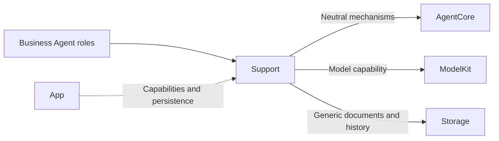
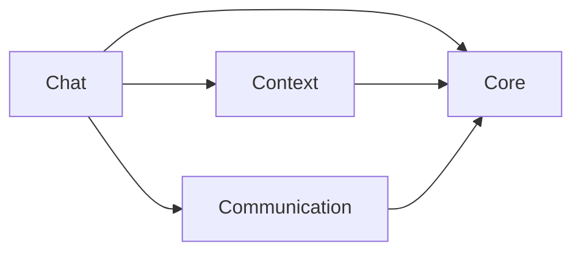
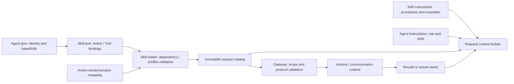

# Shared Agent Components

## Summary

Groups business-independent framework contracts, application schemas, reusable Chat adaptation and atomic context storage.

## Ownership and boundaries

Placement does not merge compilation boundaries. Core is the independent AgentCore target; Communication, Chat and Context compile inside Agents. Roles retain policy, schema and grants; Resources owns declarative instructions. Core never imports another Support layer.

## External relationships and data flow

Runtime arrows show data or capability calls; dashed arrows show injection.

## Internal structure

## Component boundaries

| Directory | Ownership |
| --- | --- |
| Core | Foundation-only identity, lifecycle, generic Signal/task/round/context/output contracts and parsing |
| Communication | Immutable business messages and contract catalog |
| Chat | Role-injected worker, independent text/Tool consumers, context projection, prompt-resource loading and Action-call communication adaptation |
| Context | Structured task/Skill state, fixed-task result coordination, atomic repository and durable evidence |

The internal diagram shows source dependencies, not runtime delivery. Role prompt JSON is packaged by Agents; the generic Function Token resource is packaged by AgentCore. Neither is a communication schema or a runtime grant.

Workers stay with their owning role/worker; shared placement creates no global history or device service. Communication supplies content schemas; Core/Communication supplies neutral transport rights. Chat consumes immutable snapshots and exact model pairing; Context supplies transactions without deciding retention. Every model send is an authorized Action, including roles that retain business Tools.

✅ Shared contracts/adapters and independent Core compilation are implemented.

## Related design

[Parent design](../README.md) · [Chat](Chat/README.md) · [Communication](Communication/README.md) · [Context](Context/README.md) · [Core](Core/README.md)

✅ Chat 仅 Assistant 使用；Support 根级提供资源/目录加载，Context 提供 Task/Skill 状态及固定后台任务协调；三个确定性 Agent 保留旧 history 字段作为只读数据迁移，不接入 Chat 执行。

## 泛化 Task 与独立 Skill

✅ 泛化 Task 与独立 Skill 已接入：任意目标、单前台任务，基础/交互链/任务 Skill 作用域；后台复用 send，不抢占前台。详见所属 Agents 与公共机制设计。

✅ Source organization audit (2026-10-11): Support root: AgentConfigurations and AgentSkillLoader (immutable asset lookup/catalog construction). Context: AgentTaskSkillState (renamed from AgentSkillState, persisted fields unchanged), AgentFixedTaskCoordinator and repository. Communication: business values/contracts only. Chat remains capability adaptation and model-round execution.

Root files are immutable composition helpers only: AgentConfigurations loads versioned resources and validates canonical FunctionContracts metadata; AgentSkillLoader expands dependencies and composes immutable grants. Neither owns a task, worker or repository.

## Source organization standard

Swift source filenames and primary types use UpperCamelCase; members/parameters use lowerCamelCase. Role directories keep Actor entry and Processing (State/Preprocessor/Builder) as the existing template. Shared files group one cohesive concern; plural schema files may contain related business values. Support root is limited to stateless resource/catalog helpers. Context holds mutable/persisted task state and lifecycle coordination; Communication holds serialized message validation. Core remains Foundation-only; Chat depends on role hooks, never concrete role casts.

Runtime IDs are protocol/persistence data, not filenames. Resources uses UpperCamelCase directories/files; the explicit Catalog maps stable IDs to paths. Xcode navigation mirrors the filesystem but does not add duplicate SwiftPM membership.

## Skill 函数目录

✅ AgentConfigurations 从 Agent.json 的 baseSkills 加载 Skill.json 中的函数；AgentSkillLoader 不再与权限上限求交，仍验证 canonical 绑定和组合冲突。

## Action-owned documentation and Skill instruction contract

✅ AgentConfigurations.installDeclarations 接收中立 Action 声明，先验证唯一性与容量再原子安装。相同目录重复安装允许；替换目录拒绝。缺失安装或未知路径明确报错，不回退到资源清单。缓存及在途请求不能被后续安装修改。

## Task controls through Action Calls

✅ AgentSkillLoader 只组合已加载 Skill 的函数绑定；五个 Agent.Task Control Channel Actions 来自 BasicSkill，无固定目录注入特例。可信内部绑定单独保留，冲突由统一目录验证拒绝。

## Agent → Skill → Function registration

✅ Implemented: Agent.json references baseSkills; Skill.json alone registers model Actions/Tools. BasicSkill owns task orchestration and environment reading; ExpressionInteraction owns expression Actions. Role instructions retain identity/responsibility/style. Business roles reuse existing Skills; internal trusted bindings remain separate. Historical snapshots are preserved.

✅ Skill概述明确标记 id/description，不把Skill ID呈现为函数；提示词边界不改变函数注册或Action参数。

✅ Chat owns rolling request projection and unlimited default cumulative decisions; Core retains optional caller budgets and usage validation only.

## 历史记录收敛（2026-10-13）

✅ 已实现：历史记录页面仅保留 Assistant 聊天记录与任务记录。Assistant context 是聊天持久化事实源，任务按持久化身份关联；页面板块重新设计另行开展。

❌ 历史记录页面板块重新设计及原生 UI/真机验收。
