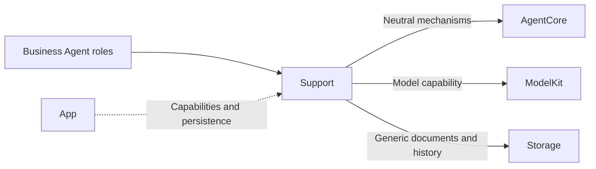
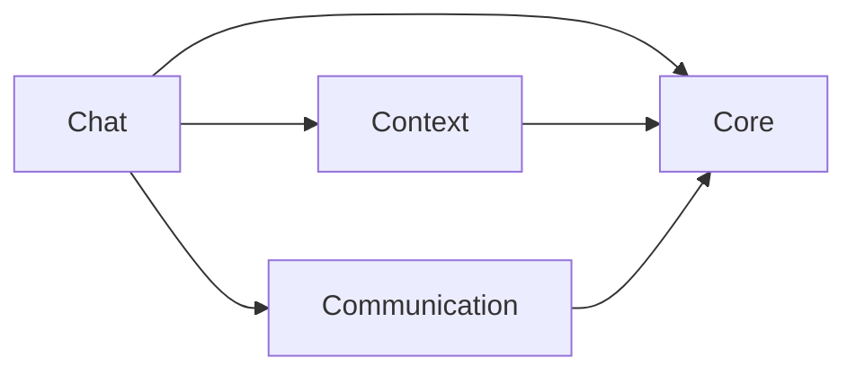
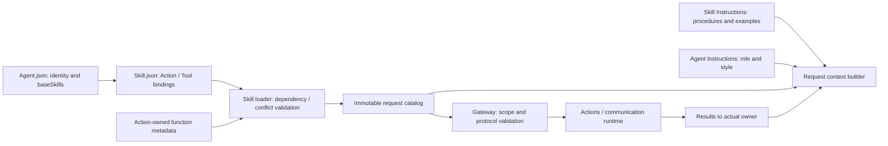

# Shared Agent Components

AgentSkillLoader 计算激活预算并组合不可变目录；Context 管理根 Skill/依赖、Task 持有、Decision 使用及会话倒计数；Chat 记录合法接纳的模型 Action/Tool 使用，在完整用户 Decision 结束时结算。资源定义缓存与模型激活状态独立。

## Summary

Groups business-independent framework contracts, application schemas, reusable Chat adaptation and atomic context storage.

## Ownership and boundaries

Placement does not merge compilation boundaries. Core is the independent AgentCore target; Communication, Chat and Context compile inside Agents. Roles retain policy, schema and grants; Resources owns declarative instructions. Core never imports another Support layer.

## External relationships and data flow

Runtime arrows show data or capability calls; dashed arrows show injection.

## Internal structure

## Component boundaries

| Directory | Ownership |
| --- | --- |
| Core | independent runtime framework identity, lifecycle, generic Signal/task/round/context/output contracts and parsing |
| Communication | Immutable business messages and contract catalog |
| Chat | Role-injected worker, independent text/Tool consumers, context projection, prompt-resource loading and Action-call communication adaptation |
| Context | Structured task/Skill state, fixed-task result coordination, atomic repository and durable evidence |

The internal diagram shows source dependencies, not runtime delivery. Role prompt JSON is packaged by Agents; the generic Function Token resource is packaged by AgentCore. Neither is a communication schema or a runtime grant.

Workers stay with their owning role/worker; shared placement creates no global history or device service. Communication supplies content schemas; Core/Communication supplies neutral transport rights. Chat consumes immutable snapshots and exact model pairing; Context supplies transactions without deciding retention. Every model send is an authorized Action, including roles that retain business Tools.

Shared contracts/adapters and independent Core compilation are implemented.

## Related design

[Parent design](../README.md) · [Chat](Chat/README.md) · [Communication](Communication/README.md) · [Context](Context/README.md) · [Core](Core/README.md)

Chat 由 Assistant 使用；Support 根级提供资源/目录加载，Context 提供 Task/Skill 状态及固定后台任务协调。确定性 Agent 使用各自的内存事务状态和注入的业务仓库，不接入 Chat 执行。

## 泛化 Task 与独立 Skill

泛化 Task 与独立 Skill 已接入：任意目标、单前台任务，基础/会话近期/任务 Skill 作用域；后台复用 send，不抢占前台。详见所属 Agents 与公共机制设计。

Root files are immutable composition helpers only: AgentConfigurations loads versioned resources and validates canonical FunctionContracts metadata; AgentSkillLoader expands dependencies and composes immutable grants. Neither owns a task, worker or repository.

## Source organization standard

Swift source filenames and primary types use UpperCamelCase; members/parameters use lowerCamelCase. Role directories keep Actor entry and Processing (State/Preprocessor/Builder) as the existing template. Shared files group one cohesive concern; plural schema files may contain related business values. Support root is limited to stateless resource/catalog helpers. Context holds mutable runtime task state and lifecycle coordination; Communication holds serialized message validation. Core remains independent runtime framework; Chat depends on role hooks, never concrete role casts.

Runtime IDs are protocol/persistence data, not filenames. Resources uses UpperCamelCase directories/files; the explicit Catalog maps stable IDs to paths. Xcode navigation mirrors the filesystem but does not add duplicate SwiftPM membership.

## Skill 函数目录

AgentConfigurations 从 Agent.json 的 baseSkills 加载 Skill.json 中的函数；AgentSkillLoader 验证 canonical 绑定和组合冲突。

## Action-owned documentation and Skill instruction contract

AgentConfigurations.installDeclarations 接收中立 Action 声明，先验证唯一性与容量再原子安装。相同目录重复安装允许；替换目录拒绝。缺失安装或未知路径明确报错，不回退到资源清单。缓存及在途请求不能被后续安装修改。

## Task controls through Action Calls

AgentSkillLoader 只组合已加载 Skill 的函数绑定；五个 Agent.Task Control Channel Actions 来自 BasicSkill，无固定目录注入特例。可信内部绑定单独保留，冲突由统一目录验证拒绝。

## Agent → Skill → Function registration

Agent.json references baseSkills; Skill.json alone registers model Actions/Tools. BasicSkill owns task orchestration and environment reading; ExpressionInteraction owns expression Actions. Role instructions retain identity/responsibility/style. Business roles reuse existing Skills; internal trusted bindings remain separate. Historical snapshots are preserved.

Skill概述明确标记 id/description，不把Skill ID呈现为函数；提示词边界不改变函数注册或Action参数。

Chat owns rolling request projection and unlimited default cumulative decisions; Core retains optional caller budgets and usage validation only.

## AgentBindings 运行接入

本目录同时容纳核心声明/配置辅助与明确隔离的 AgentBindings 源文件，二者通过静态互斥清单编译，不能依据物理目录放宽核心 imports。Support/Communication 中的角色 IntentRuntime 同样只属于 AgentBindings；普通通信 schema 仍属于 Agents 核心。

AgentServices 拥有角色接入、输出消费者、资源注册、Provider 私有请求接线及根观察。ApplicationFeatures 通过领域仓库接口组合 UI 请求服务；AgentApplicationUI 把现成服务适配成 UI.ApplicationRootProviding。RuntimeDependencies 只向会话拥有者暴露必要能力，不提供整个 App。

VoiceSessionCoordinator 只保留语音输入、同意/占用屏障、角色及输出接入；ConversationPresentationController 和 VoiceNativeEffects 分别属于 ActionBindings。VisionSession 实现 CameraVisionRunning；GatewayCameraResources 实现 CameraResourceAccess，保留真实租约与旧所有者隔离。两端都不反向依赖 App。

启动和停止由公开方法显式完成。前后台异步切换由通用 AppLifecycle 单 worker 调度，不再累积逐次 scene task 链；原生失效接口同步执行。根观察、准备、设备输入和业务操作都由模块持有，不由页面拥有。

✅ 根 UI 对生命周期自身的正常暂停取消不记录启动失败；真正业务/清理错误继续保留。App 只调度公开生命周期接口，UI 模块仍不依赖 AppLifecycle。

✅ ApplicationFeatures 持有 Sendable 的 repositories 领域仓库提供器。运行时获取仓库，未启动/关闭错误原样传播；不依赖具体后端，不接管存储生命周期。

## 待实现

- 暂无本目录独立的实现待办；跨模块及实际模型/设备验收见所属模块说明。

## Storage 依赖

✅ 存储访问使用独立的 State、Cache、Database 和 Files 接口；App 注册根实例，消费者通过构造器获得所需能力。存储容器不接管本目录的业务验证、执行和完成语义。
