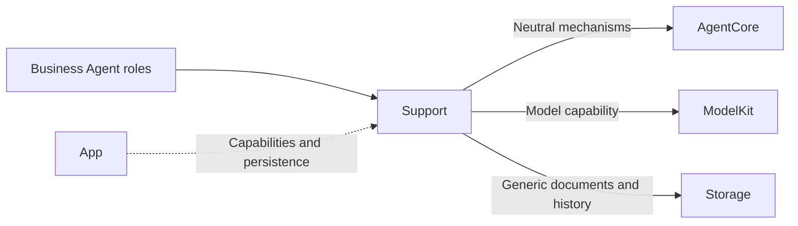
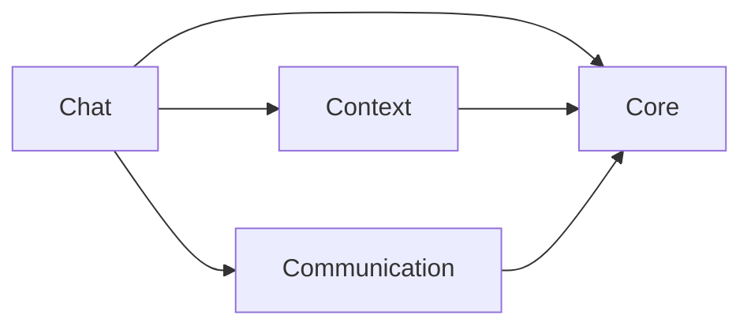
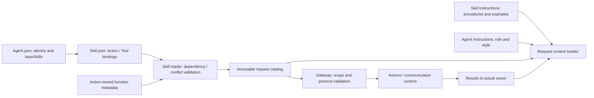

# Shared Agent Components

AgentSkillLoader 计算激活预算并组合不可变目录；Context 管理根 Skill/依赖、Task 持有、Decision 使用及会话倒计数；Chat 记录合法接纳的模型 Action/Tool 使用，在完整用户 Decision 结束时结算。资源定义缓存与模型激活状态独立。

## Summary

Groups business-independent framework contracts, application schemas, reusable Chat adaptation and atomic context storage.

## Ownership and boundaries

Placement does not merge compilation boundaries. Core is the independent AgentCore target; Communication, Chat and Context compile inside Agents. Roles retain policy, schema and grants; Resources owns declarative instructions. Core never imports another Support layer.

## External relationships and data flow

Runtime arrows show data or capability calls; dashed arrows show injection.

## Internal structure

## Component boundaries

| Directory | Ownership |
| --- | --- |
| Core | independent runtime framework identity, lifecycle, generic Signal/task/round/context/output contracts and parsing |
| Communication | Immutable business messages and contract catalog |
| Chat | Role-injected worker, independent text/Tool consumers, context projection, prompt-resource loading and Action-call communication adaptation |
| Context | Structured task/Skill state, fixed-task result coordination, atomic repository and durable evidence |

The internal diagram shows source dependencies, not runtime delivery. Role prompt JSON is packaged by Agents; the generic Function Token resource is packaged by AgentCore. Neither is a communication schema or a runtime grant.

Workers stay with their owning role/worker; shared placement creates no global history or device service. Communication supplies content schemas; Core/Communication supplies neutral transport rights. Chat consumes immutable snapshots and exact model pairing; Context supplies transactions without deciding retention. Every model send is an authorized Action, including roles that retain business Tools.

Shared contracts/adapters and independent Core compilation are implemented.

## Related design

[Parent design](../README.md) · [Chat](Chat/README.md) · [Communication](Communication/README.md) · [Context](Context/README.md) · [Core](Core/README.md)

Chat 由 Assistant 使用；Support 根级提供资源/目录加载，Context 提供 Task/Skill 状态及固定后台任务协调。确定性 Agent 使用各自的内存事务状态和注入的业务仓库，不接入 Chat 执行。

## 泛化 Task 与独立 Skill

泛化 Task 与独立 Skill 已接入：任意目标、单前台任务，基础/会话近期/任务 Skill 作用域；后台复用 send，不抢占前台。详见所属 Agents 与公共机制设计。

Root files are immutable composition helpers only: AgentConfigurations loads versioned resources and validates canonical FunctionContracts metadata; AgentSkillLoader expands dependencies and composes immutable grants. Neither owns a task, worker or repository.

## Source organization standard

Swift source filenames and primary types use UpperCamelCase; members/parameters use lowerCamelCase. Role directories keep Actor entry and Processing (State/Preprocessor/Builder) as the existing template. Shared files group one cohesive concern; plural schema files may contain related business values. Support root is limited to stateless resource/catalog helpers. Context holds mutable runtime task state and lifecycle coordination; Communication holds serialized message validation. Core remains independent runtime framework; Chat depends on role hooks, never concrete role casts.

Runtime IDs are protocol/persistence data, not filenames. Resources uses UpperCamelCase directories/files; the explicit Catalog maps stable IDs to paths. Xcode navigation mirrors the filesystem but does not add duplicate SwiftPM membership.

## Skill 函数目录

AgentConfigurations 从 Agent.json 的 baseSkills 加载 Skill.json 中的函数；AgentSkillLoader 验证 canonical 绑定和组合冲突。

## Action-owned documentation and Skill instruction contract

AgentConfigurations.installDeclarations 接收中立 Action 声明，先验证唯一性与容量再原子安装。相同目录重复安装允许；替换目录拒绝。缺失安装或未知路径明确报错，不回退到资源清单。缓存及在途请求不能被后续安装修改。

## Task controls through Action Calls

AgentSkillLoader 只组合已加载 Skill 的函数绑定；五个 Agent.Task Control Channel Actions 来自 BasicSkill，无固定目录注入特例。可信内部绑定单独保留，冲突由统一目录验证拒绝。

## Agent → Skill → Function registration

Agent.json references baseSkills; Skill.json alone registers model Actions/Tools. BasicSkill owns task orchestration and environment reading; ExpressionInteraction owns expression Actions. Role instructions retain identity/responsibility/style. Business roles reuse existing Skills; internal trusted bindings remain separate. Historical snapshots are preserved.

Skill概述明确标记 id/description，不把Skill ID呈现为函数；提示词边界不改变函数注册或Action参数。

Chat owns rolling request projection and unlimited default cumulative decisions; Core retains optional caller budgets and usage validation only.

## AgentBindings 运行接入

本目录同时容纳核心声明/配置辅助与明确隔离的 AgentBindings 源文件，二者通过静态互斥清单编译，不能依据物理目录放宽核心 imports。Support/Communication 中的角色 IntentRuntime 同样只属于 AgentBindings；普通通信 schema 仍属于 Agents 核心。

AgentServices 拥有角色接入、输出消费者、资源注册、Provider 私有请求接线及根观察。ApplicationFeatures 通过领域仓库接口组合 UI 请求服务；AgentApplicationUI 把现成服务适配成 UI.ApplicationRootProviding。RuntimeDependencies 只向会话拥有者暴露必要能力，不提供整个 App。

VoiceSessionCoordinator 只保留语音输入、同意/占用屏障、角色及输出接入；ConversationPresentationController 和 VoiceNativeEffects 分别属于 ActionBindings。ApplicationFeatures 拥有感知角色会话；GatewayCameraResources 实现 CameraResourceAccess，保留真实租约与旧所有者隔离。两端都不反向依赖 App。

启动和停止由公开方法显式完成。前后台异步切换由通用 AppLifecycle 单 worker 调度，不再累积逐次 scene task 链；原生失效接口同步执行。根观察、准备、设备输入和业务操作都由模块持有，不由页面拥有。

✅ 根 UI 对生命周期自身的正常暂停取消不记录启动失败；真正业务/清理错误继续保留。App 只调度公开生命周期接口，UI 模块仍不依赖 AppLifecycle。

✅ ApplicationFeatures 持有 Sendable 的 repositories 领域仓库提供器。运行时获取仓库，未启动/关闭错误原样传播；不依赖具体后端，不接管存储生命周期。

## 待实现

- 暂无本目录独立的实现待办；跨模块及实际模型/设备验收见所属模块说明。

## Storage 依赖

✅ 存储访问使用独立的 State、Cache、Database 和 Files 接口；App 注册根实例，消费者通过构造器获得所需能力。存储容器不接管本目录的业务验证、执行和完成语义。

## 公开 State 边界

✅ 角色运行内存由 AgentContextRepository actor 私有持有。AgentBindings 安装设备公开事实并创建会话端口；Agents 只发布 task 的有限业务视图。Skill schema v2 的 useState 决定每轮公开读取集合；确定性 Photographer 的内部反馈继续独立保留。

[公开 State 契约](../../Storage/State/README.md)

✅ VoiceSessionCoordinator 的取消回复绑定到保留会话的 interruptSession；设置导航不调用 stopVoice，页面可见性不控制根相机。原生后台仍立即停止采集/播放并加入清理，Assistant 内存由根持有。

✅ VoiceSessionCoordinator.swift 中的跨平台 VoiceReplyCancellation 顺序加入 cancelReply、waitForPlaybackStop、cleanupAudio；协调器持有唯一 replyCancellationTask 并在重启／关闭前加入。cancelReply 必须加入已接纳的执行取消，即使返回错误也继续等待原生停止并回收音频，最后传播原错误。stopVoice 同步使原生播放失效，不等待模型停声；会话句柄与取消终态只在播放清理完成后回收。此顺序器不创建任务或队列，不过滤 Storage 的真实错误。

## 分类异常诊断

✅ ApplicationControl 依据 Agent 稳定分类码选择短 toast 文案，Actions 将完整有界诊断、代码及关联标识映射为 UI 值；UI 不依赖 ModelKit/AgentCore，不从日志文本推测类别。

模型响应侧协议拒绝发生在原生调用发布前，日志归 Agent 异常；已解析调用的 unknownCapability/参数拒绝及真实 Action/Tool 执行失败继续使用既有结果/完成契约，不因新增诊断而统一终止或重试。

✅ Implemented: Skill-only production catalogs contain Actions; no native declarations are synthesized for migrated queries. Retention/Task ownership follows admitted Action calls; private state and lifecycle semantics stay intact.

## Platform 根、设备接入与同帧呈现

✅ 原生音视频转 Signal 由 Gateway 的 DeviceInputAdapter 统一完成。ApplicationFeatures 只拥有 Vision 角色登记/移除和 Photographer 追踪关系，DeviceInputConnection 负责逐帧接纳。语音协调器保留同意、半双工和确认语句/播放屏障，原生通知由 AppleAudioIO 提供。

✅ 运行服务使用注入的 Audio/Vision 能力，不构造 AppleAudioIO、BLE 或提示音/触觉实例。其他领域 IntentRuntime 的业务完成协议及 UI 适配仍保留。

## 录音容器化回归修复

✅ 移除主录音路径新增的 MainActor PCM 转发任务与第二级订阅 FIFO，startCapture 直接返回原生容量 64 的有序源流。可选订阅改为在原生回调交付阶段独立广播，不经主线程中转；保持每订阅 64、慢观察者局部 overflow、容量上限 16，不丢弃或扩大主录音队列来掩盖堵塞。原生停机前关闭观察代次并加入原生回调，旧回调不能污染新录音；原生错误结束对应观察流。

## 视觉静默停止与诊断补齐

✅ ApplicationFeatures 内的跨平台 VisionPipelineWorkflow 管理输入、输出和可选健康任务；输入正常结束或失败转换为角色终态，等待输出排空；输出失败或显式取消加入所有任务。根级监视每秒读取健康快照，3 秒无有效进展每次故障只记录一次，恢复后解除提示。ActionActivityWorkflow 将视觉诊断转发为 runtime.failure，由 ApplicationControl 决定异常分类及短 toast；接入/加载/派发失败也记录完整关联信息，不只设置相机文案。

✅ 根级消费检查媒体 Tool 的实际执行结果，将非取消的呈现失败纳入健康快照；一秒监视将其显示为 Agent 分类诊断和 toast，同一连续故障只报告一次，后续成功呈现清除该健康故障。

## 视觉 queueFull 修复

✅ 视觉根在 consumeSignals 注入角色的 outputReplacementKey，保留跨 Gateway 的状态替换语义；不增加模型并发或扩大录音/视觉 FIFO。

## UI 容器与相机能力注入

✅ ApplicationFeatures 的相机惰性属性调用 App 工厂，传递类型明确、弱引用且延迟访问 runtime 的 CameraIntegrationBindings；页面投影/观察使用注入的同一 CameraState。移除具体相机类依赖和原有状态/Coordinator 构造。

## 统一外部输入

✅ Communication 业务输入只生成草稿，Gateway 负责信封；AgentInteractionRuntime 不再自行改写文字信封。宿主控制先经过 Gateway 验证再等待既有中断/停止完成屏障，保持取消与私有请求身份。

## 统一容器异常通道

✅ ApplicationFeatures 注入 App 持有的容器故障通道；AgentServices 在实际 Agent 启动后连接分发，停止前解除连接；ApplicationControl 订阅故障 Signal 并发出内部呈现调用，ActionActivityWorkflow 不再观察容器快照生成 UI 异常，不向故障通道反向写入。预启动与清理期间仍有通道记录及启动失败接口，不伪造 Agent 已接收。

## ApplicationControl 异常展示

✅ 已实现：ActionActivityWorkflow 移除容器快照直达 UI 的监听及异常提示策略。既有执行异常快照/本地诊断仅由有界、根拥有的转发任务提交 runtime.failure；策略归 ApplicationControl，Actions 执行呈现。转发停止取消并加入任务，拒绝/投递失败显式记录不可用状态。现有跨模块装配归属本轮不调整。

转发队列最多 100 条，拒绝新项时累计 rejectedFailureSignals 并标记观察不可用；投递失败保留 lastFailureSignalError，不以新诊断递归上报。不承诺 Agent 接纳回执或持久送达。停止取消并加入转发与执行异常观察任务；已停止的流不复用，重建根时创建新 workflow。

## UI 全量容器化

✅ ApplicationFeatures/AgentServices/InteractionServices 使用 App 注入的 UI 子能力，不再创建应用级 UI 状态。请求工作流和投影通过只读呈现协议提交值；视图 façade 仅暴露同根观察对象。原会话、角色、模型和设备接入归属保持，跨模块装配尚未迁出 Bindings。

ActionActivityWorkflow.shutdown 显式取消并加入执行、任务、角色及异常观察；AgentServices 停止时先结束这些消费者。UI 到期/动画等待由 UI 根加入，不冒充业务或 GPU 完成。

✅ ActionActivityWorkflow 的显式 shutdown 同时取消并加入运行、任务、角色和异常观察；Agent 服务停止时调用，避免 UI 根关闭后仍由旧轮询持有状态。

✅ ApplicationFeatures 为相机点击工作流注入同根 CameraPresenting，避免消费者持有可变 CameraState；其页面状态仍来自 UI 根。

✅ 麦克风频谱计算 await PlatformKit 的离主线程入口；每个捕获消费者最多一个在途计算，返回后重新校验 voice generation、capture epoch、处理轮次及 UI 凭证。取消仍由 captureTask 拥有并加入，不增加 PCM 队列。

✅ 音频检测将实际 AudioIOError.interrupted 映射为已有系统中断提示；路由设备事实不冒充 Error。

## 播放启动隔离

✅ 将输出 AVAudioEngine/AVAudioPlayerNode 的连接、启动、PCM 提交和停止移至 PlatformKit 私有串行 actor；AppleAudioIO 保留主线程业务接纳和真实完成等待，以 token 围栏防止旧取消停止新播放。最多三个已调度缓冲、一个串行提交；停止同步关闭接纳并在拥有的清理任务中加入原生停止，根 stop 和下一次播放加入清理。不在 UI boot 激活音频设备。

✅ isolatedPresentation 仅为真实聊天及语音诊断选择隔离展示；普通运行继续按同一 UI 根装配，不提供视觉模拟启动分支。

✅ 会话和音频检测注入 any AudioInputOutput，保留会话／轮次校验及停止加入；模型和设备决策仍在业务层，不持有原生音频驱动。

✅ 聆听协调的 cue/haptic 注入 CuePlaying／HapticFeedbackProviding，保留原生预备、取消、加入和反馈屏障，不通过具体驱动查找设备。

✅ 应用停止原生服务前先关闭并加入模型资源交互的恢复／自动保存任务，再关闭执行依赖。
