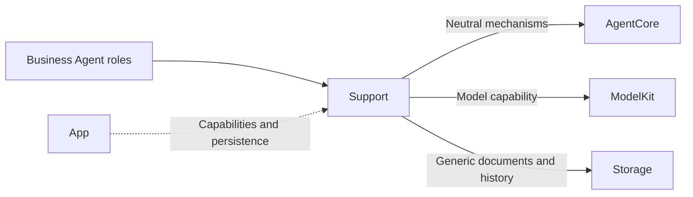
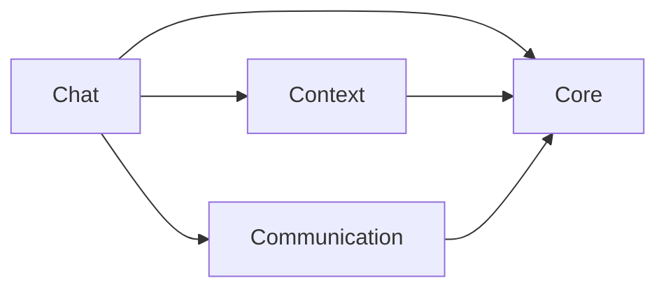

# Shared Agent Components

## Summary

Groups business-independent framework contracts, application schemas, reusable Chat adaptation and atomic context storage.

## Ownership and boundaries

Placement does not merge compilation boundaries. Core is the independent AgentCore target; Communication, Chat and Context compile inside Agents. Roles retain policy, schema, prompts and grants. Core never imports another Support layer.

## External relationships and data flow

Runtime arrows show data or capability calls; dashed arrows show injection.

## Internal structure

## Component boundaries

| Directory | Ownership |
| --- | --- |
| Core | Foundation-only identity, lifecycle, generic Signal/task/round/context/output contracts and parsing |
| Communication | Immutable business schemas, contract catalog and bundled JSON v6 configuration loading |
| Chat | Role-injected worker, independent text/Tool consumers, context projection, prompt-resource loading and Action-call communication adaptation |
| Context | Atomic repository and durable evidence adaptation |

The internal diagram shows source dependencies, not runtime delivery. Role prompt JSON is packaged by Agents; the generic Function Token resource is packaged by AgentCore. Neither is a communication schema or a runtime grant.

Workers stay with their owning role/worker; shared placement creates no global history or device service. Communication supplies content schemas; Core/Communication supplies neutral transport rights. Chat consumes immutable snapshots and exact model pairing; Context supplies transactions without deciding retention. Every model send is an authorized Action, including roles that retain business Tools.

✅ Shared contracts/adapters and independent Core compilation are implemented.

## Related design

[Parent design](../README.md) · [Chat](Chat/README.md) · [Communication](Communication/README.md) · [Context](Context/README.md) · [Core](Core/README.md)
