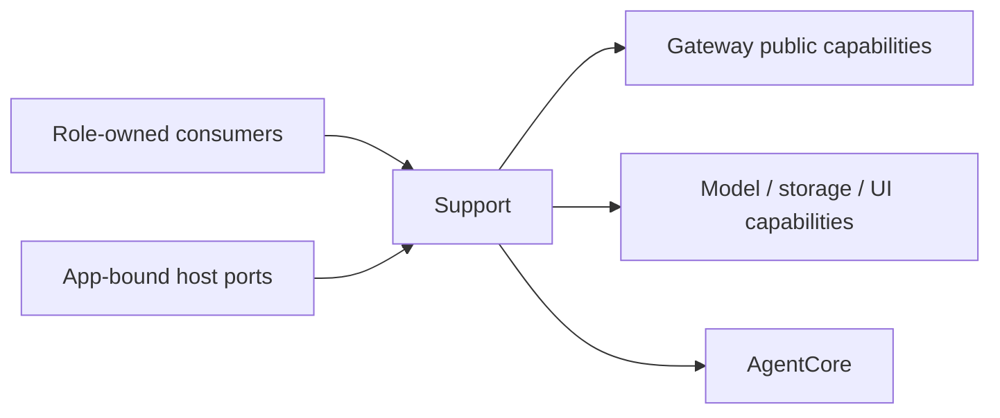
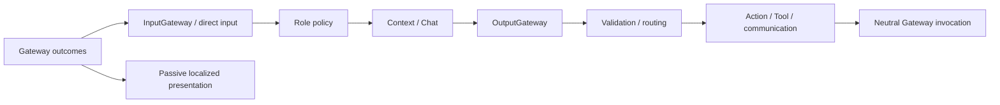

# Agents Support — Cognitive adapters and shared mechanisms

## Ownership and compilation

Support owns reusable cognitive authorization, input/execution correlation, routing, result projection, failures, configuration, Chat, Context and communication. Role-private schemas and business policy stay in the role directory. Core compiles independently as AgentCore with FunctionContracts; other sources compile as Agents and use Gateway public APIs and selected foundations, without Actions, CallRuntime or ExecutionRuntime implementations.

Module-wide [host bindings](../AgentHostBindings.swift) and [Gateway ports](../AgentGatewayPorts.swift) belong to the Agents root. Support implements their reusable adapters. Assistant owns its [conversation orchestration](../Assistant/README.md), history selection, speech port and Decision presentation.

## Root files

| File | Responsibility |
| --- | --- |
| [RuntimeLogProjection.swift](RuntimeLogProjection.swift) | Passive execution/Agent/Task log projection and localized app-owned copy. |
| [ActionDispatcher.swift](ActionDispatcher.swift) | Scheduled Action admission, channel ordering, finish and cancellation barriers. |
| [ToolDispatcher.swift](ToolDispatcher.swift) | Direct Tool calls, fresh execution attachments and correlated feedback or internal completion. |
| [ExecutionRouter.swift](ExecutionRouter.swift) | OutputValidator permission checks and side-effect-free output classification. |
| [OutputExecutionResult.swift](OutputExecutionResult.swift) | Cognitive execution outcome, direct response and UI transaction result values. |
| [InputGateway.swift](InputGateway.swift) | Bound role endpoints, semantic communication checks, receipts and result delivery. |
| [OutputGateway.swift](OutputGateway.swift) | Producer identity, frozen capabilities, Task authorization, dispatch, execution scope retirement and failure ownership. |
| [GatewayProjections.swift](GatewayProjections.swift) | Cognitive-to-neutral invocation/envelope and neutral-to-cognitive outcome conversion. |
| [AgentGatewayAssembly.swift](AgentGatewayAssembly.swift) | Gateway assembly, scoped observation lifecycle and Action feedback adapters. |
| [CapabilityCoverage.swift](CapabilityCoverage.swift) | Startup implementation coverage using explicitly supplied local-tool paths. |
| [AgentConfigurations.swift](AgentConfigurations.swift) | Validated packaged role declarations, public descriptions and function catalogs. |
| [AgentSkillLoader.swift](AgentSkillLoader.swift) | Skill dependency expansion, owner checks, function binding and teaching. |
| [AgentContainerLifecycle.swift](AgentContainerLifecycle.swift) | Coalesced startup/transition/cleanup/shutdown, revision fencing and retained failure. |
| [AgentUIRequests.swift](AgentUIRequests.swift) | Long-lived ordinary/control consumers, cancellation/deadlines and original reply completion. |
| [IndependentOutputWorkflow.swift](IndependentOutputWorkflow.swift) | Bounded independent communication/round consumers and shared Island publication transport. |
| [AgentRuntimeLogWorkflow.swift](AgentRuntimeLogWorkflow.swift) | Root-owned Agent/Task observations and bounded failure delivery. |
| [ContainerFailureChannel.swift](ContainerFailureChannel.swift) | Bounded failure journal, classification/suppression and delivery without recursive reporting. |
| [AgentInputMetrics.swift](AgentInputMetrics.swift) | Opt-in content-free timing and rejection diagnostics. |

## Subdirectories

| Area | Responsibility |
| --- | --- |
| [Chat](Chat/README.md) | Model driving, recording, neutral message/result projection and templates. |
| [Context](Context/README.md) | Private transactional Task/Skill state and read-only container context collection. |
| [Communication](Communication/README.md) | Cross-role business values, typed messages and fixed-task admission. |
| [Core](Core/README.md) | Independent cognitive identity/input/output, parsing and generic runtime contracts. |

The [audit inventory](../../../docs/requirements/technical/Agents-Support-Cleanup.md#source-inventory) records file-level responsibility; the [ownership plan](../../../docs/requirements/technical/Agents-Responsibility-Boundaries.md) records the separation rationale. The current contracts are maintained here and in the owning directory READMEs.

## Interfaces and flow

Roles produce OutputEnvelope with local processing identity. OutputGateway authenticates producer/incarnation, frozen decision/Skill catalog and Task scope. ActionCall uses ChannelScheduler; ToolCall uses DirectExecutionDispatcher. Catalog executionPolicy metadata does not switch these routes. Gateway does not repeat cognitive authorization. Revocation explicitly cancels the matching execution scope.

InputGateway registers neutral endpoints. Broadcast requires exact subscription; directed messages and runtime feedback require declared inputs. OutputGateway constructs broadcast metadata from registered contracts. Gateway transports opaque payloads under its own endpoint/envelope/capacity/scope checks. Action/Tool completion values have no observation-byte quota; trusted identity, Task permissions and result consistency remain mandatory. Model context selection is separate.

AgentGatewayAssembly receives SignalTransport and GatewayAdmission, prepares communication and a neutral GatewayConfiguration, then binds returned execution/observation capabilities. App alone configures GatewayContainer. No adapter searches or configures an upstream root. Camera/device ports exclude scene, root shutdown and native idle-join controls.

## Lifetime, capacity and failures

AgentContainerLifecycle retains at most one startup, transition, cleanup and shutdown worker. Concurrent calls coalesce; failed/cancelled startup joins cleanup. Admission closes before invalidation transitions, revisions fence stale foreground reopening and transition/cleanup failure remains observable on later stop.

consumeUI defaults to one ordinary worker, supports at most four explicitly selected concurrent workers, and retains one separate control worker/slot. Requests carry cancellation handles and a 120-second deadline. Shutdown cancels/joins every child and closes only the matching consumer token. AgentUIExecution bounds active requests and retained outputs per request to 64 each; outputs belong to their transaction or stream, never both.

Communication output is consumed independently of round barriers through a 16-item queue with at most four concurrent deliveries. Other output uses a 256-item bounded queue. Overflow fails explicitly and closure cancels/joins consumers. Communication produced after a model round can obtain a receipt without deadlocking the Action's round join.

ContainerFailureChannel retains 128 records, 64 pending deliveries and eight latest-snapshot observers. Oldest eviction has explicit counters. One worker preserves delivery failure without recursive reporting; stop joins delivery before closing observers. First/latest occurrence and repeat count are historical evidence, not current health authority. NativeFailureClassification handles model/platform lifecycle admission failures; suppression retains evidence and cleanup failures stay publishable. OutputGateway classifies cognitive execution failures; Gateway owns neutral execution/outbox evidence. Pure cancellation is distinct from mixed or real failure.

AgentRuntimeLogWorkflow bounds pending failure events to 100 with explicit rejection accounting, and joins observation/delivery workers on shutdown. Role shutdown stops only owned work, never borrowed global scheduling/transport. App retains terminal and cleanup bindings until downstream roots have stopped.

## Task authorization and internal completion

GatewayOutputConsumer.executeInternal requires the registered role's internalTools and no roundID. Agents checks permission, Gateway checks admission/resources and Actions executes. Actual results return only to the internal caller, without InputGateway ToolResult feedback. execute and executeReturning retain protocol feedback and call identity.

Task retirement is bound to the registered executor. OutputGateway closes grant admission, joins or cancels existing work according to terminal status, then revokes the admission generation. InputGateway records successful local retirement for diagnostics. Already missing grants from cleanup/restart can converge without fabricating an active grant.

Writer may request execution authorization after admitting a new ordinary message. The port authenticates message/session/both incarnations; failed business admission rolls back that grant. Progress/terminal events retain the bound scope. Writer owns its durable settlement worker and joins it during pause/stop; user notification has an independent worker. OutputGateway depends only on AgentMessageRepository for durable communication, without Task/workspace ownership APIs.

## Shared Island transport

IndependentOutputWorkflow also owns AgentIslandPublication. Roles provide IslandContent or an end intent. One immutable in-flight command and one replaceable latest pending command use stable activity/session identity and increasing revisions. Failed publication retains bounded evidence and retries latest state every 500 ms. Stop closes admission, cancels/joins the worker, then joins the final registered end call before producer retirement; Gateway supplies its deadline and cleanup failure remains visible.

Shared permissions/bind helpers own internal-tool declarations, trusted identity and result checking. Content, timing, terminal fences and response handling remain role-owned. SpeechPerception, Assistant, Photographer and ApplicationControl do not publish for each other. App-bound audio callbacks report actual audioID start/end facts only. UI owns selection/layout/animation.

## State, configuration and localization

Assistant-specific State selection stays in AssistantStateBindings. Shared Context enforces exact-path/session/size contracts and multimodal assembly. App injects complete State inspection and scoped camera preview/reset. AgentBusinessBindings.readWebScreenshot supplies scoped current web images; producers own image lifetimes. Context/Chat select attachments through Skills and do not recover media from Action receipts. There is no generic Actions environment/result reader.

AgentConfigurations validates Catalog-indexed v10 resources (category, description, identity, communication and baseSkills), then projects AgentCore v8 configuration. Public descriptions are role-owned and limited to 2,048 UTF-8 bytes each; the delegation overview is limited to 8,192 bytes and uses the actual communication adapter and caller permissions. It never loads peer private instructions. Runtime availability comes from State. Category is preserved by effective-capability projection; temporary registry-only configuration explicitly uses perception without registering a role or inventing category policy.

AgentSkillLoader expands dependencies, binds functions and reads required useInstructions. Root AgentContracts supplies role-owned local native declarations and owner identities to the immutable AgentFunctionCatalog installed in AgentConfigurations. Shared loading checks the declared owner and native protocol before caching or exposing a Skill. Registry construction checks the owner again; absent/wrong owners and Action bindings for local Tools fail. External/local path collisions, duplicate declarations and conflicting reinstallation fail. CapabilityCoverage excludes only exact locally executed paths explicitly supplied by root composition, bounded to 128 paths; the exemption grants no execution permission. Owner-restricted Skills are visible/loadable only under the matching trusted role identity; shared discovery lists ownerless Skills. Writer composes its private Skills locally. Local role tools use the same validated parameter declarations and their explicit local coverage declarations. Task scope execution is required; missing legacy required fields are not fabricated.

RuntimeLogProjection accepts AppLanguage; production App composition supplies the existing selected-language reader. AgentRuntime supplies the same selection to AgentRuntimeLogWorkflow. UI.Shared owns English-keyed translated copy and format strings. Canonical paths, raw business values, protocol strings and producer diagnostics remain unchanged. Projection captures language when the record is created; retained records are evidence, not a live retranslation store.

The default internal-action filter covers transcript/reply captions, reply waiting, voice/listening state and Island presentation. Successful runtime maintenance is hidden unless requested; real failures remain visible under existing diagnostic policy. Presentation filtering never changes authorization or execution.
