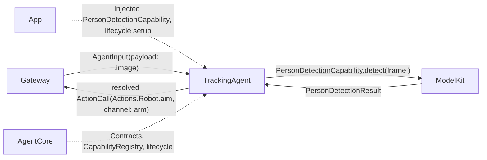
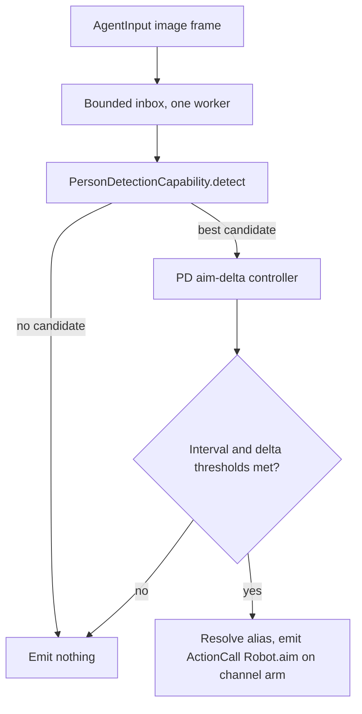

# Tracking — Deterministic Single-Target Aim Agent (Design Only)

Purpose: keep the phone's camera aimed at one detected person by driving the arm through `Actions.Robot.aim`. Design goals: no model inference in the control loop, bounded per-frame work, explicit throttling before emitting `ActionCall`s, and cancellation that stops both detection and pending arm commands. See [ADR 0035](../../../docs/adr/0035-tracking-agent-and-robot-actions.md) for the cross-module decision record and [MobileHarness/README.md](../../README.md) sections 6–24 for the target Agent contract.

- ❌ Nothing in this directory is implemented. This README fixes the design before any Swift source is added.

## Why this Agent does not use FunctionTokenParser

Architecture section 32 states the invariant explicitly: "Agent processing may use deterministic logic, models or tools; receiving a signal does not require model inference." `TrackingAgent` never holds a `ChatCapability`, never runs `AgentGenerator`/`FunctionTokenParser`, and never produces natural text. It still declares its Actions in `Tracking.agent.json` and resolves them through the same `CapabilityRegistry` every Agent uses (per [Agents/README.md](../README.md)) — the registry is what keeps `Actions/Robot` un-imported by this Agent, not a model-facing prompt. `textActions` is empty and `aim` is `hidden: true`, because no LLM ever renders a prompt for this Agent.

## Direct relationships



## Planned `Tracking.agent.json` sketch

Illustrative only; not a loaded resource yet.

```json
{
  "schemaVersion": 3,
  "agentID": "tracking",
  "channels": ["arm"],
  "textActions": [],
  "actions": [
    {
      "alias": "aim",
      "path": { "module": "Robot", "function": "aim" },
      "defaultChannel": "arm",
      "parameters": [
        { "name": "base", "valueType": "number", "required": true,
          "description": "Target logical base rotation angle, radians.",
          "constraints": "Finite; generic sanity bound only, physical limits enforced by the concrete arm adapter." },
        { "name": "shoulder", "valueType": "number", "required": true,
          "description": "Target logical shoulder angle, radians; elbow is derived to keep the camera level.",
          "constraints": "Finite; generic sanity bound only, physical limits enforced by the concrete arm adapter." }
      ],
      "examples": ["Not model-generated; this Action is never rendered to a prompt."],
      "doc": "Send a non-blocking aim target to the arm. Completion means the command was sent, not that the arm reached the target.",
      "hidden": true
    }
  ],
  "tools": []
}
```

`examples` is currently a placeholder string because the JSON v3 loader still parses every example through `FunctionTokenParser` to validate call structure (per `Agents/README.md`); a fully hidden, non-text-mapped Action with a trivial single-tag example (`"<aim base=\"0\" shoulder=\"0\"/>"`) satisfies that loader check today without implying the model ever sees it — the exact validated example string is an implementation detail to fix when `Tracking.agent.json` is actually written, not a design decision.

## Planned control algorithm (single target, Milestone 1)

1. **Input.** Receives `AgentInput(payload: .image(frame))` from Gateway at the camera's throttled sampling rate (design target: 10–15 fps, independent of the phone's native capture rate). Bounded inbox, one worker — same shape as `AssistantAgent`'s 32-slot inbox, but images replace text.
2. **Detect.** Calls `PersonDetectionCapability.detect(frame:)` (`ModelKit/Vision`, ❌ design only). No result caching across frames; each frame gets its own request, matching `ModelKit`'s per-request session isolation convention.
3. **Select.** Milestone 1 has exactly one candidate policy: highest-confidence person box. No multi-target scoring, no identity, no sticky-lock challenge window (`smart_capture.md` section 3.2's richer target selector is explicitly deferred).
4. **Compute aim delta.** A single PD-style controller (proportional + derivative on the normalized image-plane offset of the chosen box's aim point from the frame center) produces a target logical `(base, shoulder)` delta, reusing the dead-zone and non-linear small-error gain ideas from `smart_capture.md` section 4.2, adapted to one arm-only actuator (no separate fast gimbal to couple against, per ADR 0035 decision 9).
5. **Throttle before emitting.** Only emits `ActionCall(Actions.Robot.aim, channel: "arm")` when both a minimum interval has elapsed since the last emission and the computed target moved by more than a minimum angular delta. This is the primary defense against flooding the `arm` channel's 32-job bound; see ADR 0035 decision 8.
6. **No target.** When detection returns no candidate for a bounded number of consecutive frames, the Agent stops emitting `aim` calls entirely rather than sending a "return to center" command by default — an explicit re-center behavior is a follow-up decision, not silently implied here.



## Bounds and cancellation (design targets, not yet implemented)

- Inbox: bounded, explicit `queueFull` rejection on overflow — no silent frame drop at the Agent boundary, though Gateway-side frame *sampling* may itself skip frames before they ever reach the Agent (that throttling is `PlatformKit/Camera`'s responsibility, not this Agent's).
- One outstanding `detect` call at a time; a new frame does not cancel an in-flight detection, it queues behind the bounded inbox like any other input.
- `stop()` cancels the active detection call, discards the queued frame backlog, and does not emit a final "park" `ActionCall` implicitly — an explicit parking behavior, if wanted, is a caller-visible decision for a later milestone, not a hidden side effect of `stop()`.
- Cancellation never rolls back an already-sent `aim` command; per architecture invariant 12/13, only a fresh signal can correct the arm's position afterward.

## Explicitly out of scope for this Agent

Multi-target union/composition scoring, auto-zoom, the intelligent recording state machine, face recognition/identity, and any of the one-shot motion planners (orbit, patrol, headcount, vertical dolly, base sweep) from `smart_capture.md` sections 2, 6, 7 and 8. These would be either an extension of this Agent's control policy or separate Agents/Actions layered on the same `arm` channel; neither is designed here.

## Maintenance

Keep this README synchronized with implementation as soon as any file in this directory stops being documentation-only. ✅ means implemented; ❌ means planned. Do not add placeholder Swift files before the concrete detection capability and arm adapter they depend on are also ready to compile against.
