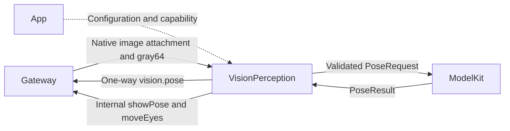
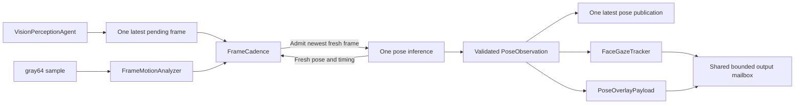

# Pose Perception, Adaptive Cadence and Gaze

## Summary

Processes the newest fresh camera frame, publishes validated pose facts and projects bounded skeleton/gaze display.

## Ownership and boundaries

This role owns detection cadence, image-motion evidence, pose association and gaze policy. PlatformKit captures/gray-samples; ModelKit owns YOLO preprocessing/inference. Photographer owns tracking/device decisions. Pose values belong to Support/Communication; display values belong to UI/Actions with ActionBindings adaptation.

## External relationships and data flow

Runtime arrows show data or capability calls; dashed arrows show injection.



<a id="输入订阅与输出契约"></a>

## Internal components



This role uses typed media requests and deterministic policy, with no Chat system prompt or role prompt asset.

## Input, workers and freshness

Retain one active inference and one latest pending image. Validate session, strictly increasing sequence, nondecreasing time, geometry and expiry. ImageValueAttachment<CameraFrame> retains the native frame; conversion to ModelKit.ImageFrame happens only after cadence admission. RGB input is upright/unmirrored RGB8 up to 640×640; attachment transport permits dimensions 1–4096 and ≤4,194,304 pixels. gray64 is a fixed 4096-byte sample.

Default cadence minimum/initial/maximum is 0/100/250 ms, with 750 ms maximum observation latency. Intervals must be finite ordered values within one second; latency is in (0,1] seconds. Future/expired/too-old inputs do not start. Stale results update only latency/cost feedback and expired counters, never pose association/ROI/publication/UI. Zero interval means immediate newest-frame processing after the single active inference finishes, not guaranteed FPS.

## Image-motion evidence

FrameMotionAnalyzer compares current gray64 against the inference reference, retaining a fixed global sample and ROI union. Subtract global luminance shift and adaptive noise before accumulating excess. ROI covers current/previous people expanded by 20%; accept only meaningful point support. Global support requires 16 changed points; ROI requires at least 16 samples and three changed points. Stable low-motion evidence updates noise at 10%, constrained to 1–6.

```text
G = sum(global excess) / 4096 / (0.08 * 16)
R = sum(ROI excess) / ROI samples / (0.2 * 12)
rateScale = clamp(0.1 / max(0.05, deltaTime), 0.5, 2)
A = min(1, max(G, R) * rateScale)
u = clamp((A - 0.1) / 0.4, 0, 1)  // applied when A >= 0.1
image demand = initialInterval * (1-u) + minimumInterval * u
```

A is normalized motion evidence, not changed-pixel percentage or a user threshold. The inference reference is replaced when inference starts; merely receiving a frame does not reset it.

## Pose demand and computation budget

Retain first-six COCO-17 person snapshots and total count. Nearest-centroid one-to-one geometry avoids array-order artifacts, without identity tracking. Reliable candidates require at least four in-image points with confidence ≥0.45 and mean ≥0.6. Association gate is max(0.08, prior span×0.6), normalized by image diagonal. Count changes, failed matching, confidence drop ≥0.15, loss of ≥4 visible points or fewer than four common points request fastest detection.

Compute common-joint body-relative speed after subtracting 0.003 diagonal jitter, using span floor 0.08. Speed ≤0.08 span/s becomes stable; ≥0.35 requests fastest detection; interpolate between. After 600 ms stability request slowest cadence. Newly lost targets search fastest for 500 ms, then approach 200 ms periodic search.

Fuse the shorter image/pose/latency demand. Shortening is immediate; lengthening uses alpha=1−exp(−min(deltaTime,1)/0.5). Total latency ≥75% of freshness budget caps demand at initial interval. Cost floor applies only when inference ≥75% of budget or dominates at least half of pressured latency: inference×1.5 capped by maximumInterval. Cost growth is immediate; decline uses 80/20 smoothing; no pressure clears the floor.

```text
interval = min(maximumInterval, max(minimumInterval, demandInterval, inferenceCost))
```

Geometry/rotation changes reset gray/ROI/noise/association/stability state but retain cost feedback; new sessions reset everything. Fixed state is 4096 gray bytes, 4096 ROI entries, six person snapshots and scalar counters; there is no image history or extra inference worker.

## Pose and presentation contracts

vision.pose permits up to 300 people, each exactly 17 COCO joints, upright/unmirrored pixel coordinates, finite x/y (possibly outside frame), confidence 0–1, sequence/time/rotation and dimensions 1–4096. Encoded limit is 256 KiB, validity one second capped by parent. Empty people is an observed empty frame. One independent publisher retains one latest pending pose; subscriber rejection does not stop local presentation.

showPose payload is ≤3000 UTF-8 bytes with at most six full COCO-17 people. Coordinates are integer normalized×10000, bounded −10000…20000; confidence is integer×1000 and out-of-frame confidence becomes zero. Optional same-frame statistics carry wait/inference/total latency, actual FPS, replacement count, next cadence and motion evidence. UI handles crop/mirroring and rejects stale sequence.

FaceGazeTracker requires two confident nose/eye points, prefers large reliable central faces and maintains a nearest spatial lock. Brief occlusion holds; recenter begins at 350 ms and lock releases at 550 ms. Deadband/adaptive smoothing and 20% gain produce x/y in [−1,1]. Crossing faces can exchange association; no identity model exists. No new result means no timeout-driven display change; camera cleanup resets gaze/overlay.

OutputMailbox has 18 total slots shared by discrete output and the `overlay`/`gaze` replacement keys; there is no per-kind reservation. Same-key state replaces its pending predecessor with counted coalescing. New entries at full capacity reject explicitly; accepted discrete entries are never replaced. Evidence retains 256 summaries. Stop cancels/joins inference and publication, closes receipts and never restores inference on restart.

## Registration and authority

[Agent.json](../../Resources/Agents/VisionPerception/Agent.json) subscribes to phone.camera media.image and publishes vision.pose. Internal UI.Pose.showPose and UI.Gaze.moveEyes are code-bound completion-only Tools; no model-callable functions or ordinary Chat worker exist. ModelKit request/scope identities are opaque SDK correlation values; session validation and business policy remain here.

## 待实现

- Person identity tracking, separate face/depth models and thermal feedback are not implemented.

[Agents](../README.md) · [Communication](../Support/Communication/README.md)

## Storage 依赖

✅ 存储访问使用独立的 State、Cache、Database 和 Files 接口；App 注册根实例，消费者通过构造器获得所需能力。存储容器不接管本目录的业务验证、执行和完成语义。

## Platform 根、设备接入与同帧呈现

✅ 原生相机输入使用 AgentCore 的 ImageValueAttachment<CameraFrame>，Gateway 不构造业务 SampledImageAttachment。感知层读取 CameraFrame 的 gray64，按采样接纳后才构造 ModelKit 输入；SampledImageAttachment 仍用于独立的数值采样输入/测试。

✅ overlay 输出按需保留对应 ImageInput 作为进程内附件，与序号/时间/方向相同的 Pose 经内部 Tool 一次呈现。普通 gaze/业务 pose 广播不保留像素。过期结果不呈现；模型运行错误按下述有界恢复契约处理，永久错误结束角色；相机影像由独立订阅更新。

## 视觉停顿恢复修复

✅ 仅模型 estimatePose 的运行错误允许继续处理后续最新帧：每次失败记录原因和计数，保持一个在途推理，等待 250 ms 后继续；连续第三次失败终止，模型成功返回重置计数。invalidRequest/sessionClosed/multipleConsumers 等永久契约错误立即终止。取消仍加入实际推理，不抛弃未完成的同步 Core ML 操作。其他输入/上下文/输出错误保持终止。

## 视觉静默停止与诊断补齐

✅ 接纳输入、推理开始/结束及新鲜结果时间组成健康快照。超过 3 秒推理未返回、输入停止或持续无新鲜结果时返回明确诊断，附序号、处理/过期/失败计数与最后模型错误。健康读取不等待模型、不启动重叠推理。外部输入失败发布带诊断的终态，即使尚未收到首帧也能上报。

✅ 根级消费检查媒体 Tool 的实际执行结果，将非取消的呈现失败纳入健康快照；一秒监视将其显示为 Agent 分类诊断和 toast，同一连续故障只报告一次，后续成功呈现清除该健康故障。

✅ 图像接纳只做会话、新鲜度、单调序号及类型验证，原子替换 latest 槽；移除接纳前未使用的上下文快照读取，避免帧接纳等待上下文持久化写锁。真正开始推理时仍读取已提交快照。回归使用被阻塞的真实仓库 commit 验证接纳能独立返回。

## 视觉 queueFull 修复

✅ 统一 outputReplacementKey 声明 overlay/gaze/pose 广播三个最新状态；角色邮箱和根级 Gateway 消费复用同一策略。姿态广播从生成端也采用最新替换，替换分别计数，不挤入离散输出。
