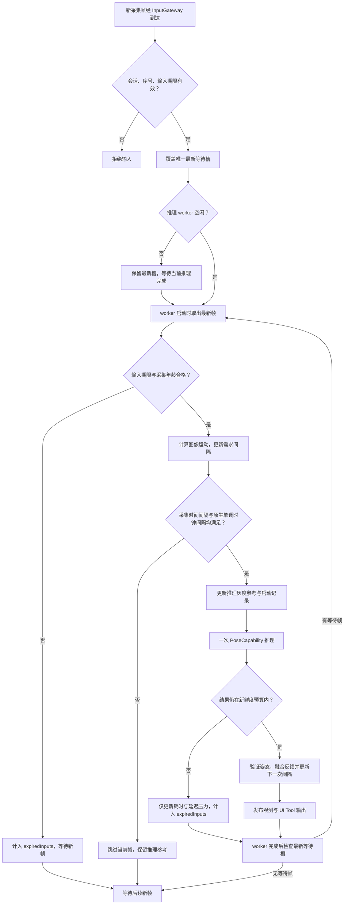
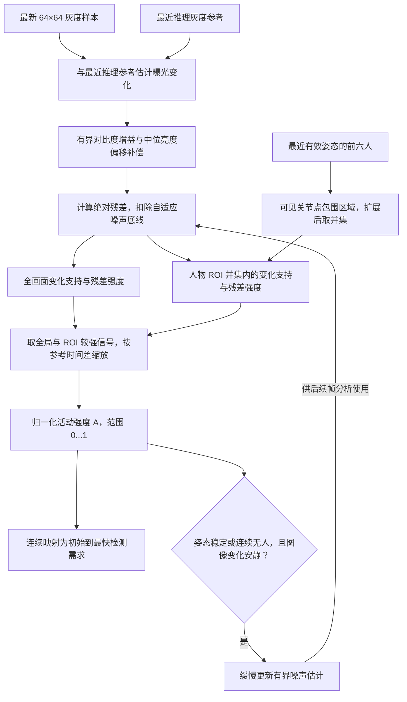
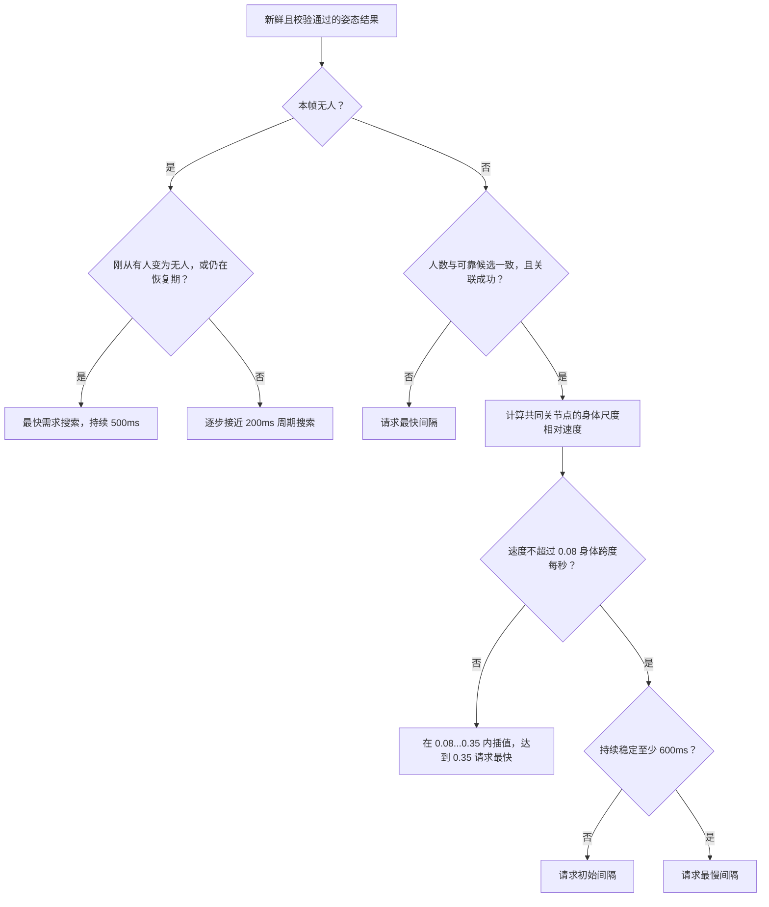
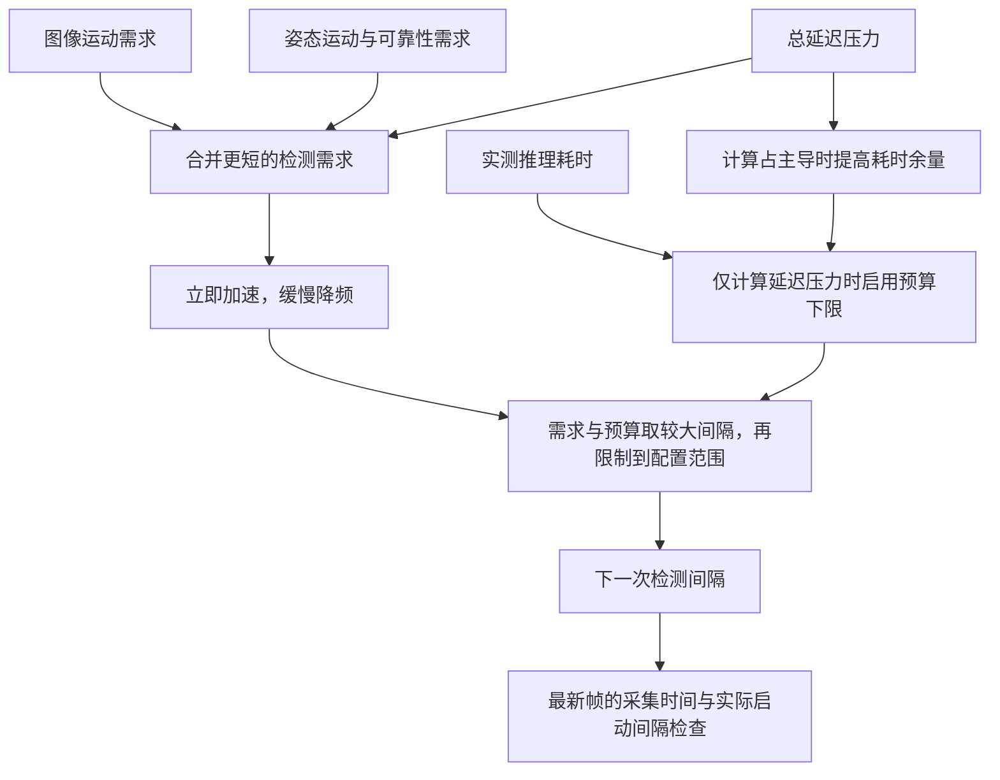
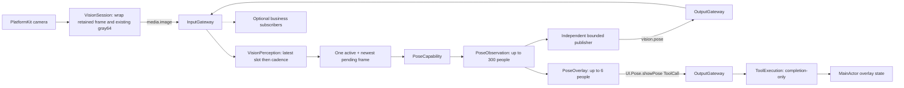

# Vision Perception

Purpose: own shared visual perception and its skeleton visualization. Design goals: one inference per accepted latest frame, typed observations for business subscribers, and direct UI Tool calls through OutputGateway. Camera motion and robot policy do not belong here.

```mermaid
flowchart LR
    InputGateway --> Latest[Every valid capture / one latest pending frame]
    Latest --> Cadence[Worker-start capture-time cadence]
    Cadence --> Model[One active injected PoseCapability]
    Model --> Observation[Up to 300 people / upright pixel joints]
    Observation -->|motion / confidence / cost feedback| Cadence
    Observation --> Pending[One latest pending observation]
    Pending --> Publisher[One publication worker]
    Publisher --> Publication[OutputGateway / InputGateway]
    Publication --> Subscribers[Optional business subscribers]
    Observation --> Overlay[Up to six people / bounded display coordinates]
    Overlay --> Generator[Code-owned UI.Pose.showPose permission]
    Generator --> Output[Latest skeleton / gaze pair]
    Output --> Gateway[OutputGateway / ToolExecution]
    Gateway --> Tool[UI.Pose.showPose completion-only Tool / injected presentation handler]
```



✅ VisionPerception.agent.json v5 contains communication policy and empty model catalogs. Code declares UI.Pose.showPose as an internal Tool with no Channel. Swift projects observations into PoseOverlay JSON (maximum 3000 bytes), constructs a typed internal ToolCall and emits one ToolCall per result. Empty people clears the overlay. No direct UI call or per-frame agent.finished is emitted; moveEyes is a separate resolved ToolCall. The registered Void handler completes without ToolResult feedback.

✅ Raw inputs have increasing sequence/timestamps and matching sessions. One worker processes a frame; every valid capture replaces the one latest pending frame independently of pixel changes. At worker start, expiry and capture-time cadence decide whether to infer that newest frame. Too-early frames are skipped without advancing the last inference timestamp; no older candidate is retained. Pause suspends dequeue, stop cancels/joins inference and suppresses late outputs. Shared observations retain up to 300 people independently of the six-person display limit.

✅ Publication uses a separate Agent-owned worker and one latest pending observation. Slow subscriber admission does not hold the inference worker or UI output. Pending observations are replaced explicitly (publicationReplacements); expired pending observations are skipped. Missing subscribers is allowed; ordinary publication errors remain recorded delivery outcomes and do not stop inference or display. Pause holds pending publication; stop cancels and joins inference and publication before finishing outputs.

✅ Presentation output is a capacity-two bufferingNewest stream: every fresh successful inference emits showPose followed by moveEyes, including neutral gaze. Only these two replaceable presentation states can be superseded, with separate overlayReplacements/gazeReplacements counters; arbitrary commands fail overflow. App awaits each admitted Tool handler before consuming the next state. The in-flight Tool remains outside the replaceable buffer and completes before the next state is dispatched. Terminal error may follow one buffered display state, finishes the stream, and cannot be overwritten by later results. OutputEnvelope holds correlation metadata rather than raw input media. A publication may retain its parent frame until delivery completes; active/pending publication slots bound that lifetime.

## 自适应动态检测算法

✅ 当前算法由 [FrameMotionAnalyzer.swift](FrameMotionAnalyzer.swift)、[FrameCadence.swift](FrameCadence.swift) 和 [VisionPerceptionAgent.swift](VisionPerceptionAgent.swift) 实现。图像运动、姿态运动与可靠性提供检测需求；推理耗时和总延迟提供预算与新鲜度约束。App 注入配置，ModelKit 执行单次姿态推理，UI 展示结果；调度策略由本 Agent 所有。

### 最新帧与检测时机

所有通过会话、序号和输入期限校验的图像都先覆盖容量为 1 的 `pending` 槽。已有推理继续完成；worker 空闲时才取出当时最新的一张图像，检查新鲜度、分析运动并判断间隔。运行中的推理期间，不逐张分析被覆盖的等待帧。

**算法只决定何时启动检测，不维护“通过灰度筛选的帧”队列。** 间隔未到时，当前取出的帧被跳过，等待后续新帧；没有 timer，也不重放旧图像。跳过的帧不推进最近推理时间或灰度参考，因此缓慢变化仍可累积。



上图省略取消、上下文校验及失败终止路径。原生输入携带 `capturedAt` 时，同时检查实际单调时钟启动间隔；缺少这个时间的输入只使用媒体时间戳间隔，不能计算采集年龄或总延迟。

### 图像运动：人物区域与全画面融合

`FrameMotionAnalyzer` 复用原生帧的 `gray64`。RGB 输入使用相同的像素中心采样和整数亮度权重，生成 64×64 样本。参考来自最近一次获准推理的帧，只有启动新推理才替换；几何尺寸或旋转改变时清空参考。



全画面证据用于发现新目标和大范围变化；ROI 证据让小人物的变化不会被整幅背景稀释。ROI 根据前六人的图内关节点生成，每人至少 4 个点且点置信度 ≥0.45，边界每侧扩展 `max(3 个采样像素, 区域跨度 × 15%)`。ROI 生成不要求后文姿态关联所用的平均置信度 ≥0.6。

| 步骤 | 当前计算与限制 |
| --- | --- |
| 对比度补偿 | 用灰度分布的第 10/90 百分位估计跨度；两幅跨度均 ≥24 时，增益限制为 0.8...1.25，否则使用 1。 |
| 亮度补偿 | 计算增益补偿后的像素差，减去全画面的有符号差值中位数。 |
| 噪声底线 | `T = clamp(3 × noise, 3, 16)`；每点有效变化为 `excess = max(0, abs(residual) - T)`。 |
| 全画面支持 | 至少 8 个点的 excess >0；否则全局强度为 0。 |
| ROI 支持 | ROI 至少覆盖 16 个采样点，且至少 3 个点发生有效变化；否则区域强度为 0。 |
| 时间缩放 | `rateScale = clamp(0.1 / max(0.05, Δt), 0.5, 2)`，Δt 为当前帧与推理参考的媒体时间差，单位秒。 |
| 噪声学习 | 只有稳定姿态或连续无人证据、A <0.1 且残差中位数 ≤6 时，才按 10% 权重更新 noise；估计值限制为 1...6。 |

图像运动强度的实现公式如下。分母是当前初始校准参数；强度是归一化运动证据，**不是变化像素百分比，也不是用户设置的筛帧阈值**。

```text
G = sum(global excess) / 4096 / (0.08 × 16)     // 满足全画面支持条件时
R = sum(ROI excess) / ROI像素数 / (0.2 × 12)   // 满足区域支持条件时
A = min(1, max(G, R) × rateScale)

A < 0.1：不增加图像运动需求，仍按周期检测
A ≥ 0.1：u = clamp((A - 0.1) / 0.4, 0, 1)
         图像需求间隔 = initialInterval × (1-u) + minimumInterval × u
```

### 姿态运动、可靠性与目标丢失

有效结果保留前六人的归一化 COCO-17 快照，同时记录全部人数以识别人数变化。使用最近质心做一对一几何关联，避免仅因数组排序变化就判断为运动；交叉人物仍可能交换关联，未提供身份识别。



可靠候选至少有 4 个图内点，点置信度 ≥0.45，平均可见点置信度 ≥0.6。关联距离不得超过 `max(0.08, 上一人物跨度 × 0.6)`，距离和跨度均以图像对角线归一化。平均置信度下降 ≥0.15、可见点减少 ≥4、共同点不足 4、人数变化或关联失败都会请求最快间隔。

速度取共同关节点的平均位移，先扣除 0.003 图像对角线的抖动底线，再除以当前与上一人物较大的跨度及时间差；人物跨度最低为 0.08 图像对角线。多人时取最大速度。图像运动需求可以覆盖姿态的降频请求，因此下一次 YOLO 结果尚未返回前，明显图像变化也能提前加快检测。

### 需求融合、耗时预算与新鲜度

`FrameCadence` 合并需求时采用较短的目标间隔，再施加计算预算。缩短需求立即生效；延长需求按 500ms 时间常数平滑，避免频率反复跳动。



| 参数或反馈 | 当前行为 |
| --- | --- |
| minimum / initial / maximumInterval | 默认 0 / 100 / 250ms；必须有限，0 ≤ minimum ≤ initial ≤ maximum ≤1s，maximum >0。 |
| maximumObservationLatency | 默认 750ms；必须有限且位于 (0,1] 秒。 |
| 需求降频 | `α = 1 - exp(-min(Δt, 1) / 0.5)`，延长时按 α 接近目标；缩短时直接使用目标。 |
| 延迟压力 | 总延迟 ≥新鲜度预算的 75% 时，把需求间隔压到不超过初始值，以更频繁地取得新快照。 |
| 计算余量 | 正常不施加耗时下限；推理耗时 ≥新鲜度预算的 75%，或有总延迟压力且推理占至少一半时，启用耗时 ×1.5 预算。 |
| 计算预算平滑 | 压力持续时预算增加立即生效，降低按 80% 原值与 20% 新值平滑；压力解除立即清除预算。预算上限为 maximumInterval。 |
| 最终间隔 | `min(maximumInterval, max(minimumInterval, demandInterval, inferenceCost))`。运动需求不能绕过预算或实际启动间隔。 |
| 输入新鲜度 | 输入期限已过，或原生采集年龄 ≥预算时，不启动推理；采集时间在未来也拒绝。 |
| 结果新鲜度 | 输入期限已过，或采集到结果的总延迟 ≥预算时，仅更新耗时/延迟反馈并计入 expiredInputs，不更新姿态关联、ROI、发布或 UI。 |

0ms 表示没有人为启动间隔：已有推理完成后立即处理最新等待帧，无新帧则等待；仍然只有一个活动推理。实际 FPS 由供帧速度、处理耗时及输出开销决定，不能由间隔保证。推理比 250ms 更慢时，单次活动操作自然限制实际 FPS。尺寸或旋转变化清空灰度参考、ROI、噪声、姿态关联及稳定/恢复状态，保留模型耗时预算；重建会话时全部状态重置。

### 有界状态与输出

✅ 持久算法状态包含一份 4096 个 UInt8 的灰度参考、一份 4096 项 ROI 并集、最多六人的 COCO-17 快照及标量时间/计数；临时数组大小固定。除此之外，Agent 仍只有一项活动推理和一项最新等待输入，没有新增 worker、帧队列或完整图像历史。

✅ 有效 Pose 与同帧统计一起生成 `UI.Pose.showPose`，沿 `OutputGateway → Gateway/Runtime → App 会话/序号校验 → UI` 更新骨架和左上角统计。统计中的间隔是反馈更新后用于下一次检测的间隔，实际 FPS 另按至少一秒窗口统计；图像运动强度为 0...1，尚无参考时为空。过期结果不会触发这条输出路径。

❌ 真机参数、持续功耗/发热、严重裁剪或非均匀曝光、小目标在 64×64 采样下的敏感度仍需验证。六人之外的详细姿态运动、交叉人物身份关联、独立人脸检测、深度和热状态反馈尚未实现。机器人运动策略不属于本 Agent。

## 输入、订阅与输出契约

以 [VisionPerception.agent.json](VisionPerception.agent.json) 和 [VisionPerceptionAgent.swift](VisionPerceptionAgent.swift) 为准。公共信封见 [Agents 输入输出约定](../README.md#输入输出文档约定)。

| 接收方式 | contract / version / kind | source / topic | 处理 |
| --- | --- | --- | --- |
| 静态订阅 | `media.image / 1 / image` | `phone.camera / media.image` | `AgentInput.payload = .image(ImageInput)`，来自 App VisionSession 的摄像帧适配，经 InputGateway 路由。匹配 session、严格递增 sequence、非倒退 timestamp，并检查接纳期限。 |
| 初始化注入，不是业务消息 | `PoseCapability`、`FrameSamplingConfiguration` | App | 能力执行一次姿态推理，VisionPerception 内部将传输附件转换为 ModelKit ImageFrame；配置提供默认 0...250ms 自适应间隔（初始 100ms）；启动时对最新帧判断，图像运动、结果运动/置信度、耗时及总延迟反馈更新节奏，不恢复固定灰度百分比筛帧。 |
| 生命周期，不是订阅 | `bind / start / pause / resume / stop` | App / AgentManager | 注入消息端口、管理两条有界 worker；没有外部指令或 ToolResult 输入。 |

```swift
// 输入结构摘要；真实定义在 Agents/Core/Input/ImageInput.swift。
ImageInput {
    width: Int; height: Int  // 正向推理图像的尺寸
    sequence: UInt64; timestamp: TimeInterval
    capturedAt: ContinuousClock.Instant? // 原生采集回调的单调时钟，用于延迟与新鲜度
    rotation: Int           // 传感器图像到正向图像的顺时针 90° 次数，0...3
    content: .rgb(Data)
          或 .attachment(any ImageAttachment) // 摄像头路径为 SampledImageAttachment，source 为 CameraImageAttachment
}
```

RGB 路径为正向、未镜像 RGB8，宽高各 1...640，字节数必须为 width × height × 3。当前摄像头走 attachment 路径：SampledImageAttachment 包装既有 gray64 和 CameraImageAttachment，后者持有原生 CameraFrame；宽高各 1...4096、总像素不超过 4194304。Gateway 不解析原生附件或执行模型预处理；VisionPerception 验证原生附件后构造模型输入。默认 image 接纳期限 1 秒，过期帧不进入推理/输出；帧率节奏由 Agent 内部控制；gray64 由 PlatformKit 在采集回调中生成，Agent 内的 FrameMotionAnalyzer 使用它作为运动证据，只影响检测时机，不改变最新帧的保存和选取规则。



### 共享感知数据：vision.pose

通过绑定端口发布 `.pose(PoseObservation)`，source 为 `visionPerception`，contract/topic 为 `vision.pose`、version 为 1。Photographer 在其 JSON 中声明订阅，用于独立的跟踪决策；无订阅者不阻止骨架显示。其他业务 Agent 也必须在自己的 JSON 中声明订阅。

```swift
PoseObservation {
    width: Int; height: Int           // 1...4096
    sequence: UInt64; timestamp: TimeInterval
    rotation: Int                    // 0...3
    people: [[Joint]]                // 0...300 人，每人恰好 17 个 COCO 关键点
}
Joint { x: Float; y: Float; confidence: Float }
```

x/y 是正向、未镜像图像的像素坐标，以左上角为原点，必须有限但可在图像外；confidence 为 0...1。共享观测只提取关节点，没有模型结果中的 bounding box、整个人置信度，也没有 tracking ID、动作指令或原始图像字段。编码校验上限 256 KiB，默认接纳期限 1 秒且受父输入期限约束。`people: []` 表示这一帧未检测到人，不是漏发数据。独立发布 worker 保留一项活动发布和一项最新等待观测，通信层不再合并状态，最新状态策略由 Agent 自己负责；不能依赖收到每帧。

people 内关节点数组的下标 0...16 固定为：nose、leftEye、rightEye、leftEar、rightEar、leftShoulder、rightShoulder、leftElbow、rightElbow、leftWrist、rightWrist、leftHip、rightHip、leftKnee、rightKnee、leftAnkle、rightAnkle。左右以被识别者自身为准；显示投影保留相同顺序。

### 显示数据：UI.Pose.showPose

代码内部权限产生 `ToolCall(id: UUID, toolPath: "UI.Pose.showPose", arguments: ["payload": String])`。payload 是以下 PoseOverlay 的 JSON 文本，最多 3000 UTF-8 字节；外层 arguments 的值仍是字符串。

```json
{"sequence":42,"timestamp":123.5,"rotation":1,"people":[]}
```

这是有效的清空骨架示例。非空时 `people` 为最多六个人的二维数组，每人必须有完整 17 个 COCO 点；单个点编码为 `[x, y, confidence]`，例如 `[5000, 2500, 900]` 表示图像宽度 50%、高度 25%、置信度 0.9，不是一个完整人的 payload。

| 字段 | 类型、单位与显示策略 |
| --- | --- |
| sequence / timestamp / rotation | 沿用输入帧的序号、秒级采集时间和旋转信息；UI 用帧序号拒绝迟到结果。 |
| joint.x / joint.y | Int，归一化坐标 ×10000；限制 -10000...20000，图外点 confidence 置 0。 |
| joint.confidence | Int，0...1000；从共享观测的 Float 量化。 |
| people | 从模型结果取前六人，按其置信排序；显示镜像和裁剪由预览层坐标转换处理。共享观测仍可保留最多 300 人。 |
| statistics | 可选的同帧等待/推理/总延迟（ms）、实际 FPS、替换帧数、下一次检测间隔（ms）与图像运动强度（0...1）；无采集时间或参考时相应字段为空。 |

Tool 经 `outputs → App transport pump → OutputGateway → Gateway/Runtime → MainActor handler` 覆盖骨架状态。无 Channel、无 Action 队列、无 ToolResult 回流；等待 handler 完成不等于等待屏幕绘制完成。外层 OutputEnvelope 用 inputID/sessionID 关联，Vision 的 envelope.sequence 和 payload.sequence 均为输入帧序号。

### 其他输出与 send 边界

| 方向 | 数据标准与语义 |
| --- | --- |
| Tool 输出 | `UI.Gaze.moveEyes`，无 Channel，`arguments["x"] / ["y"]` 为数值的十进制字符串，目标范围各为 -1...1；由 FaceGazeTracker 根据本帧脸部点位生成，未锁定目标时回中。它是显示方向，不是关节点像素坐标。与同一帧的 showPose ToolCall 组成可替换状态对。 |
| control 输出 | 推理失败发 `control("agent.error: pose processing failed")` 并终止流；不发每帧 `agent.finished`。终态控制不能被后续骨架覆盖。 |
| publish | `communication.publications` 仅有 `vision.pose`；typed payload、坐标单位、人数与容量按上文“共享感知数据”段落。该发布与骨架/眼睛 ToolCall 分离。 |
| send | `communication.sends = []`，不向其他 Agent 定向发送消息；Photographer 通过静态订阅接收 `vision.pose`。 |

JSON `actions / tools` 均为空；代码声明 UI.Gaze.moveEyes 与 UI.Pose.showPose 的 InternalTool 权限（均无 Channel）。❌ 摄影决策、机械控制与跟踪身份不在该 Agent 内实现。

## Eye attention policy

✅ FaceGazeTracker uses the existing YOLO Pose observation, without another model. At least two of nose/eyes must be visible with confidence ≥0.45; ears help estimate face span. Initial selection prefers larger, reliable, central faces. Subsequent selection uses nearest spatial association with a size-bounded gate, holds brief occlusion, starts recentering after 350ms without a match, and releases the lock after 550ms. Array reordering does not switch attention. This is geometric association, not identity tracking; crossing faces can still exchange the lock.

✅ A deadband and elapsed-time adaptive low-pass filter suppress jitter while responding faster to larger changes. Rotation resets association; upright coordinates are never rotated twice. App supplies front-camera mirroring once. x/y are screen directions in [-1,1], with 20% gain and clamping; display crop is not an exact projected-point overlay. SwiftUI handles continuous spring interpolation independently of expression. No synthetic random gaze or third-party animation library.

✅ Tracker state is one face, timestamps and one filtered target; candidate work is bounded by the existing 300-person observation limit. Updates are driven by new pose results; no extra task, timer or frame replay. Camera shutdown, failure and session replacement reset UI gaze. A stalled source with no new result retains the last display; an additional perception-driven timeout is intentionally deferred. Camera close already clears skeleton/statistics and gaze through the lifecycle owner.

```mermaid
flowchart LR
    Pose[Shared pose observation] --> Face[Confident facial points]
    Face --> Lock[Spatial lock / occlusion hold]
    Lock --> Filter[Deadband / adaptive smoothing]
    Filter --> Resolve[Code-owned gaze ToolCall]
    Resolve --> Gateway[OutputGateway]
    Gateway --> Tool[Gateway/Runtime: UI.Gaze.moveEyes validation]
    Tool --> Scene[Active camera session / sequence check]
    Scene --> Eyes[Native spring / stable eye shapes]
```



✅ `runtimeCapabilities(_:)` now supplies the same model-plus-internal capability snapshot to the Agent initializer and App startup validation. It does not duplicate or broaden grants, call Actions directly, or change JSON v6. ❌ Activity/resource ownership is not introduced.

## Action runtime stage 2

✅ The versioned configuration accepts action.result. receive validates runtime source and owner/session, stores in ActionResultInbox and returns without inference or output emission. actionResults() exposes bounded retained history. ❌ Automatic retry/replanning based on a result is not implemented.

✅ Receipt regression: runtime ActionResult is validated and consumed before image-only admission, without advancing frame sequence or invoking pose inference. Tests exercise receipt delivery through InputGateway followed by a new frame. ❌ This does not establish camera hardware acceptance.

## Action and Tool presentation boundary

✅ Gaze and skeleton are internal completion-only ToolCalls. Both are replaceable latest state, with explicit counters under the existing two-entry newest output bound. Neither enters Channel scheduling or Action history. ❌ No generic device-action coalescing is introduced.

✅ Optional subscriber admission failures increment publicationRejections and never stop local inference/showPose. Ordinary port/routing failures remain recorded delivery outcomes; missing recipients remain permitted. Startup configuration validation remains strict. No device commands are coalesced by this observation policy.

✅ All ordinary publication errors are recorded as outcomes, including closed ports and capacity rejection; visualization and inference continue. Explicit cancellation still stops owned work.

✅ Each showPose payload includes optional statistics: capture callback to capability start (including upstream/queue/preparation), capability-call duration, callback-to-result total latency, successful fresh-result FPS over windows of at least one second, and cumulative latest-slot replacements the next adaptive detection interval and optional normalized image-motion activity (0...1, not changed-pixel percentage). ContinuousClock measures elapsed time independently of image media timestamps. FPS is absent until the first window completes; session recreation resets counters. No timer, frame queue or extra output worker is added. ❌ UI rendering/sensor exposure delay and physical sustained performance are not measured.

✅ UI/Camera owns PoseOverlay and display statistics. VisionPerception owns its Encodable PoseOverlayPayload; Actions.PoseOverlay remains the independently validated callable-function payload. App maps callable payload values into UI values. UI has zero project dependencies; AgentCore has zero project dependencies. See ADR0121.

✅ PoseObservation is owned by Agents/Communication, while PoseOverlay remains in UI/Camera. COCO value validation belongs to the Agent message contract; cadence, gaze and observation projection remain here. AgentCore owns neither pose-value schema nor detection algorithms.

✅ Generic image transport carries an opaque attachment. SampledImageAttachment and the gray64 convenience initializer are grouped with FrameMotionAnalyzer; only this Agent requires a 4096-byte sample. Generic messages expose PerceptionMessage.pose through the business communication module. The scheduling algorithm and Tool payload are unchanged.

✅ CameraImageAttachment retains PlatformKit.CameraFrame without conversion. After cadence admission, VisionPerception validates transport dimensions, orientation, sequence and time against the capture and constructs ModelKit.ImageFrame from the retained buffer. RGB transport follows the same caller-owned conversion. App supplies no resolveImage closure. YOLO resizing/normalization/tensor conversion remains inside ModelKitYOLOPose. ❌ No device capture lifecycle is added.

✅ Input ordering/session rejection uses generic CommunicationError.outOfOrder/scopeClosed at this receiving Agent and cadence helper. ImageInputError.invalidFrame validates transport geometry/storage only; the types no longer contain receiver policy. ❌ No cadence or output serialization behavior changes.

✅ ADR0121 removes the Types module: AgentCore/Input owns generic audio/image transport, UI/Camera owns PoseOverlay, and VisionPerception owns PoseOverlayPayload. App adapts the independent Tool payload into UI values. ❌ Capability SDKs must not import consumer or presentation modules.

✅ ADR0156: canonical execution addresses use domain/module/function; Agent v6 bindings resolve native names separately. Existing serialization/resource and output permissions are preserved.


✅ ADR0157: canonical executable definitions and shared outcomes replace duplicate protocol metadata; consumers import Actions/FunctionContracts. Protocol request views remain adapters, and production permission/resource boundaries are preserved.

❌ Physical acceptance and additional business capability exposure are not established by this migration.
