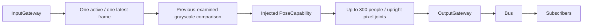

# Vision Perception

Purpose: share one pose inference per accepted camera frame among subscribers. Owns content-change selection and the injected PoseCapability, not UI or robot behavior.

✅ JSON v4 subscriptions; bounded native attachment lifetime; shared model operation; one latest pending frame; sequence/session validation; empty pose publication; expiry and replacement counters. Grayscale threshold and geometry/interval behavior are unchanged from the prior Gateway implementation.

✅ Stop cancels and joins inference; expired results are not published. The result is a bounded typed observation, not UI JSON. Photographer alone selects six people and quantizes display coordinates.

❌ Face detection, tracking, depth, robot control, collision sampling guarantees and device acceptance of this migration.

✅ Accepted input kinds derive from the JSON v4 communication snapshot; Swift retains handlers, not a duplicate production input registry.
