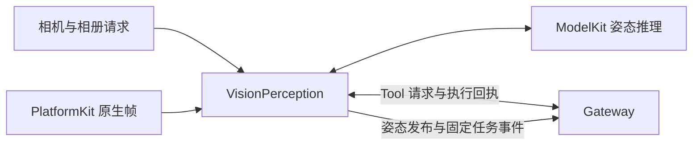
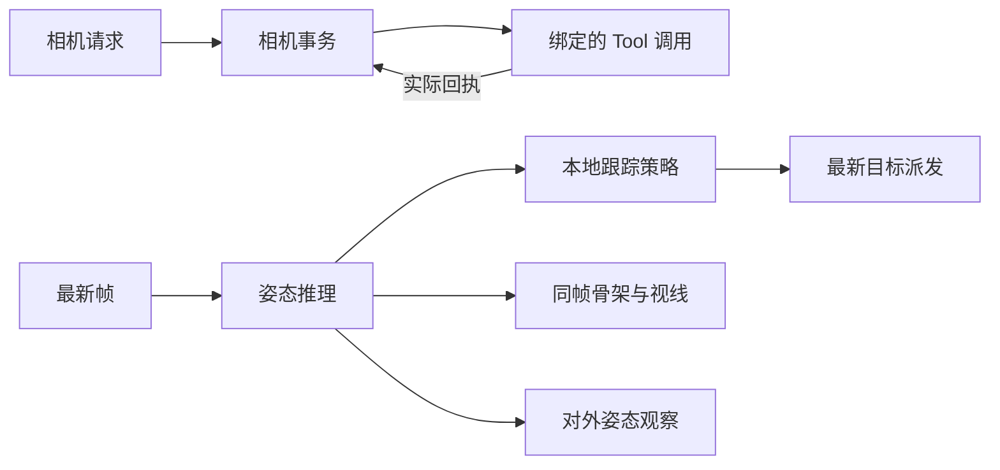

# VisionPerception

VisionPerception 是相机、相册、姿态推理、视觉展示与机械跟踪的常驻感知角色。根容器注册一个身份，绑定一个角色执行端。相机和相册请求可在姿态模型关闭时使用。Actions 拥有相机、图库和机械设备的实际操作，ModelKit 提供姿态模型与推理租约。

## 接口与生命周期



[VisionPerceptionContainer](VisionPerceptionContainer.swift) 投影摄影任务与运行状态，working 表示视觉采集代正在运行。常驻执行会话绑定相机与相册 UI。[VisionAgentSession](VisionAgentSession.swift) 按采集代绑定跟踪并启动帧订阅、推理、呈现和健康监控。打开视觉的调用与持续运行的采集任务拥有独立的请求链。关闭时取消并加入推理、发布、跟踪和该代输出，常驻角色继续受理相机事务。

## 职责与工作流



- [Input](Input/) 接纳相机、相册、固定任务与原生帧，订阅低频相机事实。
- [Workflow](Workflow/) 管理独立采集代、姿态推理、采样、视线和跟踪策略，以及具有请求身份的摄影事务。跟踪仅保留一个执行中的设备调用和一个待发送的最新目标。
- [Output](Output/) 绑定执行端、派发摄影与跟踪工具、编码骨架载荷。摄影岛依据真实相机事实更新。相机请求按请求 ID 对应结果，保留预览、录像及已保存媒体的身份。

业务调用以 tool.call.v1 到达 Actions，execution.call.result.v1 沿原请求返回。固定任务沿 agent.task.v1 接纳，沿 agent.task.events.v1 报告。对外保留 perception.vision.pose.v1；跟踪直接读取本代已接纳的姿态，设备故障独立报告。

## Input, workers and freshness

Retain one active inference and one latest pending image. Validate session, strictly increasing sequence, nondecreasing time, geometry and expiry. ImageInput.attachment retains CameraFrame directly; conversion to ModelKit.ImageFrame happens only after cadence admission. Only CameraFrame enters media processing; there is no RGB compatibility ingress or secondary sample wrapper. Native geometry permits dimensions 1–4096 and ≤4,194,304 pixels. CameraFrame.gray64 is a fixed 4096-byte sample.

Default cadence minimum/initial/maximum is 0/100/250 ms, with 750 ms maximum observation latency. Intervals must be finite ordered values within one second; latency is in (0,1] seconds. Future/expired/too-old inputs do not start. Stale results update only latency/cost feedback and expired counters, never pose association/ROI/publication/UI. Zero interval means immediate newest-frame processing after the single active inference finishes, not guaranteed FPS.

## Image-motion evidence

FrameMotionAnalyzer compares current gray64 against the inference reference, retaining a fixed global sample and ROI union. Subtract global luminance shift and adaptive noise before accumulating excess. ROI covers current/previous people expanded by 20%; accept only meaningful point support. Global support requires 16 changed points; ROI requires at least 16 samples and three changed points. Stable low-motion evidence updates noise at 10%, constrained to 1–6.

```text
G = sum(global excess) / 4096 / (0.08 * 16)
R = sum(ROI excess) / ROI samples / (0.2 * 12)
rateScale = clamp(0.1 / max(0.05, deltaTime), 0.5, 2)
A = min(1, max(G, R) * rateScale)
u = clamp((A - 0.1) / 0.4, 0, 1)  // applied when A >= 0.1
image demand = initialInterval * (1-u) + minimumInterval * u
```

A is normalized motion evidence, not changed-pixel percentage or a user threshold. The inference reference is replaced when inference starts; merely receiving a frame does not reset it.

## Pose demand and computation budget

Retain first-six COCO-17 person snapshots and total count. Nearest-centroid one-to-one geometry avoids array-order artifacts, without identity tracking. Reliable candidates require at least four in-image points with confidence ≥0.45 and mean ≥0.6. Association gate is max(0.08, prior span×0.6), normalized by image diagonal. Count changes, failed matching, confidence drop ≥0.15, loss of ≥4 visible points or fewer than four common points request fastest detection.

Compute common-joint body-relative speed after subtracting 0.003 diagonal jitter, using span floor 0.08. Speed ≤0.08 span/s becomes stable; ≥0.35 requests fastest detection; interpolate between. After 600 ms stability request slowest cadence. Newly lost targets search fastest for 500 ms, then approach 200 ms periodic search.

Fuse the shorter image/pose/latency demand. Shortening is immediate; lengthening uses alpha=1−exp(−min(deltaTime,1)/0.5). Total latency ≥75% of freshness budget caps demand at initial interval. Cost floor applies only when inference ≥75% of budget or dominates at least half of pressured latency: inference×1.5 capped by maximumInterval. Cost growth is immediate; decline uses 80/20 smoothing; no pressure clears the floor.

```text
interval = min(maximumInterval, max(minimumInterval, demandInterval, inferenceCost))
```

Geometry/rotation changes reset gray/ROI/noise/association/stability state but retain cost feedback; new sessions reset everything. Fixed state is 4096 gray bytes, 4096 ROI entries, six person snapshots and scalar counters; there is no image history or extra inference worker.

## Pose and presentation contracts

`perception.vision.pose.v1` on channel `perception.vision.pose` permits up to 300 people, each exactly 17 COCO joints, upright/unmirrored pixel coordinates, finite x/y (possibly outside frame), confidence 0–1, sequence/time/rotation and dimensions 1–4096. Encoded limit is 256 KiB, validity one second capped by parent. Empty people is an observed empty frame. One independent publisher retains one latest pending pose. Local presentation continues if a subscriber rejects delivery.

The bound role consumer uses `callTool` for `UI.Pose.showPose` and `UI.Gaze.moveEyes`. The request uses `tool.call.v1` and the actual completion returns on `execution.call.result.v1` for the session to consume. The session records non-cancellation failures for media presentation health.

showPose payload is ≤3000 UTF-8 bytes with at most six full COCO-17 people. Coordinates are integer normalized×10000, bounded −10000…20000; confidence is integer×1000 and out-of-frame confidence becomes zero. Optional same-frame statistics carry wait/inference/total latency, actual FPS, replacement count, next cadence and motion evidence. UI handles crop/mirroring and rejects stale sequence.

FaceGazeTracker requires two confident nose/eye points, prefers large reliable central faces and maintains a nearest spatial lock. Brief occlusion holds; recenter begins at 350 ms and lock releases at 550 ms. Deadband/adaptive smoothing and 20% gain produce x/y in [−1,1]. Crossing faces can exchange association; no identity model exists. No new result means no timeout-driven display change; camera cleanup resets gaze/overlay.

OutputMailbox has 18 total slots shared by discrete output and the overlay/gaze/pose-publication replacement keys; there is no per-kind reservation. Same-key state replaces its pending predecessor with counted coalescing. New entries at full capacity reject explicitly; accepted discrete entries are never replaced. Evidence retains 256 summaries. Stop cancels/joins inference and publication, closes receipts and never restores inference on restart.

## 健康、失败与生命周期

仅模型 estimatePose 运行错误允许继续后续最新帧：记录原始错误，等待 250 ms，连续第三次失败终止；成功重置计数。invalidRequest/sessionClosed/multipleConsumers 等永久契约错误立即终止。取消加入同步模型工作，不启动重叠推理。

接纳、推理开始／完成与新鲜结果时间形成健康快照；超过 3 秒推理未返回、输入结束或持续没有新鲜结果给出带序号／计数／最后模型错误的诊断。呈现实际失败也进入健康快照，由现有监视报告；同一连续故障只报告一次，成功呈现清除该项。

图像接纳只校验类型、会话、新鲜度与单调序号并原子替换 latest；实际推理读取已提交 Context。角色邮箱和会话绑定输出消费使用相同 overlay/gaze/pose 最新替换规则，离散结果不被状态更新挤掉。停止加入输入、推理、发布及回执，旧代结果不更新新代。

通信见 [Agent.json](../Resources/Agents/VisionPerception/Agent.json)。


## 基础相册实施契约

订阅UI.album并经身份绑定Gateway执行内部Album操作，根持有导入导出任务，停止取消并加入；相册不依赖相机开启。

## Execution ownership and lifecycle

Camera/device execution and CameraInteractionWorkflow belong to ActionsContainer. VisionPerception receives narrow App-bound access interfaces and UI-owned controls, owns authorization/tracking intent and cancels its execution scopes explicitly. Private album attachments validate request/session independently of role permission.

## Passive container state

当前角色在 `agents.visionperception` 同时暴露常驻角色状态和采集代的 `working`。AgentRuntime 为每次运行创建新的 Context scope，摄影事务与帧推理使用各自的私有 Context。持久化日志中的旧 `photographer` 来源保留事件发生时的身份。

stateSnapshot projects local installation/closure, Agent lifecycle/queue counters and initialized committed task/Skill fields without message content. residentContext() reads the repository’s last committed memory only; context fields are unknown before initialization. Agent start owns initialization/restoration and its failures. The root catalog binds independent readers without sampling roles or maintaining another mutable role-state registry.

The fixed camera input workflow includes takePhoto for the window shutter. Its authorized Tool is Camera.Capture.takePhoto, sharing the existing capture/receipt/ownership pipeline. Camera window management is handled by ApplicationControl; VisionPerception retains camera and album business requests.

Typed camera intent also includes perceptionOpen/perceptionClose/perceptionFlip/perceptionRetry, mapped to fixed Camera.Perception.openVision/closeVision/flipVision/retryVision calls. The same bounded request workflow and Gateway authorization apply. Pose/tracking scope exists independently of the photo window; stopping it joins tracking output before a replacement scope. Root model requirements include vision only while background visual demand is enabled.

## Capture enhancement requests

CameraInput maps to a bounded CameraCaptureIntent containing optional complete CameraCaptureSettings or a UUID recordingID. Intent validation enforces operation-specific fields before the role invokes fixed Capture.configure/cancelCapture or Video.startRecording/stopRecording/saveVideo/ignoreVideo. For startRecording the fixed Tool supplies waitForCompletion=false, acknowledging native startup without retaining the request until the movie ends. UI stop remains a separate ToolCall; it does not enter ChannelScheduler or model inference and can stop an Assistant's scheduled recording whose default completion waits for the ready file. The single pending request and source/session checks are shared with photo/lens controls; file/native work remains in Actions. UI countdown cancellation cancels and joins its existing request, or submits the fixed cancelCapture operation when the countdown was started elsewhere.

容器快照的 `business.lifecyclePhase` 公开本角色生命周期，取值见[角色 State 契约](../README.md#reflexive-state-reads-and-disclosure)。

[Input](Input/) 订阅相机、相册与帧输入，选择相机信号和推理帧。[Workflow](Workflow/) 推进相机操作、姿态推理与机械跟踪。[Output](Output/) 派发相册和视觉 Tool，接收调用回执并生成叠加层及灵动岛呈现。VisionPerceptionExecutionSession 在角色根目录管理注册和输出消费者的生命周期。
