# Vision Perception

Purpose: own shared visual perception and its skeleton visualization. Design goals: one inference per accepted latest frame, typed observations for business subscribers, and direct UI Tool calls through OutputGateway. Camera motion and robot policy do not belong here.

```mermaid
flowchart LR
    InputGateway --> Filter[Grayscale change admission]
    Filter --> Latest[One active / one latest pending frame]
    Latest --> Model[Injected PoseCapability]
    Model --> Observation[Up to 300 people / upright pixel joints]
    Observation --> Pending[One latest pending observation]
    Pending --> Publisher[One publication worker]
    Publisher --> Publication[OutputGateway / Bus / InputGateway]
    Publication --> Subscribers[Optional business subscribers]
    Observation --> Overlay[Up to six people / bounded display coordinates]
    Overlay --> Generator[CapabilityRegistry / JSON showPose tool alias]
    Generator --> Output[One latest pending skeleton]
    Output --> Gateway[OutputGateway / ToolRuntime]
    Gateway --> Action[UI.showPose Void tool / injected presentation handler]
```



✅ VisionPerception.agent.json v4 declares showPose in tools only, with no Channel. Swift projects observations into PoseOverlay JSON (maximum 3000 bytes), resolves the tool alias and emits one ToolCall per result. Empty people clears the overlay. No direct UI call, ActionCall or per-frame agent.finished is emitted. The registered Void handler completes without ToolResult feedback.

✅ Raw inputs have increasing sequence/timestamps and matching sessions. Grayscale compares previous examined frames. One worker processes a frame; one latest pending frame replaces older pending input. Pause suspends dequeue, stop cancels/joins inference and suppresses late outputs. Shared observations retain up to 300 people independently of the six-person display limit.

✅ Publication uses a separate Agent-owned worker and one latest pending observation. Slow subscriber admission does not hold the inference worker or UI output. Pending observations are replaced explicitly (publicationReplacements); expired pending observations are skipped. Missing subscribers is allowed; unexpected publication errors still fail the Agent and are surfaced through terminal control. Pause holds pending publication; stop cancels and joins inference and publication before finishing outputs.

✅ Skeleton output is a capacity-one bufferingNewest stream. Only pending UI.showPose state is replaceable (overlayReplacements), never generic Tools or physical commands. The App consumer awaits one active Tool and then takes the latest pending skeleton. Terminal errors replace an old skeleton and finish the stream; they cannot be overwritten by subsequent results. OutputEnvelope holds correlation metadata rather than raw input media. A publication may retain its parent frame until delivery completes; active/pending publication slots bound that lifetime.

✅ FrameChangeConfiguration keeps adjacent-examined-frame comparison and optional minimumInterval. Optional maximumRefreshInterval bounds admission starvation: after that interval, the next newly captured frame is accepted even with unchanged gray samples. App uses 0.1 seconds; nil preserves pure change-triggered behavior. There is no timer, no repeated sequence and no inference without a new frame. This is an admission policy, not a guaranteed FPS or deadline under load; idle-camera inference and power use can increase.


❌ Face detection, tracking, depth, robot movement and physical-device acceptance of this ownership change.


## 输入、订阅与输出契约

以 [VisionPerception.agent.json](VisionPerception.agent.json) 和 [VisionPerceptionAgent.swift](VisionPerceptionAgent.swift) 为准。公共信封见 [Agents 输入输出约定](../README.md#输入输出文档约定)。

| 接收方式 | contract / version / kind | source / topic | 处理 |
| --- | --- | --- | --- |
| 静态订阅 | `media.image / 1 / image` | `phone.camera / media.image` | `AgentInput.payload = .image(ImageInput)`，来自 App PhotographySession 的摄像帧适配，经 InputGateway 路由。匹配 session、严格递增 sequence、非倒退 timestamp，并检查接纳期限。 |
| 初始化注入，不是业务消息 | `PoseCapability`、`resolveImage`、`FrameChangeConfiguration` | App | 能力执行一次姿态推理，resolver 将传输附件转换为 ModelKit ImageFrame；筛帧配置控制 3% 阈值及 App 默认 100ms 新帧刷新。 |
| 生命周期，不是订阅 | `bind / start / pause / resume / stop` | App / AgentManager | 注入消息端口、管理两条有界 worker；没有外部指令或 ToolResult 输入。 |

```swift
// 结构摘要；真实定义在 AgentCore/ImageInput.swift。
ImageInput {
    width: Int; height: Int  // 正向推理图像的尺寸
    sequence: UInt64; timestamp: TimeInterval
    rotation: Int           // 传感器图像到正向图像的顺时针 90° 次数，0...3
    content: .rgb(Data)
          或 .sampled(gray64: Data, attachment: any ImageAttachment)
}
```

RGB 路径为正向、未镜像 RGB8，宽高各 1...640，字节数必须为 width × height × 3。当前摄像头走 sampled 路径：gray64 固定 4096 字节，附件不透明地持有原生帧；宽高各 1...4096、总像素不超过 4194304。Gateway 不解析原生附件或执行模型预处理；App 注入 resolver。默认 image 接纳期限 1 秒，过期帧不进入推理/输出；灰度筛选发生在 Agent 内。

```mermaid
flowchart LR
    Camera[PlatformKit camera] --> App[PhotographySession: gray64 + attachment]
    App -->|media.image| IG[InputGateway]
    IG --> Filter[VisionPerception: frame admission]
    Filter --> Latest[One active + newest pending frame]
    Latest --> Pose[PoseCapability]
    Pose --> Obs[PoseObservation: up to 300 people]
    Obs --> Pub[Independent bounded publisher]
    Pub -->|vision.pose| OG1[OutputGateway]
    OG1 --> Bus[Bus / InputGateway]
    Bus -.-> Future[Optional business subscribers]
    Obs --> Projection[PoseOverlay: up to 6 people]
    Projection -->|UI.showPose ToolCall| OG2[OutputGateway]
    OG2 --> TR[ToolRuntime: completion-only]
    TR --> UI[MainActor overlay state]
```



### 共享感知数据：vision.pose

通过绑定端口发布 `.pose(PoseObservation)`，source 为 `visionPerception`，contract/topic 为 `vision.pose`、version 为 1。当前运行中的其他 Agent 没有订阅它；无订阅者不阻止骨架显示。未来业务 Agent 需要在自己的 JSON 中声明订阅。

```swift
PoseObservation {
    width: Int; height: Int           // 1...4096
    sequence: UInt64; timestamp: TimeInterval
    rotation: Int                    // 0...3
    people: [[Joint]]                // 0...300 人，每人恰好 17 个 COCO 关键点
}
Joint { x: Float; y: Float; confidence: Float }
```

x/y 是正向、未镜像图像的像素坐标，以左上角为原点，必须有限但可在图像外；confidence 为 0...1。共享观测只提取关节点，没有模型结果中的 bounding box、整个人置信度，也没有 tracking ID、动作指令或原始图像字段。编码校验上限 256 KiB，默认接纳期限 1 秒且受父输入期限约束。`people: []` 表示这一帧未检测到人，不是漏发数据。独立发布 worker 保留一项活动发布和一项最新等待观测，Bus 也按最新状态规则合并未接纳的旧 pose；不能依赖收到每帧。

people 内关节点数组的下标 0...16 固定为：nose、leftEye、rightEye、leftEar、rightEar、leftShoulder、rightShoulder、leftElbow、rightElbow、leftWrist、rightWrist、leftHip、rightHip、leftKnee、rightKnee、leftAnkle、rightAnkle。左右以被识别者自身为准；显示投影保留相同顺序。

### 显示数据：UI.showPose

本地 alias `showPose` 解析为 `ToolCall(id: UUID, toolPath: "UI.showPose", arguments: ["payload": String])`。payload 是以下 PoseOverlay 的 JSON 文本，最多 3000 UTF-8 字节；外层 arguments 的值仍是字符串。

```json
{"sequence":42,"timestamp":123.5,"rotation":1,"people":[]}
```

这是有效的清空骨架示例。非空时 `people` 为最多六个人的二维数组，每人必须有完整 17 个 COCO 点；单个点编码为 `[x, y, confidence]`，例如 `[5000, 2500, 900]` 表示图像宽度 50%、高度 25%、置信度 0.9，不是一个完整人的 payload。

| 字段 | 类型、单位与显示策略 |
| --- | --- |
| sequence / timestamp / rotation | 沿用输入帧的序号、秒级采集时间和旋转信息；UI 用帧序号拒绝迟到结果。 |
| joint.x / joint.y | Int，归一化坐标 ×10000；限制 -10000...20000，图外点 confidence 置 0。 |
| joint.confidence | Int，0...1000；从共享观测的 Float 量化。 |
| people | 从模型结果取前六人，按其置信排序；显示镜像和裁剪由预览层坐标转换处理。共享观测仍可保留最多 300 人。 |

Tool 经 `outputs → App transport pump → OutputGateway → ToolRuntime → MainActor handler` 覆盖骨架状态。无 Channel、无 Action 队列、无 ToolResult 回流；等待 handler 完成不等于等待屏幕绘制完成。外层 OutputEnvelope 用 inputID/sessionID 关联，当前 Vision 没有递增其 envelope.sequence（默认 0），帧顺序来自 payload.sequence。

✅ 每次结果输出一个可替换 showPose 状态，不发每帧 agent.finished。失败输出 `control("agent.error: pose processing failed")` 并终止流；终态控制不能被后续骨架覆盖。`actions / channels / textActions / communication.sends` 均为空。❌ 摄影决策、机械控制与跟踪身份不在该 Agent 内实现。
