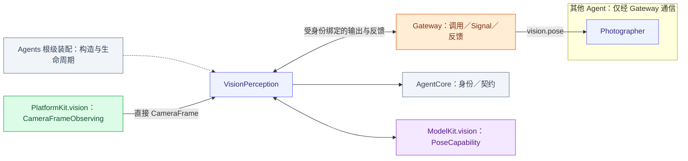

# VisionPerception — 相机帧消费、姿态与视线策略

## 角色容器

[VisionPerceptionContainer.swift](VisionPerceptionContainer.swift) 是 AgentContainer 的稳定子能力。持有至多一个捕获代任务，VisionAgentSession 在其内完成注册、原生观察和受保护输出消费。重叠 run 显式 busy；取消和 suspend 加入实际任务；根 stop 永久关闭容器。会话失败与清理失败分别保留。

生命周期由[模块根](../README.md#agent-container)统一编排；子容器能力不授予执行权。

## 职责与注入能力

构造注入 PlatformKit `CameraFrameObserving`、ModelKit `PoseCapability`、采样／镜像配置、会话身份及私有 Context。角色主动订阅原始 CameraFrame，负责节奏、运动证据、姿态关联、骨架和眼睛目标；不持有 UI 子容器、相机控制器或 Storage 根。

## 文件与职责

| 文件 | 职责 |
| --- | --- |
| [FaceGazeTracker.swift](FaceGazeTracker.swift) | 人脸目标选择与视线平滑 |
| [FrameCadence.swift](FrameCadence.swift) | 采样节奏、姿态需求与有界运动判据 |
| [FrameMotionAnalyzer.swift](FrameMotionAnalyzer.swift) | 图像运动证据的纯计算 |
| [PoseOverlayPayload.swift](PoseOverlayPayload.swift) | 推理观测到有界骨架调用载荷的转换 |
| [VisionAgentSession.swift](VisionAgentSession.swift) | 视觉角色注册、推理／输出分支和停止加入 |
| [VisionPerceptionAgent.swift](VisionPerceptionAgent.swift) | 视觉角色准入、单推理／最新候选和实际输出 |
| [VisionPerceptionCamera.swift](VisionPerceptionCamera.swift) | 原始相机帧的角色只读订阅 |
| [VisionPerceptionProcessing.swift](VisionPerceptionProcessing.swift) | 视觉私有 Context、预处理与采样配置 |

## 外部关系（一层）



角色间消息经 Gateway 递送；基础能力通过构造注入，输入订阅由角色持有。角色、Skill 与 Task 授权归 Agents；Actions 来源的协作接口由 App 以中立窄端口绑定，Agents 不导入 Actions、CallRuntime 或 ExecutionRuntime。

<a id="输入订阅与输出契约"></a>

## 内部结构与执行链

```mermaid
flowchart LR
 P["注入 Platform.vision：只读帧"]:::platform
 M["注入 ModelKit.vision：Pose"]:::model
 subgraph Role["VisionPerception"]
 N["Camera 消费／采集代／新鲜度"]:::agent
 L["一个 latest 待处理槽"]:::agent
 C["FrameMotionAnalyzer＋FrameCadence"]:::agent
 I["一个在途 Pose 推理"]:::agent
 O["PoseObservation／PoseOverlayPayload／FaceGazeTracker"]:::agent
 Q["有界 mailbox／最新状态替换"]:::agent
 end
 P --> N --> L --> C --> I --> O --> Q
 M <--> I
 Q --> G["Gateway：调度／Signal 递送"]:::gateway
 G --> X["UI.Pose.showPose／UI.Gaze.moveEyes"]:::action
 X --> U["UI.camera：同帧骨架；UI.home：眼睛"]:::ui
 G --> PH["Photographer：vision.pose"]:::agent
 classDef ui fill:#e0f2fe,stroke:#0284c7,color:#0c4a6e
 classDef platform fill:#dcfce7,stroke:#16a34a,color:#14532d
 classDef model fill:#f3e8ff,stroke:#9333ea,color:#581c87
 classDef storage fill:#fef3c7,stroke:#d97706,color:#78350f
 classDef agent fill:#eef2ff,stroke:#6366f1,color:#312e81
 classDef gateway fill:#ffedd5,stroke:#ea580c,color:#7c2d12
 classDef action fill:#ffe4e6,stroke:#e11d48,color:#881337
 classDef host fill:#f1f5f9,stroke:#64748b,color:#334155
```



`VisionPerceptionCamera.swift` 拥有唯一原生订阅及私有 ProcessingContext。start/resume 建立，pause/stop 关闭接纳并取消加入。订阅不请求权限、不启动／切换设备。相机预览由 Actions 相机执行服务直接呈现，不等待姿态推理；模型结果经受保护 Tool 呈现，同帧附件由 Actions 校验原生类型和 UI 代际。

## Input, workers and freshness

Retain one active inference and one latest pending image. Validate session, strictly increasing sequence, nondecreasing time, geometry and expiry. ImageInput.attachment retains CameraFrame directly; conversion to ModelKit.ImageFrame happens only after cadence admission. Only CameraFrame enters media processing; there is no RGB compatibility ingress or secondary sample wrapper. Native geometry permits dimensions 1–4096 and ≤4,194,304 pixels. CameraFrame.gray64 is a fixed 4096-byte sample.

Default cadence minimum/initial/maximum is 0/100/250 ms, with 750 ms maximum observation latency. Intervals must be finite ordered values within one second; latency is in (0,1] seconds. Future/expired/too-old inputs do not start. Stale results update only latency/cost feedback and expired counters, never pose association/ROI/publication/UI. Zero interval means immediate newest-frame processing after the single active inference finishes, not guaranteed FPS.

## Image-motion evidence

FrameMotionAnalyzer compares current gray64 against the inference reference, retaining a fixed global sample and ROI union. Subtract global luminance shift and adaptive noise before accumulating excess. ROI covers current/previous people expanded by 20%; accept only meaningful point support. Global support requires 16 changed points; ROI requires at least 16 samples and three changed points. Stable low-motion evidence updates noise at 10%, constrained to 1–6.

```text
G = sum(global excess) / 4096 / (0.08 * 16)
R = sum(ROI excess) / ROI samples / (0.2 * 12)
rateScale = clamp(0.1 / max(0.05, deltaTime), 0.5, 2)
A = min(1, max(G, R) * rateScale)
u = clamp((A - 0.1) / 0.4, 0, 1)  // applied when A >= 0.1
image demand = initialInterval * (1-u) + minimumInterval * u
```

A is normalized motion evidence, not changed-pixel percentage or a user threshold. The inference reference is replaced when inference starts; merely receiving a frame does not reset it.

## Pose demand and computation budget

Retain first-six COCO-17 person snapshots and total count. Nearest-centroid one-to-one geometry avoids array-order artifacts, without identity tracking. Reliable candidates require at least four in-image points with confidence ≥0.45 and mean ≥0.6. Association gate is max(0.08, prior span×0.6), normalized by image diagonal. Count changes, failed matching, confidence drop ≥0.15, loss of ≥4 visible points or fewer than four common points request fastest detection.

Compute common-joint body-relative speed after subtracting 0.003 diagonal jitter, using span floor 0.08. Speed ≤0.08 span/s becomes stable; ≥0.35 requests fastest detection; interpolate between. After 600 ms stability request slowest cadence. Newly lost targets search fastest for 500 ms, then approach 200 ms periodic search.

Fuse the shorter image/pose/latency demand. Shortening is immediate; lengthening uses alpha=1−exp(−min(deltaTime,1)/0.5). Total latency ≥75% of freshness budget caps demand at initial interval. Cost floor applies only when inference ≥75% of budget or dominates at least half of pressured latency: inference×1.5 capped by maximumInterval. Cost growth is immediate; decline uses 80/20 smoothing; no pressure clears the floor.

```text
interval = min(maximumInterval, max(minimumInterval, demandInterval, inferenceCost))
```

Geometry/rotation changes reset gray/ROI/noise/association/stability state but retain cost feedback; new sessions reset everything. Fixed state is 4096 gray bytes, 4096 ROI entries, six person snapshots and scalar counters; there is no image history or extra inference worker.

## Pose and presentation contracts

vision.pose permits up to 300 people, each exactly 17 COCO joints, upright/unmirrored pixel coordinates, finite x/y (possibly outside frame), confidence 0–1, sequence/time/rotation and dimensions 1–4096. Encoded limit is 256 KiB, validity one second capped by parent. Empty people is an observed empty frame. One independent publisher retains one latest pending pose; subscriber rejection does not stop local presentation.

showPose payload is ≤3000 UTF-8 bytes with at most six full COCO-17 people. Coordinates are integer normalized×10000, bounded −10000…20000; confidence is integer×1000 and out-of-frame confidence becomes zero. Optional same-frame statistics carry wait/inference/total latency, actual FPS, replacement count, next cadence and motion evidence. UI handles crop/mirroring and rejects stale sequence.

FaceGazeTracker requires two confident nose/eye points, prefers large reliable central faces and maintains a nearest spatial lock. Brief occlusion holds; recenter begins at 350 ms and lock releases at 550 ms. Deadband/adaptive smoothing and 20% gain produce x/y in [−1,1]. Crossing faces can exchange association; no identity model exists. No new result means no timeout-driven display change; camera cleanup resets gaze/overlay.

OutputMailbox has 18 total slots shared by discrete output and the overlay/gaze/pose-publication replacement keys; there is no per-kind reservation. Same-key state replaces its pending predecessor with counted coalescing. New entries at full capacity reject explicitly; accepted discrete entries are never replaced. Evidence retains 256 summaries. Stop cancels/joins inference and publication, closes receipts and never restores inference on restart.

## 健康、失败与生命周期

仅模型 estimatePose 运行错误允许继续后续最新帧：记录原始错误，等待 250 ms，连续第三次失败终止；成功重置计数。invalidRequest/sessionClosed/multipleConsumers 等永久契约错误立即终止。取消加入同步模型工作，不启动重叠推理。

接纳、推理开始／完成与新鲜结果时间形成健康快照；超过 3 秒推理未返回、输入结束或持续没有新鲜结果给出带序号／计数／最后模型错误的诊断。呈现实际失败也进入健康快照，由现有监视报告；同一连续故障只报告一次，成功呈现清除该项。

图像接纳只校验类型、会话、新鲜度与单调序号并原子替换 latest；实际推理读取已提交 Context。角色邮箱和会话绑定输出消费使用相同 overlay/gaze/pose 最新替换规则，离散结果不被状态更新挤掉。停止加入输入、推理、发布及回执，旧代结果不更新新代。

通信见 [Agent.json](../../Resources/Agents/VisionPerception/Agent.json)。
