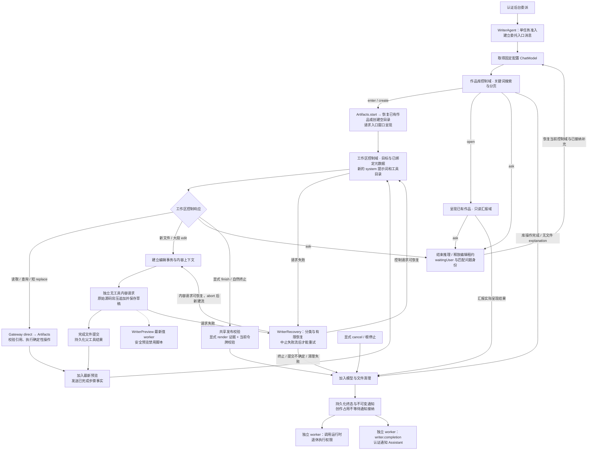

# Writer — 私有流式创作工作流

WriterWorkflow 消费独立注入的 ModelKit.ChatCapability，要求原生工具支持。控制请求选择工具、短编辑意图或经过读取校验的短literal补丁；edit返回运行时流身份后，单独无工具请求输出原始文件内容，逐个增量等待宿主追加，避免源码 JSON/XML 转义和丢失。WriterTools 由宿主绑定身份和范围，模型不能创建授权。

控制历史按完整调用/结果组裁剪，保留本次目标及最新配对；不设置固定创作轮数或整任务期限；委托统一通过显式 finish 结束。控制轮只返回正文时，运行时在恢复预算内要求补交工具调用。编辑任务通过Gateway发布校验，纯作品库任务核对实际成功库操作，显式 outcome=explanation 在尚无文件操作时完成无产物说明，成功后直接结束，不额外要求一轮模型调用。控制响应文本与源码流均不设额外字节截断，模型采用 Provider 默认输出预算；原生参数与完整观察不设置单项字节拒绝，源码响应不受历史层256KiB累积上限限制。取消会取消模型会话并中止写入；中止失败与原始错误同时保留。未正常结束的流不得完成事务。每个检查点读取追加要求，文件流期间不切换目标。

WriterAgent 是独立 AgentCore 角色，WriterContainer 随 Agents 根注册、暂停、恢复和关闭。来自 Assistant 的后台 task.request 请求通过真实 Input/OutputGateway 认证；工作区工具直接返回，不进入 ChannelScheduler。单任务准入（等待补充、暂停和取消清理也占用），每任务通过 ModelKit ChatModel 获取固定模型配置的能力句柄，暂停/补充期间保留；SDK 统一管理并发/本地排队和资源回收，Writer 不关闭或重开模型租约。Writer 不复用 Assistant 的 ChatWorker、XML、提示词或对话历史。

工作区工具与内容续写共享同一个委托所有者，但完成边界不同：Gateway 的 edit 结果仅创建编辑流；append/complete/abort 经宿主 ArtifactStreaming 直接进入已接纳会话，单次 complete 只完成文件写入。取消、根暂停和停止先取消已捕获的生成 worker 并 revoke 续写准入，再加入这些 worker；worker 负责加入模型、预览和 release 后才提交终态或允许恢复。revoke 不取消已开始的 abort；release 等待全部在途效果，不因取消者自身退出而提前释放。恢复经 Gateway start/resume 重新接纳，旧 streamID 无效。Actions 根另有 shutdown 兜底。普通 Scene 隐藏不撤销创作会话。服务的互斥、容量与失败契约见 [Artifacts 生命周期](../../Actions/Artifacts/README.md#执行与续写生命周期)。

Assistant 不参与创作循环或通过聆听/对话关闭终止 Writer；应用根拥有角色暂停/关闭，显式cancel在清理完成后确认。任务输入队列上限八项，满时拒绝；追加要求在文件检查点取出，写入恢复上下文。ask 工具发送带 interactionID 的 waitingUser 进度，结束当前推理并释放编辑租约；匹配输入后重新读取草稿继续。显式取消加入执行清理；根的显式暂停保存未完成内容并中止请求，恢复重建工作区和私有上下文；普通Scene隐藏不触发该暂停链路。窗口生命周期不决定任务生命周期。终态发送简短文本；有实际作品发布时附artifactID，纯库查询不伪造作品身份，不携带源文件。模型与文件清理完成即释放创作占用，SQLite 原子保存执行终态和通知；通知接纳、回复或播报不影响下一次委托。

控制工具失败以有界观察反馈供下一轮修正；同一规范化参数的失败调用在草稿未改变时只执行一次，再次生成只返回原错误及修复建议，不重复执行效果。未推进草稿的恢复阶段最多接纳三次失败修正，耗尽才结束。成功编辑/移动/删除/恢复草稿后清除失败屏障，读取/查询不清除。成功的作品查询清除依赖搜索结果的失败缓存；成功 render 只清除因 renderRequired 拒绝的 finish 缓存，重试仍经过发布校验，不重置恢复次数。可恢复请求进入 Writer 自有有限恢复；取消、提交不确定或清理失败立即终止。无效结束批次整体不执行并反馈修正；批次异常保留当前调用原始错误并为未执行兄弟调用补齐结果。完整配对后才添加截图或重复调用提醒。截图最多保留当前一张，不支持视觉的模型继续使用渲染文本和诊断。

## 创作执行流程

本目录拥有 WriterAgent/WriterContainer 的业务工作流。Assistant 发起委托的通用认证与调度链路见[总体委托流程](../../README.md#assistant-agent-delegation)；下图只展开 Writer 接纳后的执行、文件、呈现和通知边界。

图中的恢复边返回所属控制/内容请求；内容重试必须先加入 abort，并创建新流，不能重复追加旧前缀。预览是独立 worker，源码接收不等待页面重载；步骤汇报才加入已安排的最新预览。完整渲染与发布失败保留实际证据，不能用通知接纳替代文件或清理成功。各队列、恢复次数、暂停/停止及补偿契约见下文对应章节和 [Artifacts](../../Actions/Artifacts/README.md)。

## 编辑工作流与格式 Instruction

Writer 的 workspace 工具声明参数约束，文件编辑 Skill 教学操作顺序和失败修复。控制模型按需列出/查询文件、按行读取相关片段，用 contextReferences 将实际关联内容送入独立内容请求；新建/大段源码不进入工具参数，replace仅携带短精确旧/新文本。后续用户修订同时进入控制历史和内容请求目标。HTML/CSS/JS、Markdown、JSON、SVG 和纯文本的生成规则由 Writer 按目标扩展名选择。

工作区内的文件操作使用独立控制提示和工具目录。进入后只携带原始目标、已接受补充、绑定的工作区身份与入口呈现状态。已有文件先读再改。新目录先创建声明的入口文件。最后一次修改后使用 render 检查再 finish 发布。内容模板由 content.base 与对应格式的模板组合。

WriterPreview拥有默认安全预览：源码追加或确定性修改只唤醒一个latest-value worker，经Gateway direct内部preview读取最新词法检查点，约750ms合并，一个在途加一个最新待呈现状态。页面重载不阻塞源码接收。相同快照跳过。显式关闭结束该窗口的预览。最小化期间更新最新快照，用户恢复窗口后继续渲染。Scene 隐藏加入并取消当前预览 worker，保留最新刷新意图。render/finalize/abort先取消并加入预览，根生命周期加入worker；run独立实例和加入屏障防止迟到帧。完整render执行脚本并提供诊断，截图缺失不宣称视觉验证。

工具支持目录前缀列举、按行/字符范围读取、带总数与继续位置的字面搜索、读取引用局部编辑、文件/目录移动与删除、savepoint/diff/restore。移动后模型负责修复链接/import。savepoint 是编辑会话内的多文件撤销点，随会话释放。保存使用当前令牌防止过期写入，不保留文件版本。相关业务和存储规则见 [Artifacts](../../Actions/Artifacts/README.md)。

## SQLite 历史与设置页

WriterHistory 为每个真实控制/内容请求建立独立输入和模型请求记录，由本侧 WriterHistoryStore 与 WriterRecordStore 保存。生产装配显式注入 WriterMessageRepository、WriterExecutionRepository、AgentMessageRepository 和 ModelRequestLogRepository；无记录器仅用于显式测试实例，不是生产存储回退。完整文本/native pairs、工具定义、工具输出、用量、完成原因与失败/取消收尾保存到 SQLite。temperature 来自实际请求，控制与内容请求均不指定输出 token 上限，由 Provider 使用模型默认值；model 来自独立 ChatModel 的模型名称；不可用时明确标记名称未知。流增量先按既有 Chat 契约累积，结束边界提交；中断按现有 SQLite 恢复语义标记 interrupted，不重放操作。

委托 Task ID 与项目目标保留在 decisionMetadata/请求上下文，不加入 Assistant 的 Task message-source 集合。Writer 任务保持独立输入/请求身份，复用有界历史仓库写门。工具结果在独立内容请求结束后更新原控制记录，并显式 checkpoint。SQLite 保存失败会终止本次请求并保留原始/清理错误，不能报告虚构持久化成功。

WriterHistory 将实际 ChatRequest.tools 的完整声明写入本轮 decisionMetadata.catalogJSON，数量和字节上限由 ChatRequest 校验；工具集合随 Writer 消息业务保存，不额外写入输入级定义数组。详情直接投影本轮目录，并独立呈现模型工具调用/结果。

WriterHistory 在每次请求准入时截取最后一个 assistant 之后的 user/tool 输入，保存 WriterInputMessage 文本、工具名和关联 ID；完整历史和系统提示仍只属日志。WriterMessageRepository 将本轮输入存入 user_input_json.messages，清空日志后详情仍能展示，容量计入 Writer 历史窗口。

模型输入截图字节只在 model_request_log 保存，历史页读取 HTTP 或 local 请求中的实际图片，清日志后不回退相册。独立媒体库不参与聊天图片关联。

WriterContainer 通过 UI 自有 WriterRecordsControlling 提供分页任务、请求详情及完整记录分享。 任务页和请求页查询 21 条轻量记录、只返回前 20 条；只有存在第 21 条才附下一游标，游标对应第 20 条而非前瞻行。空页及恰好整页的末页均无下一游标，UI 不自行猜测。请求详情按稳定记录 ID 返回 WriterRequestDetails，聚合轮次标题、所选模型调用、已核实的工具来源及历史宿主收尾。App 组合记录接口与 Actions.Artifacts 的文件预览和导出能力。

WriterWorkflow 为控制/内容的每次实际请求创建独立 ChatTiming，并将同一请求及采样器交给模型；成功、失败和取消收尾均把已有Provider采样写入WriterHistory。未知Provider计时保持未知，不由文本消费时刻补造。请求完成时间由Storage记录，工具执行不改变模型完成边界。WriterContainer 投影任务开始时间、更新时间和累计轮数，标题保持长期 task 身份；不再遍历委托累计时长或提供任务级最新状态。执行轮次仍保留自己的运行状态与失败证据。

生成指标使用所选调用的日志证据，缺少参数或耗时可独立呈现。新委托的完成结果归属显式 finish 工具调用。历史宿主收尾按模型调用 ID 读取。

WriterRequestNaming 从工具与控制域派生请求行标题，包括作品查询、进入、创建、呈现、文件编辑与保存。文件内容阶段按目标路径命名，多工具按顺序去重合并，过长/含源码标记的instruction不作标题。没有操作事实时使用中性描述，不请求模型生成标题。请求失败/取消/中断优先保留，其后才判断工具失败、取消和在途状态；模型结束不等同工具操作成功。完整证据始终在请求详情。

## 委托与主动事件

Assistant 的 BasicSkill 通过调度的 XML task.delegate(agent_id=writer,description) 发送目标与实际用户输入，Writer 先获取模型判断操作；首次文件操作才通过工作区 start/resume 准备窗口和草稿，单纯作品库操作不创建文件。agents.writer 公开 idle/starting/running/waitingUser/cancelling/paused、agentID、taskID、goal、step、waitingForInput。已有窗口不等于运行任务；单任务忙碌明确拒绝。task.send 由运行时绑定待答 interactionID，Writer验证其匹配；task.cancel(agent_id,reason) 转换为可信 cancel 信号并立即接纳，由根拥有的 worker 加入清理并回报。

AgentTaskContent.writerEvent 携带版本2、UUID eventID、递增 sequence、started/progress/userInput/completed/declined/failed/cancelled 与可选项目/窗口身份。工作区就绪、文件提交和实际渲染/修改步骤回报事实，不生成虚假进度比例。运行阶段由内存 reportWorker 投递 task.progress，每种事件最多保留一项待送达事实及一个不可变在途事件；新的同类阶段替换未发送旧阶段，任务结束移除过期步骤。实际接纳由 CommunicationReceipt 决定，拒收每500ms重试，不终止创作。

Database 根目录拥有连接、schema 装配与生命周期；Shared 只保存编码、ID 与分页机制。Assistant 和 Writer 分别拥有消息/任务接口、历史 DTO、窗口及 SQL 实现。日志和 Agent 通信通过独立共享端口注入，不经统一 Chat/Task 门面。详见 [Database](../../Storage/Database/README.md)。

暂停/关闭加入创作和投递 worker，未送达终态留在同一 SQLite；恢复或新进程只重投通知，不重跑创作，也不重建旧执行权限。跨进程退休遇到已关闭 scope 时保留证据并结束退休分支，用户通知继续独立递送。Assistant 使用可信 SQLite 执行状态对账 busy、替代和发送消息；对用户的通知不是任务释放条件。

Writer 私有控制提示只教本角色的选择、文件操作、追问与完成；ask/finish 由宿主发送回报，Writer 不生成 XML 调度或自行拼接跨 Agent 消息。独立内容请求只处理格式与文件编写，不承担角色协调。

### Assistant 接收与用户汇报

默认 BasicSkill 的后台入口与 task.start 平级，同一目标不先建立前台 Task，也不加载 Skill；运行时发送单行 goal 与当前真实用户输入。单任务忙碌时明确拒绝，Assistant 根据用户意图选择补充或取消；再次委派必须等待旧执行清理，不能因为通知尚未到达而重复创作。忙碌由 WriterMessages 的单活跃委托入口约束；Assistant 通过可信通信结果更新委派视图。具体公开参数由 [Task Actions](../../Actions/System/Task/README.md) 拥有。

Writer 自有灵动岛直接显示接纳、补充、取消、进度、追问和终态。Assistant 对 started/userInput 只更新关联视图。普通进度留在 Writer 的灵动岛、窗口副标题和 State。真实用户输入发生后才由模型处理。追问保存 interactionID，补充必须匹配当前委派及追问。终态经 writer.completion 持久投递，Assistant 验证不可变通知后更新视图并标记消费。回馈不创建语音或 Assistant 模型回合。

Writer 接收 task.request、task.input 和 task.cancel。工作区工具结果直接返回调用方。task.progress 与 writer.completion 通过绑定注册身份的 AgentMessaging 直接取得投递报告。独立收尾 worker 加入执行清理并退休原授权。旧委派终态不能覆盖新执行。投递失败保留出站状态并独立重试。

## Writer 自有任务与纯通信

Assistant 只发送 task.delegate(agent_id,description)，不分配 Writer workspace。Writer 接纳认证通信后创建委托入口消息，模型自主查询或选择。模型可以在选择工作区前用 finish(outcome=declined,summary) 拒绝无法完成的目标。拒绝理由通过持久 writer.completion 回报，使用未成功的运行时终态收尾。纯库操作可以完成而不创建 workspace；busy/waiting/paused/cleanup 不自动替换。

create 和 enter 的触发请求保留发起时的历史归属。Writer 在历史写门内 checkpoint 后绑定编辑工作区。后续读取、编辑与发布使用该目标，模型消息携带 workspace_id。open 展示指定作品并保持当前阶段，同一轮可顺序执行最多八个 open。

writer_workspaces 保存 workspace 及文件 fence；writer_messages 保存委托入口、执行状态及完整消息。前序与 workspace 消息由字段区分，来源从持久化关联读取，不从当前请求兜底。Assistant 前台任务与 Writer 执行独立。

Artifacts 使用 WorkspaceID(writer,taskID)。显式 create 建立空目录并准备入口窗口，enter 复用已有目录并打开或聚焦窗口，open 只呈现已有作品。窗口隐藏时记录 deferred。会话内暂停或追问恢复使用 resume 并尊重关闭或最小化。旧回调仍校验委托范围。

## 失败诊断

WriterDiagnostics.swift 分类模型网络、HTTP、响应协议、模型配置、工具、存储、工作流、取消和清理错误。每次控制/内容请求保留阶段、模型、输入ID、尝试次数和单调耗时；WriterDiagnosticCapture保存最新未恢复请求失败，成功请求清除过期原因，不拥有重试。工具失败附实际命令/路径并区分读取、编辑、渲染和发布。清理失败独立保留原始原因及清理原因，不覆盖主错误。

通信使用 WriterFailureDiagnostic；Writer目录显式投影为 StorageChat.ModelFailureDiagnostic，存入请求/工具 evidence，另将分类摘要保存到任务 failure。失败经 Gateway control 输出 AgentFailureDiagnostic，同时通过 WriterTaskEvent.failure 传给 Assistant。首页显示简短摘要，请求历史展示结构化分类/阶段/字段；无法从过去仅有 transport 字符串的记录反推已丢失的 URLError。

## 自有任务岛

WriterIslandPresentation 根据 Writer 自身生命周期发布开始、真实步骤、等待补充、暂停恢复和取消清理。通过角色内部 UI.Island.present/end 工具经 Gateway direct 执行，不进入 ChannelScheduler，也不加入模型工具定义，不调用 Assistant 前台 startTask/finishTask。清理及终态持久化完成后展示结果、拒绝理由或失败摘要约 15 秒。Writer 拥有单个可取消的撤下定时器，新委派覆盖旧活动内容。收尾失败也显示失败摘要。诊断和独立通知保留错误证据。关闭活动不会关闭作品窗口，不影响语音或其他生产者。

独立呈现 session、稳定活动 UUID 和递增 revision 与 Assistant 会话及执行权限分离；同一根后续任务复用活动，新委托、等待和终态改变 expansionID。旧委托 和终态后的迟到进度被域内围栏拒绝，通知重投不会重放呈现。发布机制复用 [AgentIslandPublication](../Support/README.md)，只有一个在途和一个最新待发命令，结束命令参与同一 revision 围栏。失败通过 presentationFailure 公开，暂不可用每500ms重试最新事实，不影响创作、SQLite终态、新委托或 Assistant 通知。根停止先取消并加入 worker，再通过仍有效的权限尝试撤下并加入最后一次 end；失败保留证据，不启动无限清理重试。Scene隐藏保留域内容，由 UI 决定本地隐藏和系统摘要。

Writer 只构造简短目标/步骤、紫色图标、语义优先级和详情阶段；显示投影不会截断模型输出或持久历史。动画、几何、优先级仲裁、手动收起及语音顶部并存由通用 Island 组件统一拥有。Assistant/Task 日志不参与此链路。

## Bounded recovery

WriterRecovery permits at most three attempts for a model request, with cancellable500ms/1000ms backoff. Transient transport/HTTP and recoverable response failures retry; authentication/configuration, TLS, cancellation, storage and cleanup failures do not blindly retry. Natural terminal responses enter the shared publication check; missing publication prerequisites receive runtime correction; failed tools and invalid batches have a bounded correction episode. Repeated successful calls receive advisory context at3/5/8 repetitions without imposing a total creative-step budget.

Failed content generation joins abort before a fresh stream starts; no prefix is appended twice. Uncertain commit and abort failure stop without replay, preserving original and cleanup causes. Every actual attempt and paired tool outcome remains in SQLite. WriterRecoveryFailure retains phase, attempt count and last classified cause. Writer publishes recovery progress itself; Assistant never redelegates to implement retries.

Control retries append a structured runtime failure observation with category/code/stage/details, attempt, known effects and recovery guidance to the next request; successful retry carries that observation into subsequent steps. Unsuccessful control responses execute no workspace effects. Content retries add the actual cause only after abort/cleanup succeeds; uncertain commits and cleanup failures remain terminal. Tool failures retain original call/result pairing and structured diagnosis. Native argument payloads have no per-call byte ceiling and are excluded from the text-selection budget; provider token constraints remain explicit.

### 恢复上下文与完整证据

Resume reconstructs delegation-local user/reply and settled native call/result groups from the bounded recent business request window, retaining the last failed-request diagnosis. It does not depend on deletable debug prompt snapshots. Old system instructions are rebuilt; old read/stream/savepoint identities require fresh reads. Selection retains complete native groups under existing message/text budgets; complete historical evidence remains in SQLite.

Accepted user revisions also update the pinned current goal before context selection, so removing an older group cannot silently lose an accepted requirement.

Complete tool observations are checkpointed before model projection. Only model-visible oversized results are reduced to explicit UTF-8-safe head/tail excerpts under the existing text budget, with a notice that complete evidence is recorded and omitted content can be paged. This does not alter actual files/results or turn an executed operation into failure.

## Raw source and bounded correction

Code-format content streams (HTML/CSS/JS/JSON/SVG) validate the initial prefix across deltas. An outer Markdown code fence fails with writer.content.markdownWrapper before commit; abort joins, a fresh stream is allocated, and the existing bounded retry includes explicit raw-source feedback. Markdown and text keep legitimate fences. This checks source packaging, not language validity; WebKit render remains the execution check.

Each workspace tool has its own parameter schema projected from the registered function. The Writer runtime exposes its own control tools and authorizes internal preview and publication separately. Character ranges are decimal offsets inside a fresh read reference. Omitting offsets replaces that read range. A positive read count selects the requested number of lines or characters. Edit instructions and related reads pass through to the content request without Writer-specific length or item quotas. Pre-dispatch invalidParameters becomes a repairable WriterToolFailure with validationCode and executed=false; undeclared fields are rejected rather than ignored. The common capability registry and Gateway remain unchanged. Instructions require the smallest goal-complete artifact and finish after successful checks, without unsolicited cosmetic rewriting.

`replace(path,reference,oldText,newText)` 校验当前文件读取引用、版本与范围，并要求oldText在范围内唯一匹配；失败不改草稿，空newText删除匹配。所有范围外字节保持原样，文件修改使原引用失效。此短补丁直接经Gateway执行，不启动第二次内容请求；成功后需要重新render。新建和大段改写继续使用edit源码流，不扩展原生参数边界。

## 请求可见性与快速收尾

每个实际模型attempt在SQLite建立身份和producerMetadata后，调用模型前只更新Writer自己的任务岛，包含inputID、跨run累计number、phase、attempt和path。本地进度对应已经结束的模型生成及其实际步骤：控制请求成功准备编辑后汇报准备结果，再进入独立内容模型；内容提交及父工具结果持久化后汇报文件修改；普通控制轮在工具结果后汇报。进入下一模型请求前先加入已安排的最新预览，未改源码不额外重载。请求ID去重，同一请求不会因多个工具重复汇报；最终请求用终态，取消后迟到步骤不会覆盖取消状态。首画面与失败恢复仍报告实际事实，追问独立投递。收尾前处理已接纳补充，finish 的结果保存在该轮的工具调用和结果中。历史目录保存每个工具的真实地址和参数。恢复只向模型提供当前工具集可识别的调用配对，旧工具调用以历史事实的形式提供。

指令要求最小满足目标、尽早产生可见主体，不添加未请求动画/图纸信息，不反复读取刚生成文件；窗口不可见记录验证受限并收尾。Provider输出默认值及现有有限恢复不变。WriterContainer提供轻量WriterRequestItem分页，完整内容按消息ID按需读取；任务摘要以受控对话创建时间和中立timelineCount查询计算总轮次，不以已加载页数计数。

请求累计计数不等于已经完成的文件数。

云端Writer新委托/续作模型选择默认关闭或最低思考；设置页可显式开启。模型选择与思考策略在句柄取得时确定，当前执行及其恢复沿用原快照，不因表单编辑重启创作。

控制/内容请求统一经 InferenceSession.withCleanup 消费，解析、写入异常及取消均加入该请求原生清理；任务终态保留清理屏障。固定 ChatModel 跨暂停和补充保持选择，资源卸载与本地排队归 SDK。

## 窗口命名、操作副标题与场景

Writer 新项目使用 create 的显式简洁标题。指令要求使用“软件工程流程图”“星轨动画”“项目总结文档”等作品名；续作默认保留标题，rename(title)用于明确改名。标题由Artifacts随草稿/发布持久化，HTML document.title不覆盖业务窗口名。

灰色栏先使用原始目标，随后更新实际控制/文件生成/工具操作、轮完成摘要、等待补充与保存/异常事实，不呈现源码或思维。Writer通过Gateway direct的内部workspace.describe更新，运行时subtitle不进入模型工具schema；展示失败单独记录，不改变创作结果。模型编辑和命名仍通过workspace工具执行。

AgentContainer.setSceneActive只通知Writer预览可见性，不pause/resume创作；根的显式暂停/停止仍拥有取消/检查点/加入语义。模型、文件、报告和生命周期由Writer继续运行，UI隐藏仅影响渲染。后台render返回deferred，文件可以发布，但结果明确未进行视觉验证；指令禁止为此反复render或要求用户切回前台。系统是否继续分配CPU由iOS决定，本契约不保证无限后台运行。

App 为前台用户委托及追问答复注入可选的 WriterBackgroundExecution。每个执行段使用独立身份，实际完成的回合推进系统进度。Writer 写入终态或保存追问并清理后释放执行时间。系统过期回调只作用于匹配的活跃执行段，取消并加入推理与文件流，已落盘草稿保留。发布与终态清理由原有屏障完成。提交拒绝记录在 Writer 的 runtime 诊断，前台任务可以继续。原生调度由 [App Lifecycle](../../App/Lifecycle/README.md) 管理。

Writer history is request-scoped. Workspace selection changes only the target for newly admitted messages; the existing journal and invocation IDs remain unchanged. Workspace files remain owned by Storage Files and WorkspaceStore.

## Model request recording

Agents 的 AgentModelRequestRecording 将 ModelKit 中立 HTTP 采集回调桥接到共享 model_request_log，记录实际请求、响应/SSE、图片和 generation meta。非 HTTP 调用标 local。业务输入、回复和工具结果分别在 assistant_messages / writer_messages；清日志不会删除业务消息，图片与生成信息随日志删除。后续采集仅 UPDATE，不重建已清除日志。

Request admission checks durable requestStatus before creating an entry message. Requested communications are accepted without a preallocated workspace; terminal duplicates are ignored, while storage failures propagate instead of being treated as an absent request. beginRequest/task/requests/completeRequest describe Writer-owned state; the wire delegateID remains a communication correlation, not an externally assigned task.

Writer灵动岛使用Gateway的内部完成模式执行：权限、资源、结果失败仍由原执行链校验，结果
由呈现调用方直接消费，不向Writer或Assistant的输入通道发送ToolResult，也不触发创作续轮。

Writer history uses the shared full recorder; screenshot files are not separately published merely for logs. Records detail reads Base64 from request logs. Its clear operation delegates to StorageChat: one request_N or the shared entire log library; task, workspace, replies and execution records remain. Late updates cannot recreate cleared logs.

Writer续写从保留的业务请求input、response和已完成native call/result组重建上下文，最多24条／32000字节，按整组裁剪。它不读取可删除的完整请求日志，清空日志不改变续写或工作区。失败诊断独立保留；未完成工具组不会被恢复成孤立tool消息。

通知投递使用共享通信 outbox 的 claim token 与有界退避；暂停释放当前 claim，恢复只重投消息，不重做创作。权限退休与面向用户的完成通知分开确认。

历史 Prompts 图片由日志独占；本目录不提供相册或预览缓存的历史图片回退接口。实时相机和独立相册的读取不受日志清理影响。

Database 根目录拥有连接、schema 装配与生命周期；Shared 只保存编码、ID 与分页机制。Assistant 和 Writer 分别拥有消息/任务接口、历史 DTO、窗口及 SQL 实现。日志和 Agent 通信通过独立共享端口注入，不经统一 Chat/Task 门面。详见 [Database](../../Storage/Database/README.md)。
WriterContainer 和 WriterAgent 在接纳前核对消息、任务、通信和日志的 storageScope；不同数据库实例的端口不能混装。WriterHistoryStore 的 scope 与其消息仓库一致，显式无历史记录器只用于测试。

## 作品库与工作区分域

searchWorkspaces(query,before?) 在 SQLite 内匹配标题、描述或明确任务 ID。每页最多十二项，回传真实 title、taskID、entry、state 与可选 nextBefore。空查询用于用户明确要求浏览时的分页。同一搜索的返回 ID 才可用于 enter、open 和 delete，目标不清楚时使用 ask。

create(title,entry) 显式创建目录与空草稿，临时占位由窗口呈现层拥有。enter 打开已有编辑目标。两个动作成功后切到编辑域，下一请求自动使用文件编辑 Skill。open 返回实际窗口结果并保持当前阶段。模型根据检索结果选择 open 或 enter。编辑阶段可通过 enter 切换到另一件作品，也可按用户授权创建并切换。Writer 加入旧预览、释放会话、保留草稿，然后准备新目标并替换 SQLite 活动绑定。失败时恢复旧编辑会话并要求重新读取；取消或恢复失败进入委托清理。finish 以单独调用结束委托，发布当前作品。文件编辑使用 render 与 publish 校验。

作品库域加载 [writer-workspace](../../Resources/Skills/WriterWorkspace/Skill.json)。编辑域加载 [writer-file-editing](../../Resources/Skills/WriterFileEditing/Skill.json)，通过 Skill 依赖保留作品库教学和工具。两份 Skill 经同一加载器声明本轮工具与教学；共享注册表生成 native schema。enter、create、ask 和 finish 由 Writer 本地执行，其他工具经 Gateway；执行前按当前域校验已声明的工具与参数。ask 使用 question，finish 使用 summary。原始文件内容使用独立的无工具请求。

## 私有指令与公开介绍

Resources/Agents/Writer/Agent.json.description 提供公开用途。Instructions.md 保存私有共用身份，Prompts.json 的 control.library 和 control.workspace 分别管理作品库和编辑两个控制域。每个控制请求持久化域标识，恢复只加载当前域的调用/结果配对。无工具内容请求继续使用 content.base、格式模板和 content.retry。
