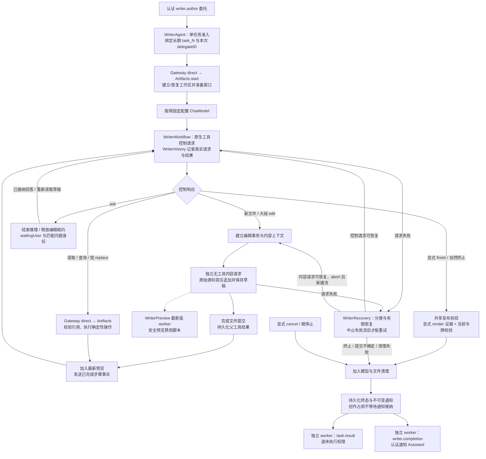

# Writer — 私有流式创作工作流

WriterWorkflow 消费独立注入的 ModelKit.ChatCapability，要求原生工具支持。控制请求选择工具、短编辑意图或经过读取校验的短literal补丁；edit返回运行时流身份后，单独无工具请求输出原始文件内容，逐个增量等待宿主追加，避免源码 JSON/XML 转义和丢失。WriterTools 由宿主绑定身份和范围，模型不能创建授权。

控制历史按完整调用/结果组裁剪，保留本次目标及最新配对；不设置固定创作轮数或整任务期限；显式finish及正常无工具终止共用Gateway发布校验，成功后直接结束，不额外要求一轮模型调用。控制响应文本与源码流均不设额外字节截断，模型采用 Provider 默认输出预算；原生参数与完整观察不设置单项字节拒绝，源码响应不受历史层256KiB累积上限限制。取消会取消模型会话并中止写入；中止失败与原始错误同时保留。未正常结束的流不得完成事务。每个检查点读取追加要求，文件流期间不切换目标。

WriterAgent 是独立 AgentCore 角色，WriterContainer 随 Agents 根注册、暂停、恢复和关闭。来自 Assistant 的后台 writer.author 请求通过真实 Input/OutputGateway 认证；工作区工具直接返回，不进入 ChannelScheduler。单任务准入（等待补充、暂停和取消清理也占用），每任务通过 ModelKit ChatModel 获取固定模型配置的能力句柄，暂停/补充期间保留；SDK 统一管理并发/本地排队和资源回收，Writer 不关闭或重开模型租约。Writer 不复用 Assistant 的 ChatWorker、XML、提示词或对话历史。

Assistant 不参与创作循环或通过聆听/对话关闭终止 Writer；应用根拥有角色暂停/关闭，显式cancel在清理完成后确认。任务输入队列上限八项，满时拒绝；追加要求在文件检查点取出，写入恢复上下文。ask 工具发送带 interactionID 的 waitingUser 进度，结束当前推理并释放编辑租约；匹配输入后重新读取草稿继续。显式取消加入执行清理；根的显式暂停保存未完成内容并中止请求，恢复重建工作区和私有上下文；普通Scene隐藏不触发该暂停链路。窗口生命周期不决定任务生命周期。终态发送简短文本和artifactID，不携带源文件。模型与文件清理完成即释放创作占用，SQLite 原子保存执行终态和通知；通知接纳、回复或播报不影响下一次委托。

控制工具失败以有界观察反馈供下一轮修正；同一规范化参数的失败调用在草稿未改变时只执行一次，再次生成只返回原错误及修复建议，不重复执行效果。未推进草稿的恢复阶段最多接纳三次失败修正，耗尽才结束。成功编辑/移动/删除/恢复草稿后清除失败屏障，读取/查询不清除。可恢复请求进入 Writer 自有有限恢复；取消、提交不确定或清理失败立即终止。无效结束批次整体不执行并反馈修正；批次异常保留当前调用原始错误并为未执行兄弟调用补齐结果。完整配对后才添加截图或重复调用提醒。截图最多保留当前一张，不支持视觉的模型继续使用渲染文本和诊断。

## 创作执行流程

本目录拥有 WriterAgent/WriterContainer 的业务工作流。Assistant 发起委托的通用认证与调度链路见[总体委托流程](../../README.md#assistant-agent-delegation)；下图只展开 Writer 接纳后的执行、文件、呈现和通知边界。

图中的恢复边返回所属控制/内容请求；内容重试必须先加入 abort，并创建新流，不能重复追加旧前缀。预览是独立 worker，源码接收不等待页面重载；步骤汇报才加入已安排的最新预览。完整渲染与发布失败保留实际证据，不能用通知接纳替代文件或清理成功。各队列、恢复次数、暂停/停止及补偿契约见下文对应章节和 [Artifacts](../../Actions/Artifacts/README.md)。

## 编辑工作流与格式 Instruction

Writer 的 workspace 工具声明完整描述参数、失败修复和操作顺序。控制模型按需列出/查询文件、按行读取相关片段，用 contextReferences 将实际关联内容送入独立内容请求；新建/大段源码不进入工具参数，replace仅携带短精确旧/新文本。后续用户修订同时进入控制历史和内容请求目标。HTML/CSS/JS、Markdown、JSON、SVG 和纯文本的格式规则由 Writer 按目标扩展名选择，不加载动态 Skill。

WriterPreview拥有默认安全预览：源码追加或确定性修改只唤醒一个latest-value worker，经Gateway direct内部preview读取最新词法检查点，约750ms合并，一个在途加一个最新待呈现状态。页面重载不阻塞源码接收。相同快照跳过；显式关闭/最小化使自动预览停止且不重开窗口；Scene隐藏只加入并取消当前预览worker、保留最新刷新意图，恢复后继续预览。render/finalize/abort先取消并加入预览，根生命周期加入worker；run独立实例和加入屏障防止迟到帧。完整render执行脚本并提供诊断，截图缺失不宣称视觉验证。

工具支持目录前缀列举、按行/字符范围读取、带总数与继续位置的字面搜索、读取引用局部编辑、文件/目录移动与删除、savepoint/diff/restore。移动后模型负责修复链接/import。savepoint 是任务内有界多文件撤销点，保存使用当前令牌防止过期写入，不保留文件版本。相关业务和存储规则见 [Artifacts](../../Actions/Artifacts/README.md)。

## SQLite 历史与设置页

WriterHistory 为每个真实控制/内容请求建立独立输入和模型请求记录，复用 StorageChat.ConversationHistoryStore 与 ConversationRecordStore(agent: writer)。生产装配使用与 Assistant 相同 SQLite Chat/Task repositories；无记录器仅用于显式测试实例，不是生产存储回退。完整文本/native pairs、工具定义、工具输出、用量、完成原因与失败/取消收尾保存到 SQLite。temperature 来自实际请求，控制与内容请求均不指定输出 token 上限，由 Provider 使用模型默认值；model 来自独立 ChatModel 的模型名称；不可用时明确标记名称未知。流增量先按既有 Chat 契约累积，结束边界提交；中断按现有 SQLite 恢复语义标记 interrupted，不重放操作。

委托 Task ID 与项目目标保留在 decisionMetadata/请求上下文，不加入 Assistant 的 Task message-source 集合。Writer 任务保持独立输入/请求身份，复用有界历史仓库写门。工具结果在独立内容请求结束后更新原控制记录，并显式 checkpoint。SQLite 保存失败会终止本次请求并保留原始/清理错误，不能报告虚构持久化成功。

模型输入截图复用既有 MediaStore：SQLite 媒体记录和 StorageFiles 字节、请求中的 imageReferences、按 source=writer/input 校验的历史图片读取；沿用既有媒体容量与回收策略。规范化对话使用imageReferences；Agent记录送入ModelKit的实际请求和返回事件，不采集HTTP头或Provider内部报文。

WriterContainer 通过 UI 自有 WriterRecordsControlling 提供分页任务、请求详情、图片及完整记录分享；App 只组合接口。没有手动新建会话、删除归档或标题生成的 Writer 管理通道。源文件预览和导出仍由 Actions.Artifacts 拥有。

WriterWorkflow 为控制/内容的每次实际请求创建独立 ChatTiming，并将同一请求及采样器交给模型；成功、失败和取消收尾均把已有Provider采样写入WriterHistory。未知Provider计时保持未知，不由文本消费时刻补造。请求完成时间由Storage记录，工具执行不改变模型完成边界。WriterContainer 读取各委托已有createdAt/finishedAt，累计终止委托时长并投影当前委托开始时间，续作间空档不计入执行时长；标题与累计轮数保持长期task身份。

时长缺失只使UI耗时投影为未知，不拒绝读取任务目标、状态或请求；运行时等待/暂停/取消清理包含在所属委托生命周期内，续作之间不计时。

WriterRequestNaming从当前原生工具名/参数派生请求行标题：读文件、编写文件、简短修改指令、渲染检查、保存等。文件内容阶段按目标路径命名，多工具按顺序去重合并，过长/含源码标记的instruction不作标题。没有操作事实时使用中性描述，不请求模型生成标题。请求失败/取消/中断优先保留，其后才判断工具失败、取消和在途状态；模型结束不等同工具操作成功。完整证据始终在请求详情。

## 委托与主动事件

Assistant 的 BasicSkill 通过调度的 XML startTask(execution=background,executor=writer) 发送目标与实际用户输入，Writer 先经工作区 start 工具显示窗口，再获取模型。agents.writer 公开 idle/starting/running/waitingUser/cancelling/paused、agentID、taskID、goal、step、waitingForInput。已有窗口不等于运行任务；单任务忙碌明确拒绝。sendMessage 由运行时绑定待答 interactionID，Writer验证其匹配；cancelTask(executor,taskID,reason) 转换为可信 cancel 信号并立即接纳，由根拥有的 worker 加入清理并回报。

AgentTaskContent.writerEvent 携带版本2、UUID eventID、递增 sequence、started/progress/userInput/completed/failed/cancelled 与可选项目/窗口身份。工作区就绪、文件提交和实际渲染/修改步骤回报事实，不生成虚假进度比例。运行阶段由内存 reportWorker 投递 task.progress，每种事件最多保留一项待送达事实及一个不可变在途事件；新的同类阶段替换未发送旧阶段，任务结束移除过期步骤。实际接纳由 CommunicationReceipt 决定，拒收每500ms重试，不终止创作。

WriterNotifications 拥有独立于创作的持久终态投递。TaskRepository 将执行终态与不可变通知原子提交，通知保留原 eventID、taskID/delegateID 和认证 scope。两个 worker 分别投递 task.result 和 writer.completion：前者只退休 Gateway 执行权限，不进入 Assistant 回复队列；后者是普通认证角色消息，不使用已退休的 taskScope。每个 worker 分页读取最多32条通知并轮转重试，用户通知拒收不能阻塞退休或创作准入。失败证据与接纳/退休确认分别保存，通知积压不形成创作次数限制。

暂停/关闭加入创作和投递 worker，未送达终态留在同一 SQLite；恢复或新进程只重投通知，不重跑创作，也不重建旧执行权限。跨进程退休遇到已关闭 scope 时保留证据并结束退休分支，用户通知继续独立递送。Assistant 使用可信 SQLite 执行状态对账 busy、替代和发送消息；对用户的通知不是任务释放条件。

控制提示词明确 Assistant 是委托者和用户沟通者，ask/finish 由宿主发送回报；Writer 不生成 XML 调度或自行拼接跨 Agent 消息。独立内容请求只处理格式与文件编写，不承担角色协调。

### Assistant 接收与用户汇报

默认 BasicSkill 的后台入口无需已有前台 Task 或加载 Writing；运行时将单行 goal 与当前真实用户输入绑定到 writer.author。单任务忙碌时明确拒绝，Assistant 根据用户意图选择补充、取消或显式 replaceCurrent；替代必须等待旧执行清理，不能因为通知尚未到达而重复创作。busy、替代和定向消息在控制前与 SQLite 的可信执行状态对账。具体公开参数由 [Task Actions](../../Actions/System/Task/README.md) 拥有。

Writer 的 started/progress 先持久化为控制事实，再合并为一个最新普通摘要。Assistant 等已有模型、输入 FIFO、播放和 peer 回复屏障排空后接纳摘要，普通回复开始间隔至少十秒；接纳后不再替换或重排。追问 userInput 与终态保持正式 FIFO，和最终语音/文本共用队列，并清除未接纳的普通摘要。原始源码、Writer 私有提示词和对话上下文不进入 Assistant 请求；回报只包含任务/窗口/步骤/失败事实，不授权模型重试创作或改变前台 Task。共享消费者的容量、去重、持久化和失败机制见 [Chat](../Support/Chat/README.md#writer普通进度合并)。

执行退休 task.result 不进入用户回复队列；writer.completion 核对可信任务、委托及不可变通知后独立接纳。已存输入身份防止跨对话重复，旧委托终态不能覆盖新执行或触发迟到回复。成功汇报在真实播放屏障后经 ReplyActivity 发送完成事实，由 SpeechPerception 按较新的显式停止与生命周期意图围栏决定播毕启听；Assistant 模型不负责恢复麦克风。见 [SpeechPerception](../SpeechPerception/README.md)。

## Agent-owned workspace tasks and delegations

Writer allocates task_N through Storage only after accepting an authenticated UUID delegation. Assistant creates delegateID and the immutable request, not Writer tasks. The public task key is writer + taskID; it owns its history and Storage directory writer/task_N. New work allocates a new task; continuation preserves the original goal, history and workspace while adding a new delegation. Task status is the latest delegation projection, not permanent completion.

Storage separates assistant_tasks from writer_tasks and agent_delegations. scope.id identifies the UUID delegation; WriterTaskEvent includes both the Agent-local taskID and internal delegateID. Request records retain UUID identities and metadata; visible ordinal numbers span delegations. The runtime resolves current delegation and pending interaction from executor + taskID for sendMessage/cancelTask. Models never provide delegate/event/interaction UUIDs. Writer public State exposes task/goal/phase/step/waitingForInput, not delegation or interaction identities.

Artifacts use WorkspaceID(agent,taskID), not an independently allocated project ID. Writer prepares the window before model acquisition and advances workspaceReady after preparation. Existing ready workspaces must exist; missing data fails explicitly. Files and read references remain task-isolated. read_N, savepoint_N and revision_N are model-facing handles; stream and immutable revision UUIDs remain private. WindowState maps internal native IDs to window_N for all Action results and State.

WriterHistory restores bounded native call/result groups from the owned task history, preserving current goal and recent failures. Full SQLite history remains complete. Busy, replacement, cancellation joins, late-event fences and notification-independent completion retain the delegation boundary. The Assistant's scheduled XML actions remain distinct from Writer's direct Gateway tools.

## 失败诊断

WriterDiagnostics.swift 分类模型网络、HTTP、响应协议、模型配置、工具、存储、工作流、取消和清理错误。每次控制/内容请求保留阶段、模型、输入ID、尝试次数和单调耗时；WriterDiagnosticCapture保存最新未恢复请求失败，成功请求清除过期原因，不拥有重试。工具失败附实际命令/路径并区分读取、编辑、渲染和发布。清理失败独立保留原始原因及清理原因，不覆盖主错误。

通信使用 WriterFailureDiagnostic；Writer目录显式投影为 StorageChat.ConversationFailureDiagnostic，存入请求/工具 evidence，另将分类摘要保存到任务 failure。失败经 Gateway control 输出 AgentFailureDiagnostic，同时通过 WriterTaskEvent.failure 传给 Assistant。首页显示简短摘要，请求历史展示结构化分类/阶段/字段；无法从过去仅有 transport 字符串的记录反推已丢失的 URLError。

## 自有任务岛

WriterIslandPresentation 根据 Writer 自身生命周期发布开始、真实步骤、等待补充、暂停恢复和取消清理。通过角色内部 UI.Island.present/end 工具经 Gateway direct 执行，不进入 ChannelScheduler，也不加入模型工具定义，不调用 Assistant 前台 startTask/finishTask。清理及终态持久化完成后撤下自己的活动；持久化收尾失败也结束展示，错误证据保留在任务记录、诊断和独立通知中。关闭活动不会关闭作品窗口，不影响语音或其他生产者。

独立呈现 session、稳定活动 UUID 和递增 revision 与 Assistant 会话及执行权限分离；同一根后续任务复用活动，新委托/等待改变 expansionID。旧委托 和终态后的迟到进度被域内围栏拒绝，通知重投不会重放呈现。发布机制复用 [AgentIslandPublication](../Support/README.md)，只有一个在途和一个最新待发命令，结束命令参与同一 revision 围栏。失败通过 presentationFailure 公开，暂不可用每500ms重试最新事实，不影响创作、SQLite终态、新委托或 Assistant 通知。根停止先取消并加入 worker，再通过仍有效的权限尝试撤下并加入最后一次 end；失败保留证据，不启动无限清理重试。Scene隐藏保留域内容，由 UI 决定本地隐藏和系统摘要。

Writer 只构造简短目标/步骤、紫色图标、语义优先级和详情阶段；显示投影不会截断模型输出或持久历史。动画、几何、优先级仲裁、手动收起及语音顶部并存由通用 Island 组件统一拥有。Assistant/Task 日志不参与此链路。

## Bounded recovery

WriterRecovery permits at most three attempts for a model request, with cancellable500ms/1000ms backoff. Transient transport/HTTP and recoverable response failures retry; authentication/configuration, TLS, cancellation, storage and cleanup failures do not blindly retry. Natural terminal responses enter the shared publication check; missing publication prerequisites receive runtime correction; failed tools and invalid batches have a bounded correction episode. Repeated successful calls receive advisory context at3/5/8 repetitions without imposing a total creative-step budget.

Failed content generation joins abort before a fresh stream starts; no prefix is appended twice. Uncertain commit and abort failure stop without replay, preserving original and cleanup causes. Every actual attempt and paired tool outcome remains in SQLite. WriterRecoveryFailure retains phase, attempt count and last classified cause. Writer publishes recovery progress itself; Assistant never redelegates to implement retries.

Control retries append a structured runtime failure observation with category/code/stage/details, attempt, known effects and recovery guidance to the next request; successful retry carries that observation into subsequent steps. Unsuccessful control responses execute no workspace effects. Content retries add the actual cause only after abort/cleanup succeeds; uncertain commits and cleanup failures remain terminal. Tool failures retain original call/result pairing and structured diagnosis. Native argument payloads have no per-call byte ceiling and are excluded from the text-selection budget; provider token constraints remain explicit.

### 恢复上下文与完整证据

Resume restores the latest control request’s selected task-local context, settled calls/results and failed-request diagnosis, rather than the entire database history. Old system instructions are rebuilt; old read/stream/savepoint identities require fresh reads. Selection retains complete native groups under existing message/text budgets; complete historical evidence remains in SQLite.

Accepted user revisions also update the pinned current goal before context selection, so removing an older group cannot silently lose an accepted requirement.

Complete tool observations are checkpointed before model projection. Only model-visible oversized results are reduced to explicit UTF-8-safe head/tail excerpts under the existing text budget, with a notice that complete evidence is recorded and omitted content can be paged. This does not alter actual files/results or turn an executed operation into failure.

## Raw source and bounded correction

Code-format content streams (HTML/CSS/JS/JSON/SVG) validate the initial prefix across deltas. An outer Markdown code fence fails with writer.content.markdownWrapper before commit; abort joins, a fresh stream is allocated, and the existing bounded retry includes explicit raw-source feedback. Markdown and text keep legitimate fences. This checks source packaging, not language validity; WebKit render remains the execution check.

Workspace parameters carry local descriptions and command enums (internal preview is not model-exposed). Character ranges are decimal offsets inside a fresh read reference; omitting offsets replaces that read range. Pre-dispatch invalidParameters becomes a repairable WriterToolFailure with validationCode and executed=false; undeclared fields are rejected rather than ignored. The common capability registry and Gateway remain unchanged. Instructions require the smallest goal-complete artifact and finish after successful checks, without unsolicited cosmetic rewriting.

`replace(path,reference,oldText,newText)` 校验当前文件读取引用、版本与范围，并要求oldText在范围内唯一匹配；失败不改草稿，空newText删除匹配。所有范围外字节保持原样，文件修改使原引用失效。此短补丁直接经Gateway执行，不启动第二次内容请求；成功后需要重新render。新建和大段改写继续使用edit源码流，不扩展原生参数边界。

## 请求可见性与快速收尾

每个实际模型attempt在SQLite建立身份和producerMetadata后，调用模型前只更新Writer自己的任务岛，包含inputID、跨run累计number、phase、attempt和path。普通汇报对应已经结束的模型生成及其实际步骤：控制请求成功准备编辑后汇报准备结果，再进入独立内容模型；内容提交及父工具结果持久化后汇报文件修改；普通控制轮在工具结果后汇报。进入下一模型请求前先加入已安排的最新预览，未改源码不额外重载。请求ID去重，同一请求不会因多个工具重复汇报；最终请求用终态，取消不发送迟到普通消息。首画面与失败恢复仍报告实际事实，追问独立投递。收尾前处理已接纳补充，运行时finalize保存在ConversationGenerationRound，来源writer.runtime，与provider tool pairs分开。

指令要求最小满足目标、尽早产生可见主体，不添加未请求动画/图纸信息，不反复读取刚生成文件；窗口不可见记录验证受限并收尾。Provider输出默认值及现有有限恢复不变。WriterContainer提供轻量WriterRequestItem分页，完整内容按消息ID按需读取；任务摘要以受控对话创建时间和中立timelineCount查询计算总轮次，不以已加载页数计数。

请求累计计数不等于已经完成的文件数。

云端Writer新委托/续作模型选择默认关闭或最低思考；设置页可显式开启。模型选择与思考策略在句柄取得时确定，当前执行及其恢复沿用原快照，不因表单编辑重启创作。

控制/内容请求统一经 InferenceSession.withCleanup 消费，解析、写入异常及取消均加入该请求原生清理；任务终态保留清理屏障。固定 ChatModel 跨暂停和补充保持选择，资源卸载与本地排队归 SDK。

## 窗口命名、操作副标题与场景

Writer新项目从显式title或goal派生初始短名，在首个edit中可携带更准确的简洁标题，不增加单独命名模型请求。指令要求使用“软件工程流程图”“星轨动画”“项目总结文档”等作品名；续作默认保留标题，rename(title)用于明确改名。标题由Artifacts随草稿/发布持久化，HTML document.title不覆盖业务窗口名。

灰色栏先使用原始目标，随后更新实际控制/文件生成/工具操作、轮完成摘要、等待补充与保存/异常事实，不呈现源码或思维。Writer通过Gateway direct的内部workspace.describe更新，运行时subtitle不进入模型工具schema；展示失败单独记录，不改变创作结果。模型编辑和命名仍通过workspace工具执行。

AgentContainer.setSceneActive只通知Writer预览可见性，不pause/resume创作；根的显式暂停/停止仍拥有取消/检查点/加入语义。模型、文件、报告和生命周期由Writer继续运行，UI隐藏仅影响渲染。后台render返回deferred，文件可以发布，但结果明确未进行视觉验证；指令禁止为此反复render或要求用户切回前台。系统是否继续分配CPU由iOS决定，本契约不保证无限后台运行。

Writer history belongs directly to writer_tasks; each delegation groups its requests. Workspace files
are current mutable files, indexed by workspace_files, with no persistent version control. Assistant
source deletion does not cascade into Writer. History rendering continues through shared round/request
projections; Writer does not acquire Assistant foreground tasks or Skill context.

## Model request recording

Agents owns AgentModelRequestRecording over existing ChatRequest/ChatEvent values. Complete submitted
messages, tools, sampling parameters, context identity and all exposed response events are persisted in
model_request_log alongside actual model identity, timing, errors and local tool outcomes. ModelKit has
no history/audit interface or storage hooks. Raw HTTP/SSE and unexposed adapter options or reasoning
are outside this record; normalized events are never presented as raw provider bodies.

Request admission checks the durable nullable delegation status before task binding. A requested
assignment is eligible for acceptance without a full accepted-task fetch; terminal duplicates are
ignored, while storage failures propagate instead of being treated as an absent assignment.

Writer灵动岛使用Gateway的内部完成模式执行：权限、资源、结果失败仍由原执行链校验，结果
由呈现调用方直接消费，不向Writer或Assistant的输入通道发送ToolResult，也不触发创作续轮。
