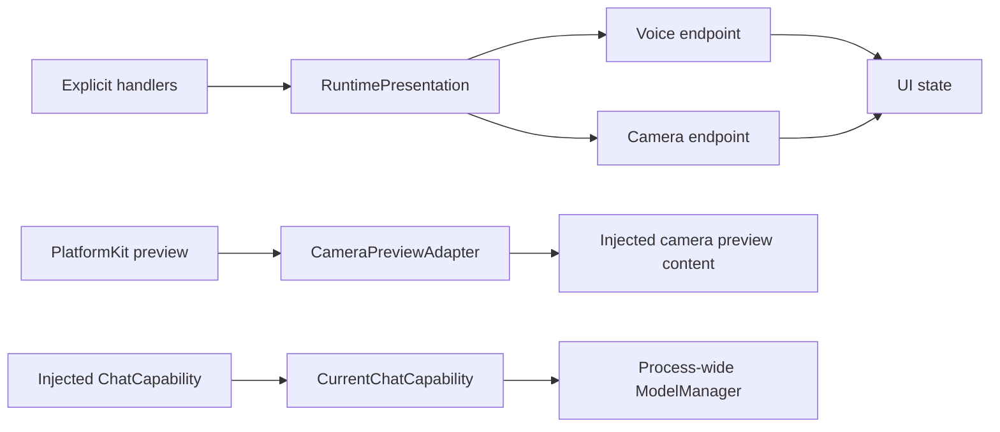

# App Adapters

Purpose: connect existing module contracts to platform and presentation implementations. Design goals: narrow interfaces, explicit ownership and no reverse dependency from UI to App.

| File | Boundary |
| --- | --- |
| RuntimePresentation.swift | Registry handlers to one complete VoiceOutputHandling or CameraOutputHandling endpoint; App lifetime owners validate session/turn/sequence |
| CameraImageAttachment.swift | AgentCore image attachment to ModelKit ImageFrame without importing model/native types into AgentCore |
| CameraPreviewAdapter.swift | PlatformKit preview source to native layer, rotation/mirroring and skeleton drawing; supplied as view content to UI |
| EyeExpression.swift | Exhaustive UI Action emotion to UI value conversion |
| CurrentChatCapability.swift | ChatCapability to the current ModelManager chat binding; resolve on each request so saved model changes take effect without replacing consumers |

✅ Roles bind atomically, reject overlap and unbind by owner identity. Action/Tool dispatch to missing roles fails; no silent dropped device Actions. Runtime log/status observation is separate. Adapters create no scheduling queues and do not bypass OutputGateway for Agent-selected effects. The chat adapter acquires an existing model binding; it never registers providers or chooses defaults.

❌ A general renderer/plugin registry and multi-window presentation routing; these are not needed by the current application.

## Domain-owned behavior assembly

✅ RuntimePresentation implements UIPresentationCapability, SpeechPlaybackCapability and PosePresentationCapability. It forwards typed semantic operations to bound whole voice/camera endpoints, preserving weak binding and session ownership. UIActions/UITools parsing and invocation moved into their domain modules. ❌ The adapter does not construct behavior registries or infer unknown operations.

## Action implementation audit

✅ SpeechPlaybackCapability now receives a typed audioID UUID plus trusted invocation; RuntimePresentation forwards it without parsing Action arguments. Existing whole-endpoint binding remains unchanged.

## Action and Tool presentation boundary

✅ RuntimePresentation implements immediate UIUpdateCapability using ToolInvocation, while speech and expression retain ActionInvocation. Voice/camera endpoint ownership, session/turn/sequence checks and weak bindings are preserved. ❌ No presentation effect bypasses OutputGateway.
