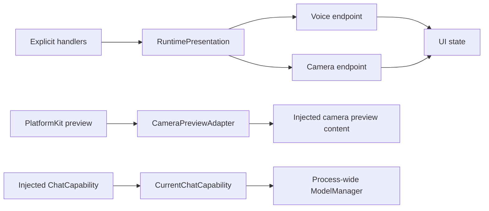

# App Adapters

Purpose: connect existing module contracts to platform and presentation implementations. Design goals: narrow interfaces, explicit ownership and no reverse dependency from UI to App.

| File | Boundary |
| --- | --- |
| RuntimePresentation.swift | Registry handlers to one complete VoiceOutputHandling or CameraOutputHandling endpoint; App lifetime owners validate session/turn/sequence |
| MediaInputAdapter.swift | Explicit host microphone/camera transport packaging and source/deadline adaptation; AgentCore/Input owns media transport values |
| CameraPreviewAdapter.swift | PlatformKit preview source to native layer, rotation/mirroring and skeleton drawing; supplied as view content to UI |
| EyeExpression.swift | Exhaustive UI Action emotion to UI value conversion |
| CurrentChatCapability.swift | ChatCapability to the current ModelManager chat binding; resolve on each request so saved model changes take effect without replacing consumers |

✅ Roles bind atomically, reject overlap and unbind by owner identity. Action/Tool dispatch to missing roles fails; no silent dropped device Actions. Runtime log/status observation is separate. Adapters create no scheduling queues and do not bypass OutputGateway for Agent-selected effects. The chat adapter acquires an existing model binding; it never registers providers or chooses defaults.

❌ A general renderer/plugin registry and multi-window presentation routing; these are not needed by the current application.

## Domain-owned behavior assembly

✅ RuntimePresentation implements UIPresentationCapability, SpeechPlaybackCapability and PosePresentationCapability. It forwards typed semantic operations to bound whole voice/camera endpoints, preserving weak binding and session ownership. UIActions/UITools parsing and invocation moved into their domain modules. ❌ The adapter does not construct behavior registries or infer unknown operations.

## Action implementation audit

✅ SpeechPlaybackCapability now receives a typed audioID UUID plus trusted invocation; RuntimePresentation forwards it without parsing Action arguments. Existing whole-endpoint binding remains unchanged.

## Action and Tool presentation boundary

✅ RuntimePresentation implements immediate UIUpdateCapability using the same FunctionInput contract as speech and expression. Voice/camera endpoint ownership, session/turn/sequence checks and weak bindings are preserved. ❌ No presentation effect bypasses OutputGateway.

✅ CameraPreviewAdapter explicitly selects preview resizeAspectFill. PlatformKit binds the native session without imposing application view layout.

✅ UI capability endpoints receive Actions.PoseOverlay; lifecycle adaptation converts it to the UI value. Action and Tool callbacks retain only opaque module-owned execution context.

✅ ADR0098: NexArmBehaviorAdapter owns the unchanged host gesture/report bindings; SettingsProviderAdapter validates/applies the configured provider; HistoryAgentAdapter owns Assistant-specific dry-run preview. These adapters create no queues or new lifecycle owners.

✅ RuntimePresentation implements CameraControlCapability: requires the bound voice endpoint to validate the active Assistant session, then forwards to the root camera owner even when vision is currently off. Camera presentation remains separately bound by vision-session lifetime.

✅ Cloud native Tool declarations and complete call events pass through ChatCapability; CurrentChatCapability forwards the current provider support flag. Local Gemma 4 E2B reports no native Tool support and rejects requests carrying tools. See [technical flow](../../ModelKit/Language/LLM/OpenAI/README.md).

✅ NexArmBehaviorAdapter binds the completion-only NexArm.Tracking.aim sender and converts connection/foreground availability errors to Tool errors. It neither selects targets nor constructs Agents.

✅ CameraOutputHandling carries camera/pose display values only. OutputGateway failure observation supplies home scheduling issues; tracking execution failures never become camera banners or clear the accepted pose (ADR0131).

✅ visionStatus scopes vision-only failure presentation separately from tracking and camera lifecycle.

✅ Expression adapter awaits finite transition/restore methods separately from synchronous base-state commitment. A complete role binding remains required; UI transaction callbacks contain only UI-owned values. ❌ No Activity transport is introduced.

## Local model resources — current contract

✅ ModelArtifactStorageAdapter bridges generic Storage into Management. Installed status compares the local receipt and actual file sizes; installed byte totals come from the receipt. SettingsModelResourcesAdapter maps Management snapshots into UI values and validates Nemotron hardware compatibility. Download SDK calls belong to ModelKitHub; App composes that adapter. ❌ Full iPhone acceptance remains pending.

✅ SettingsModelResourcesAdapter 将资源阶段映射为 UI 独立的 queued/downloading/installing/deleting 值，提供实际下载进度；UI 不接触 ModelKit 类型。❌ 原生 iOS 展示验证仍需完整 Xcode/设备。

✅ ModelArtifactStorageAdapter writes the complete transfer snapshot atomically without a split load/save revision race, using afterFirstUnlock protection consistent with background artifact files. Installed task-record failures are presented as bookkeeping warnings, and removal failures have their own message. ❌ Phone lock/unlock transfer acceptance remains pending.

✅ Installation receipt inventory uses normalized confined relative paths. Receipts matching the exact former seven-hex-digit staging-prefix bug are remapped only after identity/revision, required paths, file safety and recorded sizes validate; corrupt or unrelated receipts remain failures. A real YOLO ZIP passes the production adapter on macOS, including known-bug repair and corruption rejection. ❌ iPhone incident verification awaits connection.

✅ Artifact receipts with a different model revision produce an incompatible-resource error. Settings presents a delete-and-download instruction; old weights are never silently treated as the new Nemotron export. Nemotron downloads no longer require an h18p device check.

✅ Settings maps network error codes to resumable-transfer guidance instead of hiding every failure behind a generic network message. Existing generation-based staging and after-first-unlock storage cooperate with background file completion.

✅ SettingsModelResourcesAdapter validates the endpoint and normalizes cellular permission to true while preserving useCustomRecognition/useCustomSynthesis; it does not choose voice providers.

✅ History parsing previews show ordered rejected model calls alongside valid calls and wait boundaries. ❌ Preview does not establish execution success.

✅ Download preference validation always permits cellular use while respecting OS permissions. The former UI network restriction is no longer configurable; model transport contracts remain unchanged.

✅ CameraPreviewAdapter consumes UI/Camera and UI-owned sensor-point projection. Native preview conversion/crop/mirroring remain here.

✅ RuntimePresentation retains application-owned source acceptance using configured raw Agent names; it does not require business Agent constants from AgentCore.

✅ MediaInputAdapter owns media admission metadata only; CameraImageAttachment and model input conversion belong to VisionPerception. It supplies phone source names, 60s microphone / 1s camera deadlines and root IDs equal to each new input ID. App composition injects its source allowlist into generic CommunicationPolicy.

✅ HistoryAgentAdapter injects Assistant textSegmentation into GenerationTrace so preview and live parsing use identical business chunk limits. ❌ Preview does not execute generated calls.

✅ ADR0121 removes the Types module: AgentCore/Input owns generic audio/image transport, UI/Camera owns PoseOverlay, and VisionPerception owns PoseOverlayPayload. App adapts the independent Tool payload into UI values. ❌ Capability SDKs must not import consumer or presentation modules.

✅ ADR0129: NexArm failures preserve motor outcomes and attach the execution exception before returning a report. An exception after successful child results cannot become Action success. Adapters do not cancel Channel work or bind Bluetooth recovery to Agent lifetime.

✅ ADR0131: NexArmBehaviorAdapter preserves caught failure descriptions in Action reports. Late continuous-control execution failures feed only ActionActivityWorkflow, including errors caught after transport recovery fences the old generation; startup Tool failures retain ordinary results. CameraOutputHandling no longer carries trackingStatus. No execution failure is written to Bluetooth history. ❌ Device acceptance remains pending.

✅ NexArm bindings allocate a private ActionReportStore per invocation and receive motor outcomes through the call-specific recordReport sink. They preserve composition paths and original thrown errors; no shared last-result lookup or Bluetooth diagnostic interpretation remains. ❌ Physical execution acceptance remains pending.

✅ ADR0132: NexArmBehaviorAdapter preserves Actions availability reasons as neutral producer codes/messages, and supplies the initiating Tool provenance to the App-owned worker. No completed Tool result is rewritten by a later worker error.

❌ Sustained physical-device acceptance and durable error history remain pending.

✅ SpeechFailurePresentation maps neutral SpeechSynthesis/StorageAudio errors to localized playback failures and retains their underlying error; cancellation and unknown failures are unchanged. ❌ It performs no business decision, retry or audio cleanup.

✅ ADR0156: canonical execution addresses use domain/module/function; Agent v6 bindings resolve native names separately. Existing serialization/resource and output permissions are preserved.

✅ ADR0157: canonical executable definitions and shared outcomes replace duplicate protocol metadata; consumers import Actions/FunctionContracts. Protocol request views remain adapters, and production permission/resource boundaries are preserved.

❌ Physical acceptance and additional business capability exposure are not established by this migration.

✅ ADR0159 — Unified invocation: all business functions, injected capabilities and registered handlers receive FunctionInput with ActionExecutionContext. Native request/result normalization stays in Runtime/Gateway; no protocol-specific implementation signature remains.

✅ ADR0160: callable functions and shared producer failures are independent of call protocols. This directory consumes the appropriate pure function/shared invocation or registration adapter at its existing boundary; host profiles own protocol selection. ❌ Broader feature Signal migration and physical acceptance remain separate.

✅ ADR0161: standard callable inputs use FunctionInput/FunctionContracts; common execution and call protocols belong to independent Gateway targets. This directory retains its existing ownership, resource/permission and lifecycle boundaries. ❌ Remaining feature Signal/continuation and physical acceptance are separate work.
