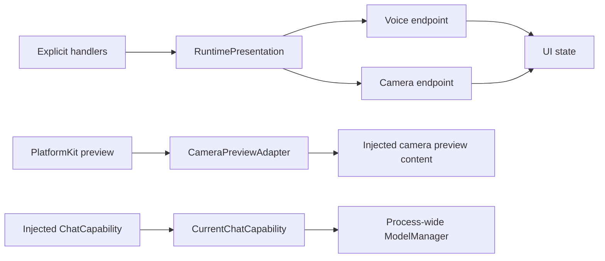

# App Adapters

Purpose: connect existing module contracts to platform and presentation implementations. Design goals: narrow interfaces, explicit ownership and no reverse dependency from UI to App.

| File | Boundary |
| --- | --- |
| RuntimePresentation.swift | Registry handlers to one complete VoiceOutputHandling or CameraOutputHandling endpoint; App lifetime owners validate session/turn/sequence |
| MediaInputAdapter.swift | Explicit host microphone/camera transport packaging and source/deadline adaptation; AgentCore/Input owns media transport values |
| CameraPreviewAdapter.swift | PlatformKit preview source to native layer, rotation/mirroring and skeleton drawing; supplied as view content to UI |
| EyeExpression.swift | Exhaustive UI Action emotion to UI value conversion |
| CurrentChatCapability.swift | ChatCapability to the current ModelManager chat binding; resolve on each request so saved model changes take effect without replacing consumers |

✅ Roles bind atomically, reject overlap and unbind by owner identity. Action/Tool dispatch to missing roles fails; no silent dropped device Actions. Runtime log/status observation is separate. Adapters create no scheduling queues and do not bypass OutputGateway for Agent-selected effects. The chat adapter acquires an existing model binding; it never registers providers or chooses defaults.

❌ A general renderer/plugin registry and multi-window presentation routing; these are not needed by the current application.

## Domain-owned behavior assembly

✅ RuntimePresentation implements UIPresentationCapability, SpeechPlaybackCapability and PosePresentationCapability. It forwards typed semantic operations to bound whole voice/camera endpoints, preserving weak binding and session ownership. UIActions/UITools parsing and invocation moved into their domain modules. ❌ The adapter does not construct behavior registries or infer unknown operations.

## Action implementation audit

✅ SpeechPlaybackCapability now receives a typed audioID UUID plus trusted invocation; RuntimePresentation forwards it without parsing Action arguments. Existing whole-endpoint binding remains unchanged.

## Action and Tool presentation boundary

✅ RuntimePresentation implements immediate UIUpdateCapability using the same FunctionInput contract as speech and expression. Voice/camera endpoint ownership, session/turn/sequence checks and weak bindings are preserved. ❌ No presentation effect bypasses OutputGateway.

✅ CameraPreviewAdapter explicitly selects preview resizeAspectFill. PlatformKit binds the native session without imposing application view layout.

✅ UI capability endpoints receive Actions.PoseOverlay; lifecycle adaptation converts it to the UI value. Action and Tool callbacks retain only opaque module-owned execution context.

✅ ADR0098: NexArmBehaviorAdapter owns the unchanged host gesture/report bindings; SettingsProviderAdapter validates/applies the configured provider; HistoryAgentAdapter owns Assistant-specific dry-run preview. These adapters create no queues or new lifecycle owners.

✅ RuntimePresentation implements CameraControlCapability: requires the bound voice endpoint to validate the active Assistant session, then forwards to the root camera owner even when vision is currently off. Camera presentation remains separately bound by vision-session lifetime.

✅ Cloud native Tool declarations and complete call events pass through ChatCapability; CurrentChatCapability forwards the current provider support flag. Local Gemma 4 E2B reports no native Tool support and rejects requests carrying tools. See [technical flow](../../ModelKit/Language/LLM/OpenAI/README.md).

✅ NexArmBehaviorAdapter binds the completion-only NexArm.Tracking.aim sender and converts connection/foreground availability errors to Tool errors. It neither selects targets nor constructs Agents.

✅ CameraOutputHandling carries camera/pose display values only. OutputGateway failure observation supplies home scheduling issues; tracking execution failures never become camera banners or clear the accepted pose (ADR0131).

✅ visionStatus scopes vision-only failure presentation separately from tracking and camera lifecycle.

✅ Expression adapter awaits finite transition/restore methods separately from synchronous base-state commitment. A complete role binding remains required; UI transaction callbacks contain only UI-owned values. ❌ No Activity transport is introduced.

## Local model resources — current contract

✅ ModelArtifactStorageAdapter bridges generic Storage into Management. Installed status compares the local receipt and actual file sizes; installed byte totals come from the receipt. ModelResourceCapabilityAdapter maps Management snapshots into neutral inventory facts and validates Nemotron hardware compatibility. SettingsModelResourcesAdapter converts successful Actions inventory JSON into UI values. Download SDK calls belong to ModelKitHub; App composes that adapter. ❌ Full iPhone acceptance remains pending.

✅ SettingsModelResourcesAdapter 将资源阶段映射为 UI 独立的 queued/downloading/installing/deleting 值，提供实际下载进度；UI 不接触 ModelKit 类型。❌ 原生 iOS 展示验证仍需完整 Xcode/设备。

✅ ModelArtifactStorageAdapter writes the complete transfer snapshot atomically without a split load/save revision race, using afterFirstUnlock protection consistent with background artifact files. Installed task-record failures are presented as bookkeeping warnings, and removal failures have their own message. ❌ Phone lock/unlock transfer acceptance remains pending.

✅ Installation receipt inventory uses normalized confined relative paths. Receipts matching the exact former seven-hex-digit staging-prefix bug are remapped only after identity/revision, required paths, file safety and recorded sizes validate; corrupt or unrelated receipts remain failures. A real YOLO ZIP passes the production adapter on macOS, including known-bug repair and corruption rejection. ❌ iPhone incident verification awaits connection.

✅ Artifact receipts with a different model revision produce an incompatible-resource error. Settings presents a delete-and-download instruction; old weights are never silently treated as the new Nemotron export. Nemotron downloads no longer require an h18p device check.

✅ Settings maps network error codes to resumable-transfer guidance instead of hiding every failure behind a generic network message. Existing generation-based staging and after-first-unlock storage cooperate with background file completion.

✅ SettingsModelResourcesAdapter validates the endpoint and normalizes cellular permission to true while preserving useCustomRecognition/useCustomSynthesis; it does not choose voice providers.

✅ History parsing previews show ordered rejected model calls alongside valid calls and wait boundaries. ❌ Preview does not establish execution success.

✅ Download preference validation always permits cellular use while respecting OS permissions. The former UI network restriction is no longer configurable; model transport contracts remain unchanged.

✅ CameraPreviewAdapter consumes UI/Camera and UI-owned sensor-point projection. Native preview conversion/crop/mirroring remain here.

✅ RuntimePresentation retains application-owned source acceptance using configured raw Agent names; it does not require business Agent constants from AgentCore.

✅ MediaInputAdapter owns media admission metadata only; CameraImageAttachment and model input conversion belong to VisionPerception. It supplies phone source names, 60s microphone / 1s camera deadlines and root IDs equal to each new input ID. App composition injects its source allowlist into generic CommunicationPolicy.

✅ HistoryAgentAdapter injects Assistant textSegmentation into GenerationTrace so preview and live parsing use identical business chunk limits. ❌ Preview does not execute generated calls.

✅ ADR0121 removes the Types module: AgentCore/Input owns generic audio/image transport, UI/Camera owns PoseOverlay, and VisionPerception owns PoseOverlayPayload. App adapts the independent Tool payload into UI values. ❌ Capability SDKs must not import consumer or presentation modules.

✅ ADR0129: NexArm failures preserve motor outcomes and attach the execution exception before returning a report. An exception after successful child results cannot become Action success. Adapters do not cancel Channel work or bind Bluetooth recovery to Agent lifetime.

✅ ADR0131: NexArmBehaviorAdapter preserves caught failure descriptions in Action reports. Late continuous-control execution failures feed only ActionActivityWorkflow, including errors caught after transport recovery fences the old generation; startup Tool failures retain ordinary results. CameraOutputHandling no longer carries trackingStatus. No execution failure is written to Bluetooth history. ❌ Device acceptance remains pending.

✅ NexArm bindings allocate a private ActionReportStore per invocation and receive motor outcomes through the call-specific recordReport sink. They preserve composition paths and original thrown errors; no shared last-result lookup or Bluetooth diagnostic interpretation remains. ❌ Physical execution acceptance remains pending.

✅ ADR0132: NexArmBehaviorAdapter preserves Actions availability reasons as neutral producer codes/messages, and supplies the initiating Tool provenance to the App-owned worker. No completed Tool result is rewritten by a later worker error.

❌ Sustained physical-device acceptance and durable error history remain pending.

✅ SpeechFailurePresentation maps neutral SpeechSynthesis/StorageAudio errors to localized playback failures and retains their underlying error; cancellation and unknown failures are unchanged. ❌ It performs no business decision, retry or audio cleanup.

✅ ADR0156: canonical execution addresses use domain/module/function; Agent v6 bindings resolve native names separately. Existing serialization/resource and output permissions are preserved.

✅ ADR0157: canonical executable definitions and shared outcomes replace duplicate protocol metadata; consumers import Actions/FunctionContracts. Protocol request views remain adapters, and production permission/resource boundaries are preserved.

❌ Physical acceptance and additional business capability exposure are not established by this migration.

✅ ADR0159 — Unified invocation: all business functions, injected capabilities and registered handlers receive FunctionInput with ActionExecutionContext. Native request/result normalization stays in Runtime/Gateway; no protocol-specific implementation signature remains.

✅ ADR0160: callable functions and shared producer failures are independent of call protocols. This directory consumes the appropriate pure function/shared invocation or registration adapter at its existing boundary; host profiles own protocol selection. ❌ Broader feature Signal migration and physical acceptance remain separate.

✅ ADR0161: standard callable inputs use FunctionInput/FunctionContracts; common execution and call protocols belong to independent Gateway targets. This directory retains its existing ownership, resource/permission and lifecycle boundaries. ❌ Remaining feature Signal/continuation and physical acceptance are separate work.

✅ Implemented: ModelResourceCapabilityAdapter translates protocol-neutral id/source inputs into ModelKit operations using the same process-wide artifact manager and joined quiescence callback. No business selection, queue or UI draft import.

✅ ADR0167: the native resource adapter suppresses unchanged binding tuples and updates its cache only after successful injected binding. Composition supplies lifecycle begin/end and ModelKitDefaults adaptation; the adapter never chooses or persists preferences.

✅ ADR0168: native preference validation converts protocol-neutral durable values using ModelDownloadSource. Stable invocation error markers become existing localized source/installation notices; registered failure presentation remains pending.

✅ ADR0169: the native adapter maps SDK phases/metadata into neutral facts, rejects unknown phases and oversized item count. The view adapter decodes canonical inventory, preserves phase/failure wording and maps precomputed group identifiers to UI values.

The inventory capability returns raw neutral facts. The snapshotResources function computes installed groups during callable execution and includes them in canonical JSON; the native adapter does not compute eligibility.

✅ ADR0170: ResourcePresentationAdapter in SettingsModelResourcesAdapter.swift validates root session and passive UI revision before mapping inventory or committing failure text. It owns no queue, native query or business decision.

✅ ADR0171: native adapter produces a stable sorted-key bounded fingerprint of neutral facts, without installed eligibility decisions. ResourcePresentationAdapter acknowledges accepted snapshots to the existing interaction coordinator; native input source is explicitly declared.

✅ ADR0172: ResourcePresentationAdapter adds session-checked operation failure commitment, independent of snapshot generation. It preserves passive refresh-error ownership rules; no native command retry.

✅ ADR0173: ResourcePresentationAdapter gains root-session checked preference error/notice commitment. recognition/synthesis map to existing UI messages, invalidSource to source guidance, execution to bounded diagnostic text. No business classification from message text on the registered path.

ADR0173 localization detail: registered and legacy-fallback source guidance reuse one adapter-owned message; native business validation is not duplicated.

ADR0173 concurrency detail: shared source guidance is an immutable nonisolated String so LocalizedError can read it outside the default App actor; all UI commitment remains MainActor-isolated.

## Resource host-failure Signal — ADR0174

✅ MediaInputAdapter admits app.resources alongside model.resources in the root communication policy. Host transport facts use the typed model.resource.hostFailure/1 schema and retain original request correlation through parentID. Existing session-checked resource presentation endpoints handle the Agent-selected function without new native behavior or text classification. Diagnostic admission/cleanup belongs to Workflows/Settings/README.md.

## Provider discovery

✅ Implemented: SettingsProviderAdapter injects discovery transport into existing SettingsProviderOperations. Native discoverModels accepts neutral Actions configuration and uses the unchanged provider SDK query. It maps HTTP status/configuration/cancellation/unknown transport failures into credential-free errors; localized display remains at the settings boundary. No direct SDK query remains in the injected UI operation.

ProviderIntentFailure carries the producer failureCode separately from the error chain. The adapter localizes exact configuration/model-list/capacity/expired-request codes and bounded HTTP status codes, without interpreting credential-bearing SDK text.

## Provider configuration transactions

✅ Implemented: SettingsCredentialAdapter.swift exposes raw Keychain legacy/key bytes, insert/delete operations and unchanged service/accessibility identifiers. Actions owns decoding, reference replacement and migration order. SettingsProviderAdapter prepares neutral provider values and supplies SDK apply/barrier callbacks; injected UI operations only use intent transport. Safe provider transaction codes localize at this boundary; raw credentials/SDK error strings never reach runtime records.

## Completion batch — provider presentation and capability policy

✅ Implemented: provider discovery model-family eligibility belongs to Actions ProviderModelList; ModelKit validates/decodes raw IDs only. Preserve filtering/dedup/order and bounds at the app boundary. SettingsState becomes a passive editable snapshot, with no tasks or injected execution; SettingsInteractionWorkflow in the existing Settings directory owns bounded form admission, revision and page-independent saves. UI forwards edits/discovery/cancellation/save through SettingsControlling.

✅ Implemented: presentation-enabled provider intents select a second registered UI.ResourcePresentation.showProviderResult call after the business call, on success or failure. Headless requests retain one call. Private result lookup and revision/session fences prevent credentials in protocol payloads and stale form updates. One attempt only, no recursive presentation/replay; producer and presentation failure chains remain distinct. App injects the native UI endpoint; business functions remain independent of UI and call protocols.

## Typed device, navigation and environment entry points

✅ Implemented: app.interaction/1 maps explicit device commands and navigation destinations to fixed registered functions through ApplicationControl and the shared root transport. This Agent now coordinates native resource interactions as well as model resources; it performs no native I/O. UI controls emit typed intent through a root-owned BluetoothInteractionWorkflow; native BluetoothWorkflow remains the injected connection/recovery/manual worker host. Existing arrival tolerance, timeouts, pacing and takeover algorithms stay unchanged.

✅ Implemented: System.Device.control validates bounded string arguments and invokes neutral DeviceControlCapability; successful submission reports acceptance, not physical arrival. Read-only status and selected connection commands are explicitly model-granted. UI.Navigation.open commits native route state; manual taps and model requests share that function. A bounded latest motor-intent worker sends only changed values, with reset/stop priority and explicit failure display. No queued motion replay.

✅ Implemented: app.environment/1 stores latest sequenced scene/device/capability facts in the root Agent, with finite categories and bounded data. App still performs synchronous background/native safety fencing before reporting facts; physical safety cannot wait on Agent admission or iOS background execution. Native back navigation remains platform-owned and reports a fact, rather than replaying navigation effects. Photo-library creation and physical acceptance are feature/acceptance boundaries, not implied by navigation support.

## Independent history presentation values

✅ Implemented: UI has no project dependencies, including StorageChat. History rendering receives UI-owned immutable HistorySnapshot/HistoryConversation/HistoryTurn values with matching data fields, not Storage types or stores. App HistoryPresentationAdapter copies the bounded stored snapshot through an explicit Codable boundary and propagates adaptation failure; Agent history mutations/queries are unchanged. Preview receives only fragments/finish reason from the view value. Optional exact continuation requests are visible in history details. UI target has zero project dependencies.

## Camera command entry

✅ Implemented: CameraInteractionWorkflow emits typed open/close/flip/retry intents through Photographer and existing Camera functions. Root presentation accepts Photographer in the dedicated camera root session or validated active voice delegation; Assistant calls delegate through the bound Gateway context. Native capture, permission, lifecycle fences and joined cleanup remain CameraCoordinator responsibilities. Retry uses a canonical callable and the native explicit settings/permission request. UI receives controls and passive camera state, not the native coordinator. One command slot rejects overlap, no replay.

## Manual worker terminal feedback

✅ Implemented: accepted device-control calls acknowledge submission only. Preset/jog native workers capture their own origin and report sink, retain one latest structured terminal failure, publish independent home issues and deliver a trusted ActionResult through InputGateway after non-cancellation failure. Root ApplicationControl accepts runtime-owned Action results into a bounded128-result inbox; environment context exposes the latest result summary. No accepted Tool receipt is rewritten, no movement replay, and no tolerance/arrival/timeout algorithm changes. Ordinary failure stops only its worker and keeps subsequent intents admissible. Diagnostic delivery rejection is reported separately.

✅ Manual terminal feedback preserves partial failure when the original report includes successful children; environment summaries retain execution-level failure codes alongside all child entries.

✅ Implemented admission hardening: the native device endpoint validates its existing foreground, connection and worker admission conditions before accepting scan/connect/reconnect/preset/jog. Rejected void UI commands must become explicit call errors, without changing native recovery/motion algorithms. Device facts include the current native issue. Motor arguments reject unrelated preset fields.

✅ ADR0181: RuntimePresentation accepts physical camera effects from Photographer in its root session or an active validated voice session. Assistant calls validate voice then delegate through the bound Gateway invocation Signal context; they do not directly mutate native capture. Retain complete nested Tool reports when returning failures to the original caller. No ApplicationControl camera exemption remains.

✅ Interaction refinement: RuntimePresentation forwardss explicit target facing through camera delegation and the typed native endpoint; no implicit toggling.

## Assistant photo observation — ADR0184

✅ Implemented: RuntimePresentation validates current Assistant voice scope then calls native photo endpoint directly. No generic delegation; CurrentChat forwards supportsImages.

❌ Real camera/shutter/animation and configured-model vision acceptance remain pending; video recording remains outside this iteration; system Photos export is implemented by ADR0185.

## Photo save and ignore — ADR0185

✅ RuntimePresentation routes Assistant save/ignore through authorized Photographer messages, validates root/active voice scopes and decodes the actual returned receipt. Photographer executes the injected CameraControlCapability; no fabricated receipt or direct UI effect.
