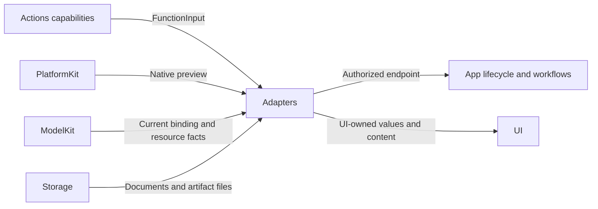

# Application Boundary Adapters

## Summary

Converts native, model, function and storage contracts into injected App endpoints and independent UI values.

## Ownership and boundaries

Adapters translate and validate boundary values; they do not choose business operations, register providers or own scheduling queues. RuntimePresentation binds whole endpoints weakly and rejects overlap, missing owners and stale scopes.

## External relationships and data flow

Runtime arrows show data or capability calls; dashed arrows show injection.

## Interface map

| Source | Responsibility |
| --- | --- |
| RuntimePresentation.swift | Typed presentation, speech, listening, camera and navigation capability forwarding; real producer/root-or-task authorization |
| MediaInputAdapter.swift | Host source/deadline/capture metadata; generic AgentCore media transport |
| CameraPreviewAdapter.swift / EyeExpression.swift | Native preview crop/rotation/mirroring and exhaustive expression conversion |
| CurrentChatCapability.swift | Resolve current ModelManager binding per request and forward provider support |
| ModelArtifactStorageAdapter.swift | Atomic task snapshots, receipts, confined artifact paths and file safety |
| SettingsModelResourcesAdapter.swift | Neutral inventory/preferences to revision-fenced UI values and localized failures |
| SettingsProviderAdapter.swift / SettingsCredentialAdapter.swift | Native SDK barriers, discovery and raw Keychain primitives; credential-free error adaptation |
| NexArmBehaviorAdapter.swift | Invocation-private reports, inherited permits and continuous-worker provenance |
| HistoryAgentAdapter.swift | Producing-role generation preview, including authorized communication catalog |
| SpeechFailurePresentation.swift | Known producer/storage failure wording after cleanup; original cause retained |

## Media and endpoint rules

Microphone inputs have a 60-second deadline; camera inputs have a one-second deadline. Each new input is its own causal root. Native rate/layout/capture instants are transported; perception Agents own conversion to ModelKit inputs. Camera preview uses resizeAspectFill and UI-owned projection values.

Camera effects require actual Photographer; listening requires actual SpeechPerception/root session; conversational navigation requires actual ApplicationControl/root-or-active-task identity. Local frontend methods use UI state directly. Missing or stale bindings fail rather than discarding effects.

## Resource and provider adaptation

Inventory adapters return neutral facts; Actions computes installation eligibility and grouping. Snapshots, operation errors and preference notices have independent revision/session commitment rules. Stable sorted-key fingerprints are bounded; unchanged binding tuples are cached only after successful application.

Receipts validate identity/revision, normalized confined relative paths, required files and exact sizes. Repair is limited to the exact former seven-hex staging-prefix form after validation. Different revisions fail as incompatible. Transfer records use atomic after-first-unlock storage; bookkeeping warnings remain distinct from successful artifact publication.

Keychain adapters expose raw operations and existing accessibility identifiers. Actions owns schema, migration and replacement order. Provider failureCode, HTTP status and configuration errors are mapped without credential-bearing SDK text. Cellular permission normalizes to true subject to OS permission; voice preferences remain independent.

## Reports and previews

NexArm reports are invocation-private and preserve every child outcome plus later exceptions. Continuous failures are separate execution diagnostics and do not rewrite completed Tool receipts or Bluetooth state. Speech errors are localized only after playback cleanup.

History preview combines the producing role's effective function and communication catalogs and shared segmentation. It parses stored fragments and rejected calls without executing them or claiming task delivery.

✅ Narrow typed adaptation, owner validation and neutral failure propagation are implemented.

## Related design

[Parent design](../README.md)
