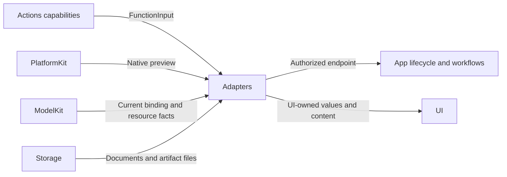

# Application Boundary Adapters

## Summary

Converts native, model, function and storage contracts into injected App endpoints and independent UI values.

## Ownership and boundaries

Adapters translate and validate boundary values; they do not choose business operations, register providers or own scheduling queues. RuntimePresentation binds whole endpoints weakly and rejects overlap, missing owners and stale scopes.

## External relationships and data flow

Runtime arrows show data or capability calls; dashed arrows show injection.

## Interface map

| Source | Responsibility |
| --- | --- |
| RuntimePresentation.swift | Typed presentation, speech, listening, camera and navigation capability forwarding; real producer/root-or-task authorization |
| MediaInputAdapter.swift | Host source/deadline/capture metadata; generic AgentCore media transport |
| CameraPreviewAdapter.swift / EyeExpression.swift | Native preview crop/rotation/mirroring and exhaustive expression conversion |
| CurrentChatCapability.swift | Resolve current ModelManager binding per request and forward provider support |
| ModelArtifactStorageAdapter.swift | Atomic task snapshots, receipts, confined artifact paths and file safety |
| SettingsModelResourcesAdapter.swift | Neutral inventory/preferences to revision-fenced UI values and localized failures |
| SettingsProviderAdapter.swift / SettingsCredentialAdapter.swift | Native SDK barriers, discovery and raw Keychain primitives; credential-free error adaptation |
| NexArmBehaviorAdapter.swift | Invocation-private reports, inherited permits and continuous-worker provenance |
| HistoryAgentAdapter.swift | Producing-role generation preview, including authorized communication catalog |
| SpeechFailurePresentation.swift | Known producer/storage failure wording after cleanup; original cause retained |

## Media and endpoint rules

Microphone inputs have a 60-second deadline; camera inputs have a one-second deadline. Each new input is its own causal root. Native rate/layout/capture instants are transported; perception Agents own conversion to ModelKit inputs. Camera preview uses resizeAspectFill and UI-owned projection values.

Camera effects require actual Photographer; listening requires actual SpeechPerception/root session; conversational navigation requires actual ApplicationControl/root-or-active-task identity. Local frontend methods use UI state directly. Missing or stale bindings fail rather than discarding effects.

## Resource and provider adaptation

Inventory adapters return neutral facts; Actions computes installation eligibility and grouping. Snapshots, operation errors and preference notices have independent revision/session commitment rules. Stable sorted-key fingerprints are bounded; unchanged binding tuples are cached only after successful application.

Receipts validate identity/revision, normalized confined relative paths, required files and exact sizes. Repair is limited to the exact former seven-hex staging-prefix form after validation. Different revisions fail as incompatible. Transfer records use atomic after-first-unlock storage; bookkeeping warnings remain distinct from successful artifact publication.

Keychain adapters expose raw operations and existing accessibility identifiers. Actions owns schema, migration and replacement order. Provider failureCode, HTTP status and configuration errors are mapped without credential-bearing SDK text. Cellular permission normalizes to true subject to OS permission; voice preferences remain independent.

## Reports and previews

NexArm reports are invocation-private and preserve every child outcome plus later exceptions. Continuous failures are separate execution diagnostics and do not rewrite completed Tool receipts or Bluetooth state. Speech errors are localized only after playback cleanup.

History preview combines the producing role's effective function and communication catalogs and shared segmentation. It parses the stored complete response string and rejected calls without executing them or claiming task delivery.

Narrow typed adaptation, owner validation and neutral failure propagation are implemented.

## Related design

[Parent design](../README.md)

## Skill/task-mode contract

History preview uses the persisted per-request catalog, including exact native schema, instead of current configuration. Missing catalogs fail preview explicitly. Camera/UI execution accepts authorized Assistant scopes as well as fixed deterministic owner scopes.

固定 Task 控制复用同一 Action：App 验证 Assistant/root-session；worker 仅在没有当前 worker、队列和接纳操作时接受无 decisionID 的可信控制。模型控制仍要求当前 input/session/round。固定终态在空闲清理条件下提交，不启动模型。

SpeechFailurePresentation 展示 ActionResult 的真实函数超时和保留底层来源的网络失败；不将等待语音完成映射为虚构超时。

## Action timeout contract

NexArmBehaviorAdapter 直接执行单个 gesture 并记录 invocation 私有报告，使用有限动作动态总预算。

EyeExpression.swift maps Actions.closed to UI.closed; App endpoints reject nonclosed finite expression performances while no voice session is active. Persistent expression acceptance remains separate from resting visual state.

RuntimePresentation forwards validated UIFeedbackCapability and listening feedback parameters to the bound VoiceOutputHandling owner; missing bindings and invalid session/source reject. It owns no native player/generator or second composition.

## 历史记录接口

HistoryAgentAdapter.preview 只使用 Assistant 当轮持久化目录；缺失或无效目录明确返回预览失败。不执行历史调用；角色选择和文本内容不能替代有效目录。

RuntimePresentation 将 notice/light 中立参数映射为 UI 值，通过根持有的 [Presentation](../Workflows/Presentation/README.md) 执行；不向 UI 注入业务服务。

Native build reconciled: UI values for Notice/Light use explicit Actions.PoseOverlay qualification at the neutral pose boundary, preserving the existing protocol signatures.

mask bottom ASR and reply/status immediately while a notice is visible, restore retained text after dismissal, and preserve pinned Task/promoted ASR layout. Consent-off clears both captions; root HomeEffectsWorkflow owns one ID/text-fenced350ms reply fade/removal task, cancelled by new text/turn/off/shutdown, scheduled only after reply-policy/playback/native-resume barriers. Agent errors stay in factual root failure notices, not persistent voiceStatus copies. App root contexts explicitly choose afterFirstUnlock file protection, including their directory; repository persistent factory accepts protection while its SDK default remains whileUnlocked. This mitigates lock-boundary writes, without claiming the screenshot proves that cause or hiding other storage failures.

VoiceOutputHandling.show is async; terminal cancellation/Agent failure joins matching input audio cleanup before output transport completes. RuntimePresentation forwards this lifecycle acknowledgment without admitting inference.

HistoryAgentAdapter.preview 不再遍历 delta 分片，只向临时 GenerationTrace 提交一次完整 response；预览不执行函数，不声称复现历史分片到达时间。

## SQLite records and runtime identity

ModelArtifactStorageAdapter 使用 Models/transfers.json；传输标识以 JSON 字符串保存，安装回执和模型目录由 ModelManagement/Storage 契约管理。

## 待实现

- 历史记录页面板块重新设计及原生 UI/真机验收。
