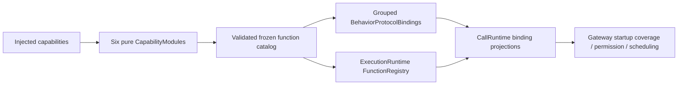

# Behavior Assembly

Purpose: inject host capabilities and assemble canonical business functions plus call bindings. Design goals: one frozen function store, explicit grouped profiles and no AgentCore dependency.

✅ BehaviorAssembly freezes the catalog once, creates FunctionRegistry and supplies it to both registration views. Canonical execution/resource/budget metadata always comes from that store. Explicit protocol-module injection remains for isolated hosts; duplicate functions or missing implementations fail without fallback.

✅ BehaviorProtocolBindings owns grouped host profiles and rejects unknown modules. Existing expression/speech/motion/gesture scheduling, returning history/system calls and completion-only presentation/camera/tracking calls are preserved. Agent aliases/exposure lists remain in Agent JSON/code.

✅ This target depends on Actions, FunctionContracts, ExecutionRuntime and CallRuntime only. Gateway's AgentCore-dependent orchestration is not imported. Business functions and injected endpoints accept standard FunctionInput, not scheduling/native invocations.

❌ Dynamic function discovery, permission inference and configuration fallback are not implemented.

✅ Implemented: the existing History.Conversation returning profile automatically binds startNew/summarize; no new protocol profile or model permission.

✅ Implemented: require ModelResourceCapability injection, assemble System.ModelResources and register its native returning/direct profile. Startup coverage validates ApplicationControl fixed permissions; no new Assistant model exposure.

ApplicationControl has code-owned internal permission for seven System.ModelResources, five UI.ResourcePresentation and three Provider transaction functions, plus typed Device, Navigation and Camera entry points. Host registration chooses returning/direct execution; its11 catalog modules cover6 business domains. The empty ApplicationControl JSON model-callable list does not grant Assistant access.

✅ ADR0167: configureSpeech uses the existing System.ModelResources returning/direct profile; no separate registry or model permission list is introduced.

✅ ADR0168: seven System.ModelResources functions share the existing returning/direct profile. Required preference capability injection and startup coverage validate source functions without adding model-callable permission.

✅ ADR0169: required inventory capability adds snapshotResources to the existing returning/direct profile. Startup coverage validates all seven resource functions and two presentation functions; Assistant permission is unchanged.

✅ ADR0170: register UI.ResourcePresentation through the returning/direct profile and validate both fixed internal permissions. ResourcePresentationModule is a required injected catalog, adding no target or model permission.

## Provider discovery

✅ Implemented: BehaviorAssembly and CapabilityModules require explicit ProviderDiscoveryCapability injection. System.Provider joins the existing returning/direct profile. ApplicationControl grants only its internal fixed query, and startup coverage verifies registration. No default no-op implementation or Assistant model grant.

## Provider configuration transactions

✅ Implemented: explicitly require ProviderSettingsCapability and add both settings functions to existing System.Provider returning/direct profile. ApplicationControl owns fixed internal grants; startup coverage verifies all functions. No no-op production fallback.

ProviderModule combines discovery/restore/save/read under one injected module. DeviceModule and NavigationModule bring the production catalog to eleven modules across six domains. ApplicationControl has three fixed Provider permissions.

## Completion batch — provider presentation and capability policy

✅ Implemented: provider discovery model-family eligibility belongs to Actions ProviderModelList; ModelKit validates/decodes raw IDs only. Preserve filtering/dedup/order and bounds at the app boundary. SettingsState becomes a passive editable snapshot, with no tasks or injected execution; SettingsInteractionWorkflow in the existing Settings directory owns bounded form admission, revision and page-independent saves. UI forwards edits/discovery/cancellation/save through SettingsControlling.

✅ Implemented: presentation-enabled provider intents select a second registered UI.ResourcePresentation.showProviderResult call after the business call, on success or failure. Headless requests retain one call. Private result lookup and revision/session fences prevent credentials in protocol payloads and stale form updates. One attempt only, no recursive presentation/replay; producer and presentation failure chains remain distinct. App injects the native UI endpoint; business functions remain independent of UI and call protocols.

## Bounded registered-observation continuation

✅ Implemented: Assistant correlates generated Action/Tool calls with runtime-only feedback under the original turn, awaits complete results and requests the next model round. Limits: four total model rounds,16 native calls,64 KiB aggregate feedback/transcript and one30-second joined generation worker. A failed call becomes data for the model, never an automatic function retry. Cancellation clears owned feedback state and joins model cleanup; unknown/stale/duplicate feedback cannot resume a turn. Internal UI receipts and explicit /status retain their existing handling.

✅ Implemented: ModelKit ChatMessage gains provider-neutral assistant tool-call declarations and tool-result messages. OpenAI serializes request-local aliases consistently across declarations and prior calls; Gemma rejects native transcripts explicitly. Storage keeps optional exact text/native continuation JSON and metadata-only image descriptors as data, with bounded records and unchanged v1 compatibility. Camera native model calls use explicit observation registration so actual completion/error can continue reasoning. No change to camera or NexArm function implementation.

## Typed device, navigation and environment entry points

✅ Implemented: app.interaction/1 maps explicit device commands and navigation destinations to fixed registered functions through ApplicationControl and the shared root transport. This Agent now coordinates native resource interactions as well as model resources; it performs no native I/O. UI controls emit typed intent through a root-owned BluetoothInteractionWorkflow; native BluetoothWorkflow remains the injected connection/recovery/manual worker host. Existing arrival tolerance, timeouts, pacing and takeover algorithms stay unchanged.

✅ Implemented: System.Device.control validates bounded string arguments and invokes neutral DeviceControlCapability; successful submission reports acceptance, not physical arrival. Read-only status and selected connection commands are explicitly model-granted. UI.Navigation.open commits native route state; manual taps and model requests share that function. A bounded latest motor-intent worker sends only changed values, with reset/stop priority and explicit failure display. No queued motion replay.

✅ Implemented: app.environment/1 stores latest sequenced scene/device/capability facts in the root Agent, with finite categories and bounded data. App still performs synchronous background/native safety fencing before reporting facts; physical safety cannot wait on Agent admission or iOS background execution. Native back navigation remains platform-owned and reports a fact, rather than replaying navigation effects. Photo-library creation and physical acceptance are feature/acceptance boundaries, not implied by navigation support.

## Action/Tool generation rounds — ADR0183

✅ BehaviorAssembly projects immutable host feedback policies. IndependentOutputWorkflow admits Actions in order while executing up to four Tools concurrently; VoiceSessionCoordinator owns, cancels and joins all dispatch tasks independently of page lifetime.

❌ Live-model, native UI and physical-device acceptance remain pending; local native Tools and generic Agent request/reply are not implemented. See [ADR0183](../../../../docs/adr/0183-generation-round-observations.md).

## Assistant photo observation — ADR0184

✅ Implemented: takePhoto gets action/tool host views with observation; Assistant exposes text Action only. Other Camera functions retain native registration.

❌ Real camera/shutter/animation and configured-model vision acceptance remain pending; video recording remains outside this iteration; system Photos export is implemented by ADR0185.

## Photo save and ignore — ADR0185

✅ takePhoto/savePhoto/ignorePhoto have Action and Tool host registrations with observation feedback. Assistant exposes text Actions; Photographer uses internal Tools. save/ignore receipts return actual state and identity, including alreadySaved; other Camera functions retain native registration.
