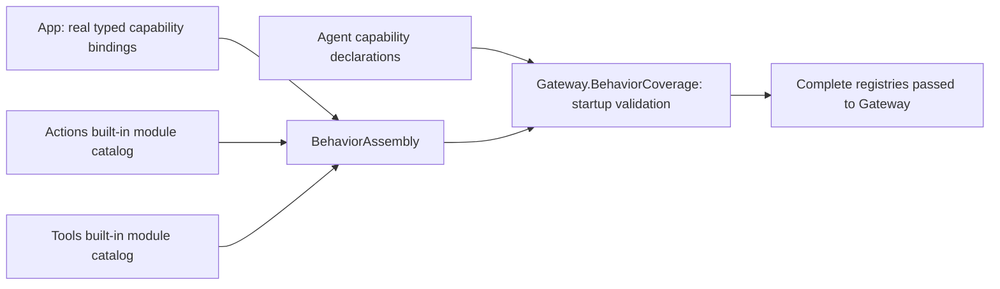

# BehaviorAssembly

Purpose: construct complete Action/Tool registries from domain-owned modules without Agent policy dependencies. Design goals: no per-function App registration, no device construction, no implicit discovery or partial async installation.

✅ Independently compiled BehaviorAssembly target depends only on Actions, Tools, ActionRuntime and ToolRuntime. The host supplies typed presentation/playback/pose capabilities and a required `shakeBase(Int, ActionInvocation)` closure. Actions.ActionModules and Tools.ToolModules own built-in module catalogs; each domain owns its definitions and handlers. An explicit module-list initializer supports isolated tests and alternative hosts. Registry creation rejects duplicate paths, invalid definitions and bounds before returning. Gateway.BehaviorCoverage separately rejects missing model/internal implementations synchronously before producers start.

No new queue or long-lived task. Maximum 32 Action modules and 32 Tool modules; existing total definition bounds remain 256/128. Gateway startup coverage accepts at most 128 capability catalogs. Missing dependencies are required typed initializer arguments, not optional fallbacks. Resource declarations remain part of definitions; ownership stays with the runtime coordinator.

✅ BehaviorAssemblyTests verifies production Agent coverage, typed argument rejection before effects, returning/completion Tool semantics, malformed/duplicate/bounded catalogs and additional modules without an App host. App adapters implement semantic capabilities without invoking individual UI Action/Tool helpers.

❌ New physical capabilities or lifecycle changes still require host adapter/binding changes. No automatic reflection, plugin discovery, generic Any command bus or hardware construction. Domain signatures not involved in registration retain documented migration exceptions.

✅ The built-in Action catalog includes the domain-owned NexArm base definition; host availability failures propagate. ❌ Assembly creates no USB device or robot lifetime.

## NexArm entertainment skills (2026-09-30)

✅ Built-in assembly now also requires the typed NexArm GestureRequest callback and includes the domain-owned entertainment module. No optional success fallback or string dispatch is introduced. ❌ Assembly does not validate physical clearance.

## Action and Tool presentation boundary

✅ BehaviorAssembly binds immediate UI tools separately from UI.express and Speech Actions; startup validation checks the updated internal grants. ❌ There is no module/source-specific Action visibility filter.

✅ Gateway.BehaviorCoverage validates Agent permissions against module-owned definitions and the assembled immutable Tool path catalog before producers start. BehaviorAssembly and registries do not depend on Agent capability catalogs.

✅ toolPaths records the validated immutable startup catalog (at most128 paths). Assembly adds no task, queue or device owner. ❌ Runtime discovery and permission inference remain unsupported.

✅ Built-in assembly requires CameraControlCapability and registers CameraToolModule. Camera controls are explicit host bindings; missing capabilities cannot silently succeed.

✅ RobotToolModule receives an explicit completion-only aim sender alongside CameraToolModule. Gateway continues to own startup permission coverage.

✅ Robot Tool resource metadata is generated from its callable declaration; BehaviorAssembly binds the injected sender without duplicating resource or Agent permissions.

✅ Built-in assembly requires HistoryQueryCapability and registers History.list/read alongside existing Tools. Missing handlers remain startup errors; this assembly imports no StorageChat. ❌ No default empty-result fallback.

✅ Built-in assembly also requires HistoryPresentationCapability for UI.showHistory; Gateway validates ConversationMemory internal permission. ❌ Assembly does not import Agents or UI.

✅ Required HistoryMutationCapability binds History.delete. Startup coverage validates ConversationMemory internal deletion permission; no mutation alias is added to Assistant. ❌ Assembly owns no deletion or continuation policy.
