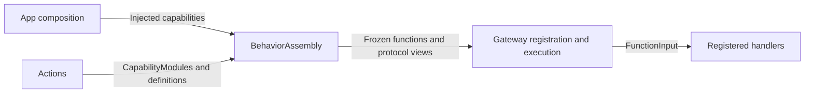

# Behavior Assembly

## Summary

Builds one canonical function catalog and projects explicit Action and Tool registration views.

## Ownership and boundaries

The BehaviorAssembly target depends on Actions, FunctionContracts, ExecutionRuntime and CallRuntime. It does not import AgentCore or select Agent permissions. Host bindings choose protocol, scheduling and fixed-caller result delivery; Actions owns implementation metadata.

## External relationships and data flow

Runtime arrows show data or capability calls; dashed arrows show injection.

## Catalog and protocol binding

BehaviorAssembly.swift validates the catalog, freezes FunctionRegistry once and shares it with both views. Duplicate addresses, missing implementations and unknown module profiles fail explicitly. Canonical resource and execution budgets come from the same definition.

BehaviorProtocolBindings.swift groups scheduling profiles by business module. ActionCall uses Channel/wait ordering; ToolCall uses direct returning execution. Both invoke the same FunctionInput handler. ReACT is derived by the Agent from the actual completion value/report or failure.

Camera functions have fixed Tool and scheduled Action bindings; Photographer model exposure is Camera Actions. System.Device.readEnvironment has both projections; Assistant exposes its Action only. UI.Navigation.open supports Agent Action execution while touch navigation calls the shared UI method locally. Speech.Listening.update is internal to SpeechPerception. Directed model communication is an authorized send Action supplied by the Agent layer, never an automatically added Tool.

## Validation and failure

Required capability injection has no no-op production default. Startup coverage checks the effective permissions against registered handlers before producers start. Agent aliases, internal grants and communication rights remain in role configuration/code. This directory owns no inference loop, native queue or task lifetime.

✅ Frozen shared function storage, explicit projections and implementation coverage are implemented.

❌ Dynamic function discovery and registry hot reload are not implemented.

## Related design

[Parent design](../README.md)

✅ Agent.Task controls register as Control Channel Action calls returning committed state. Start/load/release supply business output for continuation; terminal controls join cleanup and close their Task.

## Skill/task-mode contract

✅ TaskControlModule registers canonical loadSkills/releaseSkills/startTask/finishTask/cancelTask functions. RuntimePresentation injects the actual Assistant control endpoint; canonical implementations are shared by fixed and Action calls.

## Channel-owned Action ordering

✅ Action metadata has no serialization key. [ChannelScheduler](../../../Gateway/Output/Scheduling/README.md) owns task-local FIFO/wait ordering; ResourceCoordinator rejects unconfigured conflicts without a queue and preserves explicitly configured joined takeover.

## Task controls through Action Calls

✅ BasicSkill 的五个 Task/Skill 控制函数使用 Control Channel Action Call；App 通过 ChannelScheduler 返回已提交状态。startTask/loadSkills/releaseSkills 返回的已提交业务状态在结果屏障后重建目录并 ReACT，finishTask/cancelTask 加入回复及清理屏障后恢复默认。新目录仅影响后续请求，不允许加载轮提前调用新函数。可信固定调用复用同一实现。

## Result-driven ReACT (ADR0214)

✅ ADR0214：BehaviorProtocolBindings 删除显式反馈属性，BehaviorAssembly 删除两张反馈策略投影。宿主只配置协议、执行路径和固定调用结果投递；这些不决定模型 ReACT。

✅ ApplicationControl操作型绑定：Device.control、ModelResources.download/cancel增加Action协议投影并保留固定调用Tool投影，均复用原canonical handler和返回语义。模型当前目录只开放Skill声明的一种类型，宿主双协议不导致模型重复注册。

✅ Implemented: UI.Feedback maps to scheduled Action bindings alongside UI.Expression/Speech.Playback. Canonical child definitions are reused inside the parent listening composition; budgets and report semantics are inherited rather than duplicated by private playback code.

✅ Implemented (2026-10-13): UI.Notice.showNotice/dismissNotice and UI.Light.updateLight are canonical presentation Actions for trusted business calls, currently registered by no Skill. Neutral Actions values cross RuntimePresentation into root-owned HomeEffectsWorkflow, which retains one replaceable notice expiry and one light expiry, UUID-fenced cleanup, and explicit stop. Notices remain separate from factual ExecutionIssue history; actual upper-layer errors have display priority and Action failures remain panel-only. Decorative light accepts normalized origin, initial opacity/intensity and duration; it never changes consent, microphone or eyes. Native renderer separates light generations from listening eye generations and preserves existing exit fade. RuntimePresentation adapts Action requests into UI-owned values; AppPresentationWorkflow keeps its existing UI/AgentCore/FunctionContracts boundary. No UI project dependencies or new directories.
