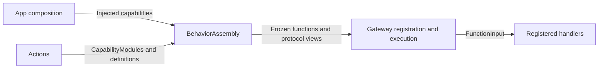

# Behavior Assembly

## Summary

Builds one canonical function catalog and projects explicit Action and Tool registration views.

## Ownership and boundaries

The BehaviorAssembly target depends on Actions, FunctionContracts, ExecutionRuntime and CallRuntime. It does not import AgentCore or select Agent permissions. Host bindings choose protocol, scheduling and feedback policy; Actions owns implementation metadata.

## External relationships and data flow

Runtime arrows show data or capability calls; dashed arrows show injection.

## Catalog and protocol binding

BehaviorAssembly.swift validates the catalog, freezes FunctionRegistry once and shares it with both views. Duplicate addresses, missing implementations and unknown module profiles fail explicitly. Canonical resource, serialization and execution budgets come from the same definition.

BehaviorProtocolBindings.swift groups scheduling profiles by business module. ActionCall uses Channel/wait ordering; ToolCall uses direct returning execution. Both invoke the same FunctionInput handler. Feedback is declared as recordOnly or observation independently of return values.

Camera functions have fixed Tool and scheduled Action bindings; Photographer model exposure is Camera Actions. System.Device.readEnvironment has both projections; Assistant exposes its Action only. UI.Navigation.open supports Agent Action execution while touch navigation calls the shared UI method locally. Speech.Listening.update is internal to SpeechPerception. Directed model communication is an authorized send Action supplied by the Agent layer, never an automatically added Tool.

## Validation and failure

Required capability injection has no no-op production default. Startup coverage checks the effective permissions against registered handlers before producers start. Agent aliases, internal grants and communication rights remain in role configuration/code. This directory owns no inference loop, native queue or task lifetime.

✅ Frozen shared function storage, explicit projections and implementation coverage are implemented.

❌ Dynamic function discovery and registry hot reload are not implemented.

## Related design

[Parent design](../README.md)
