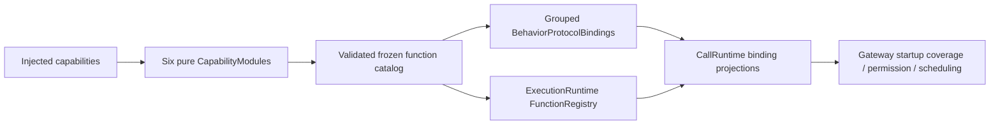

# Behavior Assembly

Purpose: inject host capabilities and assemble canonical business functions plus call bindings. Design goals: one frozen function store, explicit grouped profiles and no AgentCore dependency.

✅ BehaviorAssembly freezes the catalog once, creates FunctionRegistry and supplies it to both registration views. Canonical execution/resource/budget metadata always comes from that store. Explicit protocol-module injection remains for isolated hosts; duplicate functions or missing implementations fail without fallback.

✅ BehaviorProtocolBindings owns grouped host profiles and rejects unknown modules. Existing expression/speech/motion/gesture scheduling, returning history/system calls and completion-only presentation/camera/tracking calls are preserved. Agent aliases/exposure lists remain in Agent JSON/code.

✅ This target depends on Actions, FunctionContracts, ExecutionRuntime and CallRuntime only. Gateway's AgentCore-dependent orchestration is not imported. Business functions and injected endpoints accept standard FunctionInput, not scheduling/native invocations.

❌ Discovery, permission inference and configuration fallback are not implemented.
