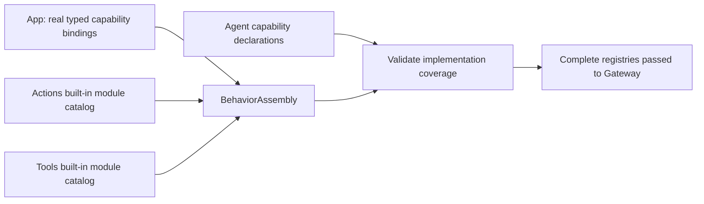

# BehaviorAssembly

Purpose: construct complete Action/Tool registries from domain-owned modules and validate Agent capability coverage before runtime startup. Design goals: no per-function App registration, no device construction, no implicit discovery or partial async installation.

✅ Independently compiled BehaviorAssembly target depends only on AgentCore, Actions and Tools. The host supplies typed presentation/playback/pose capabilities and a required `shakeBase(Int, ActionInvocation)` closure. Actions.ActionModules and Tools.ToolModules own built-in module catalogs; each domain owns its definitions and handlers. An explicit module-list initializer supports isolated tests and alternative hosts. Registry creation rejects duplicate paths, invalid definitions, bounds and missing model/internal implementations before returning.

No new queue or long-lived task. Maximum 32 Action modules and 32 Tool modules; existing total definition bounds remain 256/128. At most 128 capability catalogs per assembly. Missing dependencies are required typed initializer arguments, not optional fallbacks. Resource declarations remain part of definitions; ownership stays with the runtime coordinator.

✅ BehaviorAssemblyTests verifies production Agent coverage, typed argument rejection before effects, returning/completion Tool semantics, malformed/duplicate/bounded catalogs and additional modules without an App host. App adapters implement semantic capabilities without invoking individual UI Action/Tool helpers.

❌ New physical capabilities or lifecycle changes still require host adapter/binding changes. No automatic reflection, plugin discovery, generic Any command bus or hardware construction. Domain signatures not involved in registration retain documented migration exceptions.

✅ The built-in Action catalog includes the domain-owned NexArm base definition; host availability failures propagate. ❌ Assembly creates no USB device or robot lifetime.

## NexArm entertainment skills (2026-09-30)

✅ Built-in assembly now also requires the typed NexArm GestureRequest callback and includes the domain-owned entertainment module. No optional success fallback or string dispatch is introduced. ❌ Assembly does not validate physical clearance.

## Action and Tool presentation boundary

✅ BehaviorAssembly binds immediate UI tools separately from UI.express and Speech Actions; startup validation checks the updated internal grants. ❌ There is no module/source-specific Action visibility filter.

✅ Assembly validates Agent permissions against module-owned definitions, translating Action paths and checking Tool availability before producers start. Registries themselves do not depend on Agent capability catalogs.
