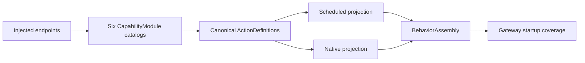

# Behavior Assembly

Purpose: bind host capabilities to domain-owned executable catalogs. Design goals: explicit composition, one definition per implementation and no AgentCore dependency.

✅ Production builds the six-domain collection once and supplies filtered Action/Tool projections. It retains canonical paths, resource/budget metadata and protocol availability. App supplies handlers but defines no per-function metadata/registration lists. BehaviorAssembly imports Actions/ActionRuntime only.

✅ Explicit protocol-module injection remains available for isolated hosts/tests; startup coverage rejects missing implementations. Tools/ToolRuntime compatibility dependencies are removed.

❌ Runtime discovery, permission inference and configuration fallback are not implemented.

✅ Composition freezes CapabilityCatalog once before projection: at most32 domains/256 canonical definitions, shared metadata validation before filtering, and duplicate addresses rejected across protocols. The same handler/metadata snapshot feeds both registries; invalid unexposed definitions cannot disappear silently.
