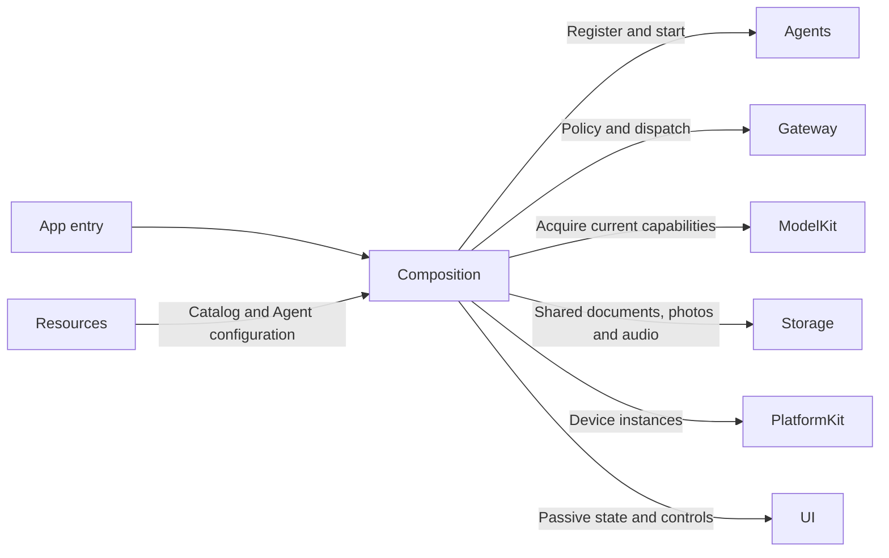
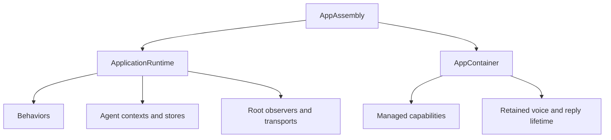

# Application Composition

## Summary

Constructs the application graph and supplies immutable runtime slices to lifecycle and feature owners.

## Ownership and boundaries

AppAssembly is owned by MobileHarnessApp. ApplicationRuntime owns shared Agents, Gateways, repositories and subscriptions; AppContainer prepares acquired capabilities and retains interaction tasks. Consumers receive interfaces rather than querying a global container.

## External relationships and data flow

Runtime arrows show data or capability calls; dashed arrows show injection.

## Internal structure

## Service construction

| Component | Responsibility |
| --- | --- |
| AppAssembly.swift | Resource roots, lazy runtime, shared AppleCamera and BluetoothWorkflow, history/settings operations and AppContainer |
| ApplicationRuntime.swift | Seven Agent roles, role-specific memory contexts, communication policy, function bindings, scheduler/resources and root observations |
| AppContainer.swift | Managed capability handles, model preparation, voice/diagnostic construction, memory warnings and retained interaction lifetime |
| Behaviors | Frozen business catalog and explicit protocol projections |

ModelKitDefaults is the process-wide registration/manager owner. CurrentChatCapability resolves the configured binding per request; each role receives its own context repository. History reads bounded live memory and indexed SQLite archive pages through the shared history facade. Camera and history share the bounded CapturedPhotoStore. Audio ownership uses StorageAudio.

## Resource and endpoint wiring

Composition creates one ResourceCoordinator and ChannelScheduler, registers camera.capture and six NexArm motor resources, and wires feedback to InputGateway. Camera capture uses the host camera owner; inherited execution permits authorize Agent writes. Settings native takeover remains an explicit host policy.

RuntimePresentation binds complete voice/camera endpoints with source/session/task validation. Provider credentials use injected Keychain primitives; Actions owns transactions and model eligibility. Resource observation, Action/Task/Agent logs and specialist transports remain root-owned across page changes.

## Replacement and shutdown

Preparation errors propagate before admitting dependent work. Interactive scene transitions join root/child startup before lifecycle lookup. Reconfiguration cancels/joins affected owners and applies the native binding barrier; durable commits survive later application failure. Scene background fences native work and cancels inference without introducing background robot execution.

One shared runtime, independent role contexts and Assistant history, explicit native endpoints and current-binding chat are implemented.

## Related design

[Parent design](../README.md) · [Behaviors](Behaviors/README.md)

## Skill/task-mode contract

ApplicationRuntime constructs one conversational Assistant, three fixed deterministic coordinators and media Agents; owns a bufferingNewest(1) Skill/task observer independent of pages. Per-task log rows carry local mode/Skills/input IDs rather than Assistant→Assistant delegation.

## 泛化 Task 与独立 Skill

Root-owned bounded Skill projections populate task ID/goal/status and Skill ownership. Task Signal projections supply independent background state. UI local expansion/navigation uses no Agent commands.

## Skill 函数目录

ApplicationRuntime 对固定角色目录及每个 bundled Skill 独立检查实现覆盖，避免把所有 Skill 合并为静态权限上限或强制彼此可组合。

## Action-owned documentation and Skill instruction contract

ApplicationRuntime 在创建 Agent 或读取配置前安装 CapabilityModules.declarations；投影无宿主设备依赖。后续真实执行模块仍绑定 App 能力，Agents 不导入 Actions 实现。

## Task 与历史边界

历史开始新对话入口复用 Assistant 固定 cancelTask Action 能力结束等待任务，再调用 Memory 归档；保留数据，不直接写 Agent 上下文。

## Result-driven ReACT

ApplicationRuntime 不再构造或注入 GenerationPolicies，BehaviorAssembly 不再输出 Action/Tool 反馈策略表；函数/协议/资源/权限覆盖及生命周期装配保持原职责。

前台任务日志使用持久化更新时间（无此字段使用创建时间），投影携带失败原因，启动恢复不显示为新发生的任务。

ApplicationControl操作型绑定：Device.control、ModelResources.download/cancel增加Action协议投影并保留固定调用Tool投影，均复用原canonical handler和返回语义。模型当前目录只开放Skill声明的一种类型，宿主双协议不导致模型重复注册。

Task 上下文由 Agents 选择：进入 Task 保留已有普通背景、启动轮及完整调用/结果；Task 终态后按源索引收敛为摘要。拍摄图片直接 enrichment，当前照片事实来自原生相机，完整执行历史独立持久化。详见 [Chat](../../Agents/Support/Chat/README.md)。

VoiceRuntimeDependencies.cancelReply is injected from the existing AgentInteractionRuntime and scoped to interactionSessionID. No new provider/service/global dependency or pause/remove/re-register of the Assistant.

existing RuntimePresentation supplies feedback to UIModule, while UI.Feedback uses the existing scheduled Action binding profile. No new target, directory, native service locator or whole-session cancellation.

AppAssembly supplies CapturedPhotoStore.Limits(maximumPhotos: 1024, maximumBytes: 2 GiB, overflowPolicy: evictOldest). Limits are validated on first I/O; media metadata is stored through the injected MediaRepository.

## 历史记录接口

AppAssembly 注入 Agent 记录入口与唯一的 Assistant 聊天记录工作流；ApplicationRuntime 不再聚合任务历史，其他 Agent 暂无记录页面。

装配向 notice/light Actions 注入 RuntimePresentation 端口，根持有 HomeEffectsWorkflow；输出投影和停止清理见 [Presentation](../Workflows/Presentation/README.md)。

mask bottom ASR and reply/status immediately while a notice is visible, restore retained text after dismissal, and preserve pinned Task/promoted ASR layout. Consent-off clears both captions; root HomeEffectsWorkflow owns one ID/text-fenced350ms reply fade/removal task, cancelled by new text/turn/off/shutdown, scheduled only after reply-policy/playback/native-resume barriers. Agent errors stay in factual root failure notices, not persistent voiceStatus copies. Durable configuration documents retain explicit file protection. Agent runtime state uses memory; business records use SQLite. This does not infer the cause of historical lock-boundary failures.

## Task history v2 and in-place compression

ApplicationRuntime 使用 SQLite 保存 dialogs/messages，Assistant 热上下文保存在有界内存仓库；启动从规范化业务记录恢复终态事实，不导入运行时 Context 文件或重放执行。

## Model photo input capability wiring

ApplicationRuntime installs AssistantContextBuilder.photoObservationHandler with read and prepareJPEG closures. The role-owned factory builds the observation worker callback; App does not interpret observation results. read only retrieves the owned original via CameraControlCapability and wraps its original MIME/data/identity. prepareJPEG maps the caller's AssistantPhotoInputPolicy fields to generic NativeImageCompression.Limits, awaits the native capability and returns its bytes. No hardcoded analysis thresholds, workflow decision or ChatImage preparation remain in App. Assistant owns policy choice, invocation, cancellation/error checks and output construction; PlatformKit owns native encoding. See [Assistant policy](../../Agents/Assistant/README.md#model-photo-preparation-policy).

## SQLite records and runtime identity

AppAssembly constructs one SQLiteRepositories family, repairs in-flight facts before runtime admission and injects domain protocols into conversation, media and Bluetooth owners. Initialization failure is retained and propagated. Every Agent runtime context uses Storage memory state; no Context JSON is loaded or saved. Title sampling positions come from Memory, SQL supplies lightweight snippets. Existing user media, credentials and model artifacts remain outside cleanup.

AppAssembly creates SQLiteRepositories and domain adapters, runs startup recovery before runtime admission, then injects chat/task/media/device protocols. Media also receives a BinaryObjectStore.

ApplicationRuntime 的云配置位于 MobileHarness/Settings/settings.json，AppAssembly 注入 Models/download-source.json、CapturedPhotos、Keychain 和 records.sqlite 的路径。运行热状态仅在内存，不导入 Context 文件。

所有角色使用内存 AgentContextRepository；配置文档由 File 后端保存，业务记录由 SQLite 仓库保存。

## Voice model admission

✅ AppContainer resolves stable speech capability handles with load:false. VAD, ASR and TTS acquire/load their own model resources on the actual request; no prepareRecognition warmup closure gates native recording. Lifecycle owns permissions and capture, and SpeechPerception owns the bounded model-wait queues.

## 待实现

- Independently active window runtimes and a unified audio-resource arbitration mapping are not implemented.

- 历史记录页面板块重新设计及原生 UI/真机验收。
