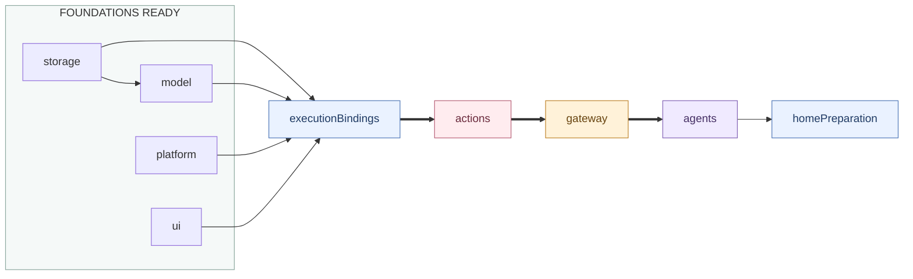

# Application composition

## Ownership and files

This directory constructs and connects public module interfaces, installs static lifecycle services and composes UI presentation. It contains no business request consumer, per-frame forwarding, function registration, role policy or domain schema conversion.

| File | Responsibility |
| --- | --- |
| ApplicationContainer | FactoryKit instance cache for seven roots, root capability aliases and the failure channel; compiled as AppStorage. |
| ServiceFactories | Scoped backend selection, deferred repositories, module roots and thin public capability adapters. |
| ApplicationActionAssembly | Calls Actions-owned business assembly and binds public cognitive/execution ports. |
| ActionServiceAdapters / AgentResourceBindings | Narrow camera/device/voice/detection and resource-run adapters; no business service registry. |
| ModuleRegistration | Public lifecycle bindings and explicit startup/rollback/stop graph. |
| AppComposition | Services lifetime, bootstrap, retry and scope replacement. |
| ApplicationPresentation | UI application/session interfaces, existing role state/control and navigation/preparation callbacks. |

Foundation aliases refer to the same owning roots. Services retains ActionsContainer, GatewayContainer and AgentContainer independently. ActionsBusinessAssembly is an Actions-owned helper retained/cleaned by ActionsContainer, not another lifecycle root. Domain/module/action declarations remain extensible library values.

## Wiring and order

Diagnostics precedes foundations. Thin arrows are readiness dependencies and thick arrows emphasize the business-root readiness chain. This graph describes lifecycle, not imports. After foundations start, executionBindings connects the cognitive request to Actions-owned service assembly, configures Gateway with the neutral execution port/resources/result callback, validates immutable catalog coverage and binds hosts. Configuration does not open business admission or devices.

Stop reverses dependencies and retains ports through Agent, Gateway and Actions cleanup. Binding rollback also stops a cold/configured Actions root if startup never reached its own node; an already stopped root is not stopped again. Every root owns and joins its own tasks; App does not inspect another module's worker registry.

## Foreground, replacement and errors

Only active Scene opens admission. Inactivation synchronously fences roots, then joins required suspension. A successfully rolled-back startup interrupted by system inactivity waits for active before replacing its scope. One replacement task coalesces events; cleanup failure retains the old scope/error and prevents duplicate native owners.

Background URLSession completion can use the same model/storage scope before foreground startup. Replacement joins those roots even if they never reached the graph's started set. No camera/audio/UI inference is started by background restoration.

ApplicationContainer projects each module's structured Failure, including ActionsFailure and GatewayFailure, into the existing diagnostic channel while preserving original errors. ModuleRegistration normalizes only pure cancellation after recording evidence; mixed cleanup errors remain failures. App supplies bootstrap failure before roles can present diagnostics.

ForegroundPreparation is activated after the lifecycle foreground barrier and visible-home check. ModelKit reports actual load transitions; App updates interaction readiness and forwards facts to Agents for presentation. Ordinary checks, already-ready state and cloud configuration do not fabricate loading. See [Lifecycle](../Lifecycle/README.md) and [overall flows](../../README.md).

## Native State capability binding

ServiceFactories injects the complete ApplicationStateInspection.snapshot read into AgentContainer. Native facts retain PlatformContainer ownership; Assistant selects their Business fields. This binding adds no App sampler, JSON schema conversion or extra lifecycle node. Platform startup owns passive native observation; Agents selects per-request reads, and roots retain their existing reverse cleanup order. Neither Actions nor Gateway is an intermediary for native State reads.

## Observation and query composition

App binds complete inspection.snapshot(path:) reads and reports scene/model preparation to Agents. Assistant owns its source field selection; App does not convert or filter domain schemas. Navigation State includes UI-owned page and album context. Specific business query Actions retain their owning services; App binds no generic environment/last-result callback from Agents into Actions.

## Internal state inspection

`ApplicationStateInspection` registers seven scoped module catalog factories, each returning exact paths and read-only reader capabilities for existing owners. Factories contain no state copies, filtering policy or service creation. Module-local data is structurally encoded/decoded only in this adapter; independent foundations do not import a shared State module.

`snapshot(path:)` resolves and reads exactly one node, without reading ancestors or siblings. `describe(path:)` derives that node's descriptor; callers with a snapshot use its stateDescriptor directly. Local snapshots contain child Reference indices only. Registration/lookup bounds catalogs to 256 nodes and encoded samples to 256 KiB. Category overlap, invalid child indices/metadata/enums, malformed paths and cancellation propagate. Owner read/encoding failure is readFailure with unknown health; a rejected configuration fences reads. The registry and State contain no global atomicity claim.

`inspectTree(path:depth:)` is explicit internal caller orchestration: read a node, follow its indices within depth 16 / 256 nodes / 256 KiB, and materialize a separate Tree. Diagnostic health aggregates are Tree properties, never Container State fields. Internal healthProjection/diagnosticProjection use this explicit traversal and preserve bounded historical evidence independently from current health. These operations are not Assistant sources or model tools.

App binds only exact snapshot(path:) into Agents. Assistant owns Business field selection for canonical Skill-declared paths. No alias or system.health/system.diagnostics scan can reveal an undeclared descendant. The weak Agent catalog binding avoids retaining the Agent root through its injected read callback. Lifetime, execution, UI and device behavior remain owned by their existing modules.

App explicitly sequences execution preparation: AgentContainer prepares cognitive inputs; ActionsContainer.configureBusiness owns business assembly preparation and returns execution/catalog/host ports; the Agent preparation validates Skill coverage and returns Gateway configuration; App configures Gateway and calls AgentContainer.bindExecution with the resulting facilities. The executionBindings lifecycle node retains this configuration boundary for partial-start rollback and reverse cleanup. Actions owns internal function binding; App owns the cross-module sequence.
