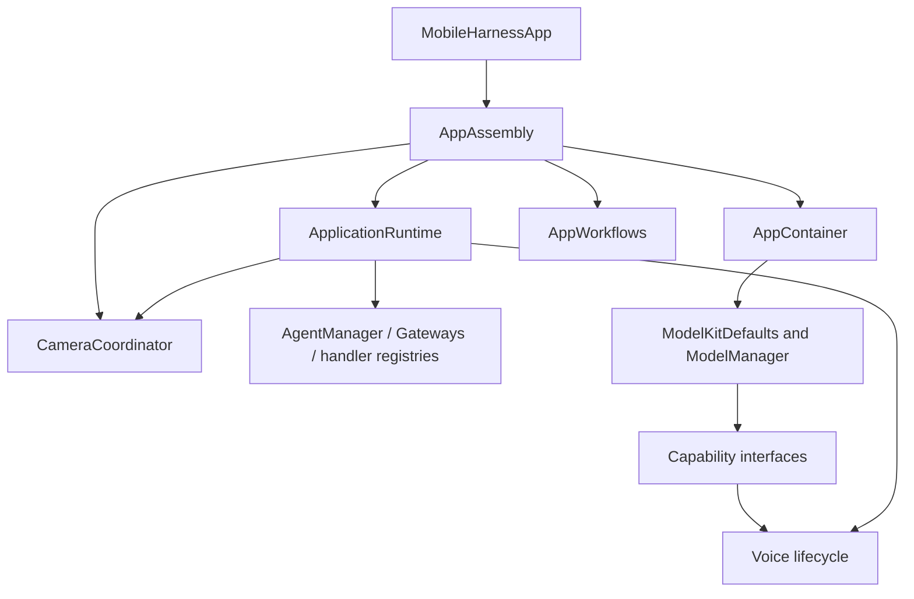

# App Composition

> Historical observation (2026-09-29): the user identified desktop simulator screen sharing as the cause of missing iPhone camera/microphone input; no causal claim is made about the earlier BLE failure. Current Bluetooth recovery is device-scoped (ADR0129); physical BLE/voice coexistence acceptance remains pending.

Purpose: construct the application graph and bind concrete services. Design goals: one explicit root, narrow injected dependencies, no hidden runtime lookup or duplicate model registrations.

| File | Responsibility |
| --- | --- |
| AppAssembly.swift | Root-owned resource path and lazy runtime, settings/history operations, camera coordinator and prepared AppContainer |
| AppContainer.swift | Receive the resource path/runtime, acquire managed capability handles, prepare voice models, assemble VoiceSessionCoordinator and diagnostic operations, forward memory warnings |
| ApplicationRuntime.swift | Independent Agent context repositories and history readers, packaged communication policy, AgentManager, Gateways and typed capability bindings to BehaviorAssembly; create Assistant with the same journal and injected chat/model-label query |

AppAssembly is owned by MobileHarnessApp. Its services survive page navigation. ApplicationRuntime has no static shared accessor; voice, vision and camera receive immutable role-specific service slices. ModelKitDefaults retains process-wide model registration and the manager. Chat operations use the current-binding adapter in App/Adapters. Diagnostic execution lives in App/Workflows; this directory only supplies its dependencies and connects views.

✅ Same journal for Assistant/history; same voice-scope PCM store for synthesis/playback; process-wide ModelManager remains owned by ModelKitDefaults. Model weights never enter UI. The settings form necessarily holds its editable credential draft; Actions owns credential-reference persistence/migration through injected App Keychain primitives; no credential is written into the settings document or Agent transport.

❌ Multiple independently active window runtimes and model/provider hot replacement outside the existing chat configuration workflow.

## Action implementation validation

✅ BehaviorAssembly constructs domain-owned ActionFunctions with finite/state kind and completion descriptions, then applies grouped host registration profiles, then validates all four packaged Agents' assembled Action and Tool catalogs before creating the scheduler. Assistant, SpeechPerception and VisionPerception expose their own runtimeCapabilities assembly, so internal grants are not copied into App; synthesis uses its packaged catalog. Duplicate/invalid definitions and missing implementations throw from initialization without fallback. Completion descriptions acknowledge UI stale-update no-ops and distinguish target acceptance from animation completion.

❌ These checks verify implementation coverage, not adapter correctness, activity ownership or physical-device completion. General dynamic registration/hot reload remains outside this stage.

## Action runtime stage 2

✅ AppAssembly owns one AppleCamera instance shared with CameraCoordinator and ApplicationRuntime. Runtime assembles camera.capture ResourceDefinition, a single ResourceCoordinator, scheduler feedback delivery to InputGateway, and OutputGateway sharing that authority. Only runtime.camera may acquire capture leases. Six NexArm motor resources are registered for guarded host/Action workers; audio resource mapping remains outstanding.

## Domain-owned behavior assembly

✅ ApplicationRuntime now calls the independently compiled BehaviorAssembly in Behaviors/ once, providing typed capabilities and assembled Agent permissions. It contains no concrete Action/Tool paths, handler definitions or async prepareTools task. Missing Action or Tool implementations fail synchronously before startup. App still owns devices, resource definitions and runtime lifetime. ❌ New physical capabilities/lifecycle changes can require App binding changes.

## Storage domain organization

✅ ApplicationRuntime assembles LocalDocumentStore from Storage and ConversationHistoryStore from StorageChat. The physical journal URL, schema and single-owner lifetime are unchanged.

✅ Bounded owned JPEG storage is implemented for photo observations (ADR0184). ❌ Galleries/video/semantic-memory stores remain planned.

✅ BehaviorAssembly requires a typed `shakeBase` binding. The iPhone root binds BluetoothWorkflow; the Mac diagnostic binds USB. Both fail explicitly when unavailable.

✅ AppAssembly owns one BluetoothWorkflow and NexArmBluetooth for Settings and conversation. Connection/recovery has no voice lifecycle or scheduler admission callback (ADR0129). ApplicationRuntime binds NexArm handlers to that workflow; device exceptions and reports use the existing Action/Tool execution/result path through InputGateway. ❌ Physical coexistence remains pending.

## NexArm entertainment skills (2026-09-30)

✅ ApplicationRuntime explicitly maps typed NexArm gesture requests to PlatformKit presets and the shared BluetoothWorkflow. Domain registration remains in Actions; callable permissions remain in Assistant JSON. ❌ New complete gestures await device acceptance.

✅ ApplicationRuntime creates and retains the unified ActionActivityWorkflow before model preparation, injecting ChannelScheduler's bounded full-snapshot observation stream. AppContainer exposes its UI state to ConversationView. This subscription survives page navigation and remains independent of Agent result delivery; no UI-to-Gateway dependency is added. ❌ Per-device progress callbacks and durable presentation history are not implemented.

## Head gestures

✅ The explicit gesture binding maps nod and shakeHead to the shared controller. No transport-specific choreography is duplicated. ❌ Hardware acceptance is separate from registration.

## NexArm feedback execution — 2026-10-01

✅ ApplicationRuntime binds `NexArm.Motion.reset` to BluetoothWorkflow.resetArm and other NexArm actions to the shared performer. No motion timing or arrival logic belongs in composition.

❌ Sustained real-device acceptance remains pending.

## Atomic composition — ADR0092

✅ ApplicationRuntime registers six motor resources, injects Settings/manual resource execution, and transfers full device reports through ActionComposition into invocation results. Cleanup joins software work without claiming physical stop.

❌ Sustained real-device acceptance and durable result delivery remain outstanding.

✅ ADR0093: NexArm bindings now resolve the gesture catalog from Actions. PlatformKit supplies connection/protocol capabilities; no platform gesture enum or business display-name catalog remains.

✅ ADR0098: Composition owns Agent factories and supplies role-specific service slices. Robot/provider/history adapters and feature workflow targets are explicit bindings. Permission coverage runs separately through Gateway before scheduler/producers start.

✅ AppAssembly supplies the root CameraCoordinator to ApplicationRuntime; RuntimePresentation binds the CameraControlCapability required by BehaviorAssembly. It does not create a second camera owner.

✅ Photographer policy and internal Tool coverage are assembled alongside existing Agents. NexArm.Tracking.aim binds the foreground Bluetooth workflow without adding AgentCore to BehaviorAssembly.

✅ ApplicationRuntime injects the root PhotographerIntentRuntime into VisionRuntimeDependencies and grants Photographer motors1–5 only. NexArm.Tracking.aim binds NexArmBehaviorAdapter alongside existing gesture bindings.

✅ Composition injects Photographer control availability as a read-only MainActor BluetoothWorkflow snapshot; Agents imports no device SDK or App service.

## Local model resources — current contract

✅ AppAssembly injects ModelKitHub and the Storage adapter through Defaults into one process manager. Catalog schema v2 declares sources; the resource root is Application Support/MobileHarness/Models/installed. Settings state outlives pages; voice preparation is explicit. ❌ HF foreground requests restart after process relaunch; full iPhone acceptance remains pending.

✅ 本地模型工作流注入的同步校验与存储构造遵循 MainActor 隔离，真机构建使用 App 现有签名配置。❌ 安装成功不等于下载网络与交互验收完成。

✅ Nemotron downloads and registration now use the shared Core ML catalog entry, without CoreAI device validation.

✅ AppAssembly restores speech preference before AppContainer construction. On changes it pauses voice through the lifecycle settings barrier, updates ModelKitDefaults policy, and releases the barrier. AppContainer uses stable default speech facades and diagnostics warms the selected synthesis; Gemma 4 E2B/YOLO are unchanged.

✅ AppAssembly applies independent recognition/synthesis preferences through the lifecycle settings barrier and caches their pair to avoid repeated voice cancellation. Model capabilities remain independently registered; download/delete backends and chat configuration are unchanged.

✅ ApplicationRuntime injects AgentContracts.communication and MediaInputAdapter.externalSources into CommunicationPolicy. Agent JSON parsing uses the same application schema catalog; Core/Gateway know no concrete speech/vision schema names.

✅ Camera resource registration uses CameraCoordinator.captureResource rather than a concrete constant in AgentCore. Existing lease ownership and stop acknowledgment remain unchanged. ❌ No new resource policy.

✅ ADR0119: App transports native camera frames and native-rate microphone samples with session/source/deadline metadata. Calling perception Agents own conversion into ModelKit inputs; composition no longer injects image conversion. SDK inputs/outputs are owned by ModelKit or PlatformKit, without Types dependencies. ❌ No physical-device acceptance is implied.

✅ ADR0121 removes the Types module: AgentCore/Input owns generic audio/image transport, UI/Camera owns PoseOverlay, and VisionPerception owns PoseOverlayPayload. App adapts the independent Tool payload into UI values. ❌ Capability SDKs must not import consumer or presentation modules.

✅ ADR0126 / ADR0139: ApplicationRuntime maps resource-busy/unavailable errors into Actions-owned execution failures at the injected Agent resource boundary, independently of native Bluetooth status/recovery. NexArm.Tracking.aim publishes without a second Tool fence; its continuous worker retains trusted owner/session cleanup. App configures Assistant-over-Photographer shared-writer takeover; Gateway implements generic arbitration only and PlatformKit contains no business priority or localized presentation.

✅ ADR0127: Settings presets/reset/jog bypass the injected Agent motor guard. Resource cleanup is bound to `stopAgentActions`, preserving independent manual ownership; Photographer availability uses `trackingAvailable` to avoid new aim commands during manual takeover. Actions recipes and PlatformKit pacing remain shared. ❌ Physical-device acceptance remains pending.

## Audio detection assembly

✅ AppContainer composes AudioDetectionWorkflow with the whole AudioDetectionSession endpoint and stable capability handles. Diagnostics select direction-only perception without model warmup. Weak pre-start barriers join voice/diagnostic shutdown before replacing microphone ownership. The application host injects UI state/controls and cancels diagnostics when the scene leaves active.

❌ Physical capture and navigation/background interaction acceptance remains pending.

✅ ADR0129: composition does not bind Bluetooth recovery to Channel cancellation, queue removal or resource suspension. Accepted Actions retain normal execution and feedback policy; device availability is checked by the handler when it executes. Model-setting changes retain their separate voice cleanup barrier.

✅ ADR0131: composition starts one root-owned Output failure observer beside the Action observer and injects that execution presentation endpoint into NexArmBehaviorAdapter. Bluetooth recovery and native diagnostics remain independent; neither observer depends on page lifetime. ❌ Physical coexistence acceptance remains pending.

## Tracking freshness and takeover — ADR0139

✅ All six NexArm resources share nexarm.writer executionGroup. Host policy explicitly permits Assistant to preempt Photographer; reverse, equal-owner and unknown-owner conflicts reject. Cleanup uses stopAgentActions and preserves Settings ownership. The root Photographer binding supplies a weak read-only hasFreshPose query into BluetoothWorkflow, avoiding a retained Agent cycle; default production freshness is one second. Generic Gateway contains no concrete identities/device policy.

❌ Physical interruption and camera/Bluetooth coexistence acceptance remain pending.

✅ ApplicationRuntime binds HistoryQueryService using its existing shared journal; App retains no history query policy. ✅ Composition now supplies a separate root memory session, history Agent/transport and scoped presentation adapter. ✅ Confirmed archive deletion now follows Agent-selected Tools and actual feedback; archive/title now uses the same Agent-selected function/result route.

✅ Composition retains ModelResourceInteractionWorkflow and its passive ModelResourcesState separately, passing both explicitly to SettingsView. ❌ Resource controls are not yet routed through an Agent/Gateway.

✅ ADR0152: production registers one six-domain CapabilityModules catalog, with unified UI/NexArm ownership and unchanged call paths/permissions. Registry projections preserve existing execution policy; regression coverage checks expression and gaze through the same UI catalog. ❌ Unified call definitions and compatibility removal remain pending.

✅ ADR0157: canonical executable definitions and shared outcomes replace duplicate protocol metadata; consumers import Actions/FunctionContracts. Protocol request views remain adapters, and production permission/resource boundaries are preserved.

❌ Physical acceptance and additional business capability exposure are not established by this migration.

✅ ADR0159 — Unified invocation: all business functions, injected capabilities and registered handlers receive FunctionInput with ActionExecutionContext. Native request/result normalization stays in Runtime/Gateway; no protocol-specific implementation signature remains.

✅ ADR0161: standard callable inputs use FunctionInput/FunctionContracts; common execution and call protocols belong to independent Gateway targets. This directory retains its existing ownership, resource/permission and lifecycle boundaries. ❌ Remaining feature Signal/continuation and physical acceptance are separate work.

✅ Implemented: bind lazy title computation to the shared HistoryMutationService, delegating only the bounded title algorithm to Memory helper. Inject prepare/startNew/summarize operations into the history facade; remove its journal and title-generation callbacks.

✅ Implemented: assemble a seventh business Agent, fixed root resource session and bound command transport. Lazy ModelResourceCapabilityAdapter preserves ModelKit admission/cancel/remove and quiescence callbacks. Settings download/cancel/remove callbacks emit typed Agent intent; no direct manager mutation remains in those callbacks.

✅ ADR0167: Settings preference application emits configureSpeech through ApplicationControlIntentRuntime. Lifecycle barriers and native Defaults binding are injected into the existing adapter; App no longer decides whether the preference command should run.

✅ ADR0168: required ModelResourcePreferencesCapability joins composition; restore/save callbacks send typed intent and decode successful results for UI. Store construction and native installed/validation endpoints are injected into Actions; no direct preference read/write remains in App.

✅ ADR0169: one native resource adapter supplies management and inventory interfaces. UI refresh binding calls ApplicationControlIntentRuntime.inventory, with no direct native snapshot query. Preference prerequisite snapshots remain separately injected native facts.

✅ ADR0170: inject the existing resource state and native inventory capability into root ResourcePresentationAdapter/ResourcePresentationModule. Generation-bearing reads invoke ApplicationControlIntentRuntime.presentInventory; query-only reads retain inventory().

✅ ADR0171: ApplicationRuntime owns observer and resource transport, injects fact/read, sequenced delivery, revision invalidation and host failure reporting. AppAssembly starts observation only after preparation and forwards active/background changes. No page owns the loop.

✅ ADR0174 packaging: existing Agents package discovers ModelResourceSignals.swift in Communication; the Xcode navigator references that source. Root communication policy admits app.resources with the typed contract, without adding a target or model grant.

## Provider discovery

✅ Implemented: root assembly constructs ProviderDiscoveryRequests with the native SDK adapter, injects its capability into the production catalog and stages form values with the resource root session. Only requestID enters the Gateway. Provider source file navigator references use existing groups/package discovery; no new directory, target, configuration file or dependency.

## Provider configuration transactions

✅ Implemented: ApplicationRuntime constructs Actions ProviderSettingsService/Store/Requests using SDK/lifecycle callbacks and native credential adapter, includes the two functions in frozen registration, stages root-session drafts and takes/discards private result slots. AppAssembly injects begin/end barriers and intent closures. Existing Xcode navigator groups are reused; the new native adapter is added to App sources.

## Completion batch — provider presentation and capability policy

✅ Implemented: provider discovery model-family eligibility belongs to Actions ProviderModelList; ModelKit validates/decodes raw IDs only. Preserve filtering/dedup/order and bounds at the app boundary. SettingsState becomes a passive editable snapshot, with no tasks or injected execution; SettingsInteractionWorkflow in the existing Settings directory owns bounded form admission, revision and page-independent saves. UI forwards edits/discovery/cancellation/save through SettingsControlling.

✅ Implemented: presentation-enabled provider intents select a second registered UI.ResourcePresentation.showProviderResult call after the business call, on success or failure. Headless requests retain one call. Private result lookup and revision/session fences prevent credentials in protocol payloads and stale form updates. One attempt only, no recursive presentation/replay; producer and presentation failure chains remain distinct. App injects the native UI endpoint; business functions remain independent of UI and call protocols.

## Typed device, navigation and environment entry points

✅ Implemented: app.interaction/1 maps explicit device commands and navigation destinations to fixed registered functions through ApplicationControl and the shared root transport. This Agent now coordinates native resource interactions as well as model resources; it performs no native I/O. UI controls emit typed intent through a root-owned BluetoothInteractionWorkflow; native BluetoothWorkflow remains the injected connection/recovery/manual worker host. Existing arrival tolerance, timeouts, pacing and takeover algorithms stay unchanged.

✅ Implemented: System.Device.control validates bounded string arguments and invokes neutral DeviceControlCapability; successful submission reports acceptance, not physical arrival. Read-only status and selected connection commands are explicitly model-granted. UI.Navigation.open commits native route state; manual taps and model requests share that function. A bounded latest motor-intent worker sends only changed values, with reset/stop priority and explicit failure display. No queued motion replay.

✅ Implemented: app.environment/1 stores latest sequenced scene/device/capability facts in the root Agent, with finite categories and bounded data. App still performs synchronous background/native safety fencing before reporting facts; physical safety cannot wait on Agent admission or iOS background execution. Native back navigation remains platform-owned and reports a fact, rather than replaying navigation effects. Photo-library creation and physical acceptance are feature/acceptance boundaries, not implied by navigation support.

## Camera command entry

✅ Implemented: CameraInteractionWorkflow emits typed open/close/flip/retry intents through Photographer and existing Camera functions. Root presentation accepts Photographer in the stable root session or validated active task scope; Assistant delegates through task communication; Photographer executes under its actual identity. Native capture, permission, lifecycle fences and joined cleanup remain CameraCoordinator responsibilities. Retry uses a canonical callable and the native explicit settings/permission request. UI receives controls and passive camera state, not the native coordinator. One command slot rejects overlap, no replay.

## Manual worker terminal feedback

✅ Implemented: accepted device-control calls acknowledge submission only. Preset/jog native workers capture their own origin and report sink, retain one latest structured terminal failure, publish independent home issues and deliver a trusted ActionResult through InputGateway after non-cancellation failure. Root ApplicationControl accepts runtime-owned Action results into a bounded128-result inbox; environment context exposes the latest result summary. No accepted Tool receipt is rewritten, no movement replay, and no tolerance/arrival/timeout algorithm changes. Ordinary failure stops only its worker and keeps subsequent intents admissible. Diagnostic delivery rejection is reported separately.

✅ ADR0180: Memory / memory identity and MemoryHistoryIntent are used consistently in configuration, host transport, presentation source guards and regression fixtures; preserve history.intent/1 and runtime behavior. Enforce the two reorganized roles’ directory/actor/configuration naming and isolated business components.

✅ ADR0181: compose one Photographer and dedicated root camera UUID; use its descriptor for capability coverage and root presentation authorization. Bind Assistant camera delegation after Gateways exist. Vision dependencies inject PhotographerIntentRuntime; no transient Photographer factory remains.

✅ Interaction refinement: Camera delegate and manual-control closures carries explicit front/back targets to Photographer; existing ownership and request cleanup remain.

## Action/Tool generation rounds — ADR0183

✅ BehaviorAssembly projects immutable host feedback policies. IndependentOutputWorkflow admits Actions in order while executing up to four Tools concurrently; VoiceSessionCoordinator owns, cancels and joins all dispatch tasks independently of page lifetime.

❌ Live-model, native UI and physical-device acceptance remain pending; native/XML task delegation and specialist loops are implemented. See [ADR0183](../../../docs/adr/0183-generation-round-observations.md).

## Assistant photo observation — ADR0184

✅ Implemented: Wire capture observation reader into Assistant factory; shared camera owner supplies stored-image reads.

❌ Real camera/shutter/animation and configured-model vision acceptance remain pending; video recording remains outside this iteration; system Photos export is implemented by ADR0185.

## Photo save and ignore — ADR0185

✅ AppAssembly forwards save/ignore with the tapped UUID through PhotographerIntentRuntime. ApplicationRuntime injects a returning camera delegation closure; current-photo semantics for omitted conversational IDs stay at the native endpoint. No UI/storage/Photos bypass.

## History image thumbnails

✅ Implemented: AppAssembly owns one CapturedPhotoStore at the existing CapturedPhotos path, inject it into CameraCoordinator and supply an Assistant-source/producing-input history loader. No new directory, path, module or dependency is added.

❌ Native image/layout and live-model acceptance remain separate from automated verification.

## Agent composition — ADR0187

✅ Agent 自有预处理、版本化结构化 Context 和 Builder 已接入；共享机制在现有 Agents/Support/Core 与 Agents 目录中。业务职责保持当前分界。函数结果按运行时捕获的执行所有者定向返回，通信投递回执只表示接纳；模型续轮不订阅自身广播。

✅ 上下文采用有界原子提交，重启将未完成工作标为中断，不重放设备动作。普通输入、反馈和控制分别接纳；所有容量或持久化失败显式返回。音视频和原生会话保持有界临时状态。

✅ 第二阶段已实现独立摄影 LLM、正式任务委派及任务定向后续输入。❌ 真实模型、原生 UI、真机语音验收仍待完成。

运输生命周期独立于页面。函数、通信、模型输出分支有界并在 round/terminal 屏障加入；生产输出在订阅时绑定真实 Agent 实例。ConversationPresentation 分开识别语句与回复身份（source/task/decision/turn）；后来的识别不能清掉正在回复的任务。播放授权由真实输出源、活跃任务/会话和函数注册共同验证；SpeechPerception 在最终 ASR 发布前及交互回复占用期间暂停新语句识别，覆盖模型等待、ReACT 和受委派任务的回复；完成及350ms播放尾音屏障后恢复。用户关闭停止物理录音，暂停保持采集会话但不接纳识别帧。

设计与阶段边界见 [ADR0187](../../../docs/adr/0187-agent-composition-and-react.md)；验证见 [Validation-History](../../../docs/Validation-History.md)。

Implemented source organization: Xcode navigator references track the consolidated Agents business Signal/Processing sources and Support configuration loader; SwiftPM continues to compile the same Agents target. No composition/runtime behavior change.

## Phase two implementation contract - ADR0188

✅ Implemented. Assistant is the persistent default user-entry Agent and delegates photography, history and application operations through authorized communication Actions and existing task Signals. Typed UI inputs use deterministic routing; model requests use the same output and function execution path. Execution results return to the real task executor.

Support owns the reusable one-round Chat worker, native/XML communication adaptation and reply mapping, with injected identity, context and policies. Each business Agent owns independent durable history, preprocessing, capabilities and task completion. No new directory, target, dependency, Core role policy or delegation runtime is introduced.

App owns registration, transport, stable interaction lifetime and native presentation authorization. Microphone capture is a separate lifetime. Delivery acceptance, child completion and native effects remain distinct. Pending questions and artifact references are bounded and task-scoped; deletion retains existing trusted UI confirmation. Storage failures terminate dependent processing, cancellation joins owned workers, and restart interrupts without replay.

See `docs/adr/0188-specialist-task-ownership.md` for migration, capacity and validation contracts.

Implemented ADR0188: the application scene pauses all four business Agent inference workers in background, joins cancellation and records cancelled decisions. Foreground resumes admission without replaying cancelled actions. Microphone stop alone leaves Agent tasks alive.

## Agent conversation history selection

✅ Implemented: the history entry lists the four conversation-storage owners (Assistant, Photographer, Memory and ApplicationControl). Each destination has a separately owned state/workflow and reads the same live context repository used by that Agent; no history copies or model startup are required. Existing request, reply, tool, usage and image presentation is reused. Assistant retains Agent-routed archive/delete/title controls; specialist histories are read-only until scoped mutation intents are defined. Streaming perception/synthesis context contains no conversation archive and is excluded. Reads propagate errors, admit one operation per destination and retain the four-image read bound. Photo reads and parser previews use the selected producer identity. Native UI acceptance remains pending.

## One-way publication and listening admission correction

## Listening policy ownership

✅ ApplicationRuntime enables reply-activity reporting on the four interactive Chat workers and injects a resident SpeechPerception factory. VoiceSessionCoordinator registers that Agent before receiving user control and keeps it alive across native microphone epochs. The common communication catalog includes explicit reply-state and native-capture facts.

❌ True-device acoustic echo, tail, route/interruption and native UI acceptance remain pending.

✅ Production Chat workers receive the current configured model label through ApplicationRuntime. New history records use this label; historical missing labels are not fabricated.

✅ Execution-log tabs: ApplicationRuntime connects the root-owned task-only subscription and bounded task-content adapter. General Signal snapshots are not subscribed by the home UI. Agent errors retain independent output-failure observation and Action failure deduplication.

✅ Robot Action ownership correction: Motor resource allowedOwners includes Assistant; Assistant may preempt Photographer through existing joined cleanup, alongside existing fixed ApplicationControl takeover. Shared writer exclusion, permit validation and hardware safety remain unchanged.

✅ Device regression fix: Scene transitions await the interaction startup barrier through AgentInteractionRuntime before accessing registered business Agents; they no longer race sequential child registration. Native foreground safety remains immediate and independent.

✅ Frontend/backend separation: AppAssembly navigates through NavigationState.show synchronously and injects immediate Bluetooth page/system-settings callbacks. ApplicationRuntime no longer binds typed specialist transports to Assistant; each transport publishes directly to its owner.

✅ Home-log simplification: retain Action / Task / Agent only. Removed the Signal UI model, collection and subscription. InputGateway exposes independently bounded task-only snapshots (256 records, shared eight-observer limit, latest-one buffering), updated only for task protocol events; media and ordinary Signals never invalidate home state or evict task traces. Presentation retains task admission/completion semantics, related Action/history identities, Agent lifecycle and independent errors. General Signal diagnostics remain available outside the home UI. Native performance acceptance is separate.

## Task-scoped specialist history

✅ Implemented: Assistant keeps current/archived conversation navigation. Specialist destinations show task lists and task-scoped detail/export instead of current/past conversation summaries. App HistoryPresentationAdapter projects one immutable repository snapshot using task identity, durable Signal evidence and task state; UI owns display-only task values. ReACT and later task inputs belong to the same task. Original task requests provide titles, not the latest reply. Records lacking retained task association remain separately labeled unassociated inputs, without inventing task identity. Task reads reuse the existing single load slot and photo authorization; no second writable history, LLM summary, directory or dependency is added. Regressions cover isolation, continuation grouping across old archives, task status, legacy/unassociated records and empty tasks. Missing task dates stay empty; terminal/recovered status takes precedence over stale waiting-user reports. ❌ Native UI/device acceptance remains separate from automated checks.

✅ Publication audit correction: publish validates its own payload/source and submits bounded one-way work, never awaiting subscriber or App observer completion and never returning recipient errors. Observer work shares bounded Gateway publication lifetime; overflow is diagnostic loss without publisher acknowledgment. Environment facts bypass request/result waiters and emit no completion acknowledgment; ApplicationControl errors still flow through its independent output consumer. Directed send retains correlated admission receipt (not task completion). Explicit UI data-operation result waits remain business completion contracts, not publish receipts.

✅ Resource-fact extension of the same audit: model-resource observations are also one-way facts. Their registered presentation functions and runtime feedback execute under the root-owned ApplicationControl consumer independently of request slots. Sampling never retries because the subscriber rejected or its presentation failed. Tests await observable business state, not a publication receipt.

✅ Camera perception/context change (2026-10-10): AppAssembly owns an independent foreground camera-state sampler (100ms, changed snapshots only). It reads actual CameraState, publishes through PhotographerIntentRuntime and shares the root lifetime; it does not depend on Bluetooth reads or create Assistant tasks. Publication errors report local adapter failures; recipient errors never become publisher errors.
