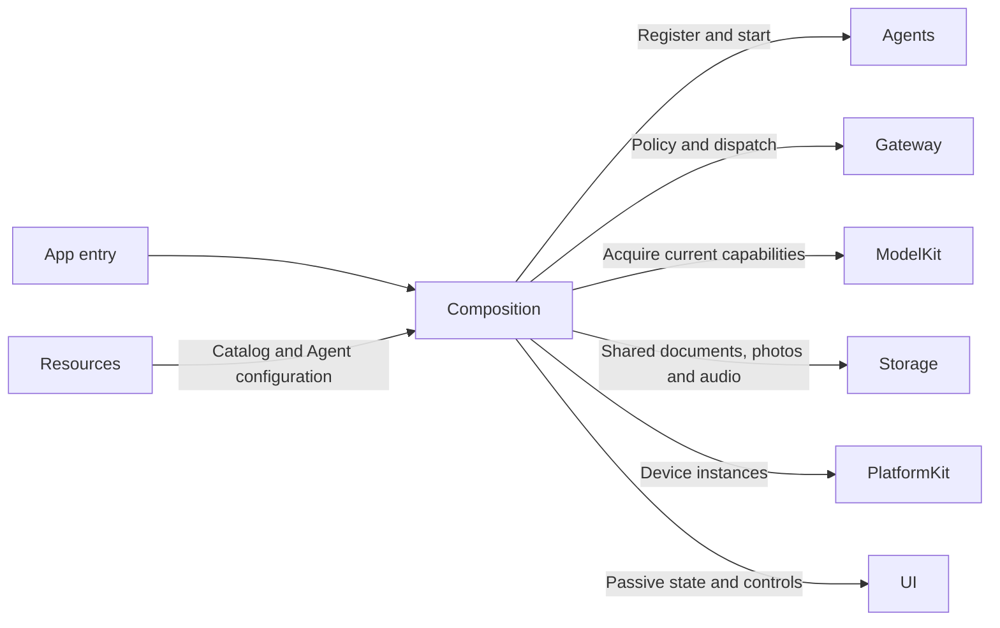
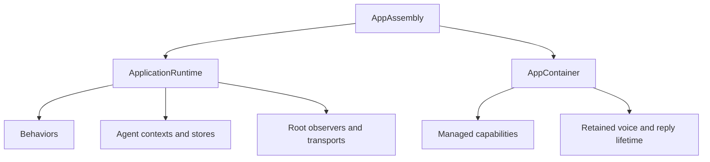

# Application Composition

## Summary

Constructs the application graph and supplies immutable runtime slices to lifecycle and feature owners.

## Ownership and boundaries

AppAssembly is owned by MobileHarnessApp. ApplicationRuntime owns shared Agents, Gateways, repositories and subscriptions; AppContainer prepares acquired capabilities and retains interaction tasks. Consumers receive interfaces rather than querying a global container.

## External relationships and data flow

Runtime arrows show data or capability calls; dashed arrows show injection.

## Internal structure

## Service construction

| Component | Responsibility |
| --- | --- |
| AppAssembly.swift | Resource roots, lazy runtime, shared AppleCamera and BluetoothWorkflow, history/settings operations and AppContainer |
| ApplicationRuntime.swift | Seven Agent roles, role-specific durable contexts, communication policy, function bindings, scheduler/resources and root observations |
| AppContainer.swift | Managed capability handles, model preparation, voice/diagnostic construction, memory warnings and retained interaction lifetime |
| Behaviors | Frozen business catalog and explicit protocol projections |

ModelKitDefaults is the process-wide registration/manager owner. CurrentChatCapability resolves the configured binding per request; each role receives its own context repository. History reads the current Assistant memory repository and separate archive files through the shared history facade. Camera and history share the bounded CapturedPhotoStore. Audio ownership uses StorageAudio.

## Resource and endpoint wiring

Composition creates one ResourceCoordinator and ChannelScheduler, registers camera.capture and six NexArm motor resources, and wires feedback to InputGateway. Camera capture uses the host camera owner; inherited execution permits authorize Agent writes. Settings native takeover remains an explicit host policy.

RuntimePresentation binds complete voice/camera endpoints with source/session/task validation. Provider credentials use injected Keychain primitives; Actions owns transactions and model eligibility. Resource observation, Action/Task/Agent logs and specialist transports remain root-owned across page changes.

## Replacement and shutdown

Preparation errors propagate before admitting dependent work. Interactive scene transitions join root/child startup before lifecycle lookup. Reconfiguration cancels/joins affected owners and applies the native binding barrier; durable commits survive later application failure. Scene background fences native work and cancels inference without introducing background robot execution.

✅ One shared runtime, independent role contexts and Assistant history, explicit native endpoints and current-binding chat are implemented.

❌ Independently active window runtimes and a unified audio-resource arbitration mapping are not implemented.

## Related design

[Parent design](../README.md) · [Behaviors](Behaviors/README.md)

## Skill/task-mode contract

✅ ApplicationRuntime constructs one conversational Assistant, three fixed deterministic coordinators and media Agents; owns a bufferingNewest(1) Skill/task observer independent of pages. Per-task log rows carry local mode/Skills/input IDs rather than Assistant→Assistant delegation.

## 泛化 Task 与独立 Skill

✅ Root-owned bounded Skill projections populate task ID/goal/status and Skill ownership. Task Signal projections supply independent background state. UI local expansion/navigation uses no Agent commands.

## Skill 函数目录

✅ ApplicationRuntime 对固定角色目录及每个 bundled Skill 独立检查实现覆盖，避免把所有 Skill 合并为静态权限上限或强制彼此可组合。

## Action-owned documentation and Skill instruction contract

✅ ApplicationRuntime 在创建 Agent 或读取配置前安装 CapabilityModules.declarations；投影无宿主设备依赖。后续真实执行模块仍绑定 App 能力，Agents 不导入 Actions 实现。

## Task/history regression correction

✅ 本次修复：历史开始新对话入口复用 Assistant 固定 cancelTask Action 能力结束等待任务，再调用 Memory 归档；保留数据，不直接写 Agent 上下文。

## Result-driven ReACT (ADR0214)

✅ ADR0214：ApplicationRuntime 不再构造或注入 GenerationPolicies，BehaviorAssembly 不再输出 Action/Tool 反馈策略表；函数/协议/资源/权限覆盖及生命周期装配保持原职责。

✅ 本次修复：前台任务日志使用持久化更新时间（无此字段使用创建时间），投影携带失败原因，启动恢复不显示为新发生的任务。

✅ ApplicationControl操作型绑定：Device.control、ModelResources.download/cancel增加Action协议投影并保留固定调用Tool投影，均复用原canonical handler和返回语义。模型当前目录只开放Skill声明的一种类型，宿主双协议不导致模型重复注册。

✅ Task上下文由 Agents 选择：进入 Task 保留已有普通背景、启动轮及完整调用/结果；旧 Task 结束后才将其过程收敛为终态摘要。✅ 已删除拍摄结果的 Assistant Task 登记回调，实际图片结果直接 enrichment；当前照片事实由原生相机提供；完整持久化历史不变。详见 [Chat](../../Agents/Support/Chat/README.md)。

✅ Implemented: VoiceRuntimeDependencies.cancelReply is injected from the existing AgentInteractionRuntime and scoped to interactionSessionID. No new provider/service/global dependency or pause/remove/re-register of the Assistant.

✅ Implemented: existing RuntimePresentation supplies feedback to UIModule, while UI.Feedback uses the existing scheduled Action binding profile. No new target, directory, native service locator or whole-session cancellation.

✅ AppAssembly supplies CapturedPhotoStore.Limits of 1024 photos/2 GiB/512 KiB index; first I/O propagates invalid/capacity errors. No existing file deletion or new source directory.

✅ Implemented: CapturedPhotoStore uses existing 1024/2 GiB/512 KiB limits with evictOldest policy, retaining a recent photo queue instead of stopping capture.

## 历史记录收敛（2026-10-13）

✅ Implemented: AppAssembly 注入 Agent 记录入口与唯一的 Assistant 聊天记录工作流；ApplicationRuntime 不再聚合任务历史，其他 Agent 暂无记录页面。

❌ 历史记录页面板块重新设计及原生 UI/真机验收。

✅ Implemented (2026-10-13): UI.Notice.showNotice/dismissNotice and UI.Light.updateLight are canonical presentation Actions for trusted business calls, currently registered by no Skill. Neutral Actions values cross RuntimePresentation into root-owned HomeEffectsWorkflow, which retains one replaceable notice expiry and one light expiry, UUID-fenced cleanup, and explicit stop. Notices remain separate from factual ExecutionIssue history; actual upper-layer errors have display priority and Action failures remain panel-only. Decorative light accepts normalized origin, initial opacity/intensity and duration; it never changes consent, microphone or eyes. Native renderer separates light generations from listening eye generations and preserves existing exit fade. RuntimePresentation adapts Action requests into UI-owned values; AppPresentationWorkflow keeps its existing UI/AgentCore/FunctionContracts boundary. No UI project dependencies or new directories.

✅ Implemented (2026-10-13 caption/error lifecycle): mask bottom ASR and reply/status immediately while a notice is visible, restore retained text after dismissal, and preserve pinned Task/promoted ASR layout. Consent-off clears both captions; root HomeEffectsWorkflow owns one UUID/text-fenced350ms reply fade/removal task, cancelled by new text/turn/off/shutdown, scheduled only after reply-policy/playback/native-resume barriers. Agent errors stay in factual root failure notices, not persistent voiceStatus copies. App root contexts explicitly choose afterFirstUnlock file protection, including their directory; repository persistent factory accepts protection while its SDK default remains whileUnlocked. This mitigates lock-boundary writes, without claiming the screenshot proves that cause or hiding other storage failures.

## Task history v2 and in-place compression

✅ Implemented: ApplicationRuntime uses current.json with independent archives and a pure-memory Assistant context. Old assistant.context.json and assistant.history-v2.context.json are unused; no import or migration.

## 会话存储性能重构 v3

✅ 已实现：ApplicationRuntime 构造纯内存 assistantContext，连接新 ConversationFileStore（current.json/index.json/独立归档）及恢复闭包。Assistant 当前状态与会话以相同捕获快照保存，所有归档不载入 context。

✅ AppAssembly 注入按会话ID的详情读取闭包；普通列表不加载正文，选中会话后才加载包含 Task 摘要和完整请求的单个文件。

✅ Records composition: AppAssembly.history owns only the Assistant conversation workflow; recordDestinations injects its real ConversationHistoryView into a generic AgentRecordsView. ApplicationRuntime has no duplicate task-history reader. MobileHarnessApp/ConversationView/ActionActivityView have no task-history callback chain or unused log inputIDs projection. No Task registry, Skill state, foreground/background observer or lifecycle behavior is removed.
