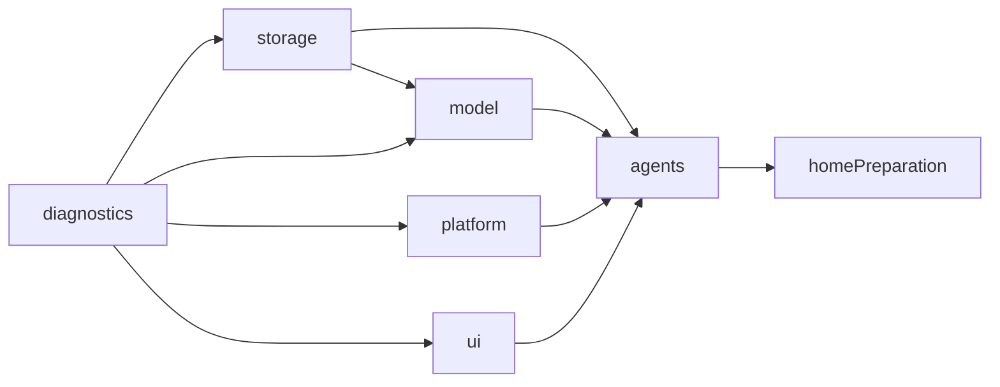

# Application Composition

## 职责与边界

✅ 创建、持有和连接模块实例，安装公开声明及静态生命周期描述，组合 UI 自有展示协议。不消费业务请求、不转换业务数据，不决定模型、相机、语音或设备策略。

## 组件、接口与关系

| 文件 | 当前职责 |
| --- | --- |
| [ApplicationContainer.swift](ApplicationContainer.swift) | AppStorage 目标的 FactoryKit 实例内缓存；持有四个基础根、根属性的子能力别名、故障通道及 Agent 根 |
| [AppComposition.swift](AppComposition.swift) | 持有 Services 和生命周期图，连接 bootstrap／retry／failure，管理作用域替换 |
| [ServiceFactories.swift](ServiceFactories.swift) | 选择存储后端和根 URL，装配公开能力、延迟仓库提供器、相机工厂与 Agent 根 |
| [ModuleRegistration.swift](ModuleRegistration.swift) | 绑定模块生命周期及静态依赖，保留原始失败并归一化纯取消 |
| [ApplicationPresentation.swift](ApplicationPresentation.swift) | 实现 UI 根／会话展示协议，组合既有页面、角色状态和请求端口，连接导航与准备回调 |

AppStorage 只编译 ApplicationContainer.swift。业务目标不导入 IoC，不创建备用基础根。ApplicationContainer.agents(make:) 在 iOS 27 上缓存一个 AgentContainer；内部类型擦除存储适配包的部署版本，公开入口保持强类型。七个稳定角色能力及内部生命周期见 [Agents](../../Agents/README.md#agent-container)。

ApplicationPresentation 的 SessionPresentation 按稳定 SpeechPerceptionContainer 身份复用，仅在该角色准备就绪时提供；读取 conversation、actionActivity、聆听／检测请求和诊断投影，不持有内部 VoiceInteractionSession 或感知任务。设置、资源、历史、相机控制使用对应角色公开工作流。

## 依赖与数据流

✅ Services 持有同一注册作用域的 StorageContainer、PlatformContainer、UIContainer、ModelContainer 和 AgentContainer。存储 start 完成打开、迁移与恢复后才发布仓库，工厂注入延迟仓库接口，不直接执行数据库恢复。UI 八个子能力和模型四个子能力均来自同根属性。

唯一 CameraCoordinator 工厂由 App 提供，Agent 根按需调用；原生执行实现归 Actions。UI 请求的订阅、处理与回执由角色拥有。照片容量、Provider 事务、资源下载、页面控制和意图解释不在 App 绑定闭包中实现。

## 生命周期、替换与失败

只有 Scene active 开启接纳。初始 inactive 等待前台；启动中系统失活且回滚成功的 suspended 图，在后续 active 停止并重建。一个替换任务合并重复事件，结束时复查最新前台状态；无重建队列或操作重放。旧图清理失败保留其作用域和错误，不启动替代所有者。

后台 URLSession 可在前台启动前使用同根模型制品／存储服务。组合根记录作用域已被使用，替换时在生命周期停止后显式加入幂等 model.stop／storage.stop，覆盖未进入 started 列表的后台所有者；不启动相机、音频、UI 或推理。

ApplicationContainer.failureDetails 提取模块自有 Failure（含 AgentFailure）的稳定 code 和 isCancellation，交给同根故障通道。ModuleRegistration 先保留结构化诊断，再将无清理失败的取消转换为宿主 CancellationError；真实清理失败不降级。启动前故障由 UI bootstrap 失败端口兜底，业务异常展示由 Agents／Actions 决定。

## 首页准备接线

Services 持有唯一 ForegroundPreparation，生命周期前台屏障完成且首页可见时激活。导航、配置应用和交互终态请求复查；失活或切页关闭接纳，根替换先加入准备任务再停止模型。活跃会话只检查，不竞争冷准备；云端不发送探测生成请求，相机开启时才准备视觉。

ModelKit 回调实际权重加载开始／结束；组合根更新 UI 交互门并向 Agents 报告 loading／idle 事实，不直接设置表情。普通检查、已就绪和无需加载不显示 loading。复查未就绪通过原始验证错误通道上报；模型能力已报告的失败不重复生成 Toast。算法与状态见 [Lifecycle](../Lifecycle/README.md)。

## 待实现

❌ 多窗口实例隔离；非合作依赖的强制中断。

[App](../README.md) · [Actions 集成](../../Actions/Support/README.md)
