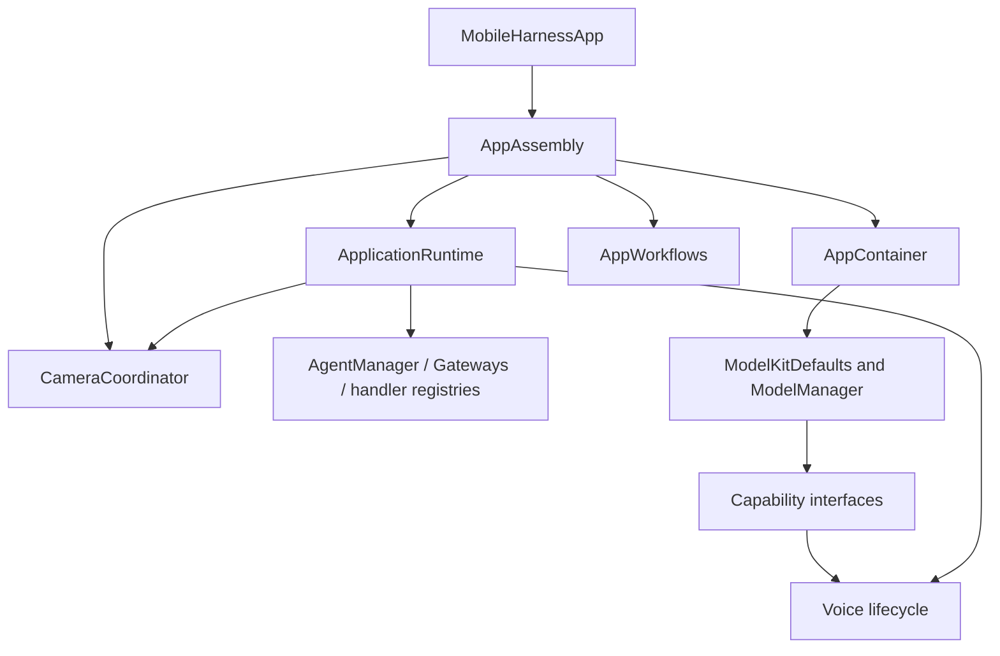

# App Composition

> Current status (2026-09-29): the user identified desktop simulator screen sharing as the cause of missing iPhone camera/microphone input. BLE settings and conversation binding are restored; receipt-admission and robot-only disconnect fixes remain. iPhone BLE acceptance without screen sharing is still pending; no causal claim is made about the earlier BLE failure.

Purpose: construct the application graph and bind concrete services. Design goals: one explicit root, narrow injected dependencies, no hidden runtime lookup or duplicate model registrations.

| File | Responsibility |
| --- | --- |
| AppAssembly.swift | Root-owned resource path and lazy runtime, settings/history operations, camera coordinator and prepared AppContainer |
| AppContainer.swift | Receive the resource path/runtime, acquire managed capability handles, prepare voice models, assemble VoiceSessionCoordinator and diagnostic operations, forward memory warnings |
| ApplicationRuntime.swift | Shared journal, packaged communication policy, AgentManager, Gateways and typed capability bindings to BehaviorAssembly; create Assistant with the same journal and injected chat/model-label query |

AppAssembly is owned by MobileHarnessApp. Its services survive page navigation. ApplicationRuntime has no static shared accessor; voice, vision and camera receive immutable role-specific service slices. ModelKitDefaults retains process-wide model registration and the manager. Chat operations use the current-binding adapter in App/Adapters. Diagnostic execution lives in App/Workflows; this directory only supplies its dependencies and connects views.

✅ Same journal for Assistant/history; same voice-scope PCM store for synthesis/playback; process-wide ModelManager remains owned by ModelKitDefaults. Model weights never enter UI. The settings form necessarily holds its editable credential draft; CloudSettingsStore owns Keychain persistence and no credential is written into the settings document.

❌ Multiple independently active window runtimes and model/provider hot replacement outside the existing chat configuration workflow.

## Action implementation validation

✅ BehaviorAssembly constructs the domain-owned ActionDefinitions with finite/state kind and completion descriptions, then validates all four packaged Agents' assembled Action and Tool catalogs before creating the scheduler. Assistant, SpeechPerception and VisionPerception expose their own runtimeCapabilities assembly, so internal grants are not copied into App; synthesis uses its packaged catalog. Duplicate/invalid definitions and missing implementations throw from initialization without fallback. Completion descriptions acknowledge UI stale-update no-ops and distinguish target acceptance from animation completion.

❌ These checks verify implementation coverage, not adapter correctness, activity ownership or physical-device completion. General dynamic registration/hot reload remains outside this stage.

## Action runtime stage 2

✅ AppAssembly owns one AppleCamera instance shared with CameraCoordinator and ApplicationRuntime. Runtime assembles camera.capture ResourceDefinition, a single ResourceCoordinator, scheduler feedback delivery to InputGateway, and OutputGateway sharing that authority. Only runtime.camera may acquire capture leases. ❌ Audio and robot resource mappings are not yet registered.

## Domain-owned behavior assembly

✅ ApplicationRuntime now calls the independently compiled BehaviorAssembly in Behaviors/ once, providing typed capabilities and assembled Agent permissions. It contains no concrete Action/Tool paths, handler definitions or async prepareTools task. Missing Action or Tool implementations fail synchronously before startup. App still owns devices, resource definitions and runtime lifetime. ❌ New physical capabilities/lifecycle changes can require App binding changes.

## Storage domain organization

✅ ApplicationRuntime assembles LocalDocumentStore from Storage and ConversationHistoryStore from StorageChat. The physical journal URL, schema and single-owner lifetime are unchanged.

❌ Image/video/semantic-memory stores remain planned; this migration adds no storage behavior.

✅ BehaviorAssembly requires a typed `shakeBase` binding. The iPhone root binds BluetoothWorkflow; the Mac diagnostic binds USB. Both fail explicitly when unavailable.

✅ AppAssembly owns one BluetoothWorkflow and NexArmBluetooth for settings and conversation. Its quiesce callback joins VoiceSessionCoordinator cleanup before changing the device; ApplicationRuntime binds shakeBase to that same workflow and requests terminal ActionResults through InputGateway. ❌ No page-owned connection or unavailable success stub remains.

## NexArm entertainment skills (2026-09-30)

✅ ApplicationRuntime explicitly maps typed NexArm gesture requests to PlatformKit presets and the shared BluetoothWorkflow. Domain registration remains in Actions; callable permissions remain in Assistant JSON. ❌ New complete gestures await device acceptance.

✅ ApplicationRuntime creates and retains the unified ActionActivityWorkflow before model preparation, injecting ChannelScheduler's bounded full-snapshot observation stream. AppContainer exposes its UI state to ConversationView. This subscription survives page navigation and remains independent of Agent result delivery; no UI-to-Gateway dependency is added. ❌ Per-device progress callbacks and durable presentation history are not implemented.

## Head gestures

✅ The explicit gesture binding maps nod and shakeHead to the shared controller. No transport-specific choreography is duplicated. ❌ Hardware acceptance is separate from registration.

## NexArm feedback execution — 2026-10-01

✅ ApplicationRuntime binds `NexArm.reset` to BluetoothWorkflow.resetArm and other NexArm actions to the shared performer. No motion timing or arrival logic belongs in composition.

❌ Sustained real-device acceptance remains pending.

## Atomic composition — ADR0092

✅ ApplicationRuntime registers six motor resources, injects Settings/manual resource execution, and transfers full device reports through ActionComposition into invocation results. Cleanup joins software work without claiming physical stop.

❌ Sustained real-device acceptance and durable result delivery remain outstanding.

✅ ADR0093: NexArm bindings now resolve the gesture catalog from Actions. PlatformKit supplies connection/protocol capabilities; no platform gesture enum or business display-name catalog remains.

✅ ADR0098: Composition owns Agent factories and supplies role-specific service slices. Robot/provider/history adapters and feature workflow targets are explicit bindings. Permission coverage runs separately through Gateway before scheduler/producers start.

✅ AppAssembly supplies the root CameraCoordinator to ApplicationRuntime; RuntimePresentation binds the CameraControlCapability required by BehaviorAssembly. It does not create a second camera owner.

✅ Photographer policy and internal Tool coverage are assembled alongside existing Agents. Robot.aim binds the foreground Bluetooth workflow without adding AgentCore to BehaviorAssembly.

✅ ApplicationRuntime injects the Photographer factory into VisionRuntimeDependencies and grants Photographer motors1–5 only. Robot.aim binds NexArmBehaviorAdapter alongside existing gesture bindings.

✅ Composition injects Photographer control availability as a read-only MainActor BluetoothWorkflow snapshot; Agents imports no device SDK or App service.

## Local model resources — current contract

✅ AppAssembly injects ModelKitHub and the Storage adapter through Defaults into one process manager. Catalog schema v2 declares sources; the resource root is Application Support/MobileHarness/Models/installed. Settings state outlives pages; voice preparation is explicit. ❌ HF foreground requests restart after process relaunch; full iPhone acceptance remains pending.

✅ 本地模型工作流注入的同步校验与存储构造遵循 MainActor 隔离，真机构建使用 App 现有签名配置。❌ 安装成功不等于下载网络与交互验收完成。

✅ Nemotron downloads and registration now use the shared Core ML catalog entry, without CoreAI device validation.

✅ AppAssembly restores speech preference before AppContainer construction. On changes it pauses voice through the lifecycle settings barrier, updates ModelKitDefaults policy, and releases the barrier. AppContainer uses stable default speech facades and diagnostics warms the selected synthesis; Gemma 4 E2B/YOLO are unchanged.

✅ AppAssembly applies independent recognition/synthesis preferences through the lifecycle settings barrier and caches their pair to avoid repeated voice cancellation. Model capabilities remain independently registered; download/delete backends and chat configuration are unchanged.
