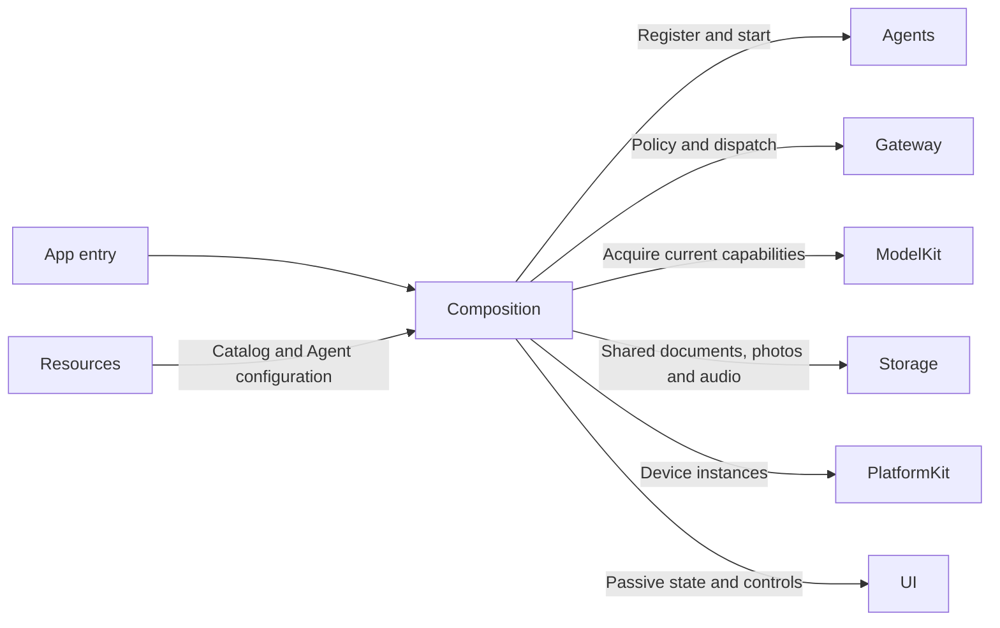
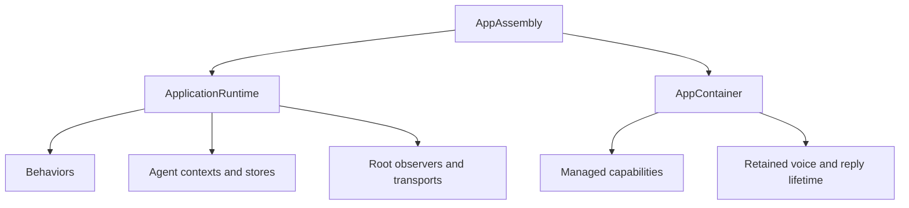

# Application Composition

## Summary

Constructs the application graph and supplies immutable runtime slices to lifecycle and feature owners.

## Ownership and boundaries

AppAssembly is owned by MobileHarnessApp. ApplicationRuntime owns shared Agents, Gateways, repositories and subscriptions; AppContainer prepares acquired capabilities and retains interaction tasks. Consumers receive interfaces rather than querying a global container.

## External relationships and data flow

Runtime arrows show data or capability calls; dashed arrows show injection.

## Internal structure

## Service construction

| Component | Responsibility |
| --- | --- |
| AppAssembly.swift | Resource roots, lazy runtime, shared AppleCamera and BluetoothWorkflow, history/settings operations and AppContainer |
| ApplicationRuntime.swift | Seven Agent roles, role-specific durable contexts, communication policy, function bindings, scheduler/resources and root observations |
| AppContainer.swift | Managed capability handles, model preparation, voice/diagnostic construction, memory warnings and retained interaction lifetime |
| Behaviors | Frozen business catalog and explicit protocol projections |

ModelKitDefaults is the process-wide registration/manager owner. CurrentChatCapability resolves the configured binding per request; each role receives its own context repository. History reads that repository rather than creating a writable copy. Camera and history share the bounded CapturedPhotoStore. Audio ownership uses StorageAudio.

## Resource and endpoint wiring

Composition creates one ResourceCoordinator and ChannelScheduler, registers camera.capture and six NexArm motor resources, and wires feedback to InputGateway. Camera capture uses the host camera owner; inherited execution permits authorize Agent writes. Settings native takeover remains an explicit host policy.

RuntimePresentation binds complete voice/camera endpoints with source/session/task validation. Provider credentials use injected Keychain primitives; Actions owns transactions and model eligibility. Resource observation, Action/Task/Agent logs and specialist transports remain root-owned across page changes.

## Replacement and shutdown

Preparation errors propagate before admitting dependent work. Interactive scene transitions join root/child startup before lifecycle lookup. Reconfiguration cancels/joins affected owners and applies the native binding barrier; durable commits survive later application failure. Scene background fences native work and cancels inference without introducing background robot execution.

✅ One shared runtime, independent role histories, explicit native endpoints and current-binding chat are implemented.

❌ Independently active window runtimes and a unified audio-resource arbitration mapping are not implemented.

## Related design

[Parent design](../README.md) · [Behaviors](Behaviors/README.md)
