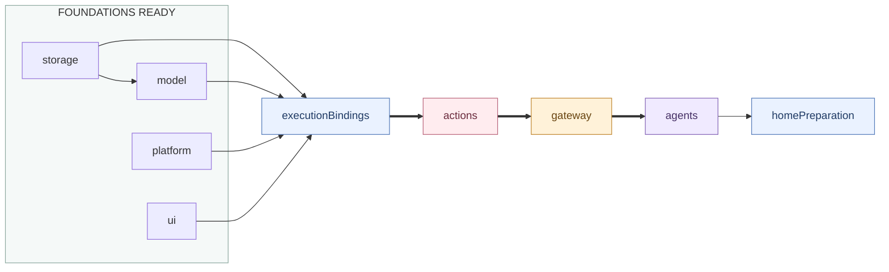

# Application composition

## Ownership and files

`ApplicationLanguageSettings` keeps the application preference and resolved locale outside replaceable service roots. `ServiceFactories` binds a thread-safe snapshot reader to Agent requests and provides the corresponding Apple recognition locale to the ModelKit root.

This directory constructs and connects public module interfaces, installs static lifecycle services and composes UI presentation. It contains no business request consumer, per-frame forwarding, function registration, role policy or domain schema conversion.

| File | Responsibility |
| --- | --- |
| ApplicationContainer | FactoryKit instance cache for seven roots, root capability aliases and the failure channel; compiled as AppStorage. |
| ServiceFactories | Scoped backend selection, deferred repositories, module roots and thin public capability adapters. |
| ApplicationActionAssembly | Supplies Actions dependencies and adapts public cognitive/execution ports. |
| ActionServiceAdapters / AgentResourceBindings | Narrow camera/device/voice/detection and resource-run adapters; no business service registry. |
| ModuleRegistration | Public lifecycle bindings and explicit startup/rollback/stop graph. |
| AppComposition | Services lifetime, bootstrap, retry and scope replacement. |
| ApplicationPresentation | UI application/session interfaces, existing role state/control and navigation/preparation callbacks. |

Foundation aliases refer to the same owning roots. Services retains ActionsContainer, GatewayContainer and AgentContainer independently. ActionsBusinessAssembly is an Actions-owned helper retained/cleaned by ActionsContainer, not another lifecycle root. Domain/module/action declarations remain extensible library values.

## Wiring and order

Diagnostics precedes foundations. Thin arrows are readiness dependencies and thick arrows emphasize the business-root readiness chain. This graph describes lifecycle, not imports. After foundations start, executionBindings connects the cognitive request to Actions-owned service assembly, configures Gateway with the neutral execution port/resources/result callback, validates immutable catalog coverage and binds hosts. Configuration does not open business admission or devices.

Stop reverses dependencies and retains ports through Agent, Gateway and Actions cleanup. Binding rollback also stops a cold/configured Actions root if startup never reached its own node; an already stopped root is not stopped again. Every root owns and joins its own tasks; App does not inspect another module's worker registry.

## Foreground, replacement and errors

Initial startup requires an active Scene. Once running, model/platform/UI/Actions/Gateway/Agents declare background continuity: scene loss keeps voice, inference and accepted business work alive while UI detaches local surfaces and Actions/Agents stop camera, tracking and foreground device work. Actions resumes scene admission separately from its owned artifact preview restoration. Window recovery diagnostics belong to Actions rather than the root preparation state. Full invalidation remains reserved for startup rollback, replacement and root shutdown. A successfully rolled-back startup interrupted by system inactivity waits for active before replacing its scope. One replacement task coalesces events; cleanup failure retains the old scope/error and prevents duplicate native owners.

Background URLSession completion can use the same model/storage scope before foreground startup. Replacement joins those roots even if they never reached the graph's started set. No camera/audio/UI inference is started by background restoration.

ApplicationContainer projects each module's structured Failure, including ActionsFailure and GatewayFailure, into the existing diagnostic channel while preserving original errors. ModuleRegistration normalizes only pure cancellation after recording evidence; mixed cleanup errors remain failures. App supplies bootstrap failure before roles can present diagnostics. App binds the main Gateway scheduler to [RuntimeLog](../../UI/Components/RuntimeLog/README.md) with a newest-one snapshot buffer and joins that consumer when execution bindings stop.

ForegroundPreparation is activated after the lifecycle foreground barrier and visible-home check. ModelKit reports actual load transitions; App updates interaction readiness and forwards facts to Agents for presentation. Ordinary checks, already-ready state and cloud configuration do not fabricate loading. See [Lifecycle](../Lifecycle/README.md) and [overall flows](../../README.md).

## Native State capability binding

ServiceFactories injects the complete ApplicationStateInspection.snapshot read into AgentContainer. Native facts retain PlatformContainer ownership; Assistant projects their complete Business dictionaries. This binding adds no App sampler, JSON schema conversion or extra lifecycle node. Platform startup owns passive native observation; Agents selects per-request reads, and roots retain their existing reverse cleanup order. Neither Actions nor Gateway is an intermediary for native State reads.

## Observation and query composition

App binds complete inspection.snapshot(path:) reads and reports scene/model preparation to Agents. Skill owns exact-path selection; Assistant projects Business; App does not convert or filter domain schemas. Navigation State includes UI-owned page and album context. Specific business query Actions retain their owning services; App binds no generic environment/last-result callback from Agents into Actions.

## Internal state inspection

`ApplicationStateInspection` registers seven scoped module catalog factories, each returning exact paths and read-only reader capabilities for existing owners. Factories contain no state copies, filtering policy or service creation. Module-local data is structurally encoded/decoded only in this adapter; independent foundations do not import a shared State module.

`snapshot(path:)` resolves and reads exactly one node, without reading ancestors or siblings. `describe(path:)` derives that node's descriptor; callers with a snapshot use its stateDescriptor directly. Local snapshots contain child Reference indices only. Registration/lookup bounds catalogs to 256 nodes and encoded samples to 256 KiB. Category overlap, invalid child indices/metadata/enums, malformed paths and cancellation propagate. Owner read/encoding failure is readFailure with unknown health; a rejected configuration fences reads. The registry and State contain no global atomicity claim.

`inspectTree(path:depth:)` is explicit internal caller orchestration: read a node, follow its indices within depth 16 / 256 nodes / 256 KiB, and materialize a separate Tree. Trees preserve each owner’s health without ranking or aggregating it. Tree traversal is not an Assistant source or model tool.

App binds only exact snapshot(path:) into Agents. Assistant projects complete Business for Skill-declared paths through a unified resolver. No alias or system.health/system.diagnostics scan can reveal an undeclared descendant. The weak Agent catalog binding avoids retaining the Agent root through its injected read callback. Lifetime, execution, UI and device behavior remain owned by their existing modules.

App explicitly sequences execution preparation: AgentContainer prepares cognitive inputs; ActionsContainer.configureBusiness owns business assembly preparation and returns execution/catalog/host ports; the Agent preparation validates Skill coverage and returns Gateway configuration; App configures Gateway and calls AgentContainer.bindExecution with the resulting facilities. The executionBindings lifecycle node retains this configuration boundary for partial-start rollback and reverse cleanup. Actions owns internal function binding; App owns the cross-module sequence.

ModuleRegistration directly calls GatewayContainer.configureExecution after AgentGatewayAssembly prepares cognitive adapters and result delivery. App returns the resulting capabilities for cognitive binding. AppComposition forwards home visibility to ActionsContainer separately from scene lifecycle; Actions combines visibility with scene admission. Agents stops its own roles/perception, Gateway drains execution, and Actions owns camera/device joins and cleanup.

ServiceFactories supplies ActionsDependencies through the App callback bridge, asks ActionsContainer.makeBusiness for the root and host capabilities, and registers that same root in ApplicationContainer. AppCameraAccess/AppDeviceAccess adapt Actions-owned public protocols to Agent-owned protocols; they never retain the private assembly or concrete execution workflows. Runtime configuration calls ActionsContainer.configureBusiness(request:) after foundations start.

ApplicationPresentation requires bootstrap and delegates complete session availability to SpeechPerception.presentation. Gateway owns runInCurrentContext, coordinated acquire and isSettled; the resource adapter contains only forwarding and boundary error conversion. Foreground model requirements come from Agents and preparation steps come from ModelKit. ServiceFactories maps those generic steps into the App-owned lifecycle coordinator without inspecting ModelState or selecting model providers.

ApplicationContainer caches the root window capability; AgentContainer and ApplicationPresentation receive that same WindowState. The root attaches WindowHost above persistent navigation. Navigation visibility gates home model preparation. Actions handles camera scene and window lifecycle.

ApplicationPresentation.cameraPreview builds the photo renderer with showsPose=false. The root retains the separate Face background visual renderer, shares the same native camera injection, and uses actual native image aspect to update the camera window sizing policy. Composition creates no second capture session.

组合注入同一个UIContainer.island到AgentContainer与ApplicationPresentation；根页面挂载前台IslandHost，系统岛点击只恢复既有场景，Actions业务装配拥有活动适配。App只传递基础呈现端口，不计算活动优先级或控制相机。

IslandState自身管理ActivityKit摘要和SwiftUI本地呈现，组合层不创建第二个系统活动owner。系统链接不改变导航/窗口/展开偏好；后台仅拆本地呈现，系统摘要随真实会话继续。根停止加入清理，进程终止的尽力清理端口属于UI，App delegate只转发。

ApplicationContainer injects IslandDeviceStatusReading into UI construction. Its closure structurally maps PlatformContainer.systemStatus() typed power/network fields into UI-owned values. It owns no polling, native sampler or presentation rule; the visible Island component controls cached-read lifetime and layout.

Web presentation is injected directly from UIContainer into ApplicationPresentation/ApplicationRootProviding. ApplicationContainer configures the separate WebWorkspaces filesystem location. ActionsBusinessAssembly owns browser, deterministic artifact storage/presentation and screenshot services; Writer owns model editing; App adds no editing logic or worker.

ApplicationPresentation 将 WriterContainer 的 WriterRecordsControlling 与 Actions 的 WriterArtifactsControlling 注入 Writer 专属任务页面；不再为 Writer 组装 Assistant 会话历史管理或标题工作流。任务、消息、图片读取由 WriterContainer 提供；文件预览与导出由 Actions 根管理。

Settings uses independent assistantHistory/writerHistory routes to injected My Assistant/My Writer record destinations. Writer request summaries are projected by WriterContainer; App does not parse SQL, model calls or progress policy.

普通Scene转发保持Writer创作连续，仅通知其预览可见性；Actions在前台恢复Artifacts最新快照，UI继续独立管理原生表面可用性。显式根暂停/替换/关闭沿原清理图执行，不借用Scene事件暂停Writer模型循环。

AppComposition 持有一个 WriterContinuedProcessing 适配器，向每个根的 WriterContainer 注入执行端口。根替换先加入旧 Writer 清理，再绑定新根。系统任务回调经执行段身份返回 Writer，系统适配器只管理 iOS 执行时间与进度。

ActionsDependencies receives a lazy WorkspaceRepository getter from the existing Storage database, alongside media/device getters. It is resolved after foundation readiness and creates no parallel database or JSON catalog.

ApplicationActionAssembly透传AgentVoiceHost.playbackChanged到ActionsVoiceHost。Assistant的语音子能力接收真实播放事实并决定展示；App只连接接口，Actions不导入Agents，基础UI不接收业务接口。播放频谱仍直连UI的专用数据接口。

Composition passes the root Storage cache to Actions and adapts scoped previewSnapshot/resetPreviewSelection through neutral host ports. It does not prepare images or own selections. Agents registers actions.camera.preview against the same Camera owner used by UI capture.

ApplicationActionAssembly 不再向 Actions 注入 Memory 的历史执行预览函数；Assistant 详情直接消费既有 History 读取接口及已记录业务快照。

ApplicationActionAssembly 传递 Decision 配置读取、分类状态与队列投影闭包。配置快照包含本地模式和可选云端工厂，由 Actions 提供。业务分类在 Agents，原生模型在 ModelKit。

Assistant 会话使用角色自身的 UI.Island 权限发布 Decision 反馈。App 继续装配通用 Gateway 与 UI 渲染端口。

ApplicationActionAssembly 将 ActionsBusinessBindings.readWebScreenshot 直接透传给 AgentBusinessBindings。Actions.Web 拥有当前截图，AgentRuntime 注册 actions.web.screenshot，App 不存储、压缩或解读图片；原 Camera readPhoto 网页桥接已删除。
