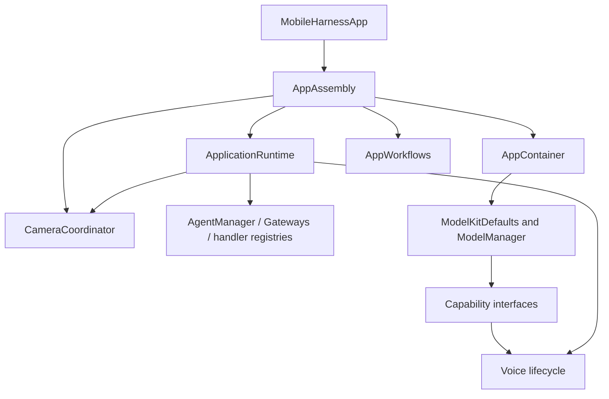

# App Composition

Purpose: construct the application graph and bind concrete services. Design goals: one explicit root, narrow injected dependencies, no hidden runtime lookup or duplicate model registrations.

| File | Responsibility |
| --- | --- |
| AppAssembly.swift | Root-owned resource path and lazy runtime, settings/history operations, camera coordinator and prepared AppContainer |
| AppContainer.swift | Receive the resource path/runtime, acquire managed capability handles, prepare voice models, assemble VoiceSessionCoordinator and diagnostic operations, forward memory warnings |
| ApplicationRuntime.swift | Shared journal, packaged communication policy, AgentManager, Gateways and typed capability bindings to BehaviorAssembly; create Assistant with the same journal and injected chat/model-label query |

AppAssembly is owned by MobileHarnessApp. Its services survive page navigation. ApplicationRuntime has no static shared accessor; voice and vision receive it explicitly. ModelKitDefaults retains process-wide model registration and the manager. Chat operations use the current-binding adapter in App/Adapters. Diagnostic execution lives in App/Workflows; this directory only supplies its dependencies and connects views.

✅ Same journal for Assistant/history; same voice-scope PCM store for synthesis/playback; process-wide ModelManager remains owned by ModelKitDefaults. Model weights never enter UI. The settings form necessarily holds its editable credential draft; CloudSettingsStore owns Keychain persistence and no credential is written into the settings document.

❌ Multiple independently active window runtimes and model/provider hot replacement outside the existing chat configuration workflow.

## Action implementation validation

✅ BehaviorAssembly constructs the eight domain-owned ActionDefinitions with finite/state kind and completion descriptions, then validates all four packaged Agents' assembled Action and Tool catalogs before creating the scheduler. Assistant, SpeechPerception and VisionPerception expose their own runtimeCapabilities assembly, so internal grants are not copied into App; synthesis uses its packaged catalog. Duplicate/invalid definitions and missing implementations throw from initialization without fallback. Completion descriptions acknowledge UI stale-update no-ops and distinguish target acceptance from animation completion.

❌ These checks verify implementation coverage, not adapter correctness, activity ownership or physical-device completion. General dynamic registration/hot reload remains outside this stage.

## Action runtime stage 2

✅ AppAssembly owns one AppleCamera instance shared with CameraCoordinator and ApplicationRuntime. Runtime assembles camera.capture ResourceDefinition, a single ResourceCoordinator, scheduler feedback delivery to InputGateway, and OutputGateway sharing that authority. Only runtime.camera may acquire capture leases. ❌ Audio and robot resource mappings are not yet registered.

## Domain-owned behavior assembly

✅ ApplicationRuntime now calls the independently compiled BehaviorAssembly in Behaviors/ once, providing typed capabilities and assembled Agent permissions. It contains no concrete Action/Tool paths, handler definitions or async prepareTools task. Missing Action or Tool implementations fail synchronously before startup. App still owns devices, resource definitions and runtime lifetime. ❌ New physical capabilities/lifecycle changes can require App binding changes.

## Storage domain organization

✅ ApplicationRuntime assembles LocalDocumentStore from Storage and ConversationHistoryStore from StorageChat. The physical journal URL, schema and single-owner lifetime are unchanged.

❌ Image/video/semantic-memory stores remain planned; this migration adds no storage behavior.
